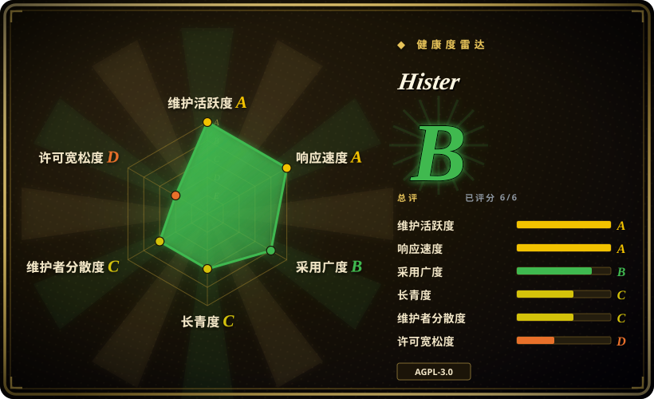
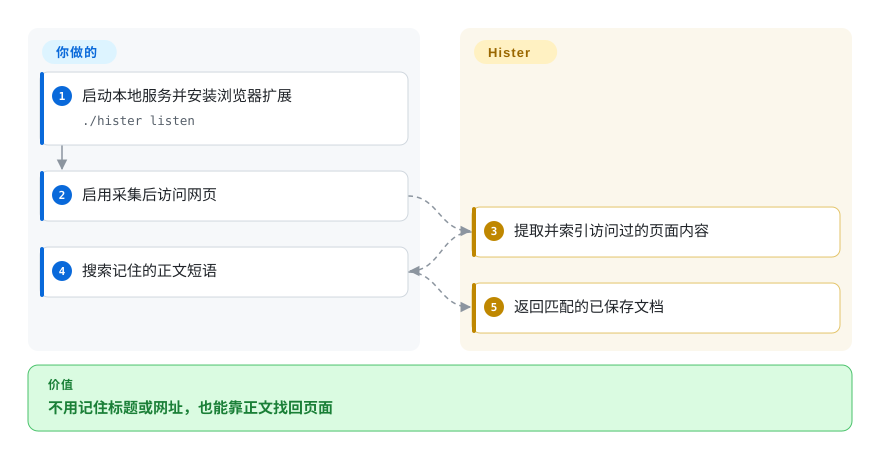
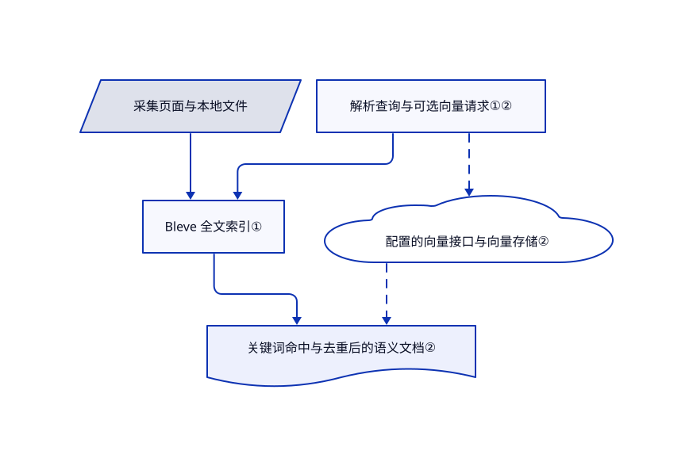

# Hister

你记得网页中的一句话，却忘了标题和网址。Hister 索引访问过的网页正文及本地文件，让这句话可以在自己的服务器中搜到。

## 何时使用

你读了很多技术网页，后来才发现浏览器历史只能匹配标题和网址。若目标是自动采集与私有全文搜索，而非手工整理书签或让聊天助手综合答案，选 Hister。网页、终端和 MCP 客户端使用同一份个人资料。

## 何时不用

- 要把丰富网页快照和媒体作为档案，先比较 ArchiveBox；可搜索不等于保真归档。
- 只整理少量精选书签，选 linkding，不必保存每次访问。
- 要跨文档、跨设备的综合回答，选 [Khoj](khoj.zh.md)，接受模型和数据库负担。
- 页面文字不能发送给模型服务时，关闭语义搜索，或使用审查过的本地接口。连保存正文都不可接受时，普通浏览器历史更合适。

## 横向对比

| 替代品 | 是否收录 | 我们的评价 | 取舍 |
|---|---|---|---|
| [Khoj](khoj.zh.md) | ✅ | 多客户端生成答案选 Khoj；不强制模型、只找原文选 Hister。 | 聊天检索服务与个人搜索引擎之间取舍。 |
| [ArchiveBox](https://github.com/ArchiveBox/ArchiveBox) | 未收录 | 交付物是 HTML、PDF 和媒体档案时选 ArchiveBox；持续找回读过的内容选 Hister。 | 保真归档与搜索优先的采集不同；本批未收录。 |
| [linkding](https://github.com/sissbruecker/linkding) | 未收录 | 主动保存精选书签选 linkding；靠正文找回未收藏访问选 Hister。 | 手动精选减少留存量；本批未收录。 |

## 快速上手

下载发布二进制，赋予执行权限，运行 `./hister listen`。打开 `http://127.0.0.1:4433`，安装官方 Chrome 或 Firefox 扩展。启用采集后访问网页，再用正文中的短语搜索。扩展提交页面内容，服务维护搜索资料；你负责采集规则、留存和备份。可选语义搜索需要独立配置向量接口，也可能向该接口发送文档文字。

<!-- flow-steps:begin (generated from flows/hister.json by tools/flow_card.py — do not edit) -->

流程文字版

1. **你**：启动本地服务并安装浏览器扩展 — `./hister listen`
2. **你**：启用采集后访问网页
3. **Hister**：提取并索引访问过的页面内容
4. **你**：搜索记住的正文短语
5. **Hister**：返回匹配的已保存文档

**价值**：不用记住标题或网址，也能靠正文找回页面

<!-- flow-steps:end -->

## 技术要点

<!-- mechanism:begin (generated from mechanisms/hister.json by tools/mechanism_card.py; do not edit) -->

机制文字版

- 采集页面与本地文件
- Bleve 全文索引①
- 解析查询与可选向量请求①②
- 配置的向量接口与向量存储②
- 关键词命中与去重后的语义文档②

- 采集页面与本地文件 → Bleve 全文索引①
- 解析查询与可选向量请求①② → Bleve 全文索引①
- 解析查询与可选向量请求①② → 配置的向量接口与向量存储②〔可选／兜底〕
- Bleve 全文索引① → 关键词命中与去重后的语义文档②
- 配置的向量接口与向量存储② → 关键词命中与去重后的语义文档②〔可选／兜底〕

<!-- mechanism:end -->

### 1. 查询嵌入式全文索引

- **解决：** 仅记录标题和网址的历史，找不到你记住的正文段落。
- **做法：** Go 索引器管理 Bleve 索引及文档存储，将查询语法转换为搜索请求，返回文档、高亮、筛选统计和分页标识。
- **边界：** 结果取决于真正采集和提取的内容。它不是通用网页搜索，不能查到从未入库的页面。
- **源码：** [索引与搜索](https://github.com/asciimoo/hister/blob/dce14327638b4177fcaad7cd11827c26b6cd17cd/server/indexer/indexer.go#L1957-L2062)。

### 2. 在关键词之外补充语义检索

- **解决：** 查询用词可能与保存页面的原文不同。
- **做法：** 可选的 OpenAI 兼容接口把查询转成向量。搜索保留关键词结果，再查向量库、按文档汇总片段，并避开重复网址。
- **边界：** 向量接口或存储失败只记录警告，不删除关键词结果。远程向量计算改变隐私边界，也增加延迟。
- **源码：** [可选语义路线](https://github.com/asciimoo/hister/blob/dce14327638b4177fcaad7cd11827c26b6cd17cd/server/indexer/indexer.go#L2064-L2116)、[向量客户端](https://github.com/asciimoo/hister/blob/dce14327638b4177fcaad7cd11827c26b6cd17cd/server/vectorstore/embedder.go#L20-L125)。

## 技术栈

Go 1.26、Bleve 全文搜索、SQLite／PostgreSQL 支持、Cobra 命令行和 Bubble Tea 终端界面。浏览器扩展提交内容；源码构建前端需要 npm。

## 依赖

采集与搜索需要服务持续运行。发布二进制免去 Go、npm 和 C 编译器构建链。浏览器采集需要扩展；语义搜索可选，需要向量接口与存储配置。

## 运维难度

**本地低，共享中等。** 保护已采集的登录页面，排除敏感站点，并备份数据目录。网络部署另需认证、TLS 和用户隔离检查。没有强制云账号。

## 健康度与可持续性

- 截至 2026-10-18，默认分支最近提交为 2026-10-16；稳定版 v0.20.0 发布于 2026-09-24，另有滚动发布。
- 创建于 2026-01-04，由 `asciimoo` 主导，并有其他贡献者。九个月的历史仍不足以形成强存续先验；6,075 颗星不证明留存安全。
- 许可实文为 GNU AGPL v3，README 明确允许后续版本。网络分发义务需要审查。
- [推断：依据是活跃提交、测试布局及不足一年历史] 可做个人试用，但要留意升级与敏感页面留存。

## 存疑（未验证）

- [未验证：本任务禁止执行上游] 未实际测试采集排除规则、提取保真度和多用户隔离。
- [推断：依据是活跃提交、测试布局及不足一年历史] 长期索引兼容性和维护持续性尚未确立。
