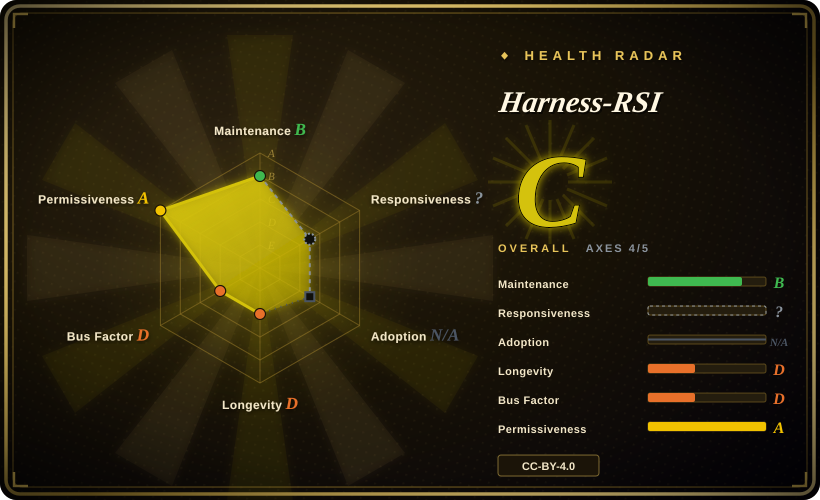
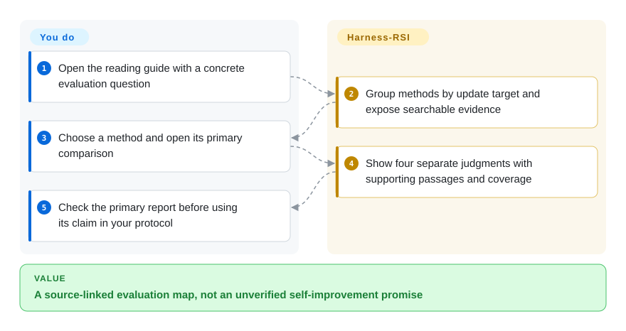
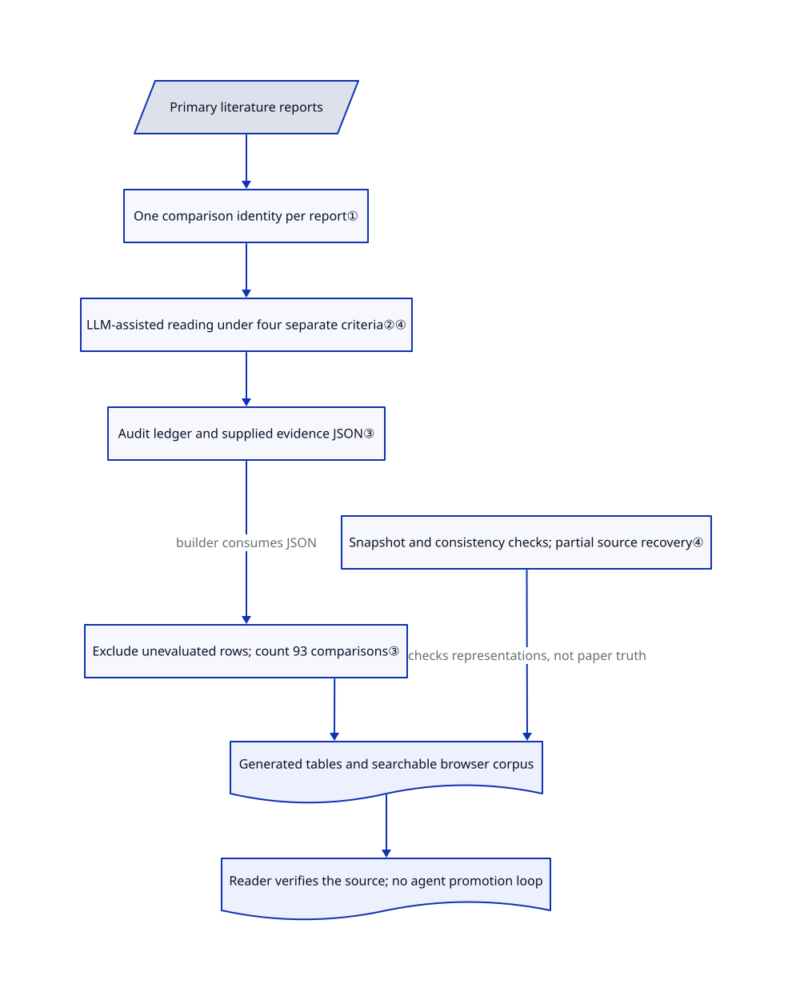

# Harness-RSI

An agent's score rises after it rewrites its instructions, but you cannot tell whether the change helped or the test was reused. Harness-RSI organizes published methods and their evidence; it does not run a self-improving agent.

## When to use

You are reviewing a proposed agent-learning experiment. Its chart reports a better final score, but the same tasks chose the winner and nobody checked whether the accepted instructions were followed. Use this corpus to identify the update target, inspect a report's primary comparison and trace its selection, activation, attribution and task-distance evidence back to the paper. Choose it over immediately installing an optimizer when the missing piece is an evaluation protocol, not candidate generation.

The reusable artifacts are a bilingual literature map, structured audit records and a static searchable explorer. The reviewed tree contains three Python maintenance scripts and a browser application, not an RSI training loop. Its resource-collection classification does not mean it supplies an installable agent skill.

## When NOT to use

- **You need generated and evaluated harness candidates.** Inspect [PenguinHarness](../agent-frameworks/workflow-builders/harness-evolution/penguin-harness.md) for a versioned experiment workspace, or [Harness²](../agent-frameworks/workflow-builders/harness-evolution/harness2.md) for task-time configuration search. This repository supplies neither an editor nor an execution sandbox, promotion gate or rollback engine.
- **You want CI to decide whether a change may ship.** Use [promptfoo](../llm-eval/promptfoo.md) around independently frozen tests. Here the scripts count supplied literature judgments; they do not grade your agent's outputs, enforce safety failures or retest a filtered final patch bundle.
- **You want an operating multi-agent workbench.** Choose [JiuwenSwarm](../agent-frameworks/agent-runtimes/agent-services/jiuwenswarm.md). Reading its learning literature does not provide team execution, tool approvals or deployment controls.
- **You need rules mined from private session history.** [Headroom](../agent-tooling/work-state/headroom.md) has a separate model-backed learning path, requiring explicit data/spending authorization and external behavioral validation. Harness-RSI reads public literature; it does not inspect your history or write agent configuration.
- **You need independently verified effectiveness rankings.** Use primary reports and an external [promptfoo](../llm-eval/promptfoo.md) experiment for your workload. The corpus explicitly disclaims independent human annotation; its four evidence columns are not a method-quality leaderboard.

## Comparison

| Alternative | In index | Our verdict | Tradeoff |
|---|---|---|---|
| [PenguinHarness](../agent-frameworks/workflow-builders/harness-evolution/penguin-harness.md) | ✅ | Choose PenguinHarness to propose and score versioned harness changes; choose Harness-RSI to audit the evaluation design before paying for that search. | Integrated runtime and snapshots versus a public evidence map; a frozen search benchmark alone does not establish unseen-task gains. |
| [Harness²](../agent-frameworks/workflow-builders/harness-evolution/harness2.md) | ✅ | Choose Harness² for same-task propose–probe–compose experiments; choose Harness-RSI to distinguish adoption evidence from independent reporting evidence. | Repeated model executions and broader editable configuration versus read-only methodology; Harness² selects from final candidates, not against its baseline. |
| [JiuwenSwarm](../agent-frameworks/agent-runtimes/agent-services/jiuwenswarm.md) | ✅ | Choose JiuwenSwarm when a leader must execute and consolidate team work; choose Harness-RSI when reviewing what a learning claim actually establishes. | Operational application and permissions versus literature records; the indexed single-harness profile has zero candidate holdout cases, not proof of generalization. |
| [Headroom](../agent-tooling/work-state/headroom.md) | ✅ | Choose Headroom for model-bound context compression or explicitly authorized history analysis; choose Harness-RSI for public-source evidence auditing without reading personal sessions. | A local proxy and optional paid model analysis versus a static corpus; Headroom's learned-rule preview is neither an egress gate nor a behavioral verifier. |

## Quick start

Open the pinned [README](https://github.com/zgcagi/Harness-RSI/blob/84108dcc15fe393a4bb406ec27228290775d1098/README.md#reading-guide), or serve a source copy with the documented `python3 -m http.server 8000` and open its local page. Filter the explorer by update target or search a method, then open its primary comparison and supporting evidence. You supply the research question and check the linked report; the project supplies classification, recorded judgments and generated tables. Reading needs no model key or GPU; the HTML loads external fonts and KaTeX assets, so local hosting is not fully offline by default. Maintainers edit the documented source records and rebuild the summaries; this intake did not execute those scripts or start the server.

<!-- flow-steps:begin (generated from flows/harness-rsi.json by tools/flow_card.py — do not edit) -->

Text version of the flow

1. **You**: Open the reading guide with a concrete evaluation question
2. **Harness-RSI**: Group methods by update target and expose searchable evidence
3. **You**: Choose a method and open its primary comparison
4. **Harness-RSI**: Show four separate judgments with supporting passages and coverage
5. **You**: Check the primary report before using its claim in your protocol

**Value**: A source-linked evaluation map, not an unverified self-improvement promise

<!-- flow-steps:end -->

## Key techniques

<!-- mechanism:begin (generated from mechanisms/harness-rsi.json by tools/mechanism_card.py; do not edit) -->

Text version of the mechanism

- Primary literature reports
- One comparison identity per report①
- LLM-assisted reading under four separate criteria②④
- Audit ledger and supplied evidence JSON③
- Exclude unevaluated rows; count 93 comparisons③
- Generated tables and searchable browser corpus
- Snapshot and consistency checks; partial source recovery④
- Reader verifies the source; no agent promotion loop

- Primary literature reports → One comparison identity per report①
- One comparison identity per report① → LLM-assisted reading under four separate criteria②④
- LLM-assisted reading under four separate criteria②④ → Audit ledger and supplied evidence JSON③
- Audit ledger and supplied evidence JSON③ → Exclude unevaluated rows; count 93 comparisons③ (builder consumes JSON)
- Exclude unevaluated rows; count 93 comparisons③ → Generated tables and searchable browser corpus
- Snapshot and consistency checks; partial source recovery④ → Generated tables and searchable browser corpus (checks representations, not paper truth)
- Generated tables and searchable browser corpus → Reader verifies the source; no agent promotion loop

<!-- mechanism:end -->

### 1. Bind all evidence to one actual comparison

- **Problem:** Combining a clean test from one experiment with an ablation from another can manufacture a convincing result that no experiment measured.
- **How:** The rubric binds each primary comparison to its update object, model, benchmark/split, baseline, round, configuration and inference budget. Secondary protocols stay separate. It distinguishes interpreted changes, such as instructions, from executable changes, such as tools and runtime code.
- **Limits:** These are literature-coding rules, not enforced frozen inputs for an optimizer. The repository generates no candidates, runs no target model and provides no candidate workspace, writable-path policy or artifact isolation. Its fixed-model/fixed-evaluator definition must not be mistaken for an implemented security boundary.
- **Source:** [Comparison identity and aggregate rules](https://github.com/zgcagi/Harness-RSI/blob/84108dcc15fe393a4bb406ec27228290775d1098/data/claim-audit-rubric.md#L62-L120), [definition and update targets](https://github.com/zgcagi/Harness-RSI/blob/84108dcc15fe393a4bb406ec27228290775d1098/README.md#L45-L78).

### 2. Separate task distance, selection hygiene and actual use

- **Problem:** A held-out label can hide repeated winner selection, while loading a new skill does not show that execution followed it.
- **How:** Selection checks whether reporting outcomes influenced proposal, ranking, admission or report choice. Activation separates availability, executed paths and downstream use. Attribution asks for an isolated change, controlled inference resources and a margin beyond measured variation; Improvement records task distance, not a guaranteed positive effect.
- **Limits:** A held-out set reused for promotion can satisfy task distance while failing selection hygiene. Activation may rest on one identified scored-run case, not every run. The README's fresh-task admission inequality and final-merged-candidate requirement are theory under stated assumptions, not a shipped independent holdout or final-package retest; there is no multi-objective safety veto, cost cap, automatic admission or recovery implementation here.
- **Source:** [Four criteria and coverage limits](https://github.com/zgcagi/Harness-RSI/blob/84108dcc15fe393a4bb406ec27228290775d1098/docs/evidence-criteria.md#L27-L79), [fresh independent tasks and merged candidates](https://github.com/zgcagi/Harness-RSI/blob/84108dcc15fe393a4bb406ec27228290775d1098/README.md#L303-L324).

### 3. Aggregate declared judgments rather than re-score tasks

- **Problem:** A website and its README can silently show different evidence populations or treat unevaluated methods as failed experiments.
- **How:** The evidence builder reads manually supplied JSON, validates unique keys and allowed codes, excludes all-X rows, and counts each criterion and joint coverage. At the reviewed commit, 95 method records yield 93 scored comparisons; 16 secondary protocols stay outside those totals. The site-data builder combines README entries and generated verdicts into one browser corpus.
- **Limits:** The 100-row audit TSV is a literature evidence ledger, not raw benchmark trajectories or per-task scores. The public builders consume JSON rather than independently deriving every judgment from papers or proving TSV-to-JSON equivalence. Checks establish representation consistency, not factual accuracy; counts of satisfied criteria must not rank methods. Search costs and scored-run budgets are audit topics, not metered resources in this application.
- **Source:** [JSON validation and counts](https://github.com/zgcagi/Harness-RSI/blob/84108dcc15fe393a4bb406ec27228290775d1098/scripts/build_evidence.py#L14-L25), [document generation](https://github.com/zgcagi/Harness-RSI/blob/84108dcc15fe393a4bb406ec27228290775d1098/scripts/build_evidence.py#L88-L167), [site projection](https://github.com/zgcagi/Harness-RSI/blob/84108dcc15fe393a4bb406ec27228290775d1098/scripts/build_site_data.py#L115-L138), [raw audit ledger](https://github.com/zgcagi/Harness-RSI/blob/84108dcc15fe393a4bb406ec27228290775d1098/data/claim-audit.tsv).

### 4. Keep provenance limits visible beside consistency checks

- **Problem:** A matching PDF hash or repeated annotation can look like independent verification when it only identifies the same artifact.
- **How:** The repository records manuscript snapshots, artifact hashes and audit revision history. The consistency checker checks bilingual links, taxonomy membership, generated projections, citations and PDF hashes. The rubric discloses primarily LLM-assisted coding and targeted source checks, not independent human raters.
- **Limits:** The full PDF was replaced on October 18; the snapshot explicitly says its correspondence to the recorded source commit is unverified. The paper source tree and earlier coding passes are not supplied in this public tree, so complete audit-history reconstruction is partial. Do not equate model-assisted literature judgments with measured agent improvements or treat local hash checks as proof that primary-source claims are true.
- **Source:** [Annotation limits and unavailable passes](https://github.com/zgcagi/Harness-RSI/blob/84108dcc15fe393a4bb406ec27228290775d1098/data/claim-audit-rubric.md#L405-L450), [artifact checks](https://github.com/zgcagi/Harness-RSI/blob/84108dcc15fe393a4bb406ec27228290775d1098/scripts/check_consistency.py#L156-L223), [replacement PDF limitation](https://github.com/zgcagi/Harness-RSI/blob/84108dcc15fe393a4bb406ec27228290775d1098/data/source-snapshot.json#L37-L49).

## Health & viability

- **2026-10-23:** created October 1, last pushed October 18, unarchived, with no tags or releases. Twenty-two days of history is too short for a durability claim despite recent maintenance.
- The README names researchers from Zhongguancun Academy, its AI institute and USTC. The contributors endpoint returns one contributor with 42 contributions; institutional affiliations do not establish a maintenance or support commitment.
- CC-BY-4.0 is present as full license text; the README applies it to this resource and explicitly preserves listed works' separate licenses. Redistributing records requires attribution and marking modifications, not relicensing linked papers or code.
- The corpus is reusable for protocol design, not a production optimizer. The snapshot dates its audit to October 10 and literature cutoff to October 8; the verification date on this page does not make that literature search current. The observed 366 stars and four forks indicate attention, not verified adoption or efficacy.

## Caveats (unverified)

- [未验证：用户禁止执行上游代码、模型和 benchmark] Website behavior and maintenance scripts were read statically, not run. No independent agent improvement, runtime containment, recovery or cost result was measured.
- [未验证：95 项原始研究未逐一复审，且作者声明以模型辅助编码] Recorded literature judgments and source quotations are an audit starting point, not independently certified effects or independent human labels.
- [未验证：上游快照明确标记 source_commit_verified 为 false，且未公开完整论文源码与早期判卷文件] The replacement full PDF's source correspondence and complete annotation-history recovery remain partial, not reproduced.
