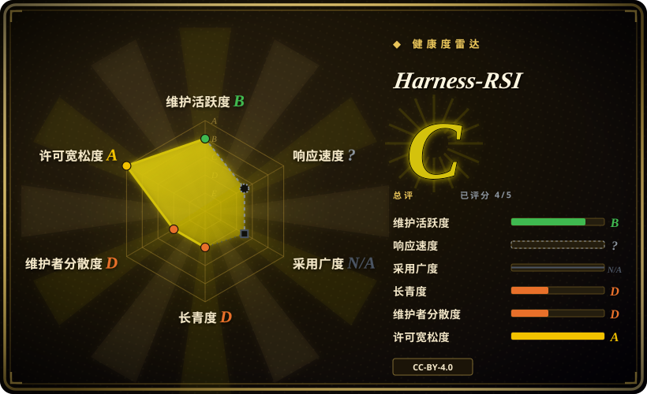
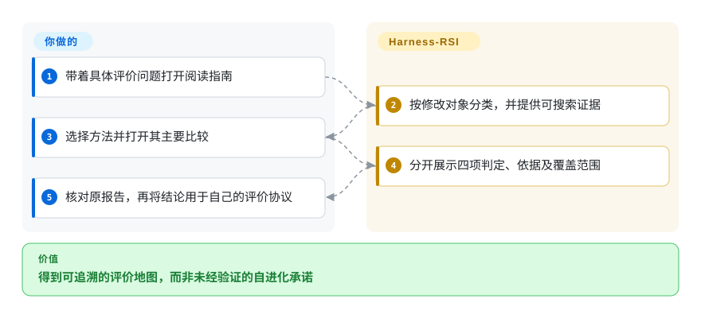
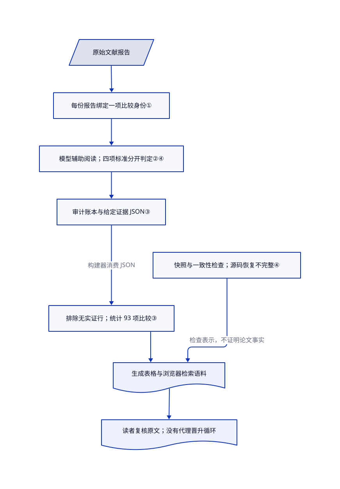

# Harness-RSI

代理改写指令后涨分，你却分不清是真变好，还是反复用了考题。Harness-RSI 整理已发表方法及其证据，不替你运行自进化代理。

## 何时使用

你在评审一个代理学习实验。图里最终成绩提高了，但选冠军和报成绩用了同一批题，也没人检查接纳的指令是否实际生效。用这份资料确定修改对象，查看报告的主要比较，再沿选优、激活、归因和任务距离四类证据追到原文。当缺的是评价协议，而非候选生成器时，先读它，比直接安装优化器更合适。

可复用产物包括双语文献地图、结构化审计记录和静态检索网页。钉住的源码树提供三个 Python 维护脚本及浏览器应用，没有 RSI 训练循环。归为资源集合，不代表它提供可安装的代理技能。

## 何时不用

- **需要自动生成并评测框架候选。** 版本化实验工作区看 [PenguinHarness](../agent-frameworks/workflow-builders/penguin-harness.zh.md)，当前任务上的配置搜索看 [Harness²](../agent-frameworks/workflow-builders/harness2.zh.md)。本仓库没有编辑器、执行沙箱、晋升门或回滚引擎。
- **需要持续集成判断修改能否发布。** 用 [promptfoo](../llm-eval/promptfoo.zh.md) 接独立冻结的测试。这里的脚本统计给定的文献判定，不评分你的代理产物，不强制安全失败，也不重测筛选后的最终补丁包。
- **需要可工作的多代理平台。** 选 [JiuwenSwarm](../agent-frameworks/agent-runtimes/agent-services/jiuwenswarm.zh.md)。阅读学习机制论文，不能替代团队执行、工具审批或部署控制。
- **需要从私密会话提炼规则。** [Headroom](../agent-tooling/work-state/headroom.zh.md) 另有模型分析入口，需要明确授权外发和费用，并另验行为效果。本项目读公开文献，不读取你的历史，也不写代理配置。
- **需要独立确认的效果榜单。** 回到原论文，再用 [promptfoo](../llm-eval/promptfoo.zh.md) 为自己的工作负载做外部实验。作者明确不声称独立人工标注，四个证据列也不是方法质量排名。

## 横向对比

| 替代品 | 是否收录 | 我们的评价 | 取舍 |
|---|---|---|---|
| [PenguinHarness](../agent-frameworks/workflow-builders/penguin-harness.zh.md) | ✅ | 要提出并评分版本化框架修改，选 PenguinHarness；想先审核评价设计，再付费搜索，读 Harness-RSI。 | 集成运行时和快照，对比公开证据地图；固定搜索题集本身不证明未见任务收益。 |
| [Harness²](../agent-frameworks/workflow-builders/harness2.zh.md) | ✅ | 要在同题上提案、试跑并组合配置，选 Harness²；要区分接纳依据与独立报告证据，读 Harness-RSI。 | 重复模型执行和更宽配置面，对比只读方法论；Harness² 从最终候选中选，不与原始基线竞争。 |
| [JiuwenSwarm](../agent-frameworks/agent-runtimes/agent-services/jiuwenswarm.zh.md) | ✅ | 要队长执行并汇集团队工作，选 JiuwenSwarm；要审查学习声明究竟证明了什么，读 Harness-RSI。 | 可运行应用和权限控制，对比文献记录；已收录的单框架配置候选留出数为零，不是泛化证明。 |
| [Headroom](../agent-tooling/work-state/headroom.zh.md) | ✅ | 要压缩模型输入或经明确授权分析历史，选 Headroom；不读个人会话、只审公开来源，读 Harness-RSI。 | 本地代理和可选付费模型分析，对比静态语料；Headroom 的学习规则预览既非外发门，也非行为验证器。 |

## 快速上手

打开钉住的 [README](https://github.com/zgcagi/Harness-RSI/blob/84108dcc15fe393a4bb406ec27228290775d1098/README_zh.md)，或按贡献指南用 `python3 -m http.server 8000` 提供源码副本，再打开本地网页。按修改对象筛选，或搜索方法名称，然后查看主要比较及其证据。你负责提出研究问题并核对原文；项目负责分类、记录判定和生成表格。阅读不需要模型密钥或 GPU，但网页加载外部字体和 KaTeX 资源，本地托管默认不等于完全离线。维护者按指南修改源记录并重建摘要；本次没有执行这些脚本，也没有启动服务。

<!-- flow-steps:begin (generated from flows/harness-rsi.json by tools/flow_card.py — do not edit) -->

流程文字版

1. **你**：带着具体评价问题打开阅读指南
2. **Harness-RSI**：按修改对象分类，并提供可搜索证据
3. **你**：选择方法并打开其主要比较
4. **Harness-RSI**：分开展示四项判定、依据及覆盖范围
5. **你**：核对原报告，再将结论用于自己的评价协议

**价值**：得到可追溯的评价地图，而非未经验证的自进化承诺

<!-- flow-steps:end -->

## 技术要点

<!-- mechanism:begin (generated from mechanisms/harness-rsi.json by tools/mechanism_card.py; do not edit) -->

机制文字版

- 原始文献报告
- 每份报告绑定一项比较身份①
- 模型辅助阅读；四项标准分开判定②④
- 审计账本与给定证据 JSON③
- 排除无实证行；统计 93 项比较③
- 生成表格与浏览器检索语料
- 快照与一致性检查；源码恢复不完整④
- 读者复核原文；没有代理晋升循环

- 原始文献报告 → 每份报告绑定一项比较身份①
- 每份报告绑定一项比较身份① → 模型辅助阅读；四项标准分开判定②④
- 模型辅助阅读；四项标准分开判定②④ → 审计账本与给定证据 JSON③
- 审计账本与给定证据 JSON③ → 排除无实证行；统计 93 项比较③（构建器消费 JSON）
- 排除无实证行；统计 93 项比较③ → 生成表格与浏览器检索语料
- 快照与一致性检查；源码恢复不完整④ → 生成表格与浏览器检索语料（检查表示，不证明论文事实）
- 生成表格与浏览器检索语料 → 读者复核原文；没有代理晋升循环

<!-- mechanism:end -->

### 1. 把证据绑定到真实存在的同一项比较

- **解决：** 把一个实验的干净测试，拼上另一个实验的消融结果，可能凑出从未实测的漂亮结论。
- **做法：** 规则把主要比较绑定到修改对象、模型、任务集及划分、基线、轮次、配置和推理预算。次要协议单独记录。它还区分指令等解释性修改，与工具和运行时代码等可执行修改。
- **边界：** 这是文献编码规则，不是优化器的输入冻结实现。仓库不生成候选、不执行目标模型，也没有候选工作区、可写路径策略或产物隔离。定义中固定模型、固定评价器，不等于实现了安全边界。
- **源码：** [比较身份与汇总规则](https://github.com/zgcagi/Harness-RSI/blob/84108dcc15fe393a4bb406ec27228290775d1098/data/claim-audit-rubric.md#L62-L120)、[定义与修改对象](https://github.com/zgcagi/Harness-RSI/blob/84108dcc15fe393a4bb406ec27228290775d1098/README.md#L45-L78)。

### 2. 分开检查任务距离、选优污染与实际生效

- **解决：** 标着留出集，仍可能反复用来挑冠军；加载新技能，也不代表执行时遵循了它。
- **做法：** 选优检查报告成绩是否参与提案、排序、接纳或结果挑选。激活区分产物可用、路径执行和下游使用。归因要求隔离改动、控制推理资源，并让收益超过实测波动；改进列记录任务距离，不担保正收益。
- **边界：** 留出集反复参与晋升，可能满足任务距离，却不满足选优独立。激活证据可以只有一条明确的计分运行案例，并非覆盖全部运行。README 中新鲜独立任务的接纳不等式和最终合并候选要求，是带假设的理论，不是已实现的独立留出门或最终包重测；这里也没有多目标安全否决、费用上限、自动晋升或恢复实现。
- **源码：** [四项标准及覆盖局限](https://github.com/zgcagi/Harness-RSI/blob/84108dcc15fe393a4bb406ec27228290775d1098/docs/evidence-criteria.md#L27-L79)、[新鲜独立任务与合并候选](https://github.com/zgcagi/Harness-RSI/blob/84108dcc15fe393a4bb406ec27228290775d1098/README.md#L303-L324)。

### 3. 汇总已有判定，而非重新给任务评分

- **解决：** 网页和 README 可能悄悄使用不同分母，或把没有实证的方法算成实验失败。
- **做法：** 证据构建器读取预先填写的 JSON，检查唯一键和合法判定，排除全为 X 的记录，再统计各标准和联合覆盖。核查提交的 95 项方法得到 93 项计入汇总的比较，16 项次要协议不计入分母。站点数据构建器把 README 条目与生成的判定表合成浏览器语料。
- **边界：** 100 行审计 TSV 是文献证据账本，不是原始 benchmark 轨迹或逐题分数。公开构建器消费 JSON，不会独立从论文得出每项判定，也未证明 TSV 到 JSON 完全等价。检查保证表示一致，不保证事实正确；满足几项标准不能用来排名。搜索成本和计分运行预算是审计对象，不是该应用计量的资源。
- **源码：** [JSON 校验和计数](https://github.com/zgcagi/Harness-RSI/blob/84108dcc15fe393a4bb406ec27228290775d1098/scripts/build_evidence.py#L14-L25)、[文档生成](https://github.com/zgcagi/Harness-RSI/blob/84108dcc15fe393a4bb406ec27228290775d1098/scripts/build_evidence.py#L88-L167)、[站点投影](https://github.com/zgcagi/Harness-RSI/blob/84108dcc15fe393a4bb406ec27228290775d1098/scripts/build_site_data.py#L115-L138)、[原始审计账本](https://github.com/zgcagi/Harness-RSI/blob/84108dcc15fe393a4bb406ec27228290775d1098/data/claim-audit.tsv)。

### 4. 一致性检查旁保留溯源局限

- **解决：** PDF 哈希匹配或重复标注，容易被误当成独立核验，其实可能只确认了同一份产物。
- **做法：** 仓库记录论文快照、产物哈希和判定修订历史。一致性检查覆盖双语链接、分类成员、生成投影、引用及 PDF 哈希。规则披露主要采用模型辅助编码和定点原文检查，不是独立人工评委。
- **边界：** 完整 PDF 在 10 月 18 日被替换；快照明确承认它与记录源码提交的对应关系未核实。公开树不含完整论文源码和早期判卷轮次文件，完整恢复审计历史只能标为部分。不能把模型辅助文献判定当成代理效果实测，也不能把本地哈希检查当成原论文事实正确的证明。
- **源码：** [标注局限与未提供的早期轮次](https://github.com/zgcagi/Harness-RSI/blob/84108dcc15fe393a4bb406ec27228290775d1098/data/claim-audit-rubric.md#L405-L450)、[产物检查](https://github.com/zgcagi/Harness-RSI/blob/84108dcc15fe393a4bb406ec27228290775d1098/scripts/check_consistency.py#L156-L223)、[替换 PDF 的局限](https://github.com/zgcagi/Harness-RSI/blob/84108dcc15fe393a4bb406ec27228290775d1098/data/source-snapshot.json#L37-L49)。

## 健康度与可持续性

- **截至 2026-10-23：** 仓库 10 月 1 日创建，最近推送为 10 月 18 日，未归档，无标签或发布版。历史只有 22 天，近期维护不等于长期可持续性。
- README 列出中关村学院、其中的人工智能研究院和中国科学技术大学研究人员。贡献接口只返回一位贡献者，贡献次数为 42；作者单位不能证明维护或支持承诺。
- 已读取完整 CC-BY-4.0 许可正文；README 将其用于本资源，并保留所列作品各自许可。再分发记录需署名并标明修改，不能据此重授链接论文或代码的许可。
- 可把语料用于协议设计，不应当生产优化器。快照的审计日期为 10 月 10 日，文献截止日为 10 月 8 日；本页核查日期不代表文献搜索更新。观察到的 366 星和四个 fork 说明有人关注，不证明真实采用或效果。

## 存疑（未验证）

- [未验证：用户禁止执行上游代码、模型和 benchmark] 网页行为与维护脚本仅静态阅读，未实跑。没有测得独立代理收益、运行时隔离、恢复或费用结果。
- [未验证：95 项原始研究未逐一复审，且作者声明以模型辅助编码] 文献判定和来源引文只是审计起点，不是独立认证的效果或独立人工标注。
- [未验证：上游快照明确标记 source_commit_verified 为 false，且未公开完整论文源码与早期判卷文件] 替换版完整 PDF 与源码对应关系、完整标注历史恢复只能标为部分，未复现。
