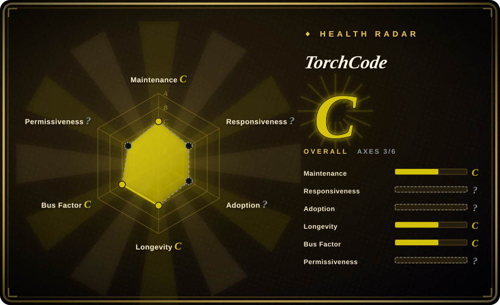
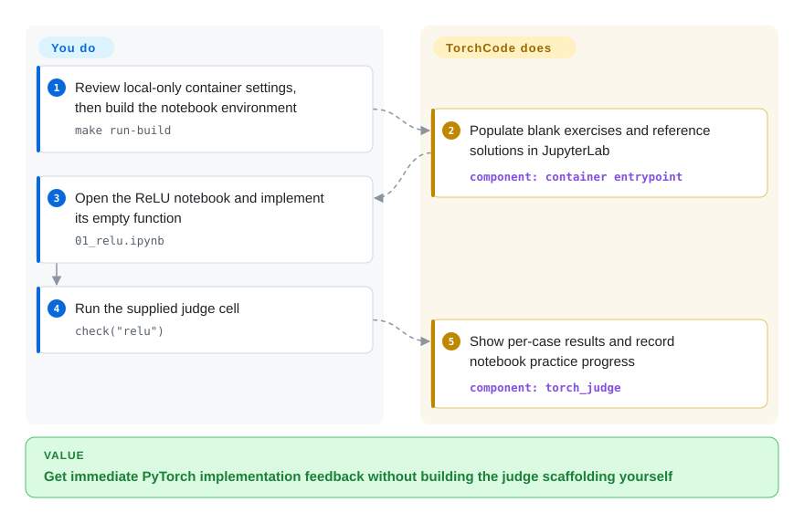
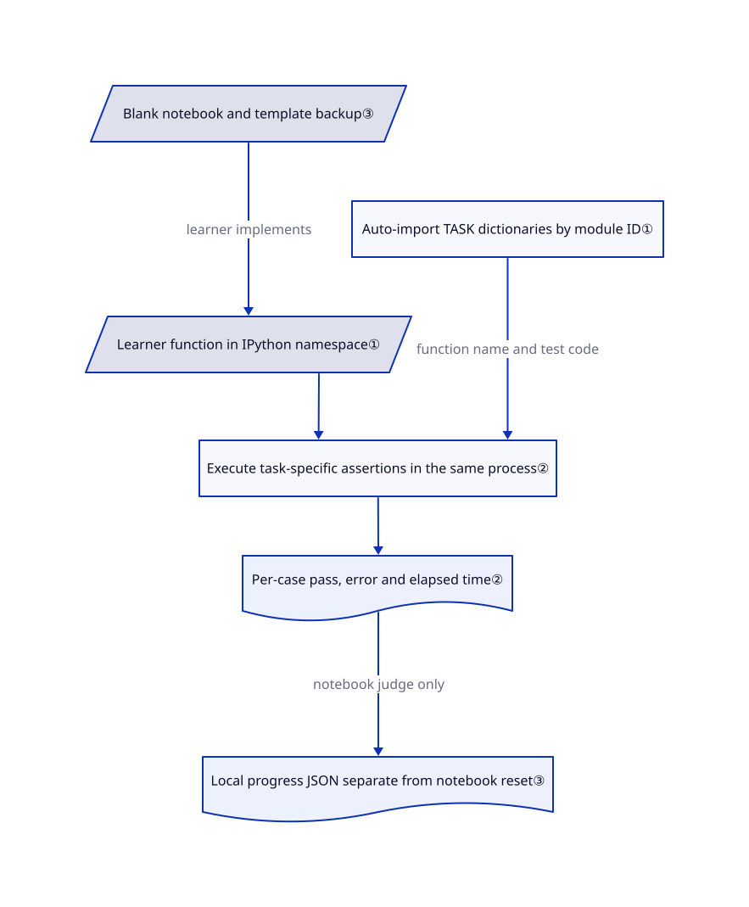

# TorchCode

You can read attention formulas but freeze when asked to implement them. TorchCode gives you blank PyTorch notebooks, reference solutions and automatic checks without needing a GPU.

## When to use

You are preparing for an ML engineering interview and can explain `softmax`, but cannot write its stable implementation without the built-in operation. You want to fill a function, run checks, inspect a failing case and try again. Choose TorchCode over a textbook when targeted implementation practice matters more than a first explanation of calculus or training. Its source contains 41 exercises spanning ReLU, normalization, attention, optimizers, decoding and preference losses.

For a private study group, you can also reuse the task-dictionary pattern. Learners supply functions or classes; the judge supplies task-specific assertions and feedback. This is a trusted personal learning environment, not a public contest server.

## When NOT to use

- **Public or mutually untrusted submissions.** Use an isolated platform such as [Judge0](https://github.com/judge0/judge0), with your own PyTorch tests and deployment hardening. TorchCode's API executes submitted Python in its server process without sandboxing or timeouts. Notebook startup disables authentication and XSRF checks; a fresh namespace is not isolation.
- **A pass must certify numerical correctness.** Use an independently authored PyTorch reference suite for formal assessment or production operators. Causal attention checks masking and gradient existence but not the complete expected tensor. ViT patch embedding checks shapes and gradients without patch contents. Open issues [#17](https://github.com/duoan/TorchCode/issues/17) and [#21](https://github.com/duoan/TorchCode/issues/21) report false positives consistent with these source gaps.
- **You need GPU-kernel tuning.** Choose [Triton Puzzles](triton-puzzles.md) for blocks, masks and traced memory operations. TorchCode's Flash Attention task checks small PyTorch outputs and gradient presence, not a fused kernel, memory bound or GPU throughput.
- **You need fundamentals or pure broadcasting practice.** Choose [Dive into Deep Learning](https://github.com/d2l-ai/d2l-en) for explanations and runnable training examples, or [Tensor Puzzles](https://github.com/srush/Tensor-Puzzles) for constrained one-line expressions. TorchCode expects you to supply the ML implementation.
- **You require verified redistribution terms or package/source parity.** Prefer an alternative with complete license text, such as Triton Puzzles, until the MIT grant is clarified. TorchCode declares MIT but lacks a LICENSE file. PyPI `torch-judge==0.1.1` omits the source's OPD task; use the reviewed source for all 41 exercises.

## Comparison

| Alternative | In index | Our verdict | Tradeoff |
|---|---|---|---|
| [Triton Puzzles](triton-puzzles.md) | ✅ | Choose TorchCode to reconstruct ML components in PyTorch; choose Triton Puzzles to translate formulas into block addresses. | Broader model topics and CPU checks versus memory-operation visualization and kernel programming. |
| [Tensor Puzzles](https://github.com/srush/Tensor-Puzzles) | not indexed | Choose Tensor Puzzles while broadcasting and indexing still require trial and error; choose TorchCode afterwards for attention and training components. | Twenty-one constrained tensor puzzles versus 41 broader ML exercises; not added in this tab batch. |
| [Dive into Deep Learning](https://github.com/d2l-ai/d2l-en) | not indexed | Choose the book when you need derivations and complete training examples first; choose TorchCode for repeated blank-page implementation practice. | More explanation and curriculum breadth, less of a focused submit-and-retry loop; not added in this tab batch. |

## Quick start

Take a local source copy at the reviewed commit and inspect its container settings. The source provides `make run-build` to build the notebook image; first restrict Compose's port mapping to loopback and isolate the environment from secrets because notebook authentication is disabled. Open `http://localhost:8888`, enter `01_relu.ipynb`, implement `relu` and run `check("relu")`. TorchCode runs the assertions and records attempts or completion; you write the implementation and judge whether the tests cover the mathematics. Save work under a different filename before restarting because startup overwrites stock notebooks; the separate Colab package route is simpler but currently omits OPD. This research did not execute upstream code.

<!-- flow-steps:begin (generated from flows/torchcode.json by tools/flow_card.py — do not edit) -->

Text version of the flow

1. **You**: Review local-only container settings, then build the notebook environment — `make run-build`
2. **TorchCode**: Populate blank exercises and reference solutions in JupyterLab — component: `container entrypoint`
3. **You**: Open the ReLU notebook and implement its empty function — `01_relu.ipynb`
4. **You**: Run the supplied judge cell — `check("relu")`
5. **TorchCode**: Show per-case results and record notebook practice progress — component: `torch_judge`

**Value**: Get immediate PyTorch implementation feedback without building the judge scaffolding yourself

<!-- flow-steps:end -->

## Key techniques

<!-- mechanism:begin (generated from mechanisms/torchcode.json by tools/mechanism_card.py; do not edit) -->

Text version of the mechanism

- Blank notebook and template backup③
- Learner function in IPython namespace①
- Auto-import TASK dictionaries by module ID①
- Execute task-specific assertions in the same process②
- Per-case pass, error and elapsed time②
- Local progress JSON separate from notebook reset③

- Blank notebook and template backup③ → Learner function in IPython namespace① (learner implements)
- Auto-import TASK dictionaries by module ID① → Execute task-specific assertions in the same process② (function name and test code)
- Learner function in IPython namespace① → Execute task-specific assertions in the same process②
- Execute task-specific assertions in the same process② → Per-case pass, error and elapsed time②
- Per-case pass, error and elapsed time② → Local progress JSON separate from notebook reset③ (notebook judge only)

<!-- mechanism:end -->

### 1. Discover task definitions and resolve the learner's function

- **Problem:** Adding an exercise should not require a central switch statement or manually passing all notebook state.
- **How:** The registry imports non-private task modules and indexes each `TASK` by module name. `check` reads IPython's user namespace, resolves the required function and substitutes its name into each test.
- **Limits:** Imports and tests run trusted Python in-process. Filenames are not canonical IDs: multi-head attention uses `mha`; follow the explicit notebook check cell.
- **Source:** [Registry:14–31](https://github.com/duoan/TorchCode/blob/e3c8782a4be4f7cdb4de871ec739f66370968a77/torch_judge/tasks/_registry.py#L14-L31), [namespace and dispatch:20–74](https://github.com/duoan/TorchCode/blob/e3c8782a4be4f7cdb4de871ec739f66370968a77/torch_judge/engine.py#L20-L74).

### 2. Turn learning objectives into task-specific executable checks

- **Problem:** A plausible expression can return the right shape but wrong values or disconnected gradients.
- **How:** Task dictionaries contain test programs. ReLU compares fixed and random outputs, selected derivatives and a coarse CPU timing threshold; Flash Attention compares small outputs with standard attention and checks one gradient's presence.
- **Limits:** Coverage varies. Banned convenience APIs are written rules, not enforced restrictions. Causal attention lacks a full reference-value test; ViT lacks a patch-content test. Passing is feedback, not a proof or reliable benchmark.
- **Source:** [ReLU:8–55](https://github.com/duoan/TorchCode/blob/e3c8782a4be4f7cdb4de871ec739f66370968a77/torch_judge/tasks/relu.py#L8-L55), [Flash Attention:8–24](https://github.com/duoan/TorchCode/blob/e3c8782a4be4f7cdb4de871ec739f66370968a77/torch_judge/tasks/flash_attention.py#L8-L24), [causal attention](https://github.com/duoan/TorchCode/blob/e3c8782a4be4f7cdb4de871ec739f66370968a77/torch_judge/tasks/causal_attention.py), [ViT checks](https://github.com/duoan/TorchCode/blob/e3c8782a4be4f7cdb4de871ec739f66370968a77/torch_judge/tasks/vit_patch.py).

### 3. Separate repeatable blank exercises from progress records

- **Problem:** Retrying a notebook should not be confused with forgetting study progress.
- **How:** Startup copies stock exercises and solutions into the working directory and backs up templates. Toolbar reset restores the selected notebook after confirmation. The notebook judge separately saves solved state, attempts and best observed time to JSON, defaulting to `data/progress.json`.
- **Limits:** Startup overwrites stock filenames without confirmation. Progress is one local file without per-user accounts, locking or atomic writes. The standalone web engine returns results without calling the notebook progress writer.
- **Source:** [Startup:4–24](https://github.com/duoan/TorchCode/blob/e3c8782a4be4f7cdb4de871ec739f66370968a77/entrypoint.sh#L4-L24), [toolbar:134–178](https://github.com/duoan/TorchCode/blob/e3c8782a4be4f7cdb4de871ec739f66370968a77/labextension/src/index.ts#L134-L178), [progress:13–63](https://github.com/duoan/TorchCode/blob/e3c8782a4be4f7cdb4de871ec739f66370968a77/torch_judge/progress.py#L13-L63), [web result path](https://github.com/duoan/TorchCode/blob/e3c8782a4be4f7cdb4de871ec739f66370968a77/torch_judge/web_engine.py).

## Tech stack

Python judge, Jupyter notebooks and PyTorch. The container builds a TypeScript JupyterLab extension and runs Python 3.11 with CPU PyTorch and NumPy. An optional separate interface uses FastAPI, Next.js 16, React 19, Monaco and KaTeX; it is not the Jupyter container's frontend.

## Dependencies

- The judge declares Python 3.10 or later and `torch>=2.0`; notebook usage needs an IPython/Jupyter-compatible environment. CPU is the documented exercise target; no external model API, database or GPU is required for that route.
- Full notebook usage needs Docker or Podman with Compose and network access for image/build dependencies. Extension builds pull Node 20 and JupyterLab tooling. The README and PR #23 document a local-build path for Apple Silicon when a prebuilt image is unavailable.
- Optional web usage adds unpinned FastAPI, Uvicorn and Pydantic requirements plus Node dependencies. The extension loads Google Fonts. Colab and Hugging Face are optional hosted services, not local-grading requirements.

## Ops difficulty

**Low for disposable personal CPU practice; high for untrusted shared hosting.** No database is needed, but defaults are unsafe for public access: authentication/XSRF are disabled, Compose exposes all interfaces and runs as root, and the API executes Python without isolation or a timeout. Keep it local-only, remove unnecessary mounts and exclude secrets. Back up renamed notebooks and `data/` before cleanup. `make clean` removes Compose volumes and the local progress file, not all images, installed packages or browser storage.

These limits are visible in the [notebook launcher](https://github.com/duoan/TorchCode/blob/e3c8782a4be4f7cdb4de871ec739f66370968a77/entrypoint.sh#L27-L39), [Compose settings](https://github.com/duoan/TorchCode/blob/e3c8782a4be4f7cdb4de871ec739f66370968a77/docker-compose.yml#L1-L14) and [in-process submission execution](https://github.com/duoan/TorchCode/blob/e3c8782a4be4f7cdb4de871ec739f66370968a77/torch_judge/web_engine.py#L25-L39).

## Health & viability

- **2026-10-23 — young teaching artifact, not a mature service.** Created 2026-03-04; the latest default-branch commit is from 2026-07-31. It is not archived and has no GitHub releases. Seven months of existence and a quiet recent period provide little longevity evidence.
- **Maintainer concentration.** The contributor response gives `duoan` 28 commits and eight other humans one or two each, plus a bot. Recent feature/fix PRs remain open; their claims are not shipped capabilities.
- **Interest is visible, outcomes are not.** GitHub reports 4,688 stars. PyPI 0.1.1 was published in March 2026 and has 40 tasks, unlike the source's 41. Issue #30 and open release PR #28 identify missing OPD. Pin source and dependencies for a course rather than assuming package parity.
- **License and grading risks decide reuse.** MIT appears in the manifest and README, but the reviewed tree and wheel lack license text; GitHub's license endpoint returns 404. Test gaps and unsafe hosting defaults also argue for reviewed personal study, not unconditional redistribution or assessment use.

## Caveats (unverified)

- [未验证：本任务禁止运行上游或安装依赖] Notebook startup, architecture-specific image availability, dependency compatibility and actual exercise results were source-reviewed, not reproduced.
- [未验证：上游未提供完整许可文本] The MIT declaration is observable; complete grant terms and copyright attribution cannot be checked. Obtain clarification before redistribution or commercial embedding.
- [未验证：没有独立学习成效或部署数据] Stars and package downloads do not establish interview success, classroom adoption or robust multi-user operation.
