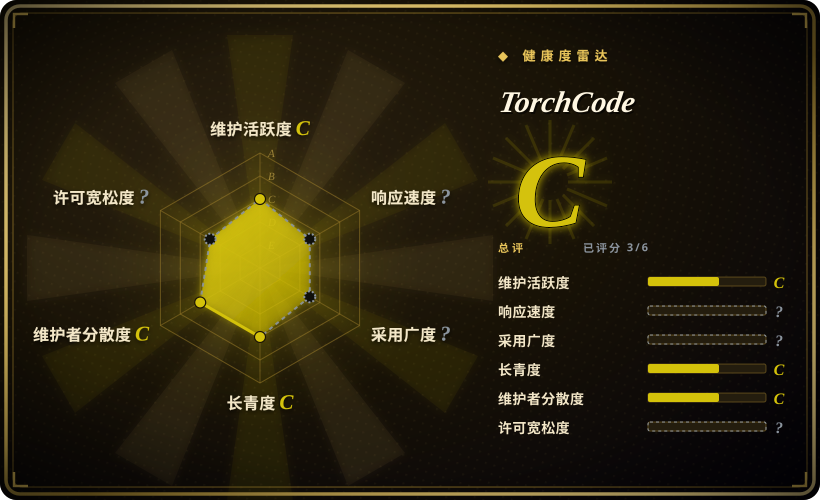
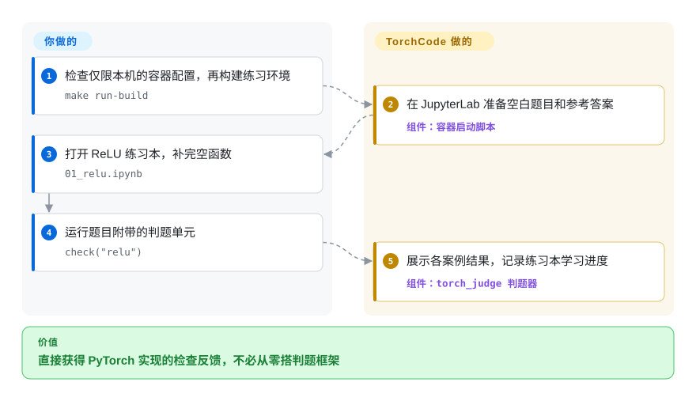
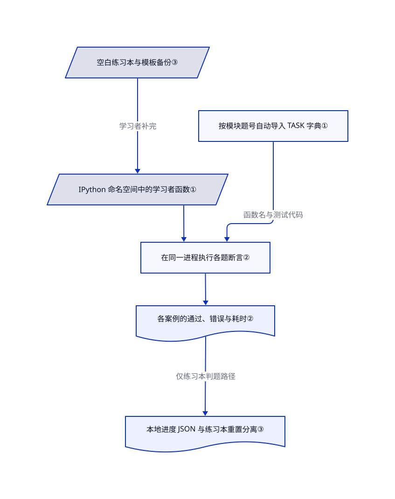

# TorchCode

注意力公式看得懂，面试让你当场写却下不了手。TorchCode 给你留空的 PyTorch 练习本、参考答案和自动判题，不用 GPU 也能练。

## 何时使用

你正在准备机器学习工程师面试，能解释 `softmax`，但离开内置函数就写不出数值稳定的实现。你想要的是短循环：填函数、跑检查、看失败案例、再修改。如果你更需要针对性实现练习，而不是从微积分和训练流程学起，选 TorchCode 比整本教材直接。源码有 41 道题，涵盖 ReLU、归一化、注意力、优化器、解码与偏好损失。

私人学习小组也可以借用题目字典的模式加题。学习者提供函数或类，判题器提供各题断言与反馈。把它当作可信个人学习环境，不要当作公开比赛的判题服务器。

## 何时不用

- **公开收题，或提交者互不信任。** 选 [Judge0](https://github.com/judge0/judge0) 这类隔离平台，自备 PyTorch 测试并加固部署。TorchCode 的 API 直接在服务器进程执行提交的 Python，没有沙箱或超时。练习本启动还关闭身份验证和防跨站请求检查；换一个命名空间不等于隔离。
- **必须用通过判题证明数值正确。** 课程评分或生产算子验收应另写独立的 PyTorch 参考测试。因果注意力题检查遮罩性质与梯度存在，却不对比完整期望结果。图像分块题只查形状与梯度，不查块内容。未关闭的 [#17](https://github.com/duoan/TorchCode/issues/17) 与 [#21](https://github.com/duoan/TorchCode/issues/21) 报告了与源码缺口一致的误放行。
- **要练 GPU 内核调优。** 选 [Triton Puzzles](triton-puzzles.zh.md)，练分块、掩码和访存轨迹。TorchCode 的 Flash Attention 题只查小规模 PyTorch 输出和梯度存在，不证明融合内核、显存上限或 GPU 吞吐。
- **需要基础讲解，或只想练广播。** 想先读推导与完整训练样例，选 [Dive into Deep Learning](https://github.com/d2l-ai/d2l-en)；想练受限的一行表达式，选 [Tensor Puzzles](https://github.com/srush/Tensor-Puzzles)。TorchCode 要你自己补出机器学习实现。
- **需要核实过的再分发许可，或要求包与源码题量一致。** 许可澄清前，优先选 Triton Puzzles 这类附有完整许可文本的替代品。TorchCode 声明 MIT，但缺 LICENSE 文件。PyPI 的 `torch-judge==0.1.1` 缺源码中的 OPD 题；要练全 41 题，应使用所读源码。

## 横向对比

| 替代品 | 是否收录 | 我们的评价 | 取舍 |
|---|---|---|---|
| [Triton Puzzles](triton-puzzles.zh.md) | ✅ | 要用 PyTorch 重写机器学习组件，选 TorchCode；要把公式换成分块地址，选 Triton Puzzles。 | 更广的模型主题和 CPU 检查，对比访存可视化与内核编程。 |
| [Tensor Puzzles](https://github.com/srush/Tensor-Puzzles) | 未收录 | 广播和索引仍需反复试错，先选 Tensor Puzzles；基础过关后，要练注意力与训练组件，再选 TorchCode。 | 21 道约束严格的张量题，对比 41 道范围更广的机器学习题；本批未添加。 |
| [Dive into Deep Learning](https://github.com/d2l-ai/d2l-en) | 未收录 | 动手前还需要推导与完整训练样例，选这本教材；要反复从空白实现，选 TorchCode。 | 讲解和课程范围更完整，但不如专用刷题器聚焦提交与重试；本批未添加。 |

## 快速上手

取所读提交的本地源码副本，先检查容器配置。源码提供 `make run-build` 来构建练习本镜像；运行前先把 Compose 端口映射限制在本机回环地址，并与密钥隔离，因为默认练习本关闭身份验证。打开 `http://localhost:8888`，进入 `01_relu.ipynb`，补完 `relu`，运行 `check("relu")`。TorchCode 执行断言，记录尝试或完成状态；实现仍由你写，测试能否覆盖数学要求也要你判断。重启会覆盖原名练习本，保留答案前先另存文件；单独装包的 Colab 路线更省事，但目前缺 OPD 题。本次未运行上游代码。

<!-- flow-steps:begin (generated from flows/torchcode.json by tools/flow_card.py — do not edit) -->

流程文字版

1. **你**：检查仅限本机的容器配置，再构建练习环境 — `make run-build`
2. **TorchCode**：在 JupyterLab 准备空白题目和参考答案 — 组件：`容器启动脚本`
3. **你**：打开 ReLU 练习本，补完空函数 — `01_relu.ipynb`
4. **你**：运行题目附带的判题单元 — `check("relu")`
5. **TorchCode**：展示各案例结果，记录练习本学习进度 — 组件：`torch_judge 判题器`

**价值**：直接获得 PyTorch 实现的检查反馈，不必从零搭判题框架

<!-- flow-steps:end -->

## 技术要点

<!-- mechanism:begin (generated from mechanisms/torchcode.json by tools/mechanism_card.py; do not edit) -->

机制文字版

- 空白练习本与模板备份③
- IPython 命名空间中的学习者函数①
- 按模块题号自动导入 TASK 字典①
- 在同一进程执行各题断言②
- 各案例的通过、错误与耗时②
- 本地进度 JSON 与练习本重置分离③

- 空白练习本与模板备份③ → IPython 命名空间中的学习者函数①（学习者补完）
- 按模块题号自动导入 TASK 字典① → 在同一进程执行各题断言②（函数名与测试代码）
- IPython 命名空间中的学习者函数① → 在同一进程执行各题断言②
- 在同一进程执行各题断言② → 各案例的通过、错误与耗时②
- 各案例的通过、错误与耗时② → 本地进度 JSON 与练习本重置分离③（仅练习本判题路径）

<!-- mechanism:end -->

### 1. 自动发现题目，再定位学习者的函数

- **解决：** 新增练习时，不想修改中央分支表，也不想手动传入整份练习本状态。
- **做法：** 注册器导入非私有题目模块，用模块名索引各自的 `TASK`。`check` 读取 IPython 用户命名空间，寻找题目要求的函数，再把函数名代入测试。
- **边界：** 导入和测试都在当前进程执行可信 Python。文件名不是权威题号，多头注意力用 `mha`；调用时应照练习本显式判题单元写。
- **源码：** [注册器第 14–31 行](https://github.com/duoan/TorchCode/blob/e3c8782a4be4f7cdb4de871ec739f66370968a77/torch_judge/tasks/_registry.py#L14-L31)、[命名空间与分派第 20–74 行](https://github.com/duoan/TorchCode/blob/e3c8782a4be4f7cdb4de871ec739f66370968a77/torch_judge/engine.py#L20-L74)。

### 2. 把学习目标写成各题可执行检查

- **解决：** 看似合理的表达式，可能形状对了，数值却不对，或者梯度断了。
- **做法：** 题目字典存放测试程序。ReLU 对比固定与随机输出、检查部分导数，并设粗略 CPU 耗时门槛；Flash Attention 用小规模输出对比标准注意力，还检查一个梯度是否存在。
- **边界：** 各题覆盖不一致，禁止调用便捷 API 只是文字规则，没有执行拦截。因果注意力缺完整参考值校验，图像分块缺块内容校验。通过只是反馈，不是证明或可靠性能基准。
- **源码：** [ReLU 第 8–55 行](https://github.com/duoan/TorchCode/blob/e3c8782a4be4f7cdb4de871ec739f66370968a77/torch_judge/tasks/relu.py#L8-L55)、[Flash Attention 第 8–24 行](https://github.com/duoan/TorchCode/blob/e3c8782a4be4f7cdb4de871ec739f66370968a77/torch_judge/tasks/flash_attention.py#L8-L24)、[因果注意力检查](https://github.com/duoan/TorchCode/blob/e3c8782a4be4f7cdb4de871ec739f66370968a77/torch_judge/tasks/causal_attention.py)、[图像分块检查](https://github.com/duoan/TorchCode/blob/e3c8782a4be4f7cdb4de871ec739f66370968a77/torch_judge/tasks/vit_patch.py)。

### 3. 把空白练习与进度记录分开

- **解决：** 重做练习本，不应被误认为学习进度也丢了。
- **做法：** 启动时把原始题目和答案复制进工作目录，并备份模板。工具栏重置会先确认，再恢复当前练习本。练习本判题器另把完成状态、尝试次数、最好观测时间写入 JSON，默认路径为 `data/progress.json`。
- **边界：** 启动覆盖原名文件时，没有确认框。进度是单个本地文件，没有分用户、锁或原子写入。独立网页引擎只返回结果，不调用练习本的进度写入器。
- **源码：** [启动第 4–24 行](https://github.com/duoan/TorchCode/blob/e3c8782a4be4f7cdb4de871ec739f66370968a77/entrypoint.sh#L4-L24)、[工具栏第 134–178 行](https://github.com/duoan/TorchCode/blob/e3c8782a4be4f7cdb4de871ec739f66370968a77/labextension/src/index.ts#L134-L178)、[进度第 13–63 行](https://github.com/duoan/TorchCode/blob/e3c8782a4be4f7cdb4de871ec739f66370968a77/torch_judge/progress.py#L13-L63)、[网页结果路径](https://github.com/duoan/TorchCode/blob/e3c8782a4be4f7cdb4de871ec739f66370968a77/torch_judge/web_engine.py)。

## 技术栈

Python 判题器、Jupyter 练习本与 PyTorch。容器构建 TypeScript 的 JupyterLab 扩展，运行层使用 Python 3.11、CPU 版 PyTorch 和 NumPy。另有可选的独立界面，使用 FastAPI、Next.js 16、React 19、Monaco 与 KaTeX；它不是 Jupyter 容器的前端。

## 依赖

- 判题包声明 Python 至少 3.10、`torch>=2.0`，练习本需要兼容 IPython／Jupyter 的环境。CPU 是文档中的练习目标，这条路线不要求外部模型 API、数据库或 GPU。
- 完整练习本路线需要 Docker 或 Podman、Compose，以及获取镜像或构建依赖的网络。扩展构建还会获取 Node 20 和 JupyterLab 工具。README 与 PR #23 说明，Apple Silicon 缺预构建镜像时可走本地构建。
- 可选网页路线另需未锁版本的 FastAPI、Uvicorn、Pydantic 和 Node 依赖。扩展加载 Google Fonts。Colab 与 Hugging Face 是可选托管服务，本地判题不依赖它们。

## 运维难度

**个人临时 CPU 练习低；不可信共享托管高。** 不用数据库，但默认配置不适合公开：身份验证和防跨站请求检查已关闭，Compose 对全部网卡开放端口并用 root 运行，API 执行 Python 时没有隔离或超时。只限本机，移除不必要挂载，不与密钥共用环境。清理前备份另存的练习本和 `data/`。`make clean` 删除 Compose 卷与本地进度文件，不会清完镜像、安装包或浏览器存储。

这些边界可从[练习本启动器](https://github.com/duoan/TorchCode/blob/e3c8782a4be4f7cdb4de871ec739f66370968a77/entrypoint.sh#L27-L39)、[Compose 配置](https://github.com/duoan/TorchCode/blob/e3c8782a4be4f7cdb4de871ec739f66370968a77/docker-compose.yml#L1-L14)和[进程内提交执行](https://github.com/duoan/TorchCode/blob/e3c8782a4be4f7cdb4de871ec739f66370968a77/torch_judge/web_engine.py#L25-L39)核实。

## 健康度与可持续性

- **2026-10-23：年轻教学材料，不是成熟服务。** 创建于 2026-03-04，默认分支最新提交在 2026-07-31。仓库未归档，GitHub releases 返回空列表。只有七个月历史，近期又较安静，长期存续证据仍少。
- **维护集中。** 贡献者响应中，`duoan` 有 28 次提交，另有八名人类贡献者各一至两次，以及一个机器人。近期功能或修复 PR 仍未合并，不能算作已发布能力。
- **能看到关注，不能量出效果。** GitHub 为 4,688 星。PyPI 0.1.1 发布于 2026 年三月，有 40 题，源码则有 41 题。issue #30 与未合并的发布 PR #28 指出缺失的 OPD 题。用于课程时应固定源码与依赖，不要默认包已同步。
- **许可和判题风险决定复用边界。** 清单和 README 声明 MIT，但所读源码树及 wheel 都缺许可文本，GitHub 许可接口返回 404。再考虑测试缺口与不安全托管默认值，建议用于经过复核的个人学习，不无条件推荐再分发或正式考核。

## 存疑（未验证）

- [未验证：本任务禁止运行上游或安装依赖] 已查源码，未复现练习本启动、各架构镜像可用性、当前依赖兼容性与实际判题结果。
- [未验证：上游未提供完整许可文本] 能核实 MIT 声明，但不能核对完整授权条款与版权归属；再分发或商业嵌入前应取得澄清。
- [未验证：没有独立学习成效或部署数据] 星数和包下载量不能证明面试成功率、课堂采用率或多人运行可靠性。
