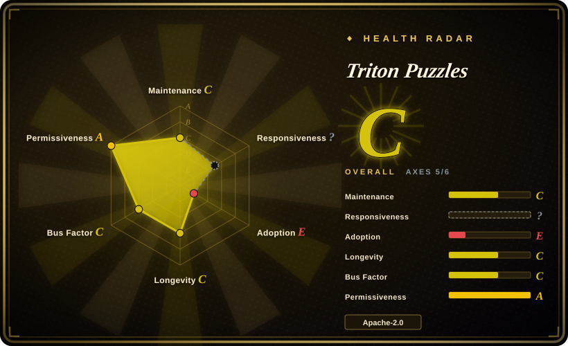
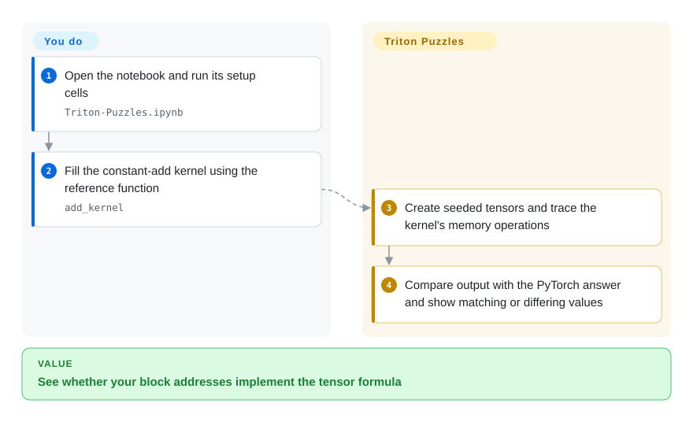
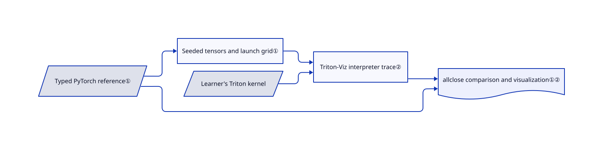

# Triton Puzzles

Your tensor formula is correct, but you cannot see which addresses a Triton block loads or why its last tile overruns the array. Twelve fill-in-the-kernel exercises pair PyTorch answers with traced memory access, without requiring a GPU for the interpreter path.

## When to use

You can write PyTorch expressions, but `tl.load` masks and `tl.program_id` make your first custom kernel hard to debug. You want to implement one missing kernel at a time and compare its output with a short reference function. Pick this notebook over a reading list when the missing skill is translating a formula into block offsets, not finding another paper. Exercises advance from adding ten through reductions, scalar attention, convolution and packed four-bit matrix multiplication.

## When NOT to use

- You need production-ready kernels or speed measurements. Use the official Triton tutorials and benchmark on your target GPU; these kernels deliberately contain TODOs, and interpreter correctness does not measure GPU throughput.
- You first need CUDA threads and shared-memory basics. Use `srush/GPU-Puzzles`; this notebook teaches Triton's block-oriented model instead.
- You need an ordered overview of serving, communication and GPU architecture. Read [AI Performance Engineering Resources](gpu-perf-engineering-resources.md); twelve implementation exercises do not cover the whole performance stack.
- You cannot expose a notebook visualizer publicly. Use the local `triton_viz.launch(share=False)` path documented in the setup cell; the supplied Colab helper uses `share=True` and waits until interrupted.

## Comparison

| Alternative | In index | Our verdict | Tradeoff |
|---|---|---|---|
| [AI Performance Engineering Resources](gpu-perf-engineering-resources.md) | ✅ | Pick Triton Puzzles to practise offsets and masks; pick the reading path to understand where kernels fit in the whole inference stack. | Executable feedback rather than broad source coverage; you must write the missing kernels. |
| GPU-Puzzles | not indexed | Choose GPU-Puzzles for CUDA-style thread indexing; choose this notebook for Triton blocks and tensor operations. | Different execution model; real repository linked by upstream, not added in this tab batch. |
| Triton official tutorials | not indexed | Choose official tutorials for complete kernels and performance tuning; choose these puzzles to solve the implementation before seeing an answer. | Broader hardware-facing documentation but less fill-in-the-blank practice; not added in this tab batch. |

## Quick start

Open `Triton-Puzzles.ipynb` in a notebook environment, using the README's Colab link or a local copy. Run its setup cells to install Triton-Viz and jaxtyping and import PyTorch and Triton. Fill the first `add_kernel` TODO and run the supplied `test` call. The notebook creates inputs, runs your kernel through the tracer and compares it with `add_spec`; you supply the implementation and interrupt the visualization helper before continuing. For a private local session, change the documented visualization launch to `share=False`; this page's research did not execute any upstream cell.

<!-- flow-steps:begin (generated from flows/triton-puzzles.json by tools/flow_card.py — do not edit) -->

Text version of the flow

1. **You**: Open the notebook and run its setup cells — `Triton-Puzzles.ipynb`
2. **You**: Fill the constant-add kernel using the reference function — `add_kernel`
3. **Triton Puzzles**: Create seeded tensors and trace the kernel's memory operations
4. **Triton Puzzles**: Compare output with the PyTorch answer and show matching or differing values

**Value**: See whether your block addresses implement the tensor formula

<!-- flow-steps:end -->

## Key techniques

<!-- mechanism:begin (generated from mechanisms/triton-puzzles.json by tools/mechanism_card.py; do not edit) -->

Text version of the mechanism

- Typed PyTorch reference①
- Seeded tensors and launch grid①
- Learner's Triton kernel
- Triton-Viz interpreter trace②
- allclose comparison and visualization①②

- Typed PyTorch reference① → Seeded tensors and launch grid①
- Seeded tensors and launch grid① → Triton-Viz interpreter trace②
- Learner's Triton kernel → Triton-Viz interpreter trace②
- Typed PyTorch reference① → allclose comparison and visualization①②
- Triton-Viz interpreter trace② → allclose comparison and visualization①②

<!-- mechanism:end -->

### 1. Derive executable checks from typed reference functions

- **Problem:** A learner needs an expected answer without duplicating tensor-shape setup for every exercise.
- **How:** `test` inspects the reference function's jaxtyping annotations, creates tensors and an output buffer, seeds random inputs, constructs the launch grid and checks the result with `torch.allclose` at `1e-3` tolerances.
- **Limits:** These are fixed example shapes and seeded random cases, not exhaustive property tests. A match is not proof of performance, arbitrary-shape correctness or numerical suitability.
- **Source:** [Notebook setup cell and first exercise](https://github.com/gpu-mode/Triton-Puzzles/blob/4d794abed02292081500ebf4b1e35cd5fc5fb019/Triton-Puzzles.ipynb) — code cells 3 and 15.

### 2. Trace memory operations while teaching tiling

- **Problem:** Broadcasting notation hides the addresses read and written by each program block.
- **How:** The wrapper applies `triton_viz.trace("tracer")` to the submitted kernel. Introductory examples isolate load/store masks and program IDs before exercises combine them into multiple tiles and reductions.
- **Limits:** The visualization is an interpreter aid, not a GPU profiler. The supplied launch helper opens a shared visualizer and blocks in a sleep loop until interrupted.
- **Source:** [Notebook tracer, launch helper and load/store demonstrations](https://github.com/gpu-mode/Triton-Puzzles/blob/4d794abed02292081500ebf4b1e35cd5fc5fb019/Triton-Puzzles.ipynb) — cells 3–11; [scope](https://github.com/gpu-mode/Triton-Puzzles/blob/4d794abed02292081500ebf4b1e35cd5fc5fb019/README.md).

## Tech stack

Python notebook, PyTorch reference operations, Triton kernels, Triton-Viz tracing and jaxtyping shape annotations. The repository contains one notebook and no dependency lockfile.

## Dependencies

A Jupyter-compatible environment or Colab, Python, PyTorch, Triton, Triton-Viz and jaxtyping. The notebook installs Triton-Viz from its live Git repository without a commit pin. The documented interpreter path does not require GPU hardware; package compatibility still depends on the environment.

## Ops difficulty

**Low for a disposable learning notebook.** There is no service or database to operate. Preserve your solved copy, isolate its unpinned dependencies and review the visualizer's sharing setting. Actual GPU performance work is a separate task.

## Health & viability

- **2026-10-18:** Created in March 2024, not archived, with no GitHub releases. The last recorded push was April 2026, so treat it as a relatively quiet teaching artifact rather than a rapidly maintained runtime.
- The contributor list is led by `srush` and `msaroufim`; the repository now belongs to GPU MODE. This gives it more history than a new launch, but does not guarantee compatibility with current Triton-Viz.
- Apache-2.0 text is present. The small repository has no CI workflow or lockfile; recent issue titles include description and test-block corrections. Pin the notebook and independently check dependency compatibility before using it in a course.

## Caveats (unverified)

- [未验证：上游代码禁止执行] Notebook execution, current Triton-Viz compatibility and the no-GPU installation path were source-reviewed, not reproduced.
- [未验证：没有独立部署数据] Stars count attention, not completed exercises or classroom adoption.
