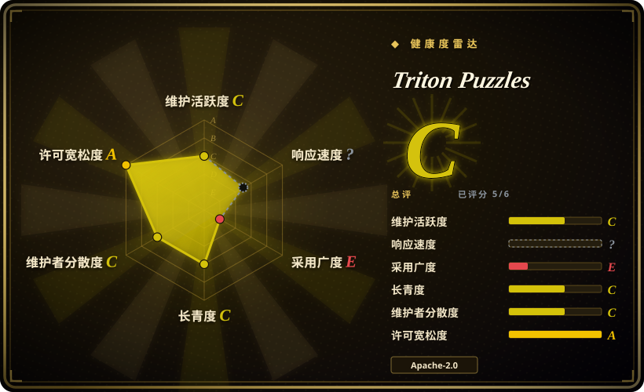
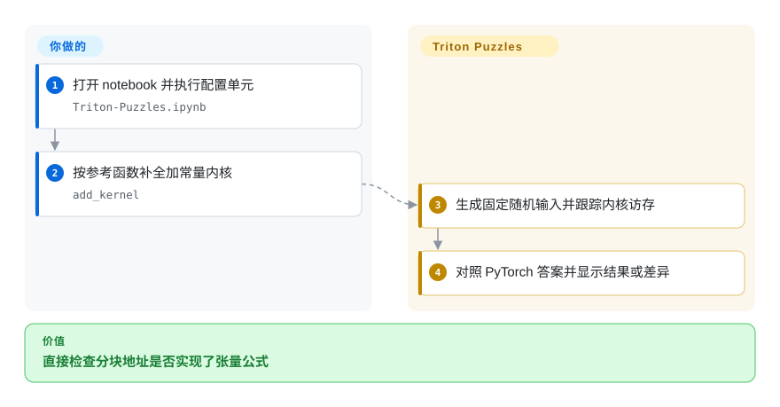
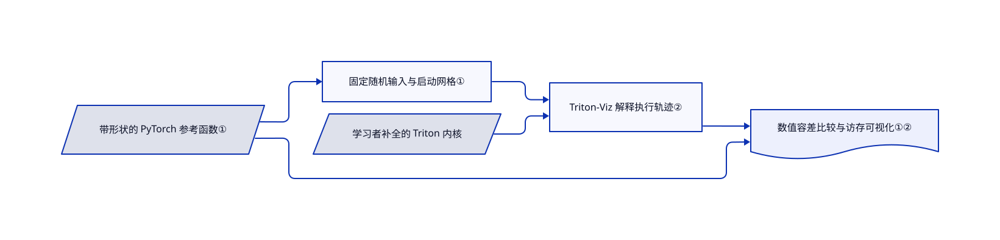

# Triton Puzzles

公式没写错，最后一块数据却越界了，你又看不出内核读了哪些地址。十二道补全题把 PyTorch 参考答案与访存轨迹放在一起，解释执行路径不要求 GPU。

## 何时使用

你能写 PyTorch 表达式，却卡在首个 Triton 内核的 `tl.load` 掩码和 `tl.program_id` 上。你希望一次只补一个内核，马上拿参考函数核对结果。此时选这份 notebook，而不是继续翻阅读清单，因为你缺的是把公式换成分块地址的练习。题目从加十开始，逐步进入归约、标量注意力、卷积和四位压缩矩阵乘法。

## 何时不用

- 要能上线的内核或性能数据，选 Triton 官方教程并在目标 GPU 实测。这里故意留有 TODO，解释器算对不等于 GPU 跑得快。
- 还没掌握 CUDA 线程与共享内存，先做 `srush/GPU-Puzzles`。这里训练的是 Triton 的块级思维。
- 想系统学习服务、通信与 GPU 架构，读 [AI Performance Engineering Resources](gpu-perf-engineering-resources.zh.md)。十二道实现题覆盖不了整个性能栈。
- 不能公开 notebook 的可视化页面，使用配置单元注明的本地 `triton_viz.launch(share=False)`。默认 Colab 辅助函数使用 `share=True`，并持续等待手动中断。

## 横向对比

| 替代品 | 是否收录 | 我们的评价 | 取舍 |
|---|---|---|---|
| [AI Performance Engineering Resources](gpu-perf-engineering-resources.zh.md) | ✅ | 练偏移和掩码选 Triton Puzzles；理解内核在推理全栈中的位置，选阅读路径。 | 换来可执行反馈，放弃广泛资料覆盖，而且内核必须自己补全。 |
| GPU-Puzzles | 未收录 | 学 CUDA 风格线程索引选 GPU-Puzzles；学 Triton 分块和张量操作选本页。 | 执行模型不同；上游链接的真实仓库，本次标签批次未收录。 |
| Triton 官方教程 | 未收录 | 要完整内核和调优示例选官方教程；想先独立解题再看答案选本页。 | 硬件侧文档更全，但不是同样的填空训练；本次标签批次未收录。 |

## 快速上手

通过 README 的 Colab 链接，或用本地 notebook 环境打开 `Triton-Puzzles.ipynb`。执行配置单元，安装 Triton-Viz 和 jaxtyping，并导入 PyTorch 与 Triton。补全首题 `add_kernel` 的 TODO，再运行现成的 `test` 调用。notebook 负责造数据、跟踪内核并与 `add_spec` 对比；你负责实现和中断可视化辅助函数，才能继续后续单元。本地私密使用应按配置单元说明改为 `share=False`；本次调研没有执行任何上游单元。

<!-- flow-steps:begin (generated from flows/triton-puzzles.json by tools/flow_card.py — do not edit) -->

流程文字版

1. **你**：打开 notebook 并执行配置单元 — `Triton-Puzzles.ipynb`
2. **你**：按参考函数补全加常量内核 — `add_kernel`
3. **Triton Puzzles**：生成固定随机输入并跟踪内核访存
4. **Triton Puzzles**：对照 PyTorch 答案并显示结果或差异

**价值**：直接检查分块地址是否实现了张量公式

<!-- flow-steps:end -->

## 技术要点

<!-- mechanism:begin (generated from mechanisms/triton-puzzles.json by tools/mechanism_card.py; do not edit) -->

机制文字版

- 带形状的 PyTorch 参考函数①
- 固定随机输入与启动网格①
- 学习者补全的 Triton 内核
- Triton-Viz 解释执行轨迹②
- 数值容差比较与访存可视化①②

- 带形状的 PyTorch 参考函数① → 固定随机输入与启动网格①
- 固定随机输入与启动网格① → Triton-Viz 解释执行轨迹②
- 学习者补全的 Triton 内核 → Triton-Viz 解释执行轨迹②
- 带形状的 PyTorch 参考函数① → 数值容差比较与访存可视化①②
- Triton-Viz 解释执行轨迹② → 数值容差比较与访存可视化①②

<!-- mechanism:end -->

### 1. 从带形状的参考函数生成检查

- **解决：** 每道题都需要参考答案，但不应反复手写张量形状和启动配置。
- **做法：** `test` 读取参考函数的 jaxtyping 注解，生成输入与输出缓冲区，固定随机种子，构造启动网格，并用容差为 `1e-3` 的 `torch.allclose` 核对结果。
- **边界：** 它只检查指定形状和固定随机样例，不是穷尽测试。匹配不代表任意形状正确、数值精度足够或性能达标。
- **源码：** [notebook 配置单元与首题](https://github.com/gpu-mode/Triton-Puzzles/blob/4d794abed02292081500ebf4b1e35cd5fc5fb019/Triton-Puzzles.ipynb)，代码单元 3 和 15。

### 2. 用访存轨迹理解分块

- **解决：** 广播表达式隐藏了每个程序块实际读写的地址。
- **做法：** 包装器给待测内核加上 `triton_viz.trace("tracer")`。入门示例先分别展示读写掩码和程序编号，再用练习组合成多块计算与归约。
- **边界：** 可视化帮助理解解释执行，不是 GPU 性能剖析器。现成的启动辅助函数会公开共享页面，并在循环中等待手动中断。
- **源码：** [跟踪器、启动辅助函数与读写示例](https://github.com/gpu-mode/Triton-Puzzles/blob/4d794abed02292081500ebf4b1e35cd5fc5fb019/Triton-Puzzles.ipynb)，单元 3–11；[范围说明](https://github.com/gpu-mode/Triton-Puzzles/blob/4d794abed02292081500ebf4b1e35cd5fc5fb019/README.md)。

## 技术栈

Python notebook、PyTorch 参考运算、Triton 内核、Triton-Viz 跟踪与 jaxtyping 形状注解。仓库只有一个 notebook，没有依赖锁文件。

## 依赖

Jupyter 兼容环境或 Colab，以及 Python、PyTorch、Triton、Triton-Viz 和 jaxtyping。配置单元直接从在线 Git 仓库安装 Triton-Viz，没有固定提交。文档里的解释执行路径不需要 GPU，软件包能否安装仍取决于环境。

## 运维难度

**一次性学习使用为低。** 没有服务或数据库要运维。保存自己的解题副本，隔离未锁定的依赖，并确认可视化共享设置。真实 GPU 性能调优是另一项工作。

## 健康度与可持续性

- **截至 2026-10-18：** 仓库创建于 2024 年 3 月，未归档，没有 GitHub release，最后记录的推送在 2026 年 4 月。应把它当相对静态的教材，而不是持续快速维护的运行时。
- 贡献者以 `srush` 和 `msaroufim` 为主，仓库现属 GPU MODE。它比新发布项目有更长历史，但这不能保证适配当前 Triton-Viz。
- 仓库有 Apache-2.0 正文，没有 CI 工作流或依赖锁文件。近期 issue 标题包含题意和测试块大小修正。用于课程前，应固定 notebook 并另测依赖兼容性。

## 存疑（未验证）

- [未验证：任务禁止执行上游代码] notebook 是否可直接运行、当前 Triton-Viz 兼容性，以及无 GPU 安装路径均只读过来源，未复现。
- [未验证：没有独立使用数据] star 只能说明关注度，不能代表完成题目或课堂采用量。
