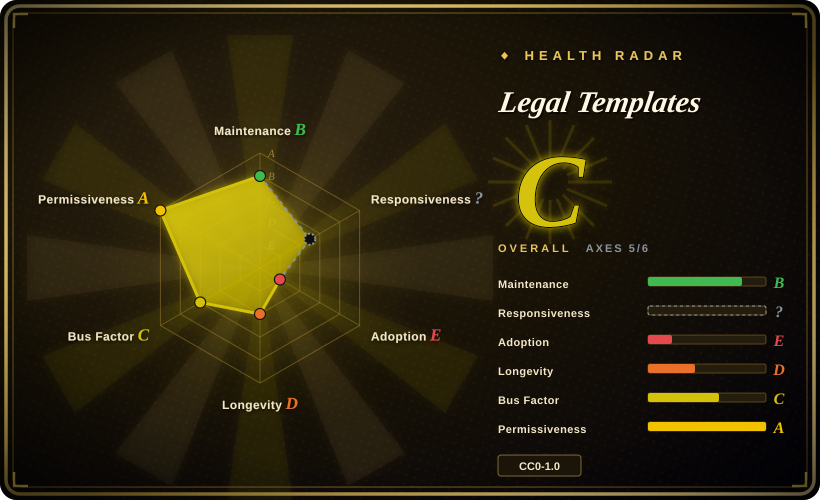
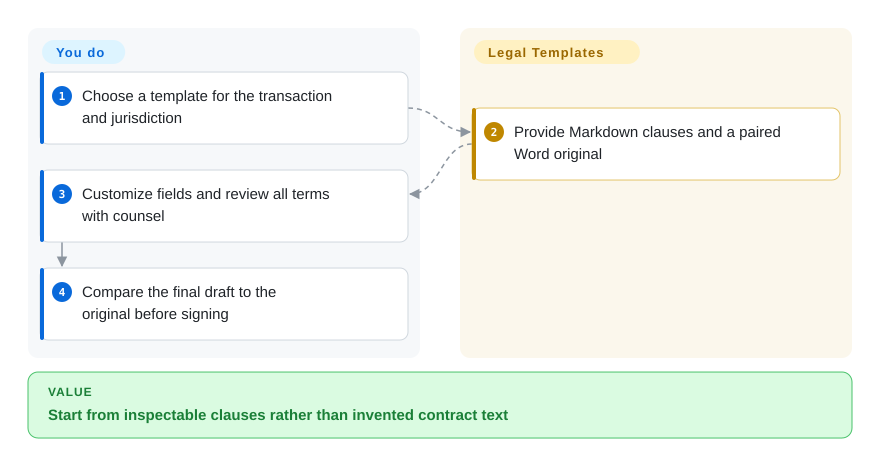
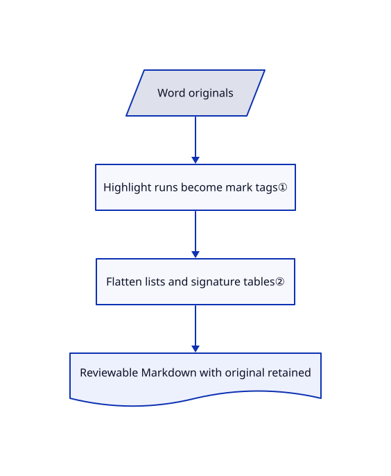

# Legal Templates

You need a reviewable NDA or privacy-policy draft, not a model inventing clauses. This repository supplies twelve templates as readable Markdown and original Word files, with highlighted customization fields.

## When to use

You are preparing documents for a technology startup and want counsel and an agent to work from the same versioned draft. Choose this collection when reusable clause text is missing, not an interview engine or legal opinion. Its U.S.-oriented agreements and separate U.S./global privacy documents provide starting material; review jurisdiction, commercial terms and every cross-reference before relying on a document.

## When NOT to use

- **You need jurisdiction-specific advice or a negotiated final agreement.** Use qualified counsel, such as General Legal's professional service; the templates disclaim legal advice and an attorney-client relationship.
- **You want questions to generate a document automatically.** Use docassemble and author the interview logic; these are highlighted fields, not a questionnaire engine.
- **You need formatted Word output from data.** Use python-docx-template with a reviewed template; these scripts convert Word into Markdown, not the reverse.
- **You assume an NDA permits uploading counterparty data into an agent.** The sampled mutual NDA restricts disclosure to AI tools without prior consent. Resolve authorization with counsel; CC0 on the template does not license confidential deal data.

## Comparison

| Alternative | In index | Our verdict | Tradeoff |
|---|---|---|---|
| docassemble | not indexed | Choose docassemble for guided interviews and document assembly; choose this collection when editable legal clauses are missing. | You build an interview and operate software; not added in this tab batch. |
| python-docx-template | not indexed | Choose python-docx-template for filling Word from data; choose this collection for initial clauses and Markdown review. | A rendering library does not provide reviewed legal terms; not added in this tab batch. |
| General Legal professional advice | not a repo | Choose counsel for jurisdiction, negotiation and transaction review; use templates only as starting material. | Paid legal service offers engagement-specific judgment rather than repository assets. |

## Quick start

Open `templates/<slug>/template.md` and keep its original in `docx-originals/` for comparison. Copy the template into your drafting workspace, replace highlighted fields and review all terms with counsel. An agent can compare drafts, but no script checks legal fitness or completeness. The optional `scripts/convert_docx.py` rebuilds Markdown using python-docx; ordinary reuse needs no installation. You remain responsible for confidentiality, jurisdiction, approval and signing.

<!-- flow-steps:begin (generated from flows/legal-templates.json by tools/flow_card.py — do not edit) -->

Text version of the flow

1. **You**: Choose a template for the transaction and jurisdiction
2. **Legal Templates**: Provide Markdown clauses and a paired Word original
3. **You**: Customize fields and review all terms with counsel
4. **You**: Compare the final draft to the original before signing

**Value**: Start from inspectable clauses rather than invented contract text

<!-- flow-steps:end -->

## Key techniques

<!-- mechanism:begin (generated from mechanisms/legal-templates.json by tools/mechanism_card.py; do not edit) -->

Text version of the mechanism

- Word originals
- Highlight runs become mark tags①
- Flatten lists and signature tables②
- Reviewable Markdown with original retained

- Word originals → Highlight runs become mark tags①
- Highlight runs become mark tags① → Flatten lists and signature tables②
- Flatten lists and signature tables② → Reviewable Markdown with original retained

<!-- mechanism:end -->

### 1. Preserve customization hints from Word

- **Problem:** Text extraction can hide which fields users should change.
- **How:** The converter wraps highlighted Word runs in `<mark>` tags and preserves emphasis; a fixed twelve-entry map connects original names to template directories.
- **Limits:** Highlighting is not a schema or completeness check. The sampled NDA has a partly highlighted bracket, and unmarked terms still need review.
- **Source:** [Run conversion and map](https://github.com/General-Legal/legal-templates/blob/6d6805425eabd41bed86fc1e2ec51612760f716c/scripts/convert_docx.py#L32-L88), [sample](https://github.com/General-Legal/legal-templates/blob/6d6805425eabd41bed86fc1e2ec51612760f716c/templates/mutual-nda/template.md#L3).

### 2. Flatten document layout for text review

- **Problem:** Signature tables and nested numbering make poor plain-text inputs.
- **How:** The script detects signature tables from field and party labels, deduplicates merged-cell values, and emits text blocks. Numbered paragraphs use counters by nesting level.
- **Limits:** Conversion is lossy. The sampled NDA restarts numbering around prose paragraphs while retaining textual section references; compare the original before signing.
- **Source:** [Tables](https://github.com/General-Legal/legal-templates/blob/6d6805425eabd41bed86fc1e2ec51612760f716c/scripts/convert_docx.py#L120-L186), [numbering](https://github.com/General-Legal/legal-templates/blob/6d6805425eabd41bed86fc1e2ec51612760f716c/scripts/convert_docx.py#L262-L281).

## Tech stack

Markdown and Word assets. Optional Python scripts use python-docx for conversion and the standard library to fetch originals from the firm's site.

## Dependencies

None for Markdown reuse; a Word-compatible editor for originals. Regeneration requires Python and python-docx. Update fetching contacts the firm and its document CDN.

## Ops difficulty

**Low technically, high review responsibility.** Version copied documents, preserve provenance and compare originals. No database or service is required; legal review and final-document validation are the costs.

## Health & viability

- **2026-10-18:** created April 2026 under General-Legal. README attributes templates to the firm's attorneys; the sampled document retains its disclaimer and credit.
- **Judgment:** six months gives little Lindy evidence, but static assets are easy to archive. Legal currency is separate from GitHub activity.
- **Rights:** full CC0 permits reuse without mandatory attribution; keeping the requested credit is courteous, not a condition. CC0 warrants neither legal suitability nor confidentiality permissions.

## Caveats (unverified)

- [未验证：未做律师审查] Enforceability, regulatory compliance and fitness for a particular transaction or jurisdiction were not assessed.
- [未验证：未逐字核对全部 Word] Numbering and highlight limitations are visible in sampled Markdown; fidelity to all twelve originals was not tested.
