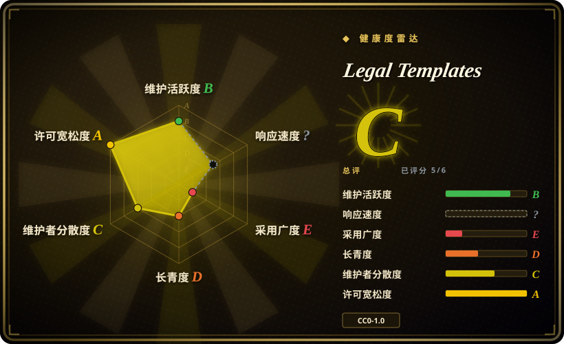
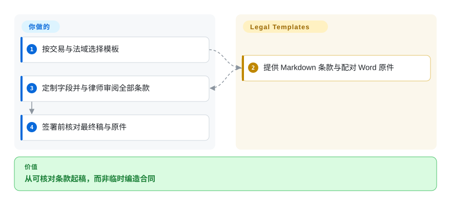
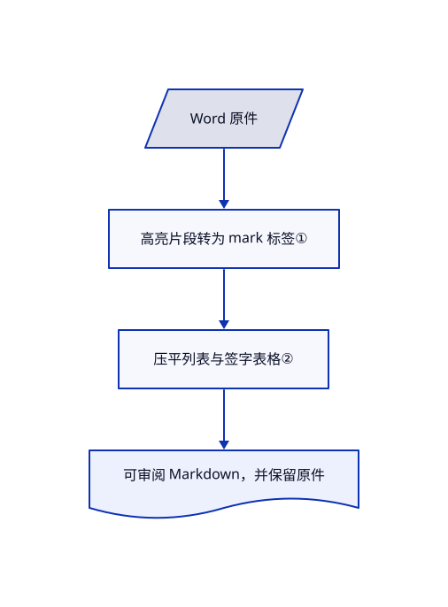

# Legal Templates

你需要可审阅的保密协议或隐私政策初稿，而非让模型临时编条款。此仓库提供十二套 Markdown 与原始 Word 模板，用高亮标记待定制字段。

## 何时使用

你在为科技初创公司准备文件，希望律师与 agent 基于同一份可版本管理的初稿协作。缺少的是可复用条款，而非访谈引擎或法律意见时，选此合集。偏美国业务的协议，以及区分美国和全球范围的隐私文件，提供起草材料；采用前仍须审阅法域、商业条件与全部交叉引用。

## 何时不用

- **需要特定法域意见或谈判后的最终协议。** 使用合资格律师，例如 General Legal 的专业服务；模板明确不构成法律意见或律师客户关系。
- **希望回答问题后自动生成文件。** 使用 docassemble 并编写访谈逻辑；这里是高亮字段，不是问卷引擎。
- **需要用数据输出格式化 Word。** 使用 python-docx-template 配合审定模板；这里脚本把 Word 转为 Markdown，不做反向生成。
- **假定保密协议允许向 agent 上传对方数据。** 已读双向保密协议限制未经事先同意向 AI 工具披露信息。先与律师确认授权；模板 CC0 不等于保密交易数据许可。

## 横向对比

| 替代品 | 是否收录 | 我们的评价 | 取舍 |
|---|---|---|---|
| docassemble | 未收录 | 要引导访谈与组装文件，选 docassemble；缺少可编辑法律条款，选本合集。 | 需要编写访谈并运维软件；本次标签批次未收录。 |
| python-docx-template | 未收录 | 用数据填充 Word，选 python-docx-template；要初始条款与 Markdown 审阅，选本合集。 | 渲染库不提供审定法律条款；本次标签批次未收录。 |
| General Legal 专业法律意见 | 非仓库 | 法域、谈判与具体交易审查应选律师；模板只作为起点。 | 付费法律服务提供个案判断，而非仓库资产。 |

## 快速上手

打开 `templates/<slug>/template.md`，保留 `docx-originals/` 中的原件核对。复制到自己的起草工作区，替换高亮字段，再与律师审阅全部条款。agent 可帮助比较稿件，但没有脚本验证法律适用性与完整性。可选的 `scripts/convert_docx.py` 用 python-docx 重建 Markdown；普通复用无需安装。保密、法域、审批与签署仍由你负责。

<!-- flow-steps:begin (generated from flows/legal-templates.json by tools/flow_card.py — do not edit) -->

流程文字版

1. **你**：按交易与法域选择模板
2. **Legal Templates**：提供 Markdown 条款与配对 Word 原件
3. **你**：定制字段并与律师审阅全部条款
4. **你**：签署前核对最终稿与原件

**价值**：从可核对条款起稿，而非临时编造合同

<!-- flow-steps:end -->

## 技术要点

<!-- mechanism:begin (generated from mechanisms/legal-templates.json by tools/mechanism_card.py; do not edit) -->

机制文字版

- Word 原件
- 高亮片段转为 mark 标签①
- 压平列表与签字表格②
- 可审阅 Markdown，并保留原件

- Word 原件 → 高亮片段转为 mark 标签①
- 高亮片段转为 mark 标签① → 压平列表与签字表格②
- 压平列表与签字表格② → 可审阅 Markdown，并保留原件

<!-- mechanism:end -->

### 1. 保留 Word 的定制提示

- **解决：** 文本提取会丢失用户应该修改的位置。
- **做法：** 转换器把高亮 Word 文本片段包在 `<mark>` 中，并保留强调格式；固定十二项映射连接原件名称与模板目录。
- **边界：** 高亮不是结构定义或完整性检查。样本保密协议有部分括号未高亮，未标条款也仍需审阅。
- **源码：** [文本转换与映射](https://github.com/General-Legal/legal-templates/blob/6d6805425eabd41bed86fc1e2ec51612760f716c/scripts/convert_docx.py#L32-L88)、[样本](https://github.com/General-Legal/legal-templates/blob/6d6805425eabd41bed86fc1e2ec51612760f716c/templates/mutual-nda/template.md#L3)。

### 2. 把文档排版压平为可审阅文本

- **解决：** 签字表格与嵌套编号不便直接做文本审阅。
- **做法：** 脚本用字段和主体标签识别签字表格，去除合并单元格造成的重复值，输出文本块。编号段落按嵌套层级计数。
- **边界：** 转换有损。样本的编号会在普通段落后重启，正文条款引用却保留；签署前须核对原件。
- **源码：** [表格](https://github.com/General-Legal/legal-templates/blob/6d6805425eabd41bed86fc1e2ec51612760f716c/scripts/convert_docx.py#L120-L186)、[编号](https://github.com/General-Legal/legal-templates/blob/6d6805425eabd41bed86fc1e2ec51612760f716c/scripts/convert_docx.py#L262-L281)。

## 技术栈

Markdown 与 Word 资产。可选 Python 脚本使用 python-docx 转换，并用标准库从律所网站获取原件。

## 依赖

Markdown 复用无运行依赖；原件需兼容 Word 的编辑器。重建需要 Python 与 python-docx。更新抓取会访问律所与文档分发服务。

## 运维难度

**技术低，审查责任高。** 对复制文件做版本管理，保留来源并核对原件。不需数据库或服务；真正成本是法律审阅与最终文件验证。

## 健康度与可持续性

- **截至 2026-10-18：** General-Legal 在 2026 年 4 月创建仓库。README 说明由律所律师起草，样本保留免责声明与署名。
- **判断：** 六个月不足以提供强长期存续证据，但静态资产容易归档。法律时效必须与 GitHub 活跃度分开评估。
- **权利：** CC0 实文允许复用，不强制署名；保留请求的署名是礼貌，不是授权条件。CC0 不保证法律适用，也不授予保密数据权限。

## 存疑（未验证）

- [未验证：未做律师审查] 未评估可执行性、监管合规或具体交易和法域的适用性。
- [未验证：未逐字核对全部 Word] 样本 Markdown 可见编号与高亮局限；未测试十二套原件的全面保真。
