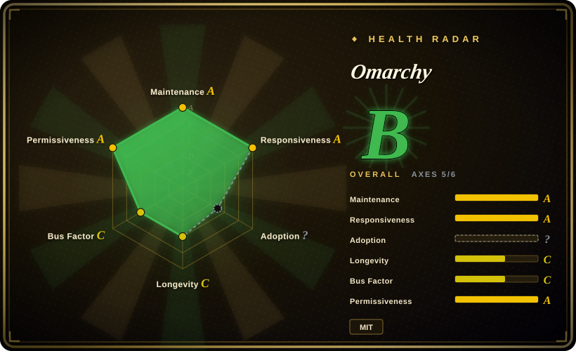
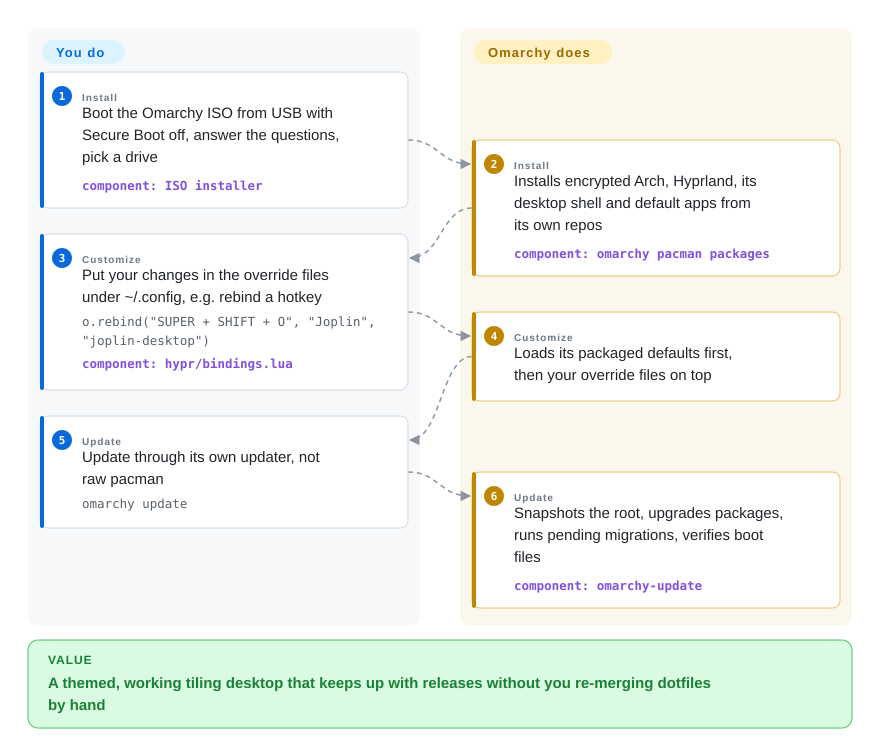
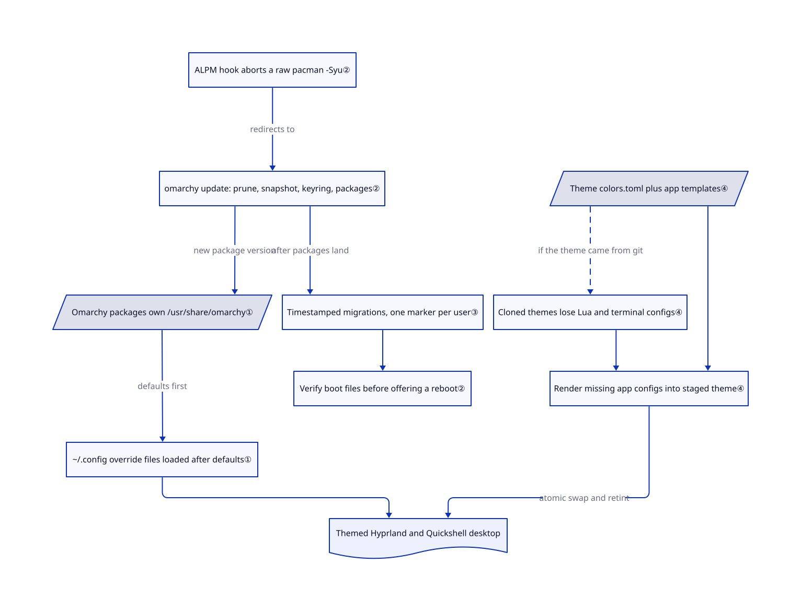

# Omarchy

Setting up Arch Linux with a tiling window manager means a week of copying other people's dotfiles, and the first big package upgrade quietly breaks half of them. Omarchy installs Arch, Hyprland and a complete themed desktop from one ISO, ships its defaults as packages kept apart from your own config files, and owns the update path so snapshots and config migrations run with every upgrade.

## When to use

You are a developer who wants to leave macOS or Windows for a keyboard-driven Linux desktop on a laptop or desktop you can wipe (or dual-boot into free space). You have tried assembling Hyprland yourself: a borrowed `hyprland.conf`, a status bar, a launcher, a lock screen, a notification daemon, and a colour scheme that only half the apps follow. Then Hyprland 0.55 moved to Lua configuration and your setup stopped loading. You reach for Omarchy when you want someone else to own that whole stack: it installs an encrypted Arch system from its ISO, gives you one menu (`Super + Space`) for apps, settings and updates, switches 23 bundled themes across the terminal, editor, browser and desktop in one action, and rewrites its own defaults through packaged migrations when upstream changes format.

Choose it over a dotfiles repository such as end-4's or ML4W's when you want a distribution with a release channel, rollback snapshots and an update command, not a configuration you copy onto a system you maintain. Choose it over a general-purpose Arch derivative when you want the author's choices made for you (Hyprland, foot, Neovim, Chrome, Obsidian, a Quickshell desktop) and are willing to live inside them.

## When NOT to use

- **You need Secure Boot, TPM unlock or a managed corporate laptop.** The [getting-started manual](https://github.com/omacom/omarchy/blob/419a5a7095d118a218d5f84548dbd83ce90067e6/manual/02-getting-started.md) says you must turn off Secure Boot and/or TPM to install. If compliance or IT policy requires them, use a mainstream distribution that supports signed boot, such as Fedora Workstation or Ubuntu, and add Hyprland there through the [ML4W dotfiles](https://github.com/mylinuxforwork/dotfiles).
- **You want a distribution you can tune piece by piece without fighting its updater.** Omarchy's pacman hook aborts a plain `pacman -Syu` until you add a bypass variable, and files under `/usr/share/omarchy` are overwritten on every update. If you want plain Arch semantics with Hyprland on top, install Arch yourself and use [end-4/dots-hyprland](https://github.com/end-4/dots-hyprland) or ML4W, which leave the package manager alone.
- **You need a stable, conservative desktop.** Major releases rewrite large parts of the system: 4.0 (2026-08-14) replaced Waybar, Walker, Mako, hyprlock and hypridle with one Quickshell process and converted every Hyprland config to Lua, and 4.5 followed 12 weeks later with more than 740 merged pull requests. Open issue [#6911](https://github.com/omacom/omarchy/issues/6911) documents the 4.0 upgrade silently stopped loading a customised `monitors.conf`. For a slower-moving desktop, use Fedora or Debian with GNOME or KDE Plasma.
- **You want a declarative, reproducible machine definition.** Omarchy is imperative: shell scripts, timestamped migrations and marker files. If you want the whole machine described in one versioned file, use NixOS; the community [omarchy-nix](https://github.com/henrysipp/omarchy-nix) port copies the look, but its last push was 2025-11-13.
- **You need to stay with Ubuntu, or keep your current OS untouched.** Omarchy installs from its own ISO onto a whole drive or free space; there is no supported install onto an existing distribution. DHH's earlier Ubuntu setup, [Omakub](https://github.com/omacom/omakub), is archived; the community [Omabuntu](https://github.com/omakasui/omabuntu) fork continues that path.
- **You object to proprietary defaults or vendor-run endpoints.** The base package list installs Google Chrome and Obsidian, packages come from `pkgs.omarchy.org` and Omarchy's own Arch mirrors, and the weather panel auto-locates you through `geo.omarchy.org`. You can remove most of it (`Remove > Preinstalls`), but if you want a desktop whose defaults are all free software from upstream mirrors, start from plain Arch or Debian.

## Comparison

| Alternative | In index | Our verdict | Tradeoff |
|---|---|---|---|
| [Omakub](https://github.com/omacom/omakub) | not indexed | Do not start a new machine on Omakub: it is archived, and its description marks it retired and sends readers to Omabuntu; pick it only as a reference for the older Ubuntu-plus-GNOME approach, or follow the Omabuntu fork if you must stay on Ubuntu. | Keeps Ubuntu's LTS base and Secure Boot story, but no longer receives fixes from the original authors. Not added in this tab batch. |
| [ML4W dotfiles](https://github.com/mylinuxforwork/dotfiles) | not indexed | When you want a polished Hyprland setup but need to keep Fedora, openSUSE, Ubuntu or an existing Arch install, pick ML4W; pick Omarchy when you want the distribution, update channel and snapshots handled for you. | You keep your distribution's package manager and boot chain, but you own upgrades and breakage yourself; GPL-3.0. Not added in this tab batch. |
| [end-4/dots-hyprland](https://github.com/end-4/dots-hyprland) | not indexed | Pick end-4 when you already run Arch (or another distribution with a current Hyprland) and want a Quickshell-based desktop configuration; pick Omarchy when you also want installer, encryption defaults and a managed update path. | A configuration you install with `./setup install` versus a full distribution; lighter footprint, but no release channel or rollback. Not added in this tab batch. |
| [CachyOS](https://github.com/CachyOS/CachyOS-Live-ISO) | not indexed | Choose CachyOS when you want an Arch-based distribution with tuned kernel builds and your own choice of desktop; choose Omarchy when the opinionated Hyprland desktop is the point. | General-purpose Arch derivative versus one person's curated desktop; CachyOS leaves more decisions to you. Not added in this tab batch. |
| [omarchy-nix](https://github.com/henrysipp/omarchy-nix) | not indexed | Treat it as a starting point for NixOS users who like Omarchy's look; it is not a maintained equivalent, since its last push was a year before this check. | Declarative NixOS configuration, but trails Omarchy 4's Quickshell rewrite and has no release channel. Not added in this tab batch. |

## Quick start

Download the ISO from [omarchy.org](https://omarchy.org), write it to a USB stick, turn off Secure Boot in the firmware settings, and boot from the stick. The installer asks for keyboard layout, user name and password, then a drive: full-disk wipes it, free-space installs next to Windows (BitLocker off first). Omarchy then installs Arch with LUKS full-disk encryption (the drive is unreadable without your password), the Btrfs file system with Snapper snapshots, the Limine boot loader, Hyprland (the tiling window manager) and its own desktop shell. Your job afterwards is to put changes in the files under `~/.config` that the [dotfiles manual](https://github.com/omacom/omarchy/blob/419a5a7095d118a218d5f84548dbd83ce90067e6/manual/31-dotfiles.md) names, such as `~/.config/hypr/bindings.lua`, and to update with `omarchy update` (or the menu's _Update > Omarchy_). Use a wired or 2.4 GHz keyboard: the encryption password prompt does not accept Bluetooth input.

<!-- flow-steps:begin (generated from flows/omarchy.json by tools/flow_card.py — do not edit) -->

Text version of the flow

1. **You** (Install): Boot the Omarchy ISO from USB with Secure Boot off, answer the questions, pick a drive — component: `ISO installer`
2. **Omarchy** (Install): Installs encrypted Arch, Hyprland, its desktop shell and default apps from its own repos — component: `omarchy pacman packages`
3. **You** (Customize): Put your changes in the override files under ~/.config, e.g. rebind a hotkey — `o.rebind("SUPER + SHIFT + O", "Joplin", "joplin-desktop")` — component: `hypr/bindings.lua`
4. **Omarchy** (Customize): Loads its packaged defaults first, then your override files on top
5. **You** (Update): Update through its own updater, not raw pacman — `omarchy update`
6. **Omarchy** (Update): Snapshots the root, upgrades packages, runs pending migrations, verifies boot files — component: `omarchy-update`

**Value**: A themed, working tiling desktop that keeps up with releases without you re-merging dotfiles by hand

<!-- flow-steps:end -->

## Key techniques

<!-- mechanism:begin (generated from mechanisms/omarchy.json by tools/mechanism_card.py; do not edit) -->

Text version of the mechanism

- Omarchy packages own /usr/share/omarchy①
- ~/.config override files loaded after defaults①
- ALPM hook aborts a raw pacman -Syu②
- omarchy update: prune, snapshot, keyring, packages②
- Timestamped migrations, one marker per user③
- Verify boot files before offering a reboot②
- Theme colors.toml plus app templates④
- Cloned themes lose Lua and terminal configs④
- Render missing app configs into staged theme④
- Themed Hyprland and Quickshell desktop

- Omarchy packages own /usr/share/omarchy① → ~/.config override files loaded after defaults① (defaults first)
- ~/.config override files loaded after defaults① → Themed Hyprland and Quickshell desktop
- ALPM hook aborts a raw pacman -Syu② → omarchy update: prune, snapshot, keyring, packages② (redirects to)
- omarchy update: prune, snapshot, keyring, packages② → Omarchy packages own /usr/share/omarchy① (new package version)
- omarchy update: prune, snapshot, keyring, packages② → Timestamped migrations, one marker per user③ (after packages land)
- Timestamped migrations, one marker per user③ → Verify boot files before offering a reboot②
- Theme colors.toml plus app templates④ → Cloned themes lose Lua and terminal configs④ (if the theme came from git) [optional/fallback]
- Cloned themes lose Lua and terminal configs④ → Render missing app configs into staged theme④
- Theme colors.toml plus app templates④ → Render missing app configs into staged theme④
- Render missing app configs into staged theme④ → Themed Hyprland and Quickshell desktop (atomic swap and retint)

<!-- mechanism:end -->

### 1. Ship defaults as packages and load your files after them

- **Problem:** A dotfiles-based desktop breaks on upgrade because the author's new defaults and your edits live in the same files.
- **How:** Since 4.0 the Omarchy internals are a pacman package installed to `/usr/share/omarchy`. Your `~/.config/hypr/hyprland.lua` runs a bootstrap, `require`s the packaged defaults, then `require`s five personal override files (monitors, input, bindings, look and feel, autostart), so a package update changes defaults without rewriting your files. `omarchy-refresh-config` copies a packaged default back into `~/.config`, keeps a timestamped backup and prints a diff only when they differ.
- **Limits:** Overrides only work where a default can be overridden after loading; a release that changes file format still has to rewrite your files through a migration, and the 4.0 upgrade left a customised `monitors.conf` unloaded without warning (issue #6911). The repository's own AGENTS.md notes that `omarchy-refresh-config` does not reject `..` in its argument.
- **Source:** [hyprland.lua load order:1–29](https://github.com/omacom/omarchy/blob/419a5a7095d118a218d5f84548dbd83ce90067e6/config/hypr/hyprland.lua#L1-L29), [refresh with backup:20–43](https://github.com/omacom/omarchy/blob/419a5a7095d118a218d5f84548dbd83ce90067e6/bin/omarchy-refresh-config#L20-L43), [dotfiles manual](https://github.com/omacom/omarchy/blob/419a5a7095d118a218d5f84548dbd83ce90067e6/manual/31-dotfiles.md).

### 2. Force every upgrade through one ordered, guarded pipeline

- **Problem:** On Arch, a user running `pacman -Syu` gets new packages without the config changes those packages now expect, and a bad upgrade can leave an unbootable system.
- **How:** An ALPM pre-transaction hook (pacman's plugin point) runs a guard with `AbortOnFail`; the guard reads the parent pacman command line and exits non-zero when it sees both sync and sysupgrade flags, pointing the user to `omarchy update`. That command takes one sudo authorization, prunes the package cache, takes a Snapper snapshot, refreshes keyrings, upgrades packages, runs migrations and hooks, then updates AUR packages and verifies boot files; if verification fails it exits without offering a reboot.
- **Limits:** `OMARCHY_ALLOW_DIRECT_PACMAN=1` bypasses the guard, and the guard only inspects flags, not intent. A missing or unconfigured Snapper prints a warning and the update continues without a snapshot; snapshots need the Limine boot loader (the default since 2.0) and roll back the root only, not `/home`.
- **Source:** [ALPM hook:1–11](https://github.com/omacom/omarchy/blob/419a5a7095d118a218d5f84548dbd83ce90067e6/default/libalpm/hooks/00-omarchy-update-guard.hook#L1-L11), [guard flag parsing:8–64](https://github.com/omacom/omarchy/blob/419a5a7095d118a218d5f84548dbd83ce90067e6/bin/omarchy-update-pacman-guard#L8-L64), [update order and boot gate:88–163](https://github.com/omacom/omarchy/blob/419a5a7095d118a218d5f84548dbd83ce90067e6/bin/omarchy-update#L88-L163), [snapshot manual](https://github.com/omacom/omarchy/blob/419a5a7095d118a218d5f84548dbd83ce90067e6/manual/47-system-snapshots.md).

### 3. Run one-time migrations per user, keyed by timestamp

- **Problem:** Some upgrade steps touch a user's home directory, session or desktop state, which a root-run package script cannot safely do.
- **How:** Each migration is a shell file named by its Unix timestamp. `omarchy-migrate` waits up to 15 minutes for any pacman lock, runs every file without a marker in `~/.local/state/omarchy/migrations/` under `bash -euo pipefail`, and writes the marker only after success. Each user on the machine runs every migration once, and a login-time service notifies users who have pending ones.
- **Limits:** Idempotence is a written rule for authors, not something the runner checks. Because markers live in `/home`, a root snapshot restore leaves later migrations marked done even though their system changes were rolled back, as the snapshot manual itself warns.
- **Source:** [runner and markers:31–97](https://github.com/omacom/omarchy/blob/419a5a7095d118a218d5f84548dbd83ce90067e6/bin/omarchy-migrate#L31-L97), [migration model](https://github.com/omacom/omarchy/blob/419a5a7095d118a218d5f84548dbd83ce90067e6/agents/skills/migrations.md), [update process doc](https://github.com/omacom/omarchy/blob/419a5a7095d118a218d5f84548dbd83ce90067e6/docs/update-process.md).

### 4. Compile one palette into every app's config, and distrust downloaded themes

- **Problem:** A theme that recolours the terminal but not the editor, browser and bar looks broken, and a theme downloaded from a stranger's git repository can carry code.
- **How:** `omarchy-theme-set` builds a staging directory from the bundled theme, overlays the user's copy, then renders 23 templates (`default/themed/*.tpl`) from the theme's `colors.toml` in one awk pass; a file the theme already ships wins, and user templates take precedence over built-in ones. The staged theme is swapped in atomically, then terminals and Hyprland retint first and other apps follow in the background. A theme directory containing `.git` is staged through a filter that drops every `*.lua`, terminal config, `vscode.json` and symlink, since those can launch programs.
- **Limits:** The denylist is maintained by hand (a test fails when a new template is not classified); apps not listed in the retint commands keep their old colours until restarted, and background retint failures only raise a notification.
- **Source:** [installed-theme denylist:35](https://github.com/omacom/omarchy/blob/419a5a7095d118a218d5f84548dbd83ce90067e6/bin/omarchy-theme-set#L35), [git-theme filter and staging:336–428](https://github.com/omacom/omarchy/blob/419a5a7095d118a218d5f84548dbd83ce90067e6/bin/omarchy-theme-set#L336-L428), [template precedence:330–345](https://github.com/omacom/omarchy/blob/419a5a7095d118a218d5f84548dbd83ce90067e6/bin/omarchy-theme-set-templates#L330-L345), [theming doc](https://github.com/omacom/omarchy/blob/419a5a7095d118a218d5f84548dbd83ce90067e6/docs/theming.md).

## Tech stack

- Mostly Bash: 613 `omarchy-*` commands under `bin/`, routed by a single `omarchy` command, plus about 297 migration scripts. The desktop shell is QML on [Quickshell](https://quickshell.org) (140 `.qml` files under `shell/`); Hyprland is configured in Lua.
- Arch Linux packages built in the separate [omarchy-pkgs](https://github.com/omacom/omarchy-pkgs) repository; the ISO is built in [omarchy-iso](https://github.com/omacom/omarchy-iso). Both are MIT-licensed repositories of the same organisation.
- Base desktop: Hyprland, Quickshell, SDDM login, foot terminal, Neovim, PipeWire/WirePlumber, NetworkManager, UFW firewall, Docker and Podman, mise for language runtimes, Plymouth boot splash (from [`install/omarchy-base.packages`](https://github.com/omacom/omarchy/blob/419a5a7095d118a218d5f84548dbd83ce90067e6/install/omarchy-base.packages)).

## Dependencies

- **Hardware and firmware:** an x86_64 PC, or an ARM machine of a supported family (Apple Silicon, Snapdragon, NVIDIA N1x/GB10, Raspberry Pi per the repository's [AGENTS.md](https://github.com/omacom/omarchy/blob/419a5a7095d118a218d5f84548dbd83ce90067e6/AGENTS.md)); Secure Boot disabled; a drive you can wipe or unallocated space on it.
- **Network services run by the project:** `pkgs.omarchy.org` for Omarchy's packages, `mirror.omarchy.org` / `stable-mirror.omarchy.org` for Arch packages (the stable mirror lags upstream Arch by about a month), and `iso.omarchy.org` for installers. A user-triggered debug upload goes to `logs.omarchy.org`.
- **Third-party accounts:** none for the base system. Coding agents, Chrome sign-in, Dropbox and Tailscale panels need their own vendors' accounts.

## Ops difficulty

**Medium.** Day to day it is low: one update command, automatic pre-update snapshots, and boot-menu rollback. The cost appears at major releases and when you customise deeply. Any change you make in `/usr/share/omarchy` is lost on the next update; overrides belong in `~/.config`, and a large release can still move or replace those files (see #6911). A snapshot restore rolls back the root file system but not `/home`, so your configs and Omarchy's migration markers stay at their newer state. Expect to read release notes before each major upgrade and keep your `~/.config` changes in version control.

## Health & viability

- **Maintenance (2026-11-18):** very active. The default branch `quattro` was pushed the same day, 100+ commits landed in the month before, and releases run from 4.0.0 (2026-08-14) through 4.0.6 to 4.5.0 (2026-11-05) with release candidates in between.
- **Governance and backing:** the repository moved from `basecamp/omarchy` to the `omacom` organisation; [omarchy.org/foundation](https://omarchy.org/foundation) describes the Omacom Foundation as a nonprofit with patrons and full-time employees. DHH authored about 5.2k commits, far ahead of the next contributor (about 950); 448 contributors overall. The roadmap is his.
- **Age (Lindy):** created 2025-06-01, about 17 months old. Momentum is high but the age prior is weak, and the project has already done two rewrites (3.0 in 2025-09, 4.0 in 2026-08).
- **Adoption and backlog:** 47.2k stars and 6.2k forks; 2,924 open issues and 4,038 open pull requests on 2026-11-18. Many issues are detailed and triaged by a bot account (`omarchybot`). Treat the backlog as a sign of scale, not neglect, but expect long tails on hardware-specific bugs.
- **Risk flags:** MIT license with no CLA file found; the risk is churn and single-author direction, not licensing. Proprietary packages ship in the default install even though the repository itself is MIT.
- **Radar scope:** the machine scored five of six axes. Adoption stays unknown because Omarchy ships as an ISO and its own pacman repository, not a registry package; responsiveness measured a 2.4-hour median first response on six qualifying issues. Grades were not adjusted by hand.

## Caveats (unverified)

- [未验证：nothing was installed or booted] Install time ("under a minute on the fastest machines"), hardware coverage and day-to-day stability come from the manual and release notes, not from a test install on hardware or in a VM.
- [推断：manual/44-mac-support.md contradicts the v4.5.0 release notes] The in-repo Mac manual still says M-series Macs are not directly supported, while the 4.5 release notes and the `omarchy-mac` repository say Apple Silicon installs natively. The page follows the newer release notes.
- [未验证：only CachyOS's ISO-build README was read] That CachyOS lets you pick among several desktops was not confirmed from its sources here.
- [推断：based on a sample of top issues and bot triage comments, no response-time statistics] The judgment that the open issue and pull-request backlog reflects scale rather than neglect is not a measured response-time result.
- [未验证：the 4,038 open pull requests were not inspected one by one] Whether most open pull requests are agent-generated or duplicates was not checked.
- [未验证：no CLA search beyond the repository root and .github] "No CLA file found" means none was seen in the files read, not that contributions carry no terms.
