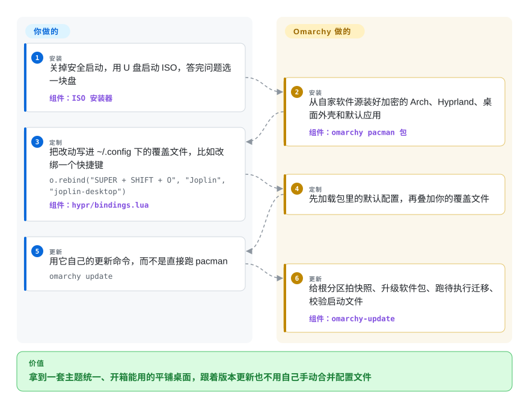
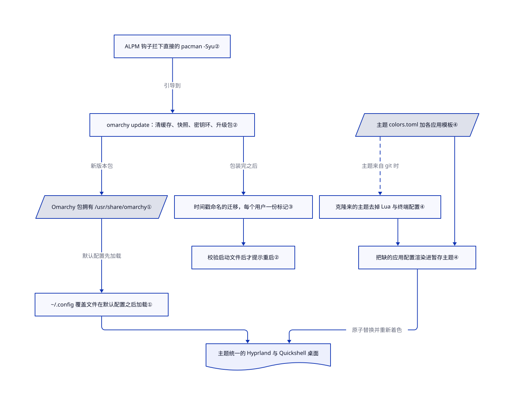

# Omarchy

自己在 Arch Linux 上搭一套平铺窗口桌面，得花一周抄别人的配置文件，结果第一次大版本升级就悄悄坏掉一半。Omarchy 用一个 ISO 装好 Arch、Hyprland 和一整套统一主题的桌面，把自己的默认配置做成软件包、和你的配置文件分开放，并且接管更新流程，让快照和配置迁移随每次升级一起跑。

## 何时使用

你是开发者，想把一台可以清空（或者能在空闲分区装双系统）的笔记本或台式机从 macOS、Windows 换成全键盘操作的 Linux 桌面。你自己拼过 Hyprland：借来的 `hyprland.conf`、一个状态栏、一个启动器、一个锁屏、一个通知守护进程，再加一套只有一半应用会跟着变的配色。后来 Hyprland 0.55 改成 Lua 配置，你那套直接加载失败。这时你会想到 Omarchy：它从 ISO 装好一套全盘加密的 Arch，用一个菜单（`Super + Space`）管应用、设置和更新，一个动作就把自带的 23 套主题同时切到终端、编辑器、浏览器和桌面上，上游改格式时由它自己的迁移脚本改写默认配置。

和 end-4、ML4W 这类配置文件仓库相比，你要的是一个有发布通道、回滚快照和更新命令的发行版，而不是拷到自己维护的系统上的一份配置，那就选 Omarchy。和通用的 Arch 衍生版相比，你愿意接受作者替你做好的选择（Hyprland、foot、Neovim、Chrome、Obsidian、Quickshell 桌面）并在里面过日子，也选它。

## 何时不用

- **你需要安全启动、TPM 解锁，或者这是公司统一管理的笔记本。** [入门手册](https://github.com/omacom/omarchy/blob/419a5a7095d118a218d5f84548dbd83ce90067e6/manual/02-getting-started.md)写明安装前必须在 BIOS 里关掉安全启动和／或 TPM。合规或 IT 政策要求这些时，改用支持签名启动的主流发行版，比如 Fedora Workstation 或 Ubuntu，再用 [ML4W dotfiles](https://github.com/mylinuxforwork/dotfiles) 在上面装 Hyprland。
- **你想一点点调自己的发行版，又不想和它的更新器较劲。** Omarchy 的 pacman 钩子会拦下普通的 `pacman -Syu`，除非你加绕过变量；`/usr/share/omarchy` 下的文件每次更新都会被覆盖。想要原汁原味的 Arch 再加 Hyprland，就自己装 Arch，配 [end-4/dots-hyprland](https://github.com/end-4/dots-hyprland) 或 ML4W，它们不碰包管理器。
- **你需要一个稳定、保守的桌面。** 大版本会重写系统的大块内容：4.0（2026-08-14）用一个 Quickshell 进程替换了 Waybar、Walker、Mako、hyprlock 和 hypridle，并把所有 Hyprland 配置改成 Lua；12 周后的 4.5 又合并了 740 多个 PR。开放 issue [#6911](https://github.com/omacom/omarchy/issues/6911) 记录了 4.0 升级后，用户自定义的 `monitors.conf` 被悄悄停止加载。想要变化慢的桌面，用 Fedora 或 Debian 配 GNOME 或 KDE Plasma。
- **你要声明式、可复现的整机定义。** Omarchy 是命令式的：shell 脚本、按时间戳命名的迁移和标记文件。想用一个版本化文件描述整台机器，用 NixOS；社区移植的 [omarchy-nix](https://github.com/henrysipp/omarchy-nix) 仿了外观，但最后一次推送是 2025-11-13。
- **你必须留在 Ubuntu，或者不想动现有系统。** Omarchy 只能从自己的 ISO 装到整块盘或空闲分区，不支持装到已有发行版上。DHH 早先的 Ubuntu 方案 [Omakub](https://github.com/omacom/omakub) 已归档，社区分叉 [Omabuntu](https://github.com/omakasui/omabuntu) 接着走这条路。
- **你不接受专有软件默认预装，或不想连项目方自己的服务。** 基础包清单里装了 Google Chrome 和 Obsidian；软件包来自 `pkgs.omarchy.org` 和 Omarchy 自建的 Arch 镜像；天气面板通过 `geo.omarchy.org` 自动定位。大部分可以删掉（菜单里的 `Remove > Preinstalls`），但如果你要的是默认全是自由软件、全走上游镜像的桌面，从原版 Arch 或 Debian 起步。

## 横向对比

| 替代品 | 是否收录 | 我们的评价 | 取舍 |
|---|---|---|---|
| [Omakub](https://github.com/omacom/omakub) | 未收录 | 新机器不要再装 Omakub：它已归档，仓库描述写明已退役并把读者引向 Omabuntu；只把它当作旧的 Ubuntu 加 GNOME 方案的参考，必须留在 Ubuntu 就跟 Omabuntu 分叉。 | 保留 Ubuntu LTS 底座和安全启动支持，但原作者不再修复。本批标签未收录。 |
| [ML4W dotfiles](https://github.com/mylinuxforwork/dotfiles) | 未收录 | 想要精致的 Hyprland 桌面、又必须保留 Fedora、openSUSE、Ubuntu 或现有 Arch 时选 ML4W；想把发行版、更新通道和快照都交出去时选 Omarchy。 | 保留你自己发行版的包管理器和启动链，但升级和故障要自己扛；GPL-3.0。本批标签未收录。 |
| [end-4/dots-hyprland](https://github.com/end-4/dots-hyprland) | 未收录 | 已经在跑 Arch（或 Hyprland 版本够新的其他发行版），想要一套基于 Quickshell 的桌面配置时选 end-4；还想要安装器、默认加密和受管更新路径时选 Omarchy。 | 一份用 `./setup install` 安装的配置，对比一个完整发行版；更轻，但没有发布通道和回滚。本批标签未收录。 |
| [CachyOS](https://github.com/CachyOS/CachyOS-Live-ISO) | 未收录 | 想要一个带调优内核构建、桌面自己挑的 Arch 系发行版时选 CachyOS；看中的就是这套固执己见的 Hyprland 桌面时选 Omarchy。 | 通用的 Arch 衍生版对比一个人精选的桌面；CachyOS 留给你的决定更多。本批标签未收录。 |
| [omarchy-nix](https://github.com/henrysipp/omarchy-nix) | 未收录 | 只把它当作喜欢 Omarchy 外观的 NixOS 用户的起点；它不是仍在维护的等价物，本次核查时距最后一次推送已一年。 | 声明式 NixOS 配置，但落后于 Omarchy 4 的 Quickshell 重写，也没有发布通道。本批标签未收录。 |

## 快速上手

从 [omarchy.org](https://omarchy.org) 下载 ISO，写进 U 盘，在固件设置里关掉安全启动，然后从 U 盘启动。安装器先问键盘布局、用户名和密码，再让你选盘：整盘安装会清空这块盘，空闲空间安装则装在 Windows 旁边（先关掉 BitLocker）。之后 Omarchy 装好 Arch，带 LUKS 全盘加密（没有密码就读不了盘）、Btrfs 文件系统和 Snapper 快照、Limine 启动器、Hyprland（平铺窗口管理器）以及它自己的桌面外壳。装完以后你要做的，是把改动写进 [dotfiles 手册](https://github.com/omacom/omarchy/blob/419a5a7095d118a218d5f84548dbd83ce90067e6/manual/31-dotfiles.md)列出的 `~/.config` 下的文件，比如 `~/.config/hypr/bindings.lua`，并用 `omarchy update`（或菜单里的 _Update > Omarchy_）更新。请用有线或 2.4 GHz 无线键盘：开机输入加密密码时不认蓝牙键盘。

<!-- flow-steps:begin (generated from flows/omarchy.json by tools/flow_card.py — do not edit) -->

流程文字版

1. **你**（安装）：关掉安全启动，用 U 盘启动 ISO，答完问题选一块盘 — 组件：`ISO 安装器`
2. **Omarchy**（安装）：从自家软件源装好加密的 Arch、Hyprland、桌面外壳和默认应用 — 组件：`omarchy pacman 包`
3. **你**（定制）：把改动写进 ~/.config 下的覆盖文件，比如改绑一个快捷键 — `o.rebind("SUPER + SHIFT + O", "Joplin", "joplin-desktop")` — 组件：`hypr/bindings.lua`
4. **Omarchy**（定制）：先加载包里的默认配置，再叠加你的覆盖文件
5. **你**（更新）：用它自己的更新命令，而不是直接跑 pacman — `omarchy update`
6. **Omarchy**（更新）：给根分区拍快照、升级软件包、跑待执行迁移、校验启动文件 — 组件：`omarchy-update`

**价值**：拿到一套主题统一、开箱能用的平铺桌面，跟着版本更新也不用自己手动合并配置文件

<!-- flow-steps:end -->

## 技术要点

<!-- mechanism:begin (generated from mechanisms/omarchy.json by tools/mechanism_card.py; do not edit) -->

机制文字版

- Omarchy 包拥有 /usr/share/omarchy①
- ~/.config 覆盖文件在默认配置之后加载①
- ALPM 钩子拦下直接的 pacman -Syu②
- omarchy update：清缓存、快照、密钥环、升级包②
- 时间戳命名的迁移，每个用户一份标记③
- 校验启动文件后才提示重启②
- 主题 colors.toml 加各应用模板④
- 克隆来的主题去掉 Lua 与终端配置④
- 把缺的应用配置渲染进暂存主题④
- 主题统一的 Hyprland 与 Quickshell 桌面

- Omarchy 包拥有 /usr/share/omarchy① → ~/.config 覆盖文件在默认配置之后加载①（默认配置先加载）
- ~/.config 覆盖文件在默认配置之后加载① → 主题统一的 Hyprland 与 Quickshell 桌面
- ALPM 钩子拦下直接的 pacman -Syu② → omarchy update：清缓存、快照、密钥环、升级包②（引导到）
- omarchy update：清缓存、快照、密钥环、升级包② → Omarchy 包拥有 /usr/share/omarchy①（新版本包）
- omarchy update：清缓存、快照、密钥环、升级包② → 时间戳命名的迁移，每个用户一份标记③（包装完之后）
- 时间戳命名的迁移，每个用户一份标记③ → 校验启动文件后才提示重启②
- 主题 colors.toml 加各应用模板④ → 克隆来的主题去掉 Lua 与终端配置④（主题来自 git 时）〔可选／兜底〕
- 克隆来的主题去掉 Lua 与终端配置④ → 把缺的应用配置渲染进暂存主题④
- 主题 colors.toml 加各应用模板④ → 把缺的应用配置渲染进暂存主题④
- 把缺的应用配置渲染进暂存主题④ → 主题统一的 Hyprland 与 Quickshell 桌面（原子替换并重新着色）

<!-- mechanism:end -->

### 1. 默认配置做成软件包，你的文件在它之后加载

- **解决：** 基于配置文件仓库的桌面一升级就坏，因为作者的新默认值和你的修改写在同一批文件里。
- **做法：** 从 4.0 起，Omarchy 的内部文件是一个装到 `/usr/share/omarchy` 的 pacman 包。你的 `~/.config/hypr/hyprland.lua` 先跑引导脚本，`require` 包里的默认配置，再 `require` 五个个人覆盖文件（显示器、输入、快捷键、外观、自启动），所以包更新只改默认值，不改写你的文件。`omarchy-refresh-config` 把包里的默认文件拷回 `~/.config`，留一份带时间戳的备份，两者不同时打印差异。
- **边界：** 只有能在加载后被覆盖的默认值才吃这套；发布版改文件格式时，仍要靠迁移改写你的文件，而 4.0 升级就让自定义的 `monitors.conf` 不再加载且没有提示（issue #6911）。仓库自己的 AGENTS.md 也写明 `omarchy-refresh-config` 不拒绝参数里的 `..`。
- **源码：** [hyprland.lua 加载顺序第 1–29 行](https://github.com/omacom/omarchy/blob/419a5a7095d118a218d5f84548dbd83ce90067e6/config/hypr/hyprland.lua#L1-L29)、[带备份的恢复默认第 20–43 行](https://github.com/omacom/omarchy/blob/419a5a7095d118a218d5f84548dbd83ce90067e6/bin/omarchy-refresh-config#L20-L43)、[dotfiles 手册](https://github.com/omacom/omarchy/blob/419a5a7095d118a218d5f84548dbd83ce90067e6/manual/31-dotfiles.md)。

### 2. 所有升级强制走一条有序、有门禁的流水线

- **解决：** 在 Arch 上直接跑 `pacman -Syu`，拿到的新包缺了它们所预期的配置改动；一次坏升级还可能让系统起不来。
- **做法：** 一个 ALPM（pacman 的插件挂载点）事务前钩子以 `AbortOnFail` 方式运行守卫脚本；守卫读取上层 pacman 的命令行，同时看到同步和全系统升级参数就非零退出，提示改用 `omarchy update`。这个命令只要一次 sudo 授权，依次清理包缓存、拍 Snapper 快照、刷新密钥环、升级软件包、跑迁移和钩子，再更新 AUR 包、校验启动文件；校验不过就直接退出，不提示重启。
- **边界：** 设 `OMARCHY_ALLOW_DIRECT_PACMAN=1` 就能绕过守卫，守卫也只看参数不看意图。没装或没配 Snapper 时只打印警告，更新照样继续、不留快照；快照依赖 Limine 启动器（2.0 起的默认），而且只回滚根分区，不回滚 `/home`。
- **源码：** [ALPM 钩子第 1–11 行](https://github.com/omacom/omarchy/blob/419a5a7095d118a218d5f84548dbd83ce90067e6/default/libalpm/hooks/00-omarchy-update-guard.hook#L1-L11)、[守卫参数解析第 8–64 行](https://github.com/omacom/omarchy/blob/419a5a7095d118a218d5f84548dbd83ce90067e6/bin/omarchy-update-pacman-guard#L8-L64)、[更新顺序与启动校验门禁第 88–163 行](https://github.com/omacom/omarchy/blob/419a5a7095d118a218d5f84548dbd83ce90067e6/bin/omarchy-update#L88-L163)、[快照手册](https://github.com/omacom/omarchy/blob/419a5a7095d118a218d5f84548dbd83ce90067e6/manual/47-system-snapshots.md)。

### 3. 一次性迁移按用户执行，按时间戳排序

- **解决：** 有些升级步骤要改用户的家目录、会话或桌面状态，以 root 身份运行的包脚本做不安全。
- **做法：** 每个迁移是一个以 Unix 时间戳命名的 shell 文件。`omarchy-migrate` 最多等 15 分钟让 pacman 锁释放，然后以 `bash -euo pipefail` 依次运行 `~/.local/state/omarchy/migrations/` 里还没有标记的文件，成功后才写标记。机器上每个用户都会把每个迁移跑一次，登录时还有服务提醒有待执行迁移的用户。
- **边界：** 幂等只是写给作者的规矩，运行器并不检查。标记放在 `/home` 里，所以回滚根分区快照后，之后跑过的迁移仍算已完成，尽管它们对系统的改动已被回滚；快照手册自己也提醒了这一点。
- **源码：** [运行器与标记第 31–97 行](https://github.com/omacom/omarchy/blob/419a5a7095d118a218d5f84548dbd83ce90067e6/bin/omarchy-migrate#L31-L97)、[迁移模型](https://github.com/omacom/omarchy/blob/419a5a7095d118a218d5f84548dbd83ce90067e6/agents/skills/migrations.md)、[更新流程文档](https://github.com/omacom/omarchy/blob/419a5a7095d118a218d5f84548dbd83ce90067e6/docs/update-process.md)。

### 4. 一套配色编译进每个应用的配置，下载来的主题不全信

- **解决：** 只改了终端、没改编辑器、浏览器和状态栏的主题看上去是坏的；从陌生人 git 仓库下载的主题还可能夹带代码。
- **做法：** `omarchy-theme-set` 先用自带主题建一个暂存目录，叠上用户的副本，再用主题的 `colors.toml` 一次 awk 渲染 23 个模板（`default/themed/*.tpl`）；主题自己带了的文件优先，用户模板优先于内置模板。暂存主题原子替换上去后，终端和 Hyprland 先重新着色，其余应用在后台跟上。含 `.git` 目录的主题要先过滤：所有 `*.lua`、终端配置、`vscode.json` 和符号链接都会被丢掉，因为它们能启动程序。
- **边界：** 黑名单靠人维护（新增模板没归类时会有测试失败）；不在重新着色命令清单里的应用要重启才变色，后台重新着色失败只弹通知。
- **源码：** [下载主题黑名单第 35 行](https://github.com/omacom/omarchy/blob/419a5a7095d118a218d5f84548dbd83ce90067e6/bin/omarchy-theme-set#L35)、[git 主题过滤与暂存第 336–428 行](https://github.com/omacom/omarchy/blob/419a5a7095d118a218d5f84548dbd83ce90067e6/bin/omarchy-theme-set#L336-L428)、[模板优先级第 330–345 行](https://github.com/omacom/omarchy/blob/419a5a7095d118a218d5f84548dbd83ce90067e6/bin/omarchy-theme-set-templates#L330-L345)、[主题文档](https://github.com/omacom/omarchy/blob/419a5a7095d118a218d5f84548dbd83ce90067e6/docs/theming.md)。

## 技术栈

- 主体是 Bash：`bin/` 下 613 个 `omarchy-*` 命令，由一个 `omarchy` 命令统一路由，另有约 297 个迁移脚本。桌面外壳是跑在 [Quickshell](https://quickshell.org) 上的 QML（`shell/` 下 140 个 `.qml` 文件）；Hyprland 用 Lua 配置。
- Arch 软件包在另一个仓库 [omarchy-pkgs](https://github.com/omacom/omarchy-pkgs) 构建，ISO 在 [omarchy-iso](https://github.com/omacom/omarchy-iso) 构建，两者都是同一组织下的 MIT 仓库。
- 基础桌面：Hyprland、Quickshell、SDDM 登录、foot 终端、Neovim、PipeWire／WirePlumber、NetworkManager、UFW 防火墙、Docker 和 Podman、管理语言运行时的 mise、Plymouth 开机画面（见 [`install/omarchy-base.packages`](https://github.com/omacom/omarchy/blob/419a5a7095d118a218d5f84548dbd83ce90067e6/install/omarchy-base.packages)）。

## 依赖

- **硬件与固件：** 一台 x86_64 电脑，或受支持系列的 ARM 机器（据仓库 [AGENTS.md](https://github.com/omacom/omarchy/blob/419a5a7095d118a218d5f84548dbd83ce90067e6/AGENTS.md)，有 Apple Silicon、骁龙、NVIDIA N1x／GB10、树莓派）；关闭安全启动；一块能清空的盘，或盘上有未分配空间。
- **项目方运营的网络服务：** `pkgs.omarchy.org` 提供 Omarchy 自己的包，`mirror.omarchy.org`／`stable-mirror.omarchy.org` 提供 Arch 包（稳定镜像比上游 Arch 晚约一个月），`iso.omarchy.org` 提供安装镜像。用户手动触发的调试日志上传会发到 `logs.omarchy.org`。
- **第三方账号：** 基础系统不需要。编程智能体、Chrome 登录、Dropbox 和 Tailscale 面板各需对应厂商的账号。

## 运维难度

**中。** 日常很低：一条更新命令，更新前自动快照，启动菜单里能回滚。成本集中在大版本和深度定制时。你在 `/usr/share/omarchy` 里改的东西下次更新就没了；覆盖应写在 `~/.config`，而大版本仍可能移动或替换这些文件（见 #6911）。快照回滚只回滚根文件系统，不回滚 `/home`，所以你的配置和 Omarchy 的迁移标记都停在较新的状态。每次大版本升级前要先读发布说明，并把 `~/.config` 的改动放进版本控制。

## 健康度与可持续性

- **维护（2026-11-18）：** 非常活跃。默认分支 `quattro` 当天就有推送，之前一个月合入 100 多个提交；发布从 4.0.0（2026-08-14）经 4.0.6 到 4.5.0（2026-11-05），中间还有候选版。
- **治理与支持：** 仓库从 `basecamp/omarchy` 迁到 `omacom` 组织；[omarchy.org/foundation](https://omarchy.org/foundation) 称 Omacom 基金会是非营利组织，有赞助人和全职员工。DHH 贡献约 5.2k 个提交，远超第二名（约 950）；总共 448 位贡献者。路线图由他定。
- **年龄（Lindy）：** 创建于 2025-06-01，约 17 个月。势头很猛，但年龄先验偏弱，而且已经经历两次大重写（2025-09 的 3.0、2026-08 的 4.0）。
- **采用与积压：** 47.2k 星、6.2k 分叉；2026-11-18 时有 2,924 个开放 issue、4,038 个开放 PR。很多 issue 写得很细，并由机器人账号（`omarchybot`）分诊。把积压看作规模的信号而不是无人管，但特定硬件的 bug 可能拖很久。
- **风险信号：** MIT 许可，没看到 CLA 文件；风险在于频繁变动和单人主导方向，不在许可证。仓库本身是 MIT，但默认安装会装上专有软件。
- **雷达覆盖：** 机器给六个轴里的五个打了分。采用度仍是未知，因为 Omarchy 通过 ISO 和自家 pacman 源分发，不是注册表里的包；响应度按 6 个符合条件的 issue 测得首次回应中位数 2.4 小时。分数没有手工调整。

## 存疑（未验证）

- [未验证：没有实机或虚拟机安装] 安装耗时（“最快的机器一分钟内”）、硬件覆盖和日常稳定性来自手册和发布说明，没有实际安装或启动验证。
- [推断：manual/44-mac-support.md 与 v4.5.0 发布说明互相矛盾] 仓库里的 Mac 手册仍说 M 系列 Mac 不直接支持，而 4.5 发布说明和 `omarchy-mac` 仓库说 Apple Silicon 已能原生安装。本页按较新的发布说明写。
- [未验证：只读了 CachyOS 的 ISO 构建仓库 README] CachyOS 让你在多个桌面里挑选，这一点没有从它的源码中确认。
- [推断：依据热门 issue 抽样与机器人分诊评论，没有统计响应时长] “积压反映规模而非无人管”的判断不是实测响应时间得出的。
- [未验证：没有逐个查看 4,038 个开放 PR] 开放 PR 里是否多数由智能体生成或重复，没有核查。
- [未验证：只查了仓库根目录和 .github] “没看到 CLA 文件”只表示读过的文件里没有，不等于贡献不附带任何条款。
