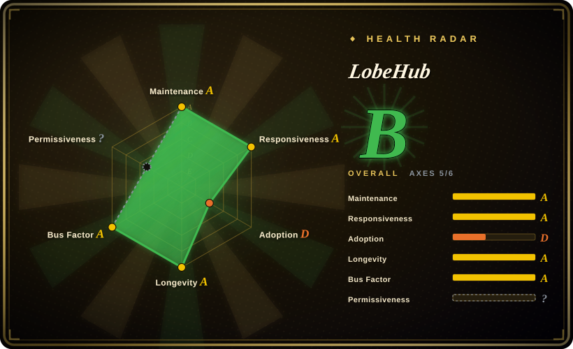
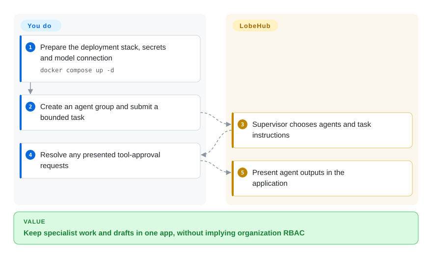
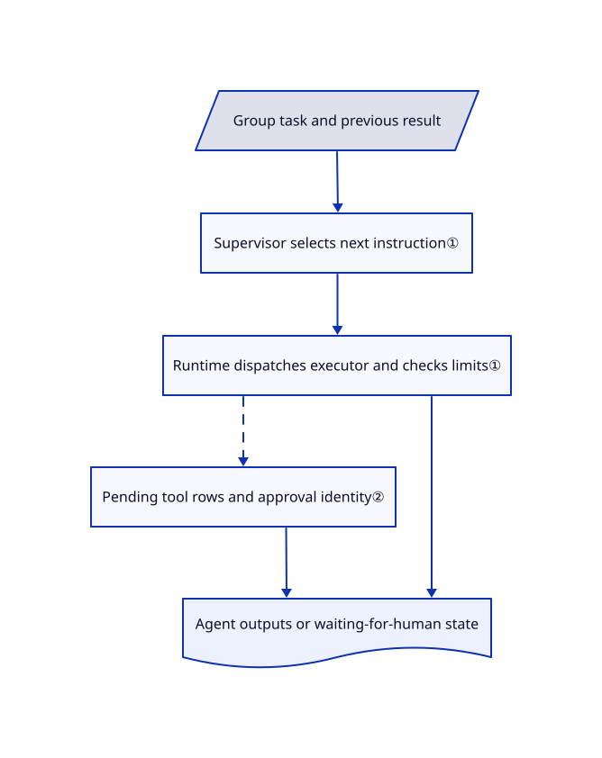

# LobeHub

Your model chats, specialist agents and drafts live in separate windows. LobeHub combines agent groups, pages and model connections in a self-hostable app, but the reviewed public build does not implement cloud Workspace role-based access control.

## When to use

You want more than a thin chat client: coordinate your own named agents, work on pages and call tools from one application. Choose LobeHub when those surfaces justify running databases, object storage and a gateway, and you do not require organization Workspace role governance from the public build. Agent groups, pages and tool approvals do not provide cloud Workspace RBAC. The former `lobehub/lobe-chat` repository redirects here; its current product is broader than the old chat frontend.

The reviewed public build resolves business-server imports to [OSS middleware](https://github.com/lobehub/lobehub/blob/94f32d6bda893628a70f6bdd7c88045efc25c72c/tsconfig.json#L19-L30): [RBAC gates](https://github.com/lobehub/lobehub/blob/94f32d6bda893628a70f6bdd7c88045efc25c72c/packages/business-server/src/trpc-middlewares/rbacPermission.ts#L3-L28) and [workspace-role checks](https://github.com/lobehub/lobehub/blob/94f32d6bda893628a70f6bdd7c88045efc25c72c/packages/business-server/src/trpc-middlewares/workspaceAuth.ts#L16-L38) pass through without checking roles. This is a known product-version boundary, not merely an untested deployment claim; it does not establish that every resource lacks user isolation.

## When NOT to use

- **Your organization needs enforced Workspace roles.** The reviewed OSS role middleware is a pass-through stub; `wsMemberProcedure` reuses the authenticated procedure, which is not a workspace-membership or role check. Evaluate [LibreChat](librechat.md) for its documented SSO, per-user storage and editable per-role permissions, or verify a commercial LobeHub contract before choosing that edition. Agent groups and tool approvals are not substitutes for organization RBAC.
- **You need unrestricted commercial forks.** The actual LICENSE requires a commercial license to develop and distribute commercial derivatives. Choose MIT [LibreChat](librechat.md) after checking its own dependencies; do not trust this repo's MIT package field or Apache badge over LICENSE.
- **You want a minimal browser-local chat client.** Choose [NextChat](nextchat.md); the reviewed Compose stack includes PostgreSQL, Redis, RustFS, a gateway and search services.
- **You mainly serve Ollama locally.** Choose [Open WebUI](open-webui.md) for its local-model-oriented start, noting its separate branding restrictions.
- **You plan to expose the Compose example unchanged.** Use an audited private deployment or managed LobeHub service instead. The example publishes database/cache ports, and its RustFS initialization command prints storage credentials into logs.

## Comparison

| Alternative | In index | Our verdict | Tradeoff |
|---|---|---|---|
| [NextChat](nextchat.md) | ✅ | Choose NextChat for a small private chat frontend; choose LobeHub for shared pages and orchestrated specialist agents. | Browser-local simplicity versus server state, gateway and object storage. |
| [LibreChat](librechat.md) | ✅ | Evaluate LibreChat when organization SSO, per-user storage and editable role permissions decide; choose public LobeHub for agent-group/page workflows only when cloud Workspace RBAC is not required. | Both are deployable multi-provider applications. LibreChat requires MongoDB; LobeHub adds its different storage/gateway stack, restrictive license and an OSS/Cloud Workspace-RBAC boundary. |
| [Open WebUI](open-webui.md) | ✅ | Choose Open WebUI for an Ollama-centered shared chat and document workflow; choose LobeHub for its agent-team workspace. | Both need license review; Open WebUI's branding clause and LobeHub's derivative restrictions are different obligations. |

## Quick start

Read the deployment Compose and environment files before using the README's remote setup script; this intake did not execute it. Configure model credentials, application/authentication secrets, database access and object-storage URLs, then start the prepared stack with `docker compose up -d`. Open the configured frontend, create an agent or group, and submit a bounded task using the selected model and tools. LobeHub handles the chat/group loop and presents results in the workspace; you pay model costs and operate persistence, authentication, tool access and backups. Pin images and remove unwanted published ports and secret logging before using real data.

<!-- flow-steps:begin (generated from flows/lobehub.json by tools/flow_card.py — do not edit) -->

Text version of the flow

1. **You**: Prepare the deployment stack, secrets and model connection — `docker compose up -d`
2. **You**: Create an agent group and submit a bounded task
3. **LobeHub**: Supervisor chooses agents and task instructions
4. **You**: Resolve any presented tool-approval requests
5. **LobeHub**: Present agent outputs in the application

**Value**: Keep specialist work and drafts in one app, without implying organization RBAC

<!-- flow-steps:end -->

## Key techniques

<!-- mechanism:begin (generated from mechanisms/lobehub.json by tools/mechanism_card.py; do not edit) -->

Text version of the mechanism

- Group task and previous result
- Supervisor selects next instruction①
- Runtime dispatches executor and checks limits①
- Pending tool rows and approval identity②
- Agent outputs or waiting-for-human state

- Group task and previous result → Supervisor selects next instruction①
- Supervisor selects next instruction① → Runtime dispatches executor and checks limits①
- Runtime dispatches executor and checks limits① → Pending tool rows and approval identity② [optional/fallback]
- Pending tool rows and approval identity② → Agent outputs or waiting-for-human state
- Runtime dispatches executor and checks limits① → Agent outputs or waiting-for-human state

<!-- mechanism:end -->

### 1. Separate group decisions from execution

- **Problem:** Multi-agent conversation needs a clear decision about who speaks or works next.
- **How:** A supervisor maps results into instructions such as one agent speaking, parallel broadcast, asynchronous tasks or finish. A separate runtime selects executors, clones state, tracks steps and checks cancellation; broadcast instructions disable tools by default.
- **Limits:** Model-led orchestration does not prove task correctness. Rounds and optional step limits bound execution, while the bundled gateway explicitly loses in-flight runs on restart.
- **Source:** [Supervisor](https://github.com/lobehub/lobehub/blob/94f32d6bda893628a70f6bdd7c88045efc25c72c/packages/agent-runtime/src/groupOrchestration/GroupOrchestrationSupervisor.ts#L48-L177), [runtime](https://github.com/lobehub/lobehub/blob/94f32d6bda893628a70f6bdd7c88045efc25c72c/packages/agent-runtime/src/groupOrchestration/GroupOrchestrationRuntime.ts#L47-L129), [gateway limitation](https://github.com/lobehub/lobehub/blob/94f32d6bda893628a70f6bdd7c88045efc25c72c/docker-compose/deploy/docker-compose.yml#L52-L57).

### 2. Persist tool-approval identity across pauses

- **Problem:** A partially approved batch can leave stale pending messages or resume the wrong operation.
- **How:** The approval executor emits a human-intervention event, stores pending calls in waiting state, and checks batch, operation and tool-call identity on resume. Missing durable tool rows or mixed identities raise explicit errors rather than silently rebinding.
- **Limits:** This explains the approval executor, not a guarantee that every plugin always needs approval or that connected devices are sandboxed.
- **Source:** [Approval executor](https://github.com/lobehub/lobehub/blob/94f32d6bda893628a70f6bdd7c88045efc25c72c/packages/agent-runtime/src/executors/humanApprove.ts#L30-L178).

## Tech stack

TypeScript monorepo with React, Next.js/Vite surfaces, database migrations and an extracted agent-runtime package. The deployment example uses ParadeDB/PostgreSQL 17, Redis 7, RustFS object storage, SearXNG and a separate LobeHub gateway; Elasticsearch is optional, not mandatory.

## Dependencies

Docker Compose or another supported deployment platform, model-provider access, persistent database/object volumes and suitable authentication secrets. Browser-accessible object and gateway URLs differ from internal container endpoints. Search and device integrations add their own network and trust boundaries.

## Ops difficulty

**High for a shared self-host.** Back up multiple stores, protect secrets, configure public/internal endpoints, test migrations and supervise gateways. The example's floating image tags and exposed infrastructure ports are starting configuration, not production hardening.

## Health & viability

- **2026-10-18:** created May 2023, with v2.2.20 published October 18 and canary/nightly activity alongside it. Several high-volume human contributors appear beside release automation.
- **Judgment:** over three years of continued work is stronger Lindy evidence than a new agent wrapper, but product expansion and rapid releases increase migration costs. Stars measure attention, not deployment safety.
- **License risk:** LICENSE is LobeHub Community License, not the manifest's MIT or the badge's Apache wording. It also reserves the producer's ability to change terms for contributors; treat licensing as a first-order product constraint.

## Caveats (unverified)

- [未验证：未运行整套部署] Upgrade safety, resource-level cross-user isolation, all plugin permissions and restart recovery were not reproduced. The known pass-through Workspace-role middleware does not by itself prove cross-user unauthorized access.
- [未验证：未逐功能对照托管版] Beyond the explicit OSS/Cloud Workspace-RBAC boundary above, remaining hosted/self-hosted feature differences were not exhaustively established; verify the contract of the edition you plan to deploy.
