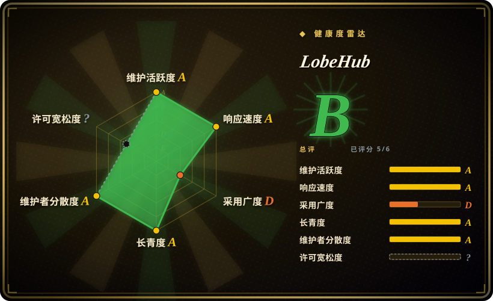
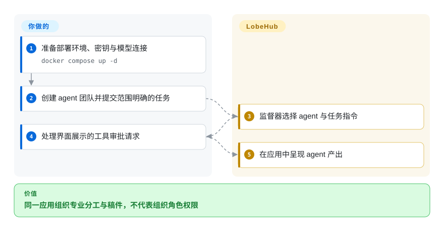
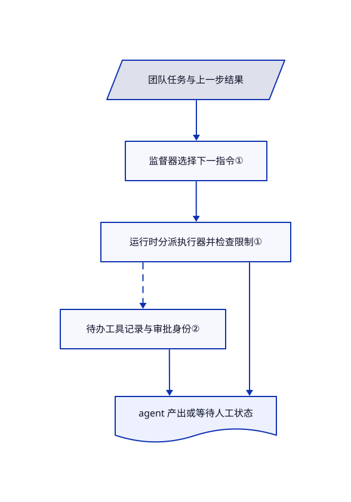

# LobeHub

模型聊天、专业 agent 和稿件分散在不同窗口。LobeHub 把团队、页面与模型连接集中到可自托管应用，但已读公开版本没有实现云端 Workspace 的角色权限控制。

## 何时使用

你不只需要轻量聊天界面，还想在同一应用协调自己的具名 agent、编辑页面与调用工具。这些界面值得你运维数据库、对象存储与网关，并且不要求公开版本提供组织 Workspace 角色治理时，选 LobeHub。agent 团队、页面与工具审批不等于云端 Workspace RBAC。旧地址 `lobehub/lobe-chat` 已重定向到此仓库；当前产品已超出旧聊天前端。

已读公开构建把业务服务导入[优先解析到 OSS 中间件](https://github.com/lobehub/lobehub/blob/94f32d6bda893628a70f6bdd7c88045efc25c72c/tsconfig.json#L19-L30)；其中 [RBAC 检查](https://github.com/lobehub/lobehub/blob/94f32d6bda893628a70f6bdd7c88045efc25c72c/packages/business-server/src/trpc-middlewares/rbacPermission.ts#L3-L28)与[工作区角色检查](https://github.com/lobehub/lobehub/blob/94f32d6bda893628a70f6bdd7c88045efc25c72c/packages/business-server/src/trpc-middlewares/workspaceAuth.ts#L16-L38)均直通，不核对角色。这是已知版本边界，不只是缺少部署实测；不能据此推断全部资源都没有用户隔离。

## 何时不用

- **组织需要强制执行 Workspace 角色。** 已读 OSS 角色中间件是直通占位实现；`wsMemberProcedure` 沿用已认证过程，不检查工作区成员身份或角色。先评估 [LibreChat](librechat.zh.md) 已描述的单点登录、按用户保存与可编辑角色权限，或核实商业 LobeHub 的版本契约后再选对应版本。agent 团队与工具审批不能替代组织 RBAC。
- **需要不受限制的商业 fork。** LICENSE 要求开发并分发商业衍生品时取得商业许可。核对依赖后可选 MIT 的 [LibreChat](librechat.zh.md)；不要用清单中的 MIT 或 Apache 徽章覆盖 LICENSE 实文。
- **只要极简浏览器本地聊天。** 选 [NextChat](nextchat.zh.md)；已读 Compose 包含 PostgreSQL、Redis、RustFS、网关与搜索服务。
- **主要在本地使用 Ollama。** 选启动路径偏本地模型的 [Open WebUI](open-webui.zh.md)，注意它另有品牌限制。
- **准备原样把 Compose 暴露公网。** 改用审定的私有部署或 LobeHub 托管服务。示例公开数据库和缓存端口，RustFS 初始化命令还会向日志打印存储凭据。

## 横向对比

| 替代品 | 是否收录 | 我们的评价 | 取舍 |
|---|---|---|---|
| [NextChat](nextchat.zh.md) | ✅ | 小型私人聊天前端选 NextChat；需要共享页面和专业 agent 编排，选 LobeHub。 | 浏览器本地的简单性，对比服务端状态、网关和对象存储。 |
| [LibreChat](librechat.zh.md) | ✅ | 组织单点登录、按用户保存与可编辑角色权限决定选型时，先评估 LibreChat；不要求云端 Workspace RBAC、只取团队和页面流程时，再选公开版 LobeHub。 | 两者都是可部署的多模型应用。LibreChat 需要 MongoDB；LobeHub 使用另一套存储和网关，并增加授权限制与 OSS／云端工作区角色边界。 |
| [Open WebUI](open-webui.zh.md) | ✅ | Ollama 为中心的共享聊天与文档流程选 Open WebUI；agent 团队工作区选 LobeHub。 | 都要审阅许可证；品牌条款与商业衍生限制是不同义务。 |

## 快速上手

先读 Compose 与环境文件，再决定是否使用 README 的远程初始化脚本；本次没有执行。配置模型凭据、应用与认证密钥、数据库和对象存储地址，再用 `docker compose up -d` 启动准备好的环境。打开配置后的前端，创建 agent 或团队，给选定模型与工具提交范围清楚的任务。LobeHub 运行聊天和团队循环，并在工作区呈现结果；模型费用、持久化、认证、工具权限和备份由你承担。使用真实数据前固定镜像版本，移除不需要的公开端口与凭据日志。

<!-- flow-steps:begin (generated from flows/lobehub.json by tools/flow_card.py — do not edit) -->

流程文字版

1. **你**：准备部署环境、密钥与模型连接 — `docker compose up -d`
2. **你**：创建 agent 团队并提交范围明确的任务
3. **LobeHub**：监督器选择 agent 与任务指令
4. **你**：处理界面展示的工具审批请求
5. **LobeHub**：在应用中呈现 agent 产出

**价值**：同一应用组织专业分工与稿件，不代表组织角色权限

<!-- flow-steps:end -->

## 技术要点

<!-- mechanism:begin (generated from mechanisms/lobehub.json by tools/mechanism_card.py; do not edit) -->

机制文字版

- 团队任务与上一步结果
- 监督器选择下一指令①
- 运行时分派执行器并检查限制①
- 待办工具记录与审批身份②
- agent 产出或等待人工状态

- 团队任务与上一步结果 → 监督器选择下一指令①
- 监督器选择下一指令① → 运行时分派执行器并检查限制①
- 运行时分派执行器并检查限制① → 待办工具记录与审批身份②〔可选／兜底〕
- 待办工具记录与审批身份② → agent 产出或等待人工状态
- 运行时分派执行器并检查限制① → agent 产出或等待人工状态

<!-- mechanism:end -->

### 1. 把团队决策与执行分开

- **解决：** 多 agent 对话需要明确决定下一步由谁发言或执行任务。
- **做法：** 监督器把结果转为单人发言、并行广播、异步任务或结束指令。独立运行时选择执行器、复制状态、计步并检查取消；广播指令默认关闭工具。
- **边界：** 模型驱动编排不证明结果正确。轮数和可选步数限制只约束运行，随附网关还明确说明重启会丢失进行中的任务。
- **源码：** [监督器](https://github.com/lobehub/lobehub/blob/94f32d6bda893628a70f6bdd7c88045efc25c72c/packages/agent-runtime/src/groupOrchestration/GroupOrchestrationSupervisor.ts#L48-L177)、[运行时](https://github.com/lobehub/lobehub/blob/94f32d6bda893628a70f6bdd7c88045efc25c72c/packages/agent-runtime/src/groupOrchestration/GroupOrchestrationRuntime.ts#L47-L129)、[网关限制](https://github.com/lobehub/lobehub/blob/94f32d6bda893628a70f6bdd7c88045efc25c72c/docker-compose/deploy/docker-compose.yml#L52-L57)。

### 2. 暂停后保留工具审批身份

- **解决：** 部分批准的工具批次，可能留下过期待办消息或恢复到错误操作。
- **做法：** 审批执行器发出人工介入事件，把待办调用存入等待状态，恢复时核对批次、操作和调用身份。持久工具记录缺失或身份混杂会明确报错，不会悄悄重新绑定。
- **边界：** 这里只解释审批执行器，不保证每个插件都必须审批，也不证明连接设备有沙箱隔离。
- **源码：** [审批执行器](https://github.com/lobehub/lobehub/blob/94f32d6bda893628a70f6bdd7c88045efc25c72c/packages/agent-runtime/src/executors/humanApprove.ts#L30-L178)。

## 技术栈

TypeScript 单仓库，包含 React、Next.js/Vite 界面、数据库迁移与独立 agent-runtime 包。部署示例使用 ParadeDB/PostgreSQL 17、Redis 7、RustFS 对象存储、SearXNG 与独立 LobeHub 网关；Elasticsearch 是可选项。

## 依赖

Docker Compose 或其他受支持部署平台、模型访问、数据库与对象存储持久卷，以及认证密钥。浏览器可访问的对象和网关地址，与容器内地址不同。搜索和设备集成另有网络与信任边界。

## 运维难度

**共享自托管高。** 要备份多个存储、保护密钥、配置内外地址、验证迁移并托管网关。示例中的浮动镜像标签与公开基础设施端口只是起始配置，不是生产加固。

## 健康度与可持续性

- **截至 2026-10-18：** 仓库建于 2023 年 5 月，当日发布 v2.2.20，同时有 canary 和 nightly 活动。发布机器人之外，有多位高提交量人工贡献者。
- **判断：** 三年多持续开发，比新 agent 包装器提供更强的长期存续证据；产品扩展和快速发布也增加迁移成本。星数表示关注，不证明部署安全。
- **许可风险：** LICENSE 是 LobeHub Community License，不是清单的 MIT 或徽章的 Apache。实文还保留生产者调整贡献者条款的权利，应把授权作为首要产品约束。

## 存疑（未验证）

- [未验证：未运行整套部署] 未复现升级安全、资源级跨用户隔离、全部插件权限与重启恢复。已知工作区角色中间件直通，不足以单独证明存在跨用户越权。
- [未验证：未逐功能对照托管版] 除上文明确的 OSS／云端工作区角色边界外，未穷尽其他版本差异；应核对实际部署版本的契约。
