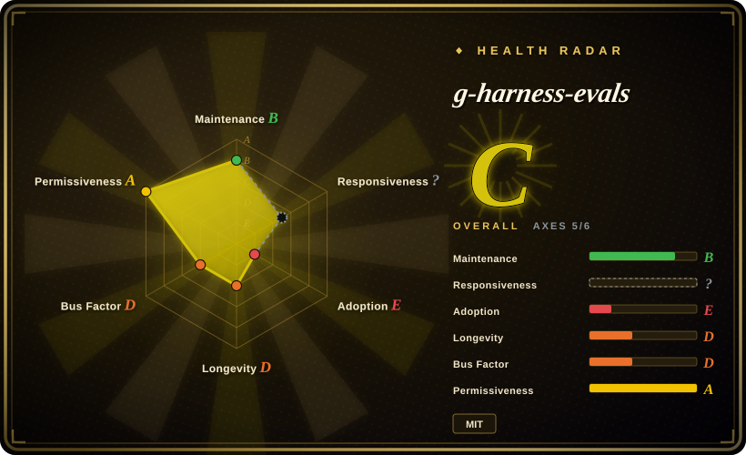
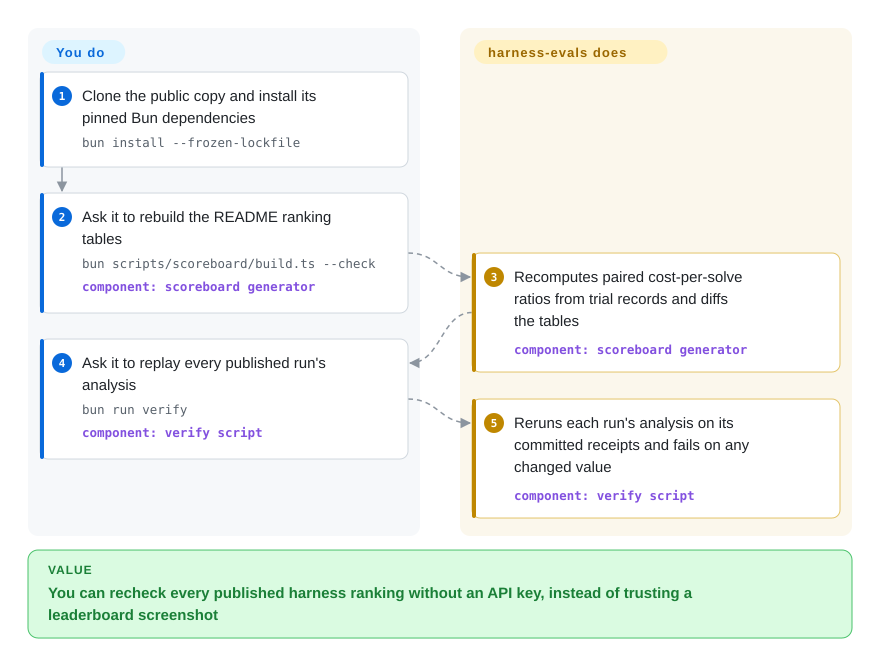
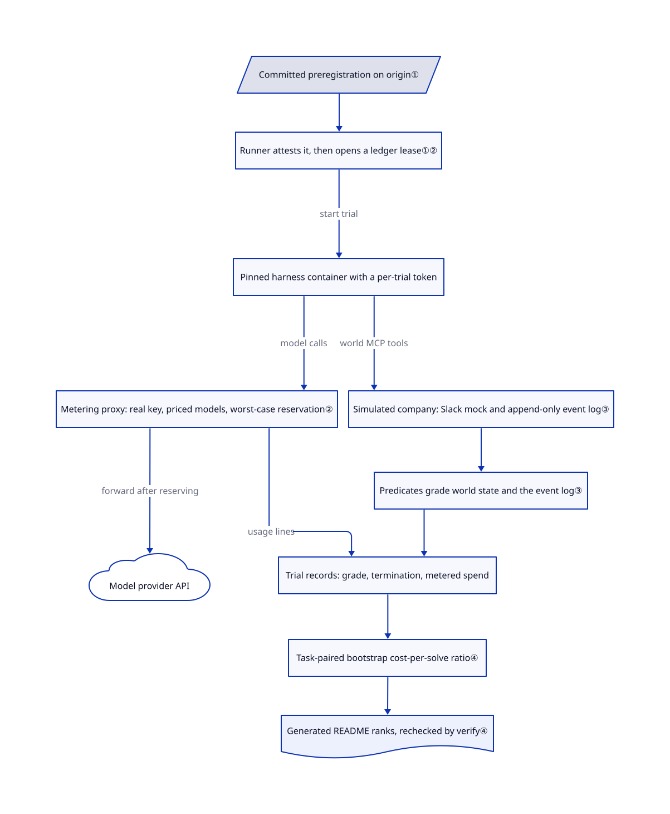

# g-harness-evals

You are about to standardize on Claude Code, Codex, OpenClaw, Hermes Agent or Pi for a team, and every comparison you find mixes models, tasks and prices, so you cannot tell whether the wrapper or the model made the difference. This repository holds the model fixed, swaps only the harness — the program around the model — and publishes pass rate and cost per solved task with every trial record, so you can recheck the ranking yourself.

## When to use

You lead a platform team that pays for agent tokens, and the argument is "OpenClaw is smarter" versus "Claude Code is cheaper". Nobody has numbers on the same model and the same tasks. The harness-evals README answers that narrow question for its pinned versions. On 20 multi-user tasks with Opus 5.5, OpenClaw cost $0.44 per solved task against $0.19–$0.24 for QM, Claude Code and Hermes Agent. On 52 Terminal-Bench 2.1 coding tasks, five of six harnesses passed within 15 points of the model's own harness. You read the rankings, open the linked findings, and rerun `bun run verify` to confirm that the published numbers come from the committed receipts.

Pick it over a model leaderboard such as [SWE-bench](swe-bench.md) when the decision is the harness, not the model. Pick it over a general framework such as Inspect AI when you want finished, preregistered results with cost metering and need not build your own test rig. The deciding tradeoff: you inherit one author's task sets, pinned versions and statistical rules in exchange for a cost-per-solve comparison that is unusually auditable. It also contains practical findings about rule placement: on Claude Code, a skill nobody named was opened 0 times in 30 turns, while a rule in the system prompt reached 30 of 30 turns.

## When NOT to use

- **You want to test your own agent, prompts or app in CI.** Use [promptfoo](../app-evals/promptfoo.md) and write your own cases. harness-evals ranks off-the-shelf harnesses on its fixed tasks, and adding a harness requires the adapter contract plus Docker image and a preregistration; it is not a test runner for your product.
- **You are choosing a model, not a harness.** Use [SWE-bench](swe-bench.md) or a model leaderboard. Here the model stays fixed (Opus 5.5 or GPT-6.1 Sol) and the README never compares Claude Code with Codex, because they cannot run the same model.
- **You need Terminal-Bench scores for an agent of your own.** Use Harbor (not indexed), the runner these coding cells used for Terminal-Bench 2.1. harness-evals adds metering, preregistration and ranking on top, but only for the harness pins that the author registered.
- **You will act on results for different versions, harder tasks or another model.** Every number applies to pinned releases (for example OpenClaw 2026.10.6 and Pi 1.5.0). The ranked task sets are public "dev" tasks that the author could see while building. On the multi-user set, 14 of 20 tasks scored the same in every cell, so pass-rate gaps under 7.7–14.2 points can hide. Run your own work through a cost-per-solve comparison before standardizing.
- **You need an evaluator with no stake in the result.** The repository and evaluation are run by Garry Tan. gstack, gbrain and gbrain-evals are his projects, QM is a Y Combinator project, and YC invests in Hermes and Particle. The README discloses this and publishes receipts, but an independent rerun is the only evidence free of that conflict.
- **You want to rerun paid cells on a Mac or rerun any cell.** The paid replication tool refuses macOS (its metering proxy binds the Linux Docker bridge), needs Linux x86_64, Docker, 20 GB free and your provider key, and reruns only registered held-out runs. It does not rerun gbrain or QM cells, sealed sets or dev-only runs such as the multi-user matrix. Use `--reanalyze` and `--estimate-only` for those, or Harbor for your own Terminal-Bench runs.
- **You expect a normal community project.** This is a public export of a private repository. `private/` and planning files are left out, the public issues (5 open, 2026-11-08 to 2026-11-09) had no maintainer reply when checked, and a list of maintainer-only areas will not accept outside pull requests. Treat it as a published study, not a shared framework.

## Comparison

| Alternative | In index | Our verdict | Tradeoff |
|---|---|---|---|
| [SWE-bench](swe-bench.md) | ✅ | Choose SWE-bench to compare models or agents on real GitHub issues with repository tests; choose harness-evals when the model stays fixed and you want to know which wrapper solves for less money. | SWE-bench gives a widely cited task set and test-based grading, but no cost metering or harness-only controls; harness-evals adds metered cost and paired ratios but covers a few pinned harnesses on its own task mix. |
| Harbor (`harbor-framework/harbor`) | not indexed | Choose Harbor to run Terminal-Bench-style tasks against your own agent; choose harness-evals to read preregistered, cost-ranked results for the harnesses it already pinned. | Harbor is a general runner that you operate; harness-evals is one study built partly on it, with adapters, a proxy and statistics you would have to rebuild. Not added in this tab batch. |
| Inspect AI (`UKGovernmentBEIS/inspect_ai`) | not indexed | Choose Inspect AI when you must author your own agent evaluations with custom solvers and scorers; choose harness-evals when the question is already "which off-the-shelf harness costs least per solve". | Inspect AI gives full flexibility and an active framework, but no harness pins or published cost ranking; harness-evals gives the ranking but little reuse outside its own experiments. Not added in this tab batch. |
| gbrain-evals (`garrytan/gbrain-evals`) | not indexed | Choose gbrain-evals to evaluate agent memory systems on its simulated company; choose harness-evals to compare the harnesses that drive a model inside that company. | Same author and world data. gbrain-evals focuses on memory retrieval, while harness-evals reuses its statistics kit, proxy and ledger for harness comparisons. Not added in this tab batch. |
| [promptfoo](../app-evals/promptfoo.md) | ✅ | Choose promptfoo to gate your own prompts and agent outputs in CI; choose harness-evals to decide which agent harness to adopt before you write those tests. | promptfoo is lightweight and runs on your cases; harness-evals is a heavy, fixed study whose results do not cover your workload. |

## Quick start

To check the published numbers without an API key, install [Bun](https://bun.sh/) and git, clone `https://github.com/garrytan/g-harness-evals.git`, and run `bun install --frozen-lockfile`. `bun scripts/scoreboard/build.ts --check` rebuilds the README ranking tables from committed results, and `bun run verify` replays every published run's analysis — the scripts that turn raw trials into tables — on its committed receipts in a scratch copy. Each command exits non-zero if a published number differs. The full keyless test suite (`bun test tests/`) takes about 25 minutes on a 4-core machine. Paid replication is a separate tool. `bun scripts/replicate.ts` with your key and a hard `--max-usd` cap reruns one registered held-out cell, then prints `WITHIN BAND`, `OUTSIDE BAND`, `NO BAND` or `INCOMPLETE`. You supply the machine, the provider key and the judgment about whether these tasks resemble your work; the project supplies tasks, pinned harness images, metering, grading and the statistics. None of these commands were executed for this page.

<!-- flow-steps:begin (generated from flows/g-harness-evals.json by tools/flow_card.py — do not edit) -->

Text version of the flow

1. **You**: Clone the public copy and install its pinned Bun dependencies — `bun install --frozen-lockfile`
2. **You**: Ask it to rebuild the README ranking tables — `bun scripts/scoreboard/build.ts --check` — component: `scoreboard generator`
3. **g-harness-evals**: Recomputes paired cost-per-solve ratios from trial records and diffs the tables — component: `scoreboard generator`
4. **You**: Ask it to replay every published run's analysis — `bun run verify` — component: `verify script`
5. **g-harness-evals**: Reruns each run's analysis on its committed receipts and fails on any changed value — component: `verify script`

**Value**: You can recheck every published harness ranking without an API key, instead of trusting a leaderboard screenshot

<!-- flow-steps:end -->

## Key techniques

<!-- mechanism:begin (generated from mechanisms/g-harness-evals.json by tools/mechanism_card.py; do not edit) -->

Text version of the mechanism

- Committed preregistration on origin①
- Runner attests it, then opens a ledger lease①②
- Pinned harness container with a per-trial token
- Metering proxy: real key, priced models, worst-case reservation②
- Model provider API
- Simulated company: Slack mock and append-only event log③
- Predicates grade world state and the event log③
- Trial records: grade, termination, metered spend
- Task-paired bootstrap cost-per-solve ratio④
- Generated README ranks, rechecked by verify④

- Committed preregistration on origin① → Runner attests it, then opens a ledger lease①②
- Runner attests it, then opens a ledger lease①② → Pinned harness container with a per-trial token (start trial)
- Pinned harness container with a per-trial token → Metering proxy: real key, priced models, worst-case reservation② (model calls)
- Metering proxy: real key, priced models, worst-case reservation② → Model provider API (forward after reserving)
- Pinned harness container with a per-trial token → Simulated company: Slack mock and append-only event log③ (world MCP tools)
- Simulated company: Slack mock and append-only event log③ → Predicates grade world state and the event log③
- Metering proxy: real key, priced models, worst-case reservation② → Trial records: grade, termination, metered spend (usage lines)
- Predicates grade world state and the event log③ → Trial records: grade, termination, metered spend
- Trial records: grade, termination, metered spend → Task-paired bootstrap cost-per-solve ratio④
- Task-paired bootstrap cost-per-solve ratio④ → Generated README ranks, rechecked by verify④

<!-- mechanism:end -->

### 1. Preregistration enforced by git, not by promise

- **Problem:** An evaluator who chooses tests after seeing results can make any harness win.
- **How:** Before its first paid request, the runner refuses unless the preregistration file is committed, clean in the worktree and contained in a commit on `origin`; it writes that attestation into the receipt. CI then checks that each preregistration commit is a strict ancestor of the commit that first added each result file.
- **Limits:** The public history was rebuilt from private squash merges, so experiments merged before the cutover are labeled "ordering attested privately, not publicly verifiable". Commit order also cannot prove that the author did not look at the public dev tasks.
- **Source:** [Order rules:1–30](https://github.com/garrytan/g-harness-evals/blob/f4dc3dff41f1edc39beedfbe71b50cb0245209d7/runner/prereg/prereg.ts#L1-L30), [runtime attestation:131–150](https://github.com/garrytan/g-harness-evals/blob/f4dc3dff41f1edc39beedfbe71b50cb0245209d7/runner/prereg/prereg.ts#L131-L150).

### 2. One metering proxy holds the key and reserves the worst case

- **Problem:** Cost-per-solve comparisons are worthless if one harness's calls are missed or a runaway trial overspends.
- **How:** In lease mode, the proxy strips incoming credentials, injects the real provider key, accepts only bound trial slots presenting a random per-trial token, forwards only priced, allowed models, and reserves each request's worst case on the budget ledger before forwarding. Each request writes one usage line without its body or key.
- **Limits:** A stream that ends without usage keeps its reservation, which overstated costs until the 2026-11-09 correction removed those charges. A 15-second egress cut on Hermes's slow calls required another correction on 2026-11-10. Prices are list prices, not your negotiated rates.
- **Source:** [Proxy contract:1–60](https://github.com/garrytan/g-harness-evals/blob/f4dc3dff41f1edc39beedfbe71b50cb0245209d7/runner/proxy/metering-proxy.ts#L1-L60), [paid-rerun key isolation](https://github.com/garrytan/g-harness-evals/blob/f4dc3dff41f1edc39beedfbe71b50cb0245209d7/docs/replicate.md).

### 3. Grade the simulated world, not the agent's reply

- **Problem:** An agent can claim "I told Dana" without doing it, or leak a private note while sounding polite.
- **How:** Multi-user tasks run inside a simulated company with a Slack mock and clock; each tool call appends one line to an evaluator-owned event log that the agent never sees. Predicates read that log, the turn windows and a world snapshot, so a reverted forbidden action still fails; any reply rubric is reported separately.
- **Limits:** The rig itself can be wrong. Until a 2026-11-09 amendment, the runner posted each harness's closing wrap-up as an extra bot message and graded it, failing some correct runs. Harnesses without per-user scoping fail the isolation predicates by construction.
- **Source:** [Event log:1–30](https://github.com/garrytan/g-harness-evals/blob/f4dc3dff41f1edc39beedfbe71b50cb0245209d7/world/services/events.ts#L1-L30), [predicate rule:1–3](https://github.com/garrytan/g-harness-evals/blob/f4dc3dff41f1edc39beedfbe71b50cb0245209d7/runner/grade/predicates.ts#L1-L3), [grading contract and amendment](https://github.com/garrytan/g-harness-evals/blob/f4dc3dff41f1edc39beedfbe71b50cb0245209d7/docs/methodology.md).

### 4. Rank by a paired cost ratio, generated rather than typed

- **Problem:** Raw cost columns invite false rankings when intervals overlap or the harnesses scored different tasks.
- **How:** For each pair on the same model, it compares cost per solve only on tasks both scored and resamples tasks with replacement to get a 95% range. A harness's rank is one plus the number of harnesses whose ratio against it lies wholly below 1. Generated markers hold the README tables, and a test fails on a hand edit.
- **Limits:** The range describes the data and is not a preregistered test. Ranks can tie or skip, and with few tasks a single expensive task can still move a ratio. `verify` confirms arithmetic over the receipts, not the task design.
- **Source:** [Rank rule:256–274](https://github.com/garrytan/g-harness-evals/blob/f4dc3dff41f1edc39beedfbe71b50cb0245209d7/scripts/scoreboard/build.ts#L256-L274), [paired bootstrap:92–117](https://github.com/garrytan/g-harness-evals/blob/f4dc3dff41f1edc39beedfbe71b50cb0245209d7/runner/stats/frontier.ts#L92-L117), [verify script:1–12](https://github.com/garrytan/g-harness-evals/blob/f4dc3dff41f1edc39beedfbe71b50cb0245209d7/scripts/verify/verify.ts#L1-L12).

## Tech stack

- **Runner and tooling:** TypeScript on Bun 1.4.3 (`packageManager` pin). About 16.8k lines in `runner/` (trial loop, metering proxy, budget ledger, price table, grader and statistics kit), 4.2k in `world/`, and 72k lines of tests at the reviewed commit.
- **Runtime libraries:** `@modelcontextprotocol/sdk` for the world MCP server every harness receives, `zod` for schemas, and `age-encryption` for sealed held-out task custody.
- **Harnesses:** one Docker image per harness under `harnesses/<name>/`, with a `pin.json` (npm integrity or commit), an `adapter.sh` with `run` (single turn) and `serve` (multi-user) modes, and non-interactive config.
- **Python:** GitHub's language bar says Python, but almost all Python lines are in `tasks/` fixtures and `scripts/` (including Harbor-side agent shims); the evaluation runner itself is TypeScript.

## Dependencies

- **Rechecking results:** Bun, git and Python 3 (for the link checker). No model key or Docker. A full clone is large: GitHub reports about 655 MB, and the replication guide cites a 1.5 GB working tree.
- **Paid reruns:** Linux x86_64, Docker, about 20 GB free, a clean checkout at the finding's rerun commit, the cell's provider key, and the trial bundle archive. Your key stays in the proxy's environment, while containers receive only a proxy URL and a per-trial token.
- **Full matrix runs:** maintainer infrastructure, including cloud shards (`run-shard.sh`, `ubicloud/`) and the program budget ledger in the private repository. Outsiders cannot reproduce that infrastructure as published.

## Ops difficulty

**Low to recheck, high to extend.** Reading the README and running `verify` needs no service, but the full suite takes about 25 minutes and the clone is heavy. Adding a harness means writing an adapter against the fake-harness conformance test, pinning it, proving `serve` live, then preregistering before any counted cell. Paid reruns cost real money; for example, the guide estimates $3.47 for a single-rep, 20-trial OpenClaw cell. They also require Linux and Docker hygiene, plus disciplined use of `--max-usd`, `--resume` and drift labels. Results also age quickly: each new harness release or model generation creates a new run rather than an update.

## Health & viability

- **Maintenance (checked 2026-11-18):** very active. The public repository was created on 2026-11-05, its imported history starts on 2026-10-22, and the latest push was on 2026-11-16. The public CI and public-safety workflows passed on that push. No tags or GitHub releases exist; the `VERSION` file (0.0.136) increases with each merged change.
- **Governance and bus factor:** one contributor account (`garrytan`, 412 commits), owned by a personal account. Many commit titles reference an "internal-task" process. [Inference: based on commit titles and cadence] Much of the work appears agent-assisted, with one person owning the roadmap.
- **Age and Lindy:** under one month public and under one month of history. That provides no Lindy prior. Treat it as a fast-moving study whose task sets, corrections and rankings will keep changing.
- **Adoption and responsiveness:** 158 stars and 11 forks (2026-11-18). The 5 outside issues and a DeepSeek-harness pull request, all from 2026-11-08 to 2026-11-09, had no maintainer comment when checked.
- **Risk flags:** a declared conflict of interest (author's own gstack, gbrain and QM, plus YC investments); a public copy that omits private material and contains docs pointing to it; a corrections log listing about 18 dated corrections or deviations from 2026-10-23 to 2026-11-13, including four defects found on 2026-11-09 that biased published rows. That openness is a strength, but early numbers move. License is truthful and layered: code MIT, reports and data CC BY 4.0, captured harness prompts under their upstream licenses, and Claude Code prompts published only as hashes and short quotations.

## Caveats (unverified)

- [Unverified: no Bun install or test run was authorized for this review] `bun install --frozen-lockfile`, `scoreboard/build.ts --check`, `bun run verify` and `replicate.ts` were read in source and docs, not executed. Their runtimes come from the upstream docs.
- [Unverified: requires paid model calls] Every pass rate, cost and rank on this page is the author's measurement; this review did not reproduce any trial.
- [Inference: based on commit titles mentioning "internal-task" and the commit rate] The share of agent-authored changes, and whether a second person reviews them, is not stated.
- [Unverified: the private history is not public] Preregistration order for experiments before the public cutover is attested privately; the public prereg check labels those runs as not publicly verifiable.
- [Inference: based on line counts per directory at commit f4dc3dff] Python dominates GitHub's language bar because of task fixtures and Harbor-side scripts, not the runner; the frontmatter therefore names TypeScript.
- [Unverified: names and prices as listed at run time] Model names (Opus 5.5, GPT-6.1 Sol, Fable 5.2, particle-1) and list prices are those of the pinned runs and will be superseded by later generations.
