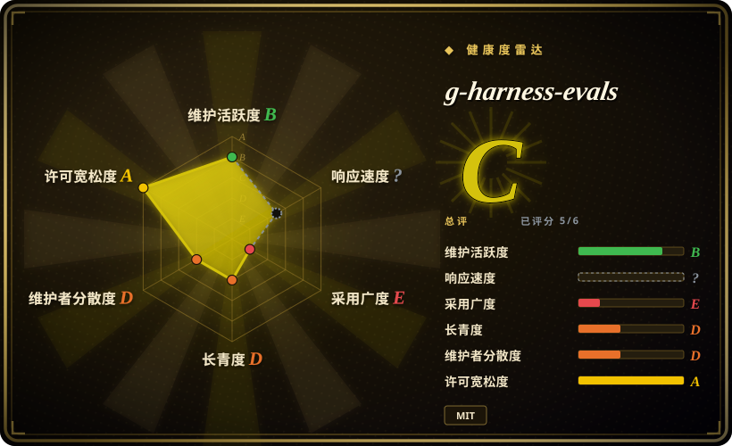
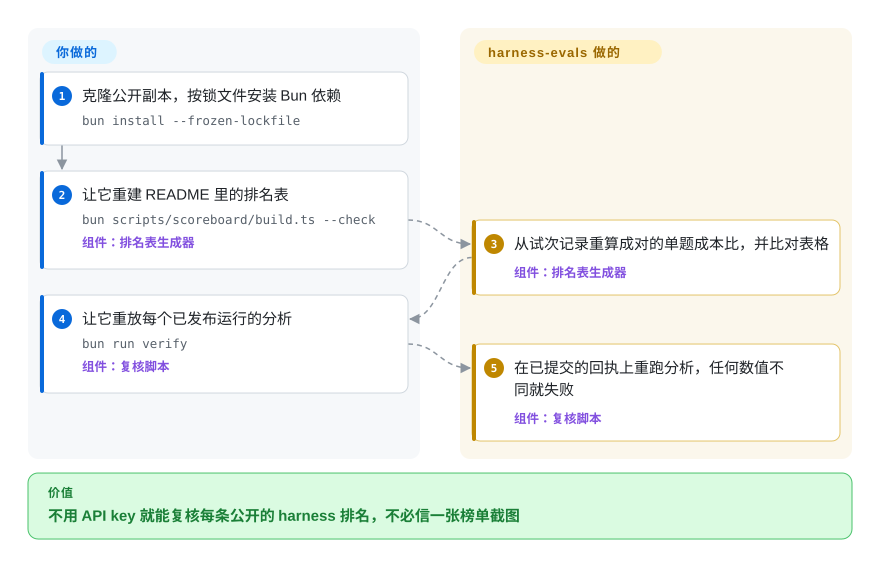
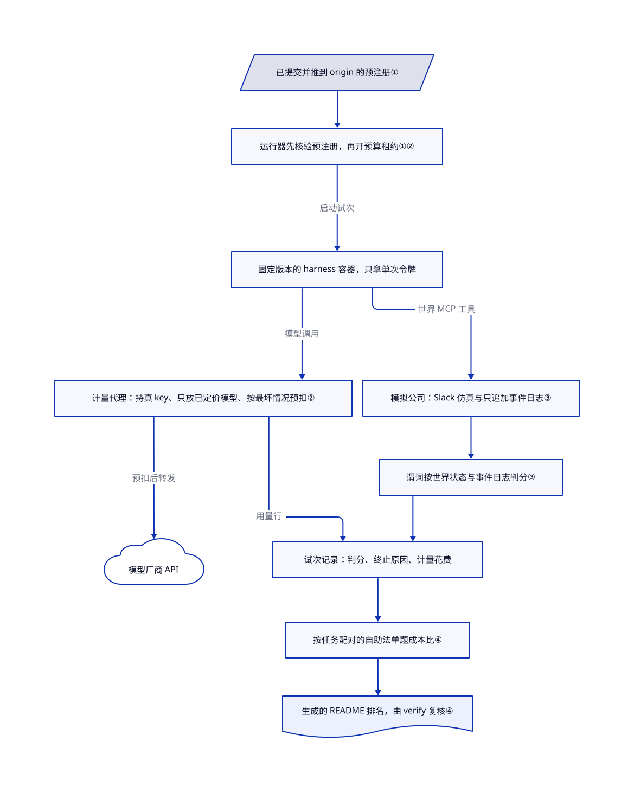

# g-harness-evals

团队要在 Claude Code、Codex、OpenClaw、Hermes Agent、Pi 里定一个，可网上的对比把模型、任务、价格混在一起，分不清差距来自外壳还是模型。这个仓库固定模型、只换 harness（包在模型外面的那层程序），公开每题通过率和“每解出一题花多少钱”，连同每次试跑的原始记录，让你自己复核排名。

## 何时使用

你带一个平台团队，agent 的 token 账单由你来付，组里在争“OpenClaw 更聪明”还是“Claude Code 更省钱”，却没人拿得出同模型、同任务下的数字。harness-evals 的 README 恰好回答这个窄问题，只对其固定的版本成立：在 20 个多用户任务上用 Opus 5.5，OpenClaw 每解出一题 0.44 美元，QM、Claude Code、Hermes Agent 在 0.19 到 0.24 美元之间；在 52 个 Terminal-Bench 2.1 编码任务上，六个组合里有五个的通过率与该模型的自家 harness 相差不超过 15 个百分点。你读排名表，点开对应的 finding，再跑一次 `bun run verify`，确认公布的数字确实出自已提交的回执。

当要决定的是 harness 而不是模型时，选它而不是 [SWE-bench](swe-bench.zh.md) 这类模型榜；当你要的是现成、预先登记过方案、带成本计量的结论，而不想自己搭评测台时，选它而不是 Inspect AI 这类通用框架。决定性的取舍是：你接受一位作者定的任务集、固定版本和统计规则，换来一份异常可审计的“每题成本”对比。它还附带一些关于规则放哪儿的实用发现，例如在 Claude Code 上，没人点名的 skill 在 30 轮里被打开 0 次，而写进系统提示词的规则 30 轮都生效。

## 何时不用

- **你要在 CI 里测自己的 agent、提示词或应用。** 用 [promptfoo](../app-evals/promptfoo.zh.md) 自己写用例。harness-evals 是在它自己的固定任务上给现成 harness 排名，加一个 harness 要写适配器、做 Docker 镜像、再做预注册，它不是给你产品用的测试工具。
- **你要选的是模型，不是 harness。** 用 [SWE-bench](swe-bench.zh.md) 或模型排行榜。这里模型是固定的（Opus 5.5 或 GPT-6.1 Sol），README 也从不拿 Claude Code 和 Codex 互比，因为两者跑不了同一个模型。
- **你要给自己的 agent 跑 Terminal-Bench 分数。** 用 Harbor（未收录），这批编码任务就是用它跑的 Terminal-Bench 2.1。harness-evals 在其上加了计量、预注册和排名，但只覆盖作者登记过的 harness 版本。
- **你要把结论用到别的版本、更难的任务或别的模型上。** 每个数字只对固定版本成立（例如 OpenClaw 2026.10.6、Pi 1.5.0）；参与排名的任务是作者开发时就能看到的公开“dev”任务；多用户任务集里 20 题有 14 题在所有组合上得分相同，7.7 到 14.2 个百分点以内的通过率差距可能看不出来。定标准之前，拿你自己的工作做一次每题成本对比。
- **你需要一个与结果无利益关系的评测者。** 仓库和评测都由 Garry Tan 主持；gstack、gbrain、gbrain-evals 是他自己的项目，QM 是 Y Combinator 的项目，YC 还投了 Hermes 和 Particle。README 对此都有披露并公开了回执，但只有独立复跑才能排除这层利益关系。
- **你想在 Mac 上复跑付费组合，或复跑任意组合。** 付费复跑工具会拒绝 macOS（计量代理要绑定 Linux 的 Docker 网桥），需要 Linux x86_64、Docker、20 GB 空闲磁盘和你自己的厂商 key，而且只复跑已登记的 held-out 运行；gbrain、QM 组合、封存集和多用户矩阵这类只有 dev 的运行都不复跑。这些情况只能用 `--reanalyze` 和 `--estimate-only`，或者用 Harbor 跑你自己的 Terminal-Bench。
- **你以为它是一个常规社区项目。** 它是私有仓库的公开导出：`private/` 和规划文件被删去；截至查看时，5 个公开 issue（2026-11-08 至 2026-11-09）都没有维护者回复；还有一份“仅维护者”清单，外部 PR 改到这些部分一律不收。把它当作一份公开发表的研究，而不是共建框架。

## 横向对比

| 替代品 | 是否收录 | 我们的评价 | 取舍 |
|---|---|---|---|
| [SWE-bench](swe-bench.zh.md) | ✅ | 要在真实 GitHub issue 上用仓库测试比较模型或 agent，选 SWE-bench；模型固定、想知道哪个外壳解题更省钱，选 harness-evals。 | SWE-bench 任务集引用广、靠测试判分，但不计成本、也不控制只换 harness；harness-evals 有计量成本和成对比值，但只覆盖少数固定 harness 和它自己的任务组合。 |
| Harbor（`harbor-framework/harbor`） | 未收录 | 要对自己的 agent 跑 Terminal-Bench 类任务，选 Harbor；要读现成的、预注册过且按成本排序的结论，选 harness-evals。 | Harbor 是要你自己运维的通用运行器；harness-evals 是部分建在它上面的一项研究，它的适配器、代理和统计你得自己重做。本批未收录。 |
| Inspect AI（`UKGovernmentBEIS/inspect_ai`） | 未收录 | 要自己编写带自定义 solver 和 scorer 的 agent 评测，选 Inspect AI；问题已经是“哪个现成 harness 每题最便宜”，选 harness-evals。 | Inspect AI 灵活、框架活跃，但没有固定的 harness 版本和公开的成本排名；harness-evals 给出排名，但出了它自己的实验就很难复用。本批未收录。 |
| gbrain-evals（`garrytan/gbrain-evals`） | 未收录 | 要在模拟公司里评测 agent 的记忆系统，选 gbrain-evals；要比较在同一家公司里驱动模型的 harness，选 harness-evals。 | 同一作者、同一份世界数据；gbrain-evals 关注记忆检索，harness-evals 复用了它的统计工具、代理和预算账本来比较 harness。本批未收录。 |
| [promptfoo](../app-evals/promptfoo.zh.md) | ✅ | 要在 CI 里卡住自己的提示词和 agent 输出，选 promptfoo；写这些测试之前先决定用哪个 agent harness，选 harness-evals。 | promptfoo 轻量、跑你自己的用例；harness-evals 是一份重型、固定的研究，结论不覆盖你的工作负载。 |

## 快速上手

不需要 API key 就能复核已公布的数字：装好 [Bun](https://bun.sh/) 和 git，克隆 `https://github.com/garrytan/g-harness-evals.git`，运行 `bun install --frozen-lockfile`。`bun scripts/scoreboard/build.ts --check` 从已提交的结果重建 README 排名表；`bun run verify` 把每个已发布运行的分析（把原始试次变成表格的那些脚本）放在临时副本里，基于已提交的回执重跑一遍。任何公布数字对不上，两条命令都以非零状态退出。完整的免 key 测试（`bun test tests/`）在 4 核机器上约需 25 分钟。付费复跑是另一件工具：`bun scripts/replicate.ts` 用你的 key 加一个硬性上限 `--max-usd`，复跑一个已登记的 held-out 组合，最后打印 `WITHIN BAND`、`OUTSIDE BAND`、`NO BAND` 或 `INCOMPLETE`。机器、厂商 key，以及“这些任务像不像你的工作”的判断由你负责；任务、固定版本的 harness 镜像、计量、判分和统计由项目提供。本页没有实际执行这些命令。

<!-- flow-steps:begin (generated from flows/g-harness-evals.json by tools/flow_card.py — do not edit) -->

流程文字版

1. **你**：克隆公开副本，按锁文件安装 Bun 依赖 — `bun install --frozen-lockfile`
2. **你**：让它重建 README 里的排名表 — `bun scripts/scoreboard/build.ts --check` — 组件：`排名表生成器`
3. **g-harness-evals**：从试次记录重算成对的单题成本比，并比对表格 — 组件：`排名表生成器`
4. **你**：让它重放每个已发布运行的分析 — `bun run verify` — 组件：`复核脚本`
5. **g-harness-evals**：在已提交的回执上重跑分析，任何数值不同就失败 — 组件：`复核脚本`

**价值**：不用 API key 就能复核每条公开的 harness 排名，不必信一张榜单截图

<!-- flow-steps:end -->

## 技术要点

<!-- mechanism:begin (generated from mechanisms/g-harness-evals.json by tools/mechanism_card.py; do not edit) -->

机制文字版

- 已提交并推到 origin 的预注册①
- 运行器先核验预注册，再开预算租约①②
- 固定版本的 harness 容器，只拿单次令牌
- 计量代理：持真 key、只放已定价模型、按最坏情况预扣②
- 模型厂商 API
- 模拟公司：Slack 仿真与只追加事件日志③
- 谓词按世界状态与事件日志判分③
- 试次记录：判分、终止原因、计量花费
- 按任务配对的自助法单题成本比④
- 生成的 README 排名，由 verify 复核④

- 已提交并推到 origin 的预注册① → 运行器先核验预注册，再开预算租约①②
- 运行器先核验预注册，再开预算租约①② → 固定版本的 harness 容器，只拿单次令牌（启动试次）
- 固定版本的 harness 容器，只拿单次令牌 → 计量代理：持真 key、只放已定价模型、按最坏情况预扣②（模型调用）
- 计量代理：持真 key、只放已定价模型、按最坏情况预扣② → 模型厂商 API（预扣后转发）
- 固定版本的 harness 容器，只拿单次令牌 → 模拟公司：Slack 仿真与只追加事件日志③（世界 MCP 工具）
- 模拟公司：Slack 仿真与只追加事件日志③ → 谓词按世界状态与事件日志判分③
- 计量代理：持真 key、只放已定价模型、按最坏情况预扣② → 试次记录：判分、终止原因、计量花费（用量行）
- 谓词按世界状态与事件日志判分③ → 试次记录：判分、终止原因、计量花费
- 试次记录：判分、终止原因、计量花费 → 按任务配对的自助法单题成本比④
- 按任务配对的自助法单题成本比④ → 生成的 README 排名，由 verify 复核④

<!-- mechanism:end -->

### 1. 预注册靠 git 强制，而不是靠承诺

- **解决：** 评测者看完结果再挑测试，可以让任何一个 harness 胜出。
- **做法：** 运行器在第一次付费请求之前，要求预注册文件已提交、在工作区没有改动、且所在提交已在 `origin` 上，否则拒绝运行，并把这份核验写进回执。CI 再检查每份预注册的提交，是否严格早于首次加入对应结果文件的提交。
- **边界：** 公开历史是从私有仓库的 squash 合并重建的，切换之前合并的实验被标为“排序经私下核验，公开不可验证”；提交顺序也证明不了作者没看过公开的 dev 任务。
- **源码：** [顺序规则第 1–30 行](https://github.com/garrytan/g-harness-evals/blob/f4dc3dff41f1edc39beedfbe71b50cb0245209d7/runner/prereg/prereg.ts#L1-L30)、[运行时核验第 131–150 行](https://github.com/garrytan/g-harness-evals/blob/f4dc3dff41f1edc39beedfbe71b50cb0245209d7/runner/prereg/prereg.ts#L131-L150)。

### 2. 只有一个计量代理拿着 key，并按最坏情况预扣

- **解决：** 某个 harness 的调用漏记，或某次试跑失控超支，每题成本对比就失去意义。
- **做法：** 在租约模式下，代理剥掉进来的凭据、注入真实厂商 key；只接受已绑定、并出示随机单次令牌的试次槽位；只转发已定价、在允许名单内的模型；转发前先在预算账本上按该请求的最坏情况预扣。每个请求写一行用量记录，不含正文和 key。
- **边界：** 流式回复没报用量就结束时会保留预扣额，这曾高估成本，直到 2026-11-09 的更正去掉这部分；Hermes 慢请求被 15 秒出口超时切断，又引出 2026-11-10 的更正。价格按公开牌价算，不是你谈下的价格。
- **源码：** [代理约定第 1–60 行](https://github.com/garrytan/g-harness-evals/blob/f4dc3dff41f1edc39beedfbe71b50cb0245209d7/runner/proxy/metering-proxy.ts#L1-L60)、[付费复跑的 key 隔离](https://github.com/garrytan/g-harness-evals/blob/f4dc3dff41f1edc39beedfbe71b50cb0245209d7/docs/replicate.md)。

### 3. 按模拟世界判分，不按 agent 的回复

- **解决：** agent 可以嘴上说“我已经告诉 Dana 了”却没做，也可以语气客气地泄露别人的私人笔记。
- **做法：** 多用户任务跑在一个模拟公司里，带 Slack 仿真和模拟时钟；每次工具调用都往评测方持有、agent 看不到的事件日志追加一行。判分谓词读这份日志、各轮时间窗和世界快照，所以做过又撤回的违规动作照样判失败；对回复本身的评分单独报告。
- **边界：** 评测台自己也会错：2026-11-09 修订之前，运行器把每个 harness 的收尾总结当作机器人的额外消息发出去并参与判分，误判了一些本来正确的试次；没有按用户隔离能力的 harness，在隔离类谓词上注定失败。
- **源码：** [事件日志第 1–30 行](https://github.com/garrytan/g-harness-evals/blob/f4dc3dff41f1edc39beedfbe71b50cb0245209d7/world/services/events.ts#L1-L30)、[谓词规则第 1–3 行](https://github.com/garrytan/g-harness-evals/blob/f4dc3dff41f1edc39beedfbe71b50cb0245209d7/runner/grade/predicates.ts#L1-L3)、[判分约定与修订](https://github.com/garrytan/g-harness-evals/blob/f4dc3dff41f1edc39beedfbe71b50cb0245209d7/docs/methodology.md)。

### 4. 用成对成本比排名，表格由脚本生成而不是手填

- **解决：** 直接比成本列，在区间重叠或两边做的题不一样时，很容易排出假名次。
- **做法：** 同一模型下两两配对，只在双方都判过分的任务上比较每题成本，并按任务有放回重抽样得到 95% 区间；一个 harness 的名次等于 1 加上“对它的比值区间整体低于 1”的 harness 个数。README 表格夹在生成标记之间，手改会让测试失败。
- **边界：** 这个区间只描述数据，不是事先登记的检验；名次可以并列、可以跳号；任务少时，一道特别贵的题仍能拉动比值。`verify` 只确认回执上的算术，不评判任务设计。
- **源码：** [排名规则第 256–274 行](https://github.com/garrytan/g-harness-evals/blob/f4dc3dff41f1edc39beedfbe71b50cb0245209d7/scripts/scoreboard/build.ts#L256-L274)、[成对自助法第 92–117 行](https://github.com/garrytan/g-harness-evals/blob/f4dc3dff41f1edc39beedfbe71b50cb0245209d7/runner/stats/frontier.ts#L92-L117)、[verify 脚本第 1–12 行](https://github.com/garrytan/g-harness-evals/blob/f4dc3dff41f1edc39beedfbe71b50cb0245209d7/scripts/verify/verify.ts#L1-L12)。

## 技术栈

- **运行器与工具：** 跑在 Bun 1.4.3 上的 TypeScript（由 `packageManager` 固定）。在本次查看的提交里，`runner/`（试次循环、计量代理、预算账本、价格表、判分器、统计工具）约 1.68 万行，`world/` 约 4200 行，测试约 7.2 万行。
- **运行时库：** `@modelcontextprotocol/sdk` 用于每个 harness 都会拿到的世界 MCP 服务，`zod` 用于数据校验，`age-encryption` 用于封存 held-out 任务。
- **Harness：** 每个 harness 在 `harnesses/<name>/` 下有一个 Docker 镜像，配 `pin.json`（npm 完整性校验值或提交号）、带 `run`（单轮）和 `serve`（多用户）两种模式的 `adapter.sh`，以及非交互配置。
- **Python：** GitHub 的语言统计显示 Python 居首，但 Python 代码几乎都在 `tasks/` 的任务样例和 `scripts/`（包括 Harbor 侧的 agent 适配脚本）里；评测运行器本身是 TypeScript。

## 依赖

- **复核结果：** Bun、git，以及跑链接检查用的 Python 3；不需要模型 key，也不需要 Docker。完整克隆很大：GitHub 报告约 655 MB，复跑指南说工作区约 1.5 GB。
- **付费复跑：** Linux x86_64、Docker、约 20 GB 空闲磁盘、一个停在该 finding 复跑提交上的干净检出、对应组合的厂商 key，以及试次打包文件。你的 key 只留在代理的环境变量里，容器只拿到代理地址和单次令牌。
- **完整矩阵运行：** 依赖维护者的基础设施，包括云端分片（`run-shard.sh`、`ubicloud/`）和放在私有仓库里的总预算账本；外部人员无法按公开内容复现。

## 运维难度

**复核低，扩展高。** 读 README、跑 `verify` 不需要任何服务，但完整测试约 25 分钟，克隆也很重。加一个 harness 要按假 harness 的一致性测试写适配器、固定版本、证明 `serve` 模式能在线跑通，然后在任何计数试次之前做预注册。付费复跑要花真钱：按指南估算，OpenClaw 组合跑 1 遍、20 个试次约 3.47 美元；还需要 Linux 和 Docker 的日常维护，以及对 `--max-usd`、`--resume`、漂移标记的严格使用。结论过期也快：harness 每出新版、模型每换一代，都是开新运行，而不是更新旧结果。

## 健康度与可持续性

- **维护（2026-11-18 查看）：** 非常活跃。公开仓库 2026-11-05 创建，导入的历史从 2026-10-22 开始，最近一次推送是 2026-11-16，这次推送上的公开 CI 和 public-safety 工作流都通过了。没有 tag 或 GitHub release；`VERSION` 文件（0.0.136）随每次合并递增。
- **治理与巴士系数：** 只有一个贡献者账号（`garrytan`，412 个提交），归属个人账号。许多提交标题提到“internal-task”流程。[推断：依据提交标题与提交频率] 大量工作看起来由 agent 辅助完成，路线图由一人掌握。
- **年龄与 Lindy：** 公开不到一个月，历史也不到一个月，没有 Lindy 先验可言。把它当成一项快速变化的研究：任务集、更正和排名都还会变。
- **采用与响应：** 158 star、11 fork（2026-11-18）；5 个外部 issue 和一个接入 DeepSeek harness 的 PR，都在 2026-11-08 至 2026-11-09 提交，查看时都没有维护者评论。
- **风险信号：** 作者有已披露的利益关系（他自己的 gstack、gbrain、QM，以及 YC 的投资）；公开副本删去了私有材料，但仍有文档指向它们；更正日志在 2026-10-23 至 2026-11-13 之间列了约 18 条带日期的更正或偏离说明，其中 2026-11-09 一次查出 4 个让公开结果偏差的缺陷。这种公开是优点，但早期数字会变。许可证真实且分层：代码 MIT，报告和数据 CC BY 4.0，抓取的 harness 提示词沿用各自上游许可证，Claude Code 的提示词只以哈希和简短引用出现。

## 存疑（未验证）

- [未验证：本次未获授权安装 Bun 或运行测试] `bun install --frozen-lockfile`、`scoreboard/build.ts --check`、`bun run verify` 和 `replicate.ts` 只读了源码和文档，没有实际执行；耗时数字来自上游文档。
- [未验证：需要付费模型调用] 本页所有通过率、成本和名次都是作者的测量，本次没有复现任何试次。
- [推断：依据提到“internal-task”的提交标题和提交频率] agent 写的改动占多少、是否有第二个人审，仓库没有说明。
- [未验证：私有历史不公开] 公开切换之前的实验，其预注册顺序只经私下核验；公开的预注册检查把这些运行标为公开不可验证。
- [推断：依据提交 f4dc3dff 上各目录的代码行数] GitHub 语言栏以 Python 为主，是因为任务样例和 Harbor 侧脚本，不是运行器；所以 frontmatter 写的是 TypeScript。
- [未验证：名称和价格以运行时为准] 模型名（Opus 5.5、GPT-6.1 Sol、Fable 5.2、particle-1）和牌价是这些固定运行当时的，会被后续世代取代。
