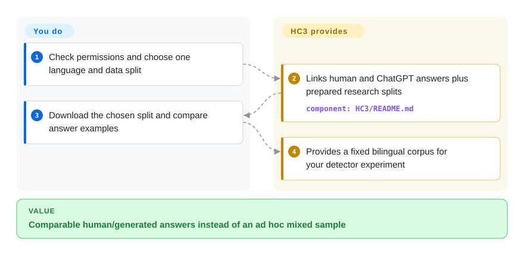

# chatgpt-comparison-detection

You need human and early ChatGPT answers to the same questions, not unrelated text samples; HC3 supplies bilingual comparison data and detector-training scripts.

## When to use

You are reproducing an early AI-text-detection study and your spreadsheet mixes human answers from one topic with generated answers from another. HC3 gives you English and Chinese question-answer material, full-answer and sentence splits, and filtered versions that remove obvious identifying phrases. Choose it for a historically comparable, bilingual supervised baseline rather than a current universal detector.

The corpus, model links and research scripts are separate artifacts. The repository's main branch last changed on 2023-06-27, and its Python code has no root license grant. Resolve the relevant source-data, model and code permissions before reuse; the dataset copyright paragraph does not license every artifact.

## When NOT to use

- **You need generalization across generators, genres and attacks.** Use RAID as a broader evaluation corpus; HC3 is an early ChatGPT question-answer snapshot, not evidence about today's generators.
- **You want detection without training on labeled HC3 examples.** Compare Binoculars or Fast-DetectGPT instead; their scoring-model approaches trade supervised fitting for larger model inference and calibration work.
- **You want to punish a student or reject an applicant from a detector label.** Use documented provenance and human review instead, not another automatic detector; the scripts offer classification metrics, not proof of authorship.
- **You require a clear code redistribution grant.** Consider RAID's MIT code after separately reviewing its data terms; HC3 has no LICENSE file, and its data table includes Unknown, None and noncommercial restrictions.
- **You need a supported installation with regression coverage.** Start from RAID's package interface rather than these unversioned research scripts. In particular, `ml_train.py` reads training CSVs from `hc3/` but test CSVs from `c3/`; resolve that inconsistency before reproducing its linguistic baseline.

## Comparison

| Alternative | In index | Our verdict | Tradeoff |
|---|---|---|---|
| [RAID](https://github.com/liamdugan/raid) | not indexed | Choose RAID for multi-generator and adversarial evaluation; choose HC3 for reproducing early bilingual question-answer comparisons. | RAID supplies a package and broader evaluation slices; HC3 supplies the particular historical paired corpus. Neither proves present-day authorship. |
| [Binoculars](https://github.com/ahans30/Binoculars) | not indexed | Choose Binoculars for zero-shot scoring without an HC3 training split; choose HC3 when you need labeled human/generated answers for supervised experiments. | Binoculars loads two scoring models and warns against unsupervised consumer use; HC3 adds data-permission and training responsibilities. |
| [Fast-DetectGPT](https://github.com/baoguangsheng/fast-detect-gpt) | not indexed | Choose Fast-DetectGPT to study conditional-probability scoring; choose HC3 to compare paired answers and train classifiers on that corpus. | Fast-DetectGPT needs sampling/scoring model inference; HC3 needs dataset preparation and has stale, unlicensed code. |

## Quick start

Use the corpus path first: open the English or Chinese dataset links in [README.md:22–32](https://github.com/Hello-SimpleAI/chatgpt-comparison-detection/blob/1f8c15c28f87e09a5abfd86ee6e15005dc7d2119/README.md#L22-L32), and check the source-specific permissions before downloading. For the paper's prepared training/test data, follow [HC3/README.md:26–33](https://github.com/Hello-SimpleAI/chatgpt-comparison-detection/blob/1f8c15c28f87e09a5abfd86ee6e15005dc7d2119/HC3/README.md#L26-L33) and select one language plus full-answer or sentence data, with or without identifying-phrase filtering. Read the corresponding human/generated answer examples and keep the chosen split fixed when comparing your detector. HC3 supplies the comparison material and research baselines; you implement evaluation, check false positives and retain provenance and permission records. Dataset access uses external Hugging Face, ModelScope or Drive services; this reading path does not call a paid model, while later local training requires your compute and separate model-permission review.

<!-- flow-steps:begin (generated from flows/chatgpt-comparison-detection.json by tools/flow_card.py — do not edit) -->

Text version of the flow

1. **You**: Check permissions and choose one language and data split
2. **chatgpt-comparison-detection**: Links human and ChatGPT answers plus prepared research splits — component: `HC3/README.md`
3. **You**: Download the chosen split and compare answer examples
4. **chatgpt-comparison-detection**: Provides a fixed bilingual corpus for your detector experiment

**Value**: Comparable human/generated answers instead of an ad hoc mixed sample

<!-- flow-steps:end -->

## Key techniques

- **Remove easy identity clues before measuring detection.** [HC3/demo_indicating_words.ipynb:98–127](https://github.com/Hello-SimpleAI/chatgpt-comparison-detection/blob/1f8c15c28f87e09a5abfd86ee6e15005dc7d2119/HC3/demo_indicating_words.ipynb#L98-L127) splits answers into sentences, removes any sentence containing a listed identifying phrase, and normalizes a Chinese form of address. This tests whether a detector relies on obvious phrases rather than broader writing patterns; the fixed lists can also remove substantive content and cannot eliminate every shortcut.
- **Switch between answer-only and paired-question classification.** [detect/dl_train.py:53–98](https://github.com/Hello-SimpleAI/chatgpt-comparison-detection/blob/1f8c15c28f87e09a5abfd86ee6e15005dc7d2119/detect/dl_train.py#L53-L98) reads local CSV splits, can combine full answers and sentences, then tokenizes either the answer or question plus answer with truncation. The question supplies context, but the length limit drops longer material; `--all-train` explicitly merges test data into training and must not be mistaken for held-out evaluation.
- **Turn token predictability into small classifier inputs.** [detect/ml_train.py:45–81](https://github.com/Hello-SimpleAI/chatgpt-comparison-detection/blob/1f8c15c28f87e09a5abfd86ee6e15005dc7d2119/detect/ml_train.py#L45-L81) counts tokens in four GPT-2 probability-rank buckets; [detect/ml_train.py:241–262](https://github.com/Hello-SimpleAI/chatgpt-comparison-detection/blob/1f8c15c28f87e09a5abfd86ee6e15005dc7d2119/detect/ml_train.py#L241-L262) fits logistic regression with repeated stratified cross-validation. This separates feature extraction from classification, but inherits the scoring model and corpus biases, and cross-validation does not establish performance on unseen generators.

## Tech stack

- Python research scripts; PyTorch and Transformers for sequence classification and GPT-2 feature extraction.
- Hugging Face Datasets, pandas, NumPy and scikit-learn for CSV preparation and metrics; NLTK/regular expressions for sentence handling. No service or database is provided.

## Dependencies

- The corpus-reading path needs network access and a reader for the downloaded data; there is no packaged installer or requirements manifest in the tree.
- Training imports `datasets`, `evaluate`, pandas, NumPy, torch and Transformers; the old installation comment pins torch 1.12.1 but omits some imports. Build and pin your own compatible environment rather than assuming it is complete.
- Supply the expected CSV columns (`id`, `question`, `answer`, `source`, `label`) and externally hosted model weights. GPU/CPU requirements depend on the selected baseline, batch and length settings.

## Ops difficulty

**Low to browse, medium/high to reproduce.** Reading downloaded examples needs no server. Reproduction requires reconciling script paths, fixing package versions, acquiring permitted data and model weights, and managing checkpoints and held-out splits; the tree does not supply an automated supported deployment.

## Health & viability

- **Verdict, 2026-10-13:** a historical research reference, not a maintained production detector. Main last changed on 2023-06-27, GitHub has no Releases, and code has no LICENSE file; the machine NONE/E cap remains appropriate.
- **Adoption and backing:** 1479 stars show research attention, not deployment evidence. README names a university/company research team, but this is not a foundation or support commitment; the scorer has no attributable current governance signal.
- **Age/Lindy:** the repository dates from January 2023, but more than three years without a main-branch change defeats an active-maintenance Lindy argument. Corpus age does not validate detection of newer generators.
- **Permission boundary:** README's data rule follows stricter source licenses, otherwise CC-BY-SA; several listed sources are Unknown/None or noncommercial. Hugging Face's CC-BY-SA-4.0 dataset tag does not replace that table, a code grant, or individual model terms.

## Caveats (unverified)

- [未验证：未运行上游训练或下载数据] Current package compatibility, Drive availability and end-to-end reproducibility were not tested; commands and implementation were inspected at the linked SHA.
- [未验证：无统一代码许可与部分来源授权] The dataset copyright notice does not settle code or all underlying data/model reuse rights; obtain the necessary grants before redistribution.
- [推断：只有历史语料与脚本，没有本次跨模型测试] Results on HC3 alone cannot establish reliability on current generators or justify individual authorship decisions.
