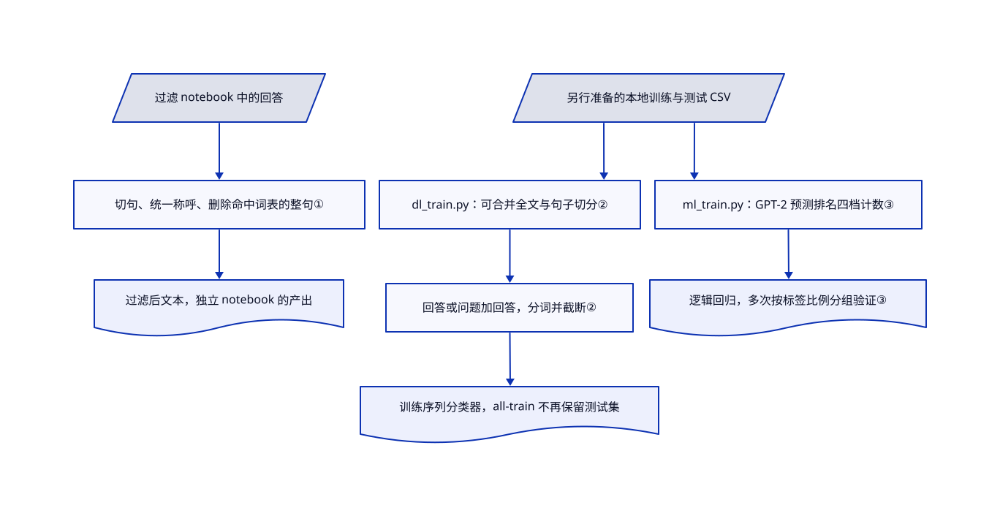

# chatgpt-comparison-detection

你要比较人类和早期 ChatGPT 对同一问题的回答，却只有互不相关的样本；HC3 提供双语对比语料和检测器训练脚本。

## 何时使用

你在复现早期 AI 文本检测研究，表格里人类回答和生成回答却来自不同话题。HC3 提供中英文问答、全文与句子切分，以及去除明显身份提示词的版本。需要历史可比的双语监督学习基线时选它，而不是把它当成当前通用检测器。

语料、模型链接和研究脚本是不同产物。默认分支最后更新于 2023-06-27，Python 代码没有根目录许可授权。复用前分别解决原始数据、模型和代码的权限；数据版权段落不能替所有产物授权。

## 何时不用

- **要核跨生成模型、文体和攻击的泛化。** 用 RAID 的更广评测语料；HC3 是早期 ChatGPT 问答快照，不能证明对今天模型的有效性。
- **不想用标注 HC3 数据训练。** 比较 Binoculars 或 Fast-DetectGPT；它们用评分模型替代监督拟合，但需要更大的模型推理和校准工作。
- **想凭检测标签处罚学生或拒绝求职者。** 改用可记录的创作过程与人工复核，而不是换另一个自动检测器；脚本给的是分类指标，不是作者身份证明。
- **要求明确的代码再分发授权。** 可考虑 RAID 的 MIT 代码，并另核数据条款；HC3 没有 LICENSE，数据来源表还含 Unknown、None 和非商业限制。
- **要求有支持的安装和回归覆盖。** 从 RAID 的包接口起步，别直接依赖这些未版本化脚本。尤其 `ml_train.py` 从 `hc3/` 读训练数据，却从 `c3/` 读测试数据；复现语言特征基线前先解决路径矛盾。

## 横向对比

| 替代品 | 是否收录 | 我们的评价 | 取舍 |
|---|---|---|---|
| [RAID](https://github.com/liamdugan/raid) | 未收录 | 跨生成模型和对抗评测选 RAID；复现早期双语问答对比选 HC3。 | RAID 提供包接口和更广评测切片；HC3 提供特定历史配对语料。两者都不能证明当前文本的作者身份。 |
| [Binoculars](https://github.com/ahans30/Binoculars) | 未收录 | 不用 HC3 训练切分而做零样本评分时选 Binoculars；需要标注人类与生成回答做监督实验时选 HC3。 | Binoculars 加载两个评分模型，并警告不能无人监督地用于消费产品；HC3 增加数据授权与训练责任。 |
| [Fast-DetectGPT](https://github.com/baoguangsheng/fast-detect-gpt) | 未收录 | 研究条件概率评分选 Fast-DetectGPT；比较配对回答并训练语料分类器选 HC3。 | Fast-DetectGPT 要做采样与评分模型推理；HC3 要整理数据，且代码停更、没有许可授权。 |

## 快速上手

先走语料路径：打开 [README.md:22–32](https://github.com/Hello-SimpleAI/chatgpt-comparison-detection/blob/1f8c15c28f87e09a5abfd86ee6e15005dc7d2119/README.md#L22-L32) 的英文或中文数据入口，下载前核各来源许可。需要论文整理好的训练与测试数据时，沿 [HC3/README.md:26–33](https://github.com/Hello-SimpleAI/chatgpt-comparison-detection/blob/1f8c15c28f87e09a5abfd86ee6e15005dc7d2119/HC3/README.md#L26-L33) 选择一种语言、全文或句子，以及是否过滤身份提示词。查看相应的人类与生成回答样本，比较检测器时固定这份切分。HC3 提供对比材料和研究基线，你负责实现评测、核误报、保存来源和授权记录。数据访问使用外部 Hugging Face、ModelScope 或 Drive 服务；这条阅读路径不调用付费模型，后续本地训练另需你的算力和模型授权复核。

<!-- flow-steps:begin (generated from flows/chatgpt-comparison-detection.json by tools/flow_card.py — do not edit) -->

流程文字版

1. **你**：核许可并选定语言与数据切分
2. **chatgpt-comparison-detection**：给出人类与 ChatGPT 回答及研究切分入口 — 组件：`HC3/README.md`
3. **你**：下载所选切分并比较回答样本
4. **chatgpt-comparison-detection**：提供可固定使用的双语检测实验语料

**价值**：用可比较的人类与生成回答代替临时拼凑的样本

<!-- flow-steps:end -->

## 技术要点

<!-- mechanism:begin (generated from mechanisms/chatgpt-comparison-detection.json by tools/mechanism_card.py; do not edit) -->

机制文字版

- 过滤 notebook 中的回答
- 切句、统一称呼、删除命中词表的整句①
- 过滤后文本，独立 notebook 的产出
- 另行准备的本地训练与测试 CSV
- dl_train.py：可合并全文与句子切分②
- 回答或问题加回答，分词并截断②
- 训练序列分类器，all-train 不再保留测试集
- ml_train.py：GPT-2 预测排名四档计数③
- 逻辑回归，多次按标签比例分组验证③

- 过滤 notebook 中的回答 → 切句、统一称呼、删除命中词表的整句①
- 切句、统一称呼、删除命中词表的整句① → 过滤后文本，独立 notebook 的产出
- 另行准备的本地训练与测试 CSV → dl_train.py：可合并全文与句子切分②
- dl_train.py：可合并全文与句子切分② → 回答或问题加回答，分词并截断②
- 回答或问题加回答，分词并截断② → 训练序列分类器，all-train 不再保留测试集
- 另行准备的本地训练与测试 CSV → ml_train.py：GPT-2 预测排名四档计数③
- ml_train.py：GPT-2 预测排名四档计数③ → 逻辑回归，多次按标签比例分组验证③

<!-- mechanism:end -->

### 1. 删除暴露身份的整句，而不只删词

- **解决：** 检测器可能只是认出了明确的身份提示词，并没有学到更广的写作模式。
- **做法：** 过滤用的 notebook 先将回答切句，把中文称呼“您”统一成“你”，再删除含清单提示词的每个整句。
- **边界：** 固定清单会误删实质内容，也排除不了所有捷径。这个 notebook 与训练脚本是独立研究工具，不是自动串好的流水线。
- **源码：** [HC3/demo_indicating_words.ipynb:98–127](https://github.com/Hello-SimpleAI/chatgpt-comparison-detection/blob/1f8c15c28f87e09a5abfd86ee6e15005dc7d2119/HC3/demo_indicating_words.ipynb#L98-L127)。

### 2. 选择分类器能看到哪些上下文

- **解决：** 只看回答就用不上问题的上下文；完整回答与单句也代表不同的检测条件。
- **做法：** `dl_train.py` 读取本地训练与测试 CSV，可将全文和句子切分合并，再把回答单独或问题加回答转换成词元。训练序列分类器前，按配置长度截断输入。
- **边界：** 截断会丢弃较长内容。`--all-train` 将测试集并入训练，并关闭该评测路径；这种运行不能当成保留集评测。
- **源码：** [detect/dl_train.py:53–98](https://github.com/Hello-SimpleAI/chatgpt-comparison-detection/blob/1f8c15c28f87e09a5abfd86ee6e15005dc7d2119/detect/dl_train.py#L53-L98)、[分类器与评测设置：109–136](https://github.com/Hello-SimpleAI/chatgpt-comparison-detection/blob/1f8c15c28f87e09a5abfd86ee6e15005dc7d2119/detect/dl_train.py#L109-L136)。

### 3. 先统计 GPT-2 的预测排名，再训练小型分类器

- **解决：** 轻量分类器需要数字特征，不能直接吃进原始回答文本。
- **做法：** 一条特征路径让 GPT-2 给实际下一个词元排预测名次，再统计前 10、10–99、100–999、1000 及以后的四档数量。逻辑回归从这些计数学习，并用重复分层交叉验证选参数，即多次分组验证且各组保持标签比例。
- **边界：** 特征提取与分类分开，但都继承评分模型与语料的偏差。在这份材料内交叉验证，不证明对未见生成模型有效。
- **源码：** [detect/ml_train.py:45–81](https://github.com/Hello-SimpleAI/chatgpt-comparison-detection/blob/1f8c15c28f87e09a5abfd86ee6e15005dc7d2119/detect/ml_train.py#L45-L81)、[特征分流：197–215](https://github.com/Hello-SimpleAI/chatgpt-comparison-detection/blob/1f8c15c28f87e09a5abfd86ee6e15005dc7d2119/detect/ml_train.py#L197-L215)、[分类器训练：241–262](https://github.com/Hello-SimpleAI/chatgpt-comparison-detection/blob/1f8c15c28f87e09a5abfd86ee6e15005dc7d2119/detect/ml_train.py#L241-L262)。

## 技术栈

- Python 研究脚本；PyTorch 和 Transformers 用于序列分类与 GPT-2 特征提取。
- Hugging Face Datasets、pandas、NumPy 和 scikit-learn 负责 CSV 整理与指标；NLTK 和正则负责句子处理。没有配套服务或数据库。

## 依赖

- 语料阅读路径需要网络和下载数据的读取工具；源码树没有打包安装器或 requirements 清单。
- 训练导入 `datasets`、`evaluate`、pandas、NumPy、torch 和 Transformers；旧安装注释固定 torch 1.12.1，却漏掉部分导入。要自行建立并固定兼容环境，不能假定注释足够完整。
- 提供预期 CSV 列（`id`、`question`、`answer`、`source`、`label`）和外部模型权重。GPU 或 CPU 需求取决于基线、批量与长度设置。

## 运维难度

**浏览低，复现中高。** 阅读下载样本不需要服务器。复现要对齐脚本路径、固定包版本、取得获准数据和模型权重，并管理检查点与保留切分；源码树没有自动化且有支持的部署方案。

## 健康度与可持续性

- **判断日期 2026-10-13：** 只作历史研究参考，不是维护中的生产检测器。默认分支最后更新于 2023-06-27，GitHub 没有 Releases，代码没有 LICENSE；机器的 NONE/E 封顶仍有依据。
- **采用与支持：** 1479 stars 表示研究关注，不是部署证据。README 列出高校与公司研究团队，但不是基金会或支持承诺；评分器没有可归属的当前治理信号。
- **年龄与 Lindy：** 仓库始于 2023 年 1 月，但默认分支超过三年未改，不能据年龄推得持续维护。语料历史也不证明能检测更新生成模型。
- **权限边界：** README 要求遵守更严来源许可，否则用 CC-BY-SA；部分来源仍为 Unknown、None 或限非商业。Hugging Face 的 CC-BY-SA-4.0 数据标签不能替代来源表、代码授权或各模型条款。

## 存疑（未验证）

- [未验证：未运行上游训练或下载数据] 当前包兼容性、Drive 可用性和端到端复现没有实测；命令与实现按链接 SHA 阅读。
- [未验证：无统一代码许可与部分来源授权] 数据版权说明没有解决代码、所有底层数据及模型的复用权；再分发前须取得相应授权。
- [推断：只有历史语料与脚本，没有本次跨模型测试] 单凭 HC3 结果不能证明对当前生成模型可靠，也不能支持个人作者身份裁决。
