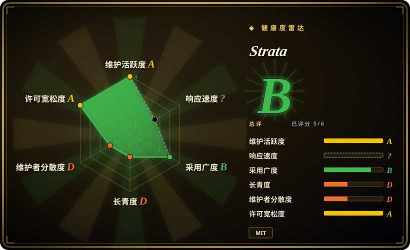
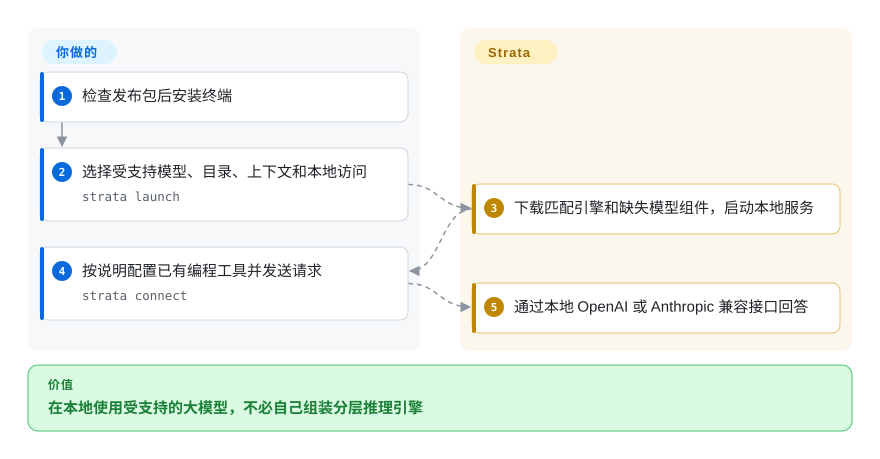
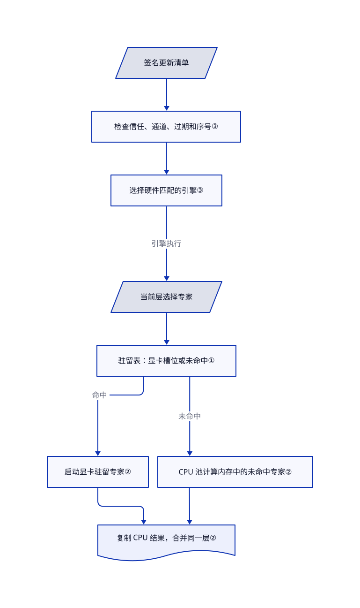

# Strata

想用的 Qwen 模型装不进显存，又不想换整台电脑。Strata 把部分专家留在显卡，其余交给 CPU 计算，再用安装向导和本地接口接上编程工具。

## 何时使用

你想让受支持的 Qwen 或 DeepSeek 模型，在自己的工作站回答编程智能体。显存装不下整个模型，但你能提供较大的内存和 SSD 空间。相比直接换小模型，你更想用 Strata 为特定模型设计的内存布局、CPU 与 GPU 专家计算，以及引导式下载。终端和桌面应用提供 OpenAI、Anthropic 兼容接口，方便连接现有客户端。

当硬约束是装下某个受支持模型，而不是拥有庞大模型库时，考虑它而非 [Ollama](../ollama.zh.md)。当你想要整理好的安装流程和模型专用混合计算，而不是自己配置引擎时，考虑它而非 [llama.cpp](../llama-cpp.zh.md)。这不代表它在你的机器上更快，先核对模型、量化、后端和上下文长度。

## 何时不用

- **要运行任意 GGUF 架构。** 选 [llama.cpp](../llama-cpp.zh.md) 的广泛模型覆盖。Strata 目录列出特定 Qwen3.8、Qwen3.6、DeepSeekV4.1 家族和量化组合，文件名以 `.gguf` 结尾不等于兼容。
- **要小下载和少做容量规划。** 在 [Ollama](../ollama.zh.md) 选更小的模型。移出显存不等于省掉模型存储，文档中的 DeepSeek 模型包仍需约 197–280 GB 可用磁盘空间。
- **要建设多人共用的 GPU 服务。** 选 [vLLM](../../serving-engines/vllm.zh.md) 的服务端调度。Strata 有并发槽位，但受内存和草稿模式影响，DFlash2 的文档路径一次回答一个请求。接口兼容不等于数据中心吞吐，也不代表完整复刻供应商接口行为。
- **要更成熟、维护不那么集中的依赖。** 优先考虑 [llama.cpp](../llama-cpp.zh.md)，并固定实测版本。核验时 Strata 仅创建 40 天，提交高度集中于作者，近期问题报告了引擎升级后的速度回退。
- **要隔离不可信代码。** 用 [Ollama](../ollama.zh.md) 仅提供推理，把执行工具留给另行控制的智能体。Strata 桌面代理能运行命令、修改文件，聊天目录不是隔离边界，Bypass 会关闭审批。无论选哪个运行时，都不要向网络暴露无鉴权接口。

## 横向对比

| 替代品 | 是否收录 | 我们的评价 | 取舍 |
| --- | --- | --- | --- |
| [llama.cpp](../llama-cpp.zh.md) | 已收录 | 要覆盖更多架构或内嵌控制，选 llama.cpp；要为受支持模型提供整理好的安装与 CPU／GPU 专家路径，选 Strata。 | Strata 提供模型准备和桌面、终端管理；llama.cpp 给更宽的后端与模型接口，不带这层产品管理。 |
| [Ollama](../ollama.zh.md) | 已收录 | 模型库与客户端生态更重要时，选 Ollama；装下特定大于显存的 MoE 模型是硬约束时，考虑 Strata。 | Strata 提供模型专用内存和草稿选项，代价是较窄的兼容矩阵和短得多的历史。 |
| [vLLM](../../serving-engines/vllm.zh.md) | 已收录 | GPU 服务要应对大量并发客户端时，选 vLLM；个人工作站要把受支持模型分配到多级存储时，考虑 Strata。 | vLLM 带服务调度器，部署也更重；Strata 带消费级机器安装流程，不是经实测可替代该调度器的方案。 |

## 快速上手

使用带版本号的桌面发布包，或先阅读[安装指南](https://github.com/Niko1221/Strata/blob/ffa80d73133ea5c548aefe57889a16e8085a938f/docs/INSTALL.md)中的终端脚本再执行。终端入口是 `strata launch`，向导让你选择受支持模型、存储目录、上下文和访问范围。Strata 下载对应引擎及缺失模型组件，然后启动本地服务。运行 `strata connect` 获取现有编程工具的接入说明，再把请求发给显示的地址。你负责磁盘、内存、受支持显卡驱动和客户端配置，大下载和本地耗电仍由你承担。本次只读源码和示例，没有安装或运行 Strata。

<!-- flow-steps:begin (generated from flows/strata.json by tools/flow_card.py — do not edit) -->

流程文字版

1. **你**：检查发布包后安装终端
2. **你**：选择受支持模型、目录、上下文和本地访问 — `strata launch`
3. **Strata**：下载匹配引擎和缺失模型组件，启动本地服务
4. **你**：按说明配置已有编程工具并发送请求 — `strata connect`
5. **Strata**：通过本地 OpenAI 或 Anthropic 兼容接口回答

**价值**：在本地使用受支持的大模型，不必自己组装分层推理引擎

<!-- flow-steps:end -->

## 技术要点

<!-- mechanism:begin (generated from mechanisms/strata.json by tools/mechanism_card.py; do not edit) -->

机制文字版

- 签名更新清单
- 检查信任、通道、过期和序号③
- 选择硬件匹配的引擎③
- 当前层选择专家
- 驻留表：显卡槽位或未命中①
- 启动显卡驻留专家②
- CPU 池计算内存中的未命中专家②
- 复制 CPU 结果，合并同一层②

- 签名更新清单 → 检查信任、通道、过期和序号③
- 检查信任、通道、过期和序号③ → 选择硬件匹配的引擎③
- 选择硬件匹配的引擎③ → 当前层选择专家（引擎执行）
- 当前层选择专家 → 驻留表：显卡槽位或未命中①
- 驻留表：显卡槽位或未命中① → 启动显卡驻留专家②（命中）
- 驻留表：显卡槽位或未命中① → CPU 池计算内存中的未命中专家②（未命中）
- 启动显卡驻留专家② → 复制 CPU 结果，合并同一层②
- CPU 池计算内存中的未命中专家② → 复制 CPU 结果，合并同一层②

<!-- mechanism:end -->

### 1. 用显式驻留表分配专家，不把所有专家塞进显存

- **解决：** 混合专家模型每个词只选部分小网络，但把全部小网络留在显卡会超出显存。
- **做法：** 缓存分配显卡槽位，用表把每个层与专家映射到槽位或未命中。启动时可按使用频率排名填充，驻留表把显卡计算与内存权重上的 CPU 计算分开。
- **边界：** 槽位存储类本身不执行专家，也不负责自适应替换。缓存满或封存后，准入路径拒绝新成员，变化由上层策略管理。多放几个槽位不能消除内存、模型格式和带宽约束。
- **源码：** [存储职责与排名格式](https://github.com/Niko1221/Strata/blob/ffa80d73133ea5c548aefe57889a16e8085a938f/include/strata/core/expert_cache.hpp#L19-L73)、[驻留查询与准入](https://github.com/Niko1221/Strata/blob/ffa80d73133ea5c548aefe57889a16e8085a938f/src/core/expert_cache.cpp#L735-L804)。

### 2. 显卡算命中、CPU 算未命中，再合并同一层

- **解决：** 等显卡算完才让 CPU 算专家，会让一方闲着。
- **做法：** 会话轮询固定内存中的显卡通知，先启动显卡驻留专家，再让 CPU 专家池与显卡并行计算。它把 CPU 结果复制回显卡，在同一条有序流中先合并结果，再执行该层后处理。
- **边界：** 循环仍需查询驱动才能观察通知，结束时仍会同步。源码明确记录驱动可见性约束，并行不等于普遍提速；这条 CUDA／HIP 会话路径也不能证明全部后端行为一致。
- **源码：** [会话固定内存](https://github.com/Niko1221/Strata/blob/ffa80d73133ea5c548aefe57889a16e8085a938f/src/core/session.cpp#L533-L571)、[通知、重叠与同层合并](https://github.com/Niko1221/Strata/blob/ffa80d73133ea5c548aefe57889a16e8085a938f/src/core/session.cpp#L681-L798)。

### 3. 先认证更新清单，再选匹配硬件的引擎

- **解决：** 安装器既要选对显卡版本，也不能接受被替换或重放的更新清单。
- **做法：** 控制层用已信任公钥验证签名，检查通道、可选过期时间和递增序号，再按平台、后端、驱动与架构筛选引擎。签名清单携带压缩包和包清单哈希，供后续下载校验。
- **边界：** 终端首次安装时，二进制和信任公钥来自同一份 GitHub 发布。后续签名也防不了有发布权限的人作恶。源码安装路径另有不同回退行为，不能概括成所有安装方式都失败即阻断。
- **源码：** [清单认证](https://github.com/Niko1221/Strata/blob/ffa80d73133ea5c548aefe57889a16e8085a938f/strata_control/feed.py#L335-L362)、[硬件匹配](https://github.com/Niko1221/Strata/blob/ffa80d73133ea5c548aefe57889a16e8085a938f/strata_control/feed.py#L408-L461)、[首次安装信任边界](https://github.com/Niko1221/Strata/blob/ffa80d73133ea5c548aefe57889a16e8085a938f/SECURITY.md#L73-L95)。

## 技术栈

- C++ 推理引擎、CUDA／HIP 内核，以及独立 Metal、SYCL 实现；使用 CMake 构建和源自 ggml 的组件。
- Python 终端、控制层与 HTTP 服务，源码安装依赖锁定了 NumPy、Jinja2、requests、Pillow 等包。
- React 19、TypeScript、Vite 主机应用要求 Node 24.12 以上，桌面壳用 Rust 与 Tauri 2。它们是源码构建要求，不代表安装成品包还需另装整套开发工具链。
- 根代码为 MIT，第三方组件保留各自通知，模型权重另有条款。上游[许可说明](https://github.com/Niko1221/Strata/blob/ffa80d73133ea5c548aefe57889a16e8085a938f/docs/HOW_IT_WORKS.md#L60-L77)还列出 OFL 字体与受 Qwen 许可约束的实验激活向量，根 MIT 不会覆盖这些素材的原许可。

## 依赖

- 受支持的系统、显卡、模型家族与量化组合。README 列出 NVIDIA、部分 AMD、Linux 上的 Intel Arc 和 Apple Silicon 路径，不代表它们全面等价。
- 为模型包和上下文留足内存、显存与 SSD。DeepSeek 的 Mac 路径注明仅文本，要求至少 64 GB 统一内存。
- 下载时访问 GitHub Releases 和模型托管站。外部模型服务、搜索、远程工具、隧道是可选联网路径，不应概括为无条件离线。
- 现有编程智能体仍是独立程序，其网络流量、权限和模型表现不受 Strata 本地接口控制。

## 运维难度

**中。** 引导下载和硬件专用包简化了安装，但模型空间、驱动兼容、上下文容量与版本回退仍需自己管理。未设置鉴权和网络控制时，只监听回环地址。裸服务和桌面共享都允许在警告后无密钥运行。桌面共享还允许在运行中删除密钥，此后鉴权检查会直接放行请求；开放任一监听前，都应自行配置鉴权和网络控制。[共享监听](https://github.com/Niko1221/Strata/blob/ffa80d73133ea5c548aefe57889a16e8085a938f/apps/host/server/local-share.mjs#L1-L35)、[可选密钥与鉴权](https://github.com/Niko1221/Strata/blob/ffa80d73133ea5c548aefe57889a16e8085a938f/apps/host/server/serving.mjs#L70-L91)。终端托管服务可用 `strata launch --stop` 停止；卸载应用不代表文档保证同时删除所选模型目录与聊天记录。

## 健康度与可持续性

- **2026-11-03 判断：** 适合固定版本、可回退的工作站试用，不宜当长期可靠性承诺。[推断：依据项目年龄与贡献集中度，没有生产试用。]
- **机器雷达：** 总评 B，已评分 5／6 轴。匿名 GraphQL 返回 HTTP 403，响应速度轴保持未知。治理采集窗口内，第一贡献者占 84.1%；发布附件下载量属于采用信号，不是独立用户数。
- **维护：** 公开元数据显示默认分支于 2026-11-02 提交，同日发布 v0.2.10，之前为 10 月 31 日的 v0.2.9 和 10 月 29 日的 v0.2.8。高频发布也意味着兼容面频繁变化。
- **治理与支持：** 仓库由个人账户持有，有贡献规则和私密安全报告入口。贡献者前十响应中，作者为 4526 次，第二位为 29 次；这是集中度信号，不是完整维护者名单。README 接受捐助，这里不声称存在基金会治理。
- **年龄与林迪效应：** 2026-09-24 创建，核验时仅 40 天。约 3.9 万星不能替代长期运行史，也不能证明基准性能。近期[问题 5121](https://github.com/Niko1221/Strata/issues/5121)报告引擎版本升级后减速，本次未复现该报告。
- **许可与安全：** 已读根 MIT 和实际第三方许可文件。上游明确表示尚无外部安全审计；模型许可和桌面代理权限仍是重要风险。

## 存疑（未验证）

- [未验证：本次收录禁止执行上游。] 未独立复现硬件兼容、输出质量、容量和性能，不把宣传倍数当实测结果。
- [推断：依据带日期的 API 历史与贡献样本。] 可回退试用建议与较弱林迪先验属于选型判断，不是项目会停更的预测。
- [未验证：未完成全部第三方及模型权属审计。] 与声明使用的 llama.cpp 快照逐 blob 比较，5681 个文件中有 2 个相同，643 个核心源码文件均不同；只能排除对该快照的大量逐字复制，不能排除全部复制或许可缺陷。
- [未验证：上游隐私说明存在更新口径冲突。] `docs/SAFETY.md` 概览说 DeepSeek 可自动获取更新，详述及 `SECURITY.md` 又说更新需显式触发。不要假设启动时零出站；离线是硬要求时，核对安装版本并用强制网络控制。
- [未验证：本次未授权认证 GraphQL 访问。] 因匿名接口产生的健康度未知轴，是采集缺口，不代表项目不回复问题。
