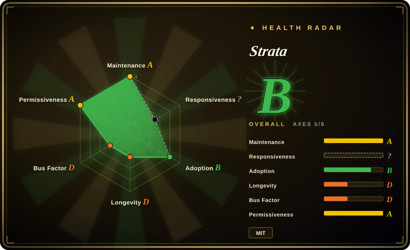
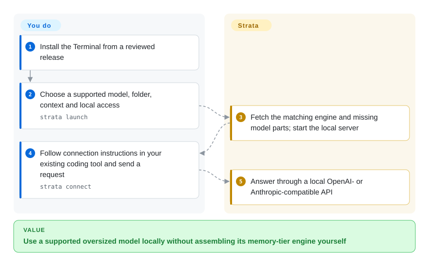
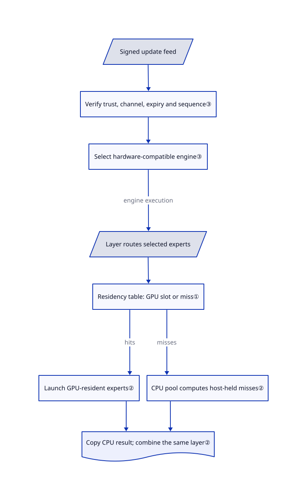

# Strata

Your chosen Qwen model is larger than your graphics memory, yet replacing the whole PC is not an option. Strata keeps selected experts on the GPU and computes the missing ones on the CPU, with a guided installer and local coding-tool APIs.

## When to use

You want a supported Qwen or DeepSeek model to answer your coding agent on your own workstation. The model cannot fit entirely in graphics memory, but you can supply substantial system RAM and SSD space. Instead of lowering the model size immediately, you want Strata's model-specific memory layout, CPU/GPU expert execution and guided model download. Its Terminal and desktop app expose OpenAI- and Anthropic-compatible interfaces for existing clients.

Choose it over [Ollama](ollama.md) when fitting one of its explicitly supported model packs matters more than a broad model store. Choose it over [llama.cpp](llama-cpp.md) when you want the curated installation and model-specific hybrid path rather than an engine you configure yourself. This is not evidence that it is faster on your machine: check the exact model, quantization, backend and context first.

## When NOT to use

- **You need arbitrary GGUF architectures.** Choose [llama.cpp](llama-cpp.md) for broad model coverage. Strata's catalog names specific Qwen3.8, Qwen3.6 and DeepSeekV4.1 families and supported quantizations; a file ending in `.gguf` does not establish compatibility.
- **You want a small download and minimal capacity planning.** Choose a smaller model in [Ollama](ollama.md). Moving work out of VRAM does not eliminate model storage: the documented DeepSeek packs alone need roughly 197–280 GB of free disk, depending on the pack.
- **You are building a multi-user GPU service.** Choose [vLLM](../serving-engines/vllm.md) for serving-oriented scheduling. Strata has parallel slots, but they interact with memory and drafting; DFlash2's documented path answers one request at a time. Do not equate API compatibility with datacenter throughput or full provider behavior.
- **You need a mature, less concentrated dependency.** Prefer [llama.cpp](llama-cpp.md) and pin a tested version. Strata was only 40 days old on this review date, has an author-dominated contribution history, and recent issues report speed regressions across engine versions.
- **You want an untrusted-code sandbox.** Use [Ollama](ollama.md) as an inference-only backend and keep tool execution in your separately controlled agent. Strata's desktop agent can execute commands and edit files; its chat folder is not confinement, and Bypass removes approval prompts. For any runtime, do not expose an unauthenticated server to the network.

## Comparison

| Alternative | In index | Our verdict | Tradeoff |
| --- | --- | --- | --- |
| [llama.cpp](llama-cpp.md) | indexed | Pick llama.cpp for broad architectures or embedded engine control; pick Strata for its curated supported-model installation and CPU/GPU expert path. | Strata supplies model preparation and app/Terminal management; llama.cpp offers a wider backend/model surface without this product layer. |
| [Ollama](ollama.md) | indexed | Pick Ollama when a managed model catalog and client ecosystem decide; pick Strata when the supported oversized MoE model is the hard constraint. | Strata exposes model-specific memory and drafting choices; you pay with a narrower compatibility matrix and a much shorter history. |
| [vLLM](../serving-engines/vllm.md) | indexed | Pick vLLM for a GPU service handling many concurrent clients; pick Strata for a personal workstation that must split a supported model across memory tiers. | vLLM brings a serving scheduler and heavier deployment; Strata brings consumer-machine setup, not a measured replacement for that scheduler. |

## Quick start

Use a versioned desktop release, or inspect the Terminal installer linked in the [installation guide](https://github.com/Niko1221/Strata/blob/ffa80d73133ea5c548aefe57889a16e8085a938f/docs/INSTALL.md) before executing it. The documented Terminal entry is `strata launch`; its screens let you choose a supported model, storage folder, context and access scope. Strata downloads the matching engine and missing model components, then starts the local server. Run `strata connect` to obtain instructions for your existing coding tool, then send that tool's requests to the displayed address. You supply disk, RAM, the supported GPU driver and the client configuration; downloads are large and local inference still consumes power. This review read the source and examples only; it did not install or run Strata.

<!-- flow-steps:begin (generated from flows/strata.json by tools/flow_card.py — do not edit) -->

Text version of the flow

1. **You**: Install the Terminal from a reviewed release
2. **You**: Choose a supported model, folder, context and local access — `strata launch`
3. **Strata**: Fetch the matching engine and missing model parts; start the local server
4. **You**: Follow connection instructions in your existing coding tool and send a request — `strata connect`
5. **Strata**: Answer through a local OpenAI- or Anthropic-compatible API

**Value**: Use a supported oversized model locally without assembling its memory-tier engine yourself

<!-- flow-steps:end -->

## Key techniques

<!-- mechanism:begin (generated from mechanisms/strata.json by tools/mechanism_card.py; do not edit) -->

Text version of the mechanism

- Signed update feed
- Verify trust, channel, expiry and sequence③
- Select hardware-compatible engine③
- Layer routes selected experts
- Residency table: GPU slot or miss①
- Launch GPU-resident experts②
- CPU pool computes host-held misses②
- Copy CPU result; combine the same layer②

- Signed update feed → Verify trust, channel, expiry and sequence③
- Verify trust, channel, expiry and sequence③ → Select hardware-compatible engine③
- Select hardware-compatible engine③ → Layer routes selected experts (engine execution)
- Layer routes selected experts → Residency table: GPU slot or miss①
- Residency table: GPU slot or miss① → Launch GPU-resident experts② (hits)
- Residency table: GPU slot or miss① → CPU pool computes host-held misses② (misses)
- Launch GPU-resident experts② → Copy CPU result; combine the same layer②
- CPU pool computes host-held misses② → Copy CPU result; combine the same layer②

<!-- mechanism:end -->

### 1. Explicit expert residency instead of loading every expert into VRAM

- **Problem:** A mixture-of-experts model selects only some small expert networks per token, but storing every network on the GPU exceeds available memory.
- **How:** The cache allocates GPU slots and a table mapping each layer/expert pair to a slot or a miss. Profile rankings can initialize residency; the table separates the GPU-resident work from CPU work on host-held weights.
- **Limits:** The slot-storage class does not itself execute experts or implement adaptive replacement. Its admission path refuses new entries when full or sealed; a higher-level policy must manage changes. More GPU slots do not remove RAM, model-format or bandwidth constraints.
- **Source:** [Storage contract and profile format](https://github.com/Niko1221/Strata/blob/ffa80d73133ea5c548aefe57889a16e8085a938f/include/strata/core/expert_cache.hpp#L19-L73), [residency and admission](https://github.com/Niko1221/Strata/blob/ffa80d73133ea5c548aefe57889a16e8085a938f/src/core/expert_cache.cpp#L735-L804).

### 2. Overlap GPU hits with CPU misses, then combine the same layer

- **Problem:** Running CPU expert work only after GPU work finishes leaves one processor idle.
- **How:** The session polls a GPU-to-host doorbell in pinned memory, launches GPU-resident experts, and runs the CPU expert pool while the GPU proceeds. It copies CPU results back and combines both results before the layer's post-processing, on one ordered stream.
- **Limits:** The loop still queries the driver to observe the doorbell and synchronizes at the end. The source documents driver visibility constraints; overlap is not proof of a universal speedup, and this CUDA/HIP session path is not evidence for every backend.
- **Source:** [Pinned session scratch](https://github.com/Niko1221/Strata/blob/ffa80d73133ea5c548aefe57889a16e8085a938f/src/core/session.cpp#L533-L571), [doorbell, overlap and layer combine](https://github.com/Niko1221/Strata/blob/ffa80d73133ea5c548aefe57889a16e8085a938f/src/core/session.cpp#L681-L798).

### 3. Authenticate an update feed before selecting a compatible engine

- **Problem:** An installer needs the right GPU build without accepting a substituted or replayed update manifest.
- **How:** Control verifies the feed signature against trusted keys, checks channel, optional expiration and monotonic sequence, then filters engine packages by platform, backend, driver and architecture. The signed feed carries archive and manifest hashes for downstream package checks.
- **Limits:** The first Terminal installer obtains the binary and its trust key from the same GitHub release. Later signature checks do not protect against a malicious authorized publisher. Source-route checks have different fallback behavior, so this is not a blanket claim that every installation route fails closed.
- **Source:** [Feed verification](https://github.com/Niko1221/Strata/blob/ffa80d73133ea5c548aefe57889a16e8085a938f/strata_control/feed.py#L335-L362), [hardware matching](https://github.com/Niko1221/Strata/blob/ffa80d73133ea5c548aefe57889a16e8085a938f/strata_control/feed.py#L408-L461), [bootstrap trust boundary](https://github.com/Niko1221/Strata/blob/ffa80d73133ea5c548aefe57889a16e8085a938f/SECURITY.md#L73-L95).

## Tech stack

- C++ inference engine, CUDA/HIP kernels, additional Metal and SYCL implementations; CMake build and ggml-derived components.
- Python Terminal/control and HTTP serving; pinned source-route packages include NumPy, Jinja2, requests and Pillow.
- React 19/TypeScript/Vite host app on Node 24.12+, with a Rust/Tauri 2 desktop shell. These are source-build requirements, not a demand to install a separate development toolchain for each packaged user.
- Root code license is MIT. Vendored components retain separate notices; model weights have separate terms. The upstream [license explanation](https://github.com/Niko1221/Strata/blob/ffa80d73133ea5c548aefe57889a16e8085a938f/docs/HOW_IT_WORKS.md#L60-L77) also identifies OFL font material and a Qwen-licensed experimental activation vector; root MIT does not relicense those assets.

## Dependencies

- A supported combination of OS, GPU, model family and quantization. README documents NVIDIA, selected AMD, Intel Arc on Linux and Apple Silicon paths, not universal parity across them.
- Enough system RAM, VRAM and SSD capacity for the selected pack and context. DeepSeek's Mac route is documented as text-only on machines with at least 64 GB unified memory.
- GitHub Releases and model hosting during acquisition. External model providers, web search, remote tools and tunnels are optional network paths, not part of an unconditional offline guarantee.
- Existing coding agents remain separate programs. Their own network traffic, permissions and model quality are not controlled by Strata's local API.

## Ops difficulty

**Medium.** Guided downloads and hardware-specific packages reduce setup work, but model storage, driver/backend compatibility, context sizing and regressions remain yours. Keep the server on loopback unless you configure authentication and network controls. Both the bare server and desktop sharing can run without a key after a warning. Desktop sharing also allows removing the key while active; its authorization check then accepts requests without a key. Configure authentication and network controls before exposing either listener. [Sharing listener](https://github.com/Niko1221/Strata/blob/ffa80d73133ea5c548aefe57889a16e8085a938f/apps/host/server/local-share.mjs#L1-L35), [optional key and authorization](https://github.com/Niko1221/Strata/blob/ffa80d73133ea5c548aefe57889a16e8085a938f/apps/host/server/serving.mjs#L70-L91). Stop a Terminal-managed run with `strata launch --stop`; uninstalling the app is not a documented guarantee that chosen model folders or saved conversations are erased.

## Health & viability

- **2026-11-03 verdict:** suitable for a reversible, pinned workstation evaluation, not a long-term reliability promise. [Inference: age and contribution concentration, not a production trial.]
- **Machine radar:** B over 5 of 6 axes. Anonymous GraphQL returned HTTP 403, leaving responsiveness unknown. The governance collector reports the top contributor at 84.1% in its window; release-asset downloads are an adoption signal, not unique users.
- **Maintenance:** public metadata shows a 2026-11-02 default-branch commit and v0.2.10 released that day, following v0.2.9 on October 31 and v0.2.8 on October 29. Fast release activity also means frequent compatibility changes.
- **Governance/backing:** a user-owned repository, with contribution rules and private security reporting. The top-ten contributor response lists the owner at 4,526 commits versus 29 for the next contributor; this sample is a concentration signal, not a complete maintainer census. README solicits donations; no foundation governance is claimed here.
- **Age/Lindy:** created 2026-09-24, only 40 days before verification. About 39k stars do not supply a long operating history or validate benchmarks. Recent [issue 5121](https://github.com/Niko1221/Strata/issues/5121) reports an engine-version speed regression; that report is not independently reproduced here.
- **License/security:** root MIT and real third-party license files were inspected. Upstream explicitly says there has been no outside security audit. Separate model licenses and desktop agent permissions remain material risks.

## Caveats (unverified)

- [Unverified: execution was prohibited for this intake.] Hardware compatibility, output quality, memory fit and benchmark speed were not independently reproduced. The page does not repeat headline speed multipliers as measurements.
- [Inference: based on the dated API history and contributor sample.] The reversible-evaluation recommendation and weak Lindy prior are selection judgments, not predictions of abandonment.
- [Unverified: no full third-party or model-rights audit.] Fixed-tree comparison against the declared llama.cpp snapshot found 2 identical blobs out of 5,681, none among 643 core source files; this rules out wholesale blob identity with that snapshot, not all copied code or licensing defects.
- [Unverified: upstream privacy text contains conflicting update descriptions.] The overview of `docs/SAFETY.md` describes automatic DeepSeek acquisition, while its detailed section and `SECURITY.md` say updates are explicit. Do not assume zero startup egress; verify the installed release and use enforced network controls if offline operation is a hard requirement.
- [Unverified: no authenticated GraphQL access was authorized.] Any unknown health axis caused by anonymous API access is a collection gap, not evidence that the project ignores issues.
