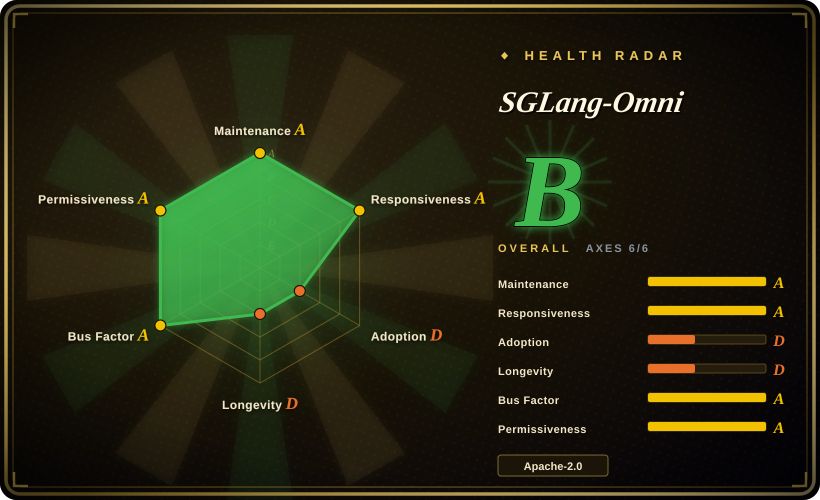
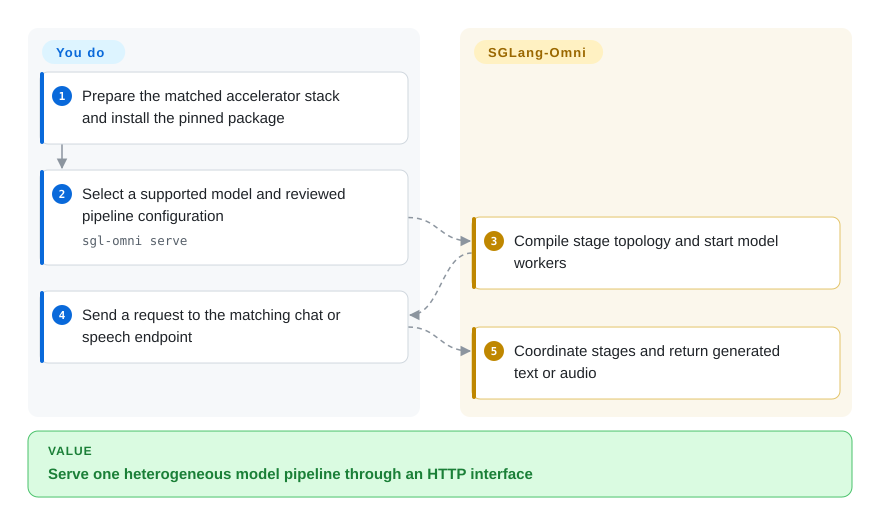
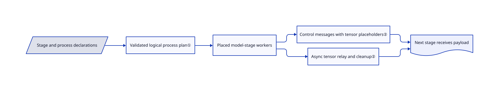

# SGLang-Omni

One speech request passes through encoders, token generation and audio decoding with different resource needs; SGLang-Omni runs those stages as a coordinated serving pipeline behind an HTTP API.

## When to use

You serve a supported speech or omni model and a single text-generation loop cannot represent its encoder, talker and vocoder work. Choose SGLang-Omni when explicit stage/process/GPU placement and streaming handoffs matter. It composes with SGLang where autoregressive execution fits, rather than replacing every model engine. You own hardware sizing, model licenses and the exposed API boundary.

## When NOT to use

- Only need text generation and prefix caching? Use [SGLang](sglang.md) without another stage runtime.
- Have an ordinary model already well supported by [vLLM](vllm.md)? Keep that simpler deployment unless multi-stage audio output is the actual requirement.
- Already operate vLLM and need heterogeneous multimodal output? Compare vLLM-Omni as the same-layer alternative, not only core vLLM; use it if its exact model/device recipe and stage-transfer requirements fit your stack. Do not infer a speed winner without testing the same workload.
- Need arbitrary business-model composition and cluster autoscaling? Choose [Ray Serve](ray-serve.md); this project specializes in model-family inference stages.
- Need full multimodal parity on a Mac? Use a model-specific local runtime instead. Apple Silicon support is experimental and limited to documented ASR paths, not all CUDA models.

## Comparison

| Alternative | In index | Our verdict | Tradeoff |
| --- | --- | --- | --- |
| [vLLM-Omni](https://github.com/vllm-project/vllm-omni) | not indexed | Evaluate vLLM-Omni when your supported target model and device recipe belong in an existing vLLM deployment; choose SGLang-Omni when its SGLang-backed stages and model integration match the deployment you own. | This is a same-layer heterogeneous serving framework, not core vLLM alone. Its [pinned README](https://github.com/vllm-project/vllm-omni/blob/c470395bde2f8de4f6f29b54adf970f885afa32f/README.md#about) documents OmniConnector stage handoffs, streaming and omni/TTS integrations; compare those transfers and the exact CUDA/ROCm/XPU/NPU model recipe against SGLang-Omni's relay/device path. Documentation does not establish blanket device parity or a throughput/latency winner. Not added in this tab batch. |
| [SGLang](sglang.md) | ✅ | Choose core SGLang for a normal autoregressive service; choose Omni for model pipelines that also own encoders, talkers and audio decoding. | Omni adds topology and lifecycle management over a core it can reuse. |
| [vLLM](vllm.md) | ✅ | Choose vLLM when its supported model and conventional serving interface suffice; choose Omni for its documented multi-stage speech integrations. | Broader established serving ecosystem versus explicit heterogeneous stages; verify model support rather than generalizing. |
| [Ray Serve](ray-serve.md) | ✅ | Choose Ray Serve for application-level model composition and scaling; choose Omni for low-level tensor handoffs inside one supported model family. | Generic distributed application framework versus specialized inference topology. |

## Quick start

Prepare the documented hardware stack and install `uv pip install --prerelease=allow "sglang-omni==0.1.8"` in a suitable environment. Start `sgl-omni serve` with a supported `--model-path`, or a reviewed YAML pipeline configuration. Send a chat or speech request to the matching OpenAI-style endpoint; the runtime coordinates stages and returns text or audio. You must size memory, obtain weights and secure network exposure: the documented default bind address is `0.0.0.0`. Installation examples include a privileged container and moving development tags, so do not copy them into production without reviewing privileges and pinning artifacts. See [installation](https://github.com/sgl-project/sglang-omni/blob/1db2fdef764759fa6605a5ae2940ae89b77a312e/docs/get_started/installation.md) and [API usage](https://github.com/sgl-project/sglang-omni/blob/1db2fdef764759fa6605a5ae2940ae89b77a312e/docs/get_started/apiserver_quickstart.md).

<!-- flow-steps:begin (generated from flows/sglang-omni.json by tools/flow_card.py — do not edit) -->

Text version of the flow

1. **You**: Prepare the matched accelerator stack and install the pinned package
2. **You**: Select a supported model and reviewed pipeline configuration — `sgl-omni serve`
3. **SGLang-Omni**: Compile stage topology and start model workers
4. **You**: Send a request to the matching chat or speech endpoint
5. **SGLang-Omni**: Coordinate stages and return generated text or audio

**Value**: Serve one heterogeneous model pipeline through an HTTP interface

<!-- flow-steps:end -->

## Key techniques

<!-- mechanism:begin (generated from mechanisms/sglang-omni.json by tools/mechanism_card.py; do not edit) -->

Text version of the mechanism

- Stage and process declarations
- Validated logical process plan①
- Placed model-stage workers
- Control messages with tensor placeholders②
- Async tensor relay and cleanup②
- Next stage receives payload

- Stage and process declarations → Validated logical process plan①
- Validated logical process plan① → Placed model-stage workers
- Placed model-stage workers → Control messages with tensor placeholders②
- Placed model-stage workers → Async tensor relay and cleanup②
- Control messages with tensor placeholders② → Next stage receives payload
- Async tensor relay and cleanup② → Next stage receives payload

<!-- mechanism:end -->

### 1. Compile process membership before workers start

- **Problem:** Stage replication and GPU placement can otherwise disagree about process ownership.
- **How:** A logical process plan groups declared stages, attaches replica policy and validates cross-process edges before later topology expansion. GPU replica declarations must match their parallelism.
- **Limits:** Valid topology does not guarantee the chosen model fits memory or achieves the desired latency.
- **Source:** [Process compilation](https://github.com/sgl-project/sglang-omni/blob/1db2fdef764759fa6605a5ae2940ae89b77a312e/sglang_omni/config/topology.py#L1-L229), [concrete placement profile](https://github.com/sgl-project/sglang-omni/blob/1db2fdef764759fa6605a5ae2940ae89b77a312e/examples/configs/qwen3_omni_colocated_h100_bf16.yaml).

### 2. Separate tensor transfer from control messages

- **Problem:** Large tensors should not be treated like ordinary serialized routing messages.
- **How:** Stage I/O extracts tensors into path-addressed placeholders. Relay backends expose asynchronous put/get handles with receiver metadata and cleanup; shared memory, NCCL, CUDA IPC, NIXL and Mooncake are selectable implementations.
- **Limits:** Backend dependencies and ownership/acknowledgment support vary; the abstraction is not a universal zero-copy or cross-platform guarantee.
- **Source:** [Tensor extraction](https://github.com/sgl-project/sglang-omni/blob/1db2fdef764759fa6605a5ae2940ae89b77a312e/sglang_omni/comm/stage_io.py#L34-L177), [relay contract](https://github.com/sgl-project/sglang-omni/blob/1db2fdef764759fa6605a5ae2940ae89b77a312e/sglang_omni/relay/base.py#L38-L150).

## Tech stack

Python 3.10–3.12, PyTorch, pinned SGLang and Transformers, ZeroMQ/MessagePack control traffic, FastAPI/Uvicorn API and native tensor-transfer backends.

## Dependencies

CUDA is the full-coverage primary path; other accelerator and CPU paths have separate manifests and limited support. The reviewed main manifest pins Torch 2.13.0, SGLang 0.5.21 and CUDA-13 transfer packages. Weights, GPU memory and model-specific extras are separate from the framework's Apache license.

## Ops difficulty

**High.** Align GPU drivers, kernels, UCX, transfer backends, model-stage memory budgets and pinned package versions. The installation document mixes image namespaces in its tag and digest examples; verify the actual image identity before deployment. Put authentication and network policy in front of a publicly bound API.

## Health & viability

- On 2026-10-18, v0.1.8 dated October 12, current commits and multiple substantive contributors show active SGLang-ecosystem development.
- Created January 2026, it remains pre-1.0. [推断：依据是年龄、版本与依赖锁定] Ecosystem backing improves support prospects, but rapid model and dependency changes weaken interface durability.
- Apache-2.0 covers the runtime; model weights and adapted model components require their own license review.

## Caveats (unverified)

- [未验证：本批禁止执行上游，未分配推理硬件] Throughput, latency, memory capacity and non-CUDA paths were not benchmarked.
- [未验证：未拉取或部署容器] The installation document's differing container namespaces were not reconciled against registry artifacts.
- [未验证：未运行两套推理服务或目标硬件] The vLLM-Omni comparison uses its pinned README, not a matched deployment test; no model/device parity or performance advantage is asserted.
- [推断：依据是年龄、版本与依赖锁定] Long-term compatibility is not established by current activity.
