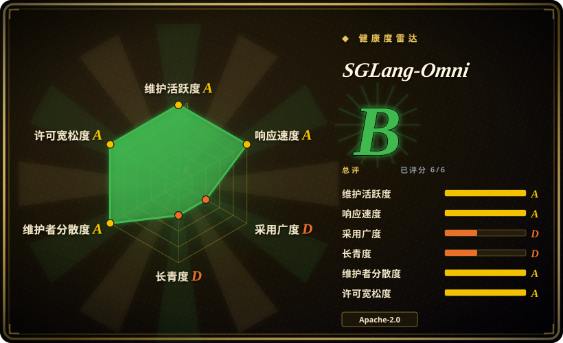
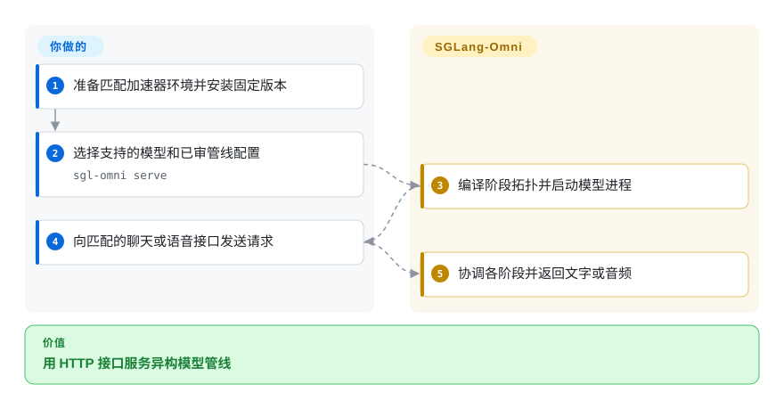
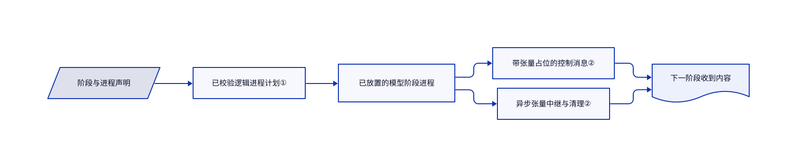

# SGLang-Omni

一次语音请求要经过编码、逐词生成和音频解码，资源需求各不相同。SGLang-Omni 把这些阶段编成协同管线，再提供 HTTP 接口。

## 何时使用

你要服务已支持的语音或全模态模型，单一文字生成循环装不下编码器、语音生成器和声码器。需要明确配置阶段、进程与 GPU 位置，并流式交接结果时，可选 SGLang-Omni。适用的自回归执行仍复用 SGLang，不是替换所有模型引擎。硬件容量、模型许可和接口防护仍归你。

## 何时不用

- 只要文字生成与前缀缓存，直接选 [SGLang](sglang.zh.md)，不必多加阶段运行时。
- 普通模型已由 [vLLM](vllm.zh.md) 支持，就保留较简单的部署，除非实际需要多阶段音频输出。
- 已运营 vLLM，又需要异构多模态输出时，应比较同层的 vLLM-Omni，而不只核心 vLLM。目标模型、设备配方与阶段传输都匹配时可选它；相同负载未实测前不能推断速度胜负。
- 要任意业务模型组合和集群扩缩，选 [Ray Serve](ray-serve.zh.md)，本项目专门处理模型内部推理阶段。
- 要 Mac 上完整多模态对等，应选专用本地运行时。Apple Silicon 路径仍实验性，只覆盖文档列出的语音识别，不等于全部 CUDA 模型。

## 横向对比

| 替代品 | 是否收录 | 我们的评价 | 取舍 |
| --- | --- | --- | --- |
| [vLLM-Omni](https://github.com/vllm-project/vllm-omni) | 未收录 | 已有 vLLM 部署且目标模型、设备配方受支持时评估 vLLM-Omni；已有 SGLang 阶段与对应模型集成更匹配时选 SGLang-Omni。 | 这是同层异构服务框架，不只是核心 vLLM。[固定说明](https://github.com/vllm-project/vllm-omni/blob/c470395bde2f8de4f6f29b54adf970f885afa32f/README.md#about)记载 OmniConnector 阶段交接、流式输出与全模态、语音集成；应逐一比较实际传输要求及 CUDA、ROCm、XPU、NPU 的目标模型配方，与 SGLang-Omni 的中继和设备路径对应。文档不证明全面设备对等或吞吐、延迟胜负。本次标签批次不新增该仓库。 |
| [SGLang](sglang.zh.md) | ✅ | 普通自回归服务选核心 SGLang；还要管理编码、语音生成和音频解码时选 Omni。 | Omni 在可复用核心之上增加拓扑与生命周期管理。 |
| [vLLM](vllm.zh.md) | ✅ | 已支持模型与常规服务接口够用时选 vLLM；需要文档明确的多阶段语音集成时选 Omni。 | 较成熟的服务生态，对比显式异构阶段；必须逐模型核对支持。 |
| [Ray Serve](ray-serve.zh.md) | ✅ | 应用级模型组合与扩缩选 Ray Serve；同一模型家族内部的张量交接选 Omni。 | 通用分布式框架，对比专用推理拓扑。 |

## 快速上手

先准备文档对应的硬件环境，再安装 `uv pip install --prerelease=allow "sglang-omni==0.1.8"`。用 `sgl-omni serve` 指定受支持的 `--model-path`，或提供已审 YAML 管线配置。向匹配的 OpenAI 风格聊天或语音地址发请求，运行时协调阶段并返回文字或音频。你负责显存、权重和网络防护；文档默认监听地址为 `0.0.0.0`。安装示例包含特权容器与滚动开发标签，不能不审权限、不固定产物就搬进生产。来源为[安装说明](https://github.com/sgl-project/sglang-omni/blob/1db2fdef764759fa6605a5ae2940ae89b77a312e/docs/get_started/installation.md)和[接口用法](https://github.com/sgl-project/sglang-omni/blob/1db2fdef764759fa6605a5ae2940ae89b77a312e/docs/get_started/apiserver_quickstart.md)。

<!-- flow-steps:begin (generated from flows/sglang-omni.json by tools/flow_card.py — do not edit) -->

流程文字版

1. **你**：准备匹配加速器环境并安装固定版本
2. **你**：选择支持的模型和已审管线配置 — `sgl-omni serve`
3. **SGLang-Omni**：编译阶段拓扑并启动模型进程
4. **你**：向匹配的聊天或语音接口发送请求
5. **SGLang-Omni**：协调各阶段并返回文字或音频

**价值**：用 HTTP 接口服务异构模型管线

<!-- flow-steps:end -->

## 技术要点

<!-- mechanism:begin (generated from mechanisms/sglang-omni.json by tools/mechanism_card.py; do not edit) -->

机制文字版

- 阶段与进程声明
- 已校验逻辑进程计划①
- 已放置的模型阶段进程
- 带张量占位的控制消息②
- 异步张量中继与清理②
- 下一阶段收到内容

- 阶段与进程声明 → 已校验逻辑进程计划①
- 已校验逻辑进程计划① → 已放置的模型阶段进程
- 已放置的模型阶段进程 → 带张量占位的控制消息②
- 已放置的模型阶段进程 → 异步张量中继与清理②
- 带张量占位的控制消息② → 下一阶段收到内容
- 异步张量中继与清理② → 下一阶段收到内容

<!-- mechanism:end -->

### 1. 启动工作进程前编译归属关系

- **解决：** 阶段副本与 GPU 放置容易对进程归属产生不同理解。
- **做法：** 逻辑进程计划按声明分组阶段，附加副本策略，并在展开拓扑之前检查跨进程边。GPU 副本声明必须匹配并行规模。
- **边界：** 拓扑有效不证明显存装得下，也不证明延迟达标。
- **源码：** [进程编译](https://github.com/sgl-project/sglang-omni/blob/1db2fdef764759fa6605a5ae2940ae89b77a312e/sglang_omni/config/topology.py#L1-L229)、[实际放置配置](https://github.com/sgl-project/sglang-omni/blob/1db2fdef764759fa6605a5ae2940ae89b77a312e/examples/configs/qwen3_omni_colocated_h100_bf16.yaml)。

### 2. 张量传输与控制消息分开

- **解决：** 大张量不适合当作普通序列化路由消息传递。
- **做法：** 阶段输入输出把张量提取成按路径标识的占位。中继后端提供异步读写、接收端元数据与清理契约，可选共享内存、NCCL、CUDA IPC、NIXL 和 Mooncake。
- **边界：** 后端依赖、所有权和确认能力不同，不是通用零拷贝或跨平台保证。
- **源码：** [张量提取](https://github.com/sgl-project/sglang-omni/blob/1db2fdef764759fa6605a5ae2940ae89b77a312e/sglang_omni/comm/stage_io.py#L34-L177)、[中继契约](https://github.com/sgl-project/sglang-omni/blob/1db2fdef764759fa6605a5ae2940ae89b77a312e/sglang_omni/relay/base.py#L38-L150)。

## 技术栈

Python 3.10 至 3.12、PyTorch、固定版本 SGLang 与 Transformers、ZeroMQ 和 MessagePack 控制消息、FastAPI 与 Uvicorn 接口，以及原生张量传输后端。

## 依赖

完整覆盖以 CUDA 为主，其他加速器和 CPU 使用独立清单且支持有限。已读主清单固定 Torch 2.13.0、SGLang 0.5.21 和 CUDA 13 传输包。权重、显存及模型扩展独立于框架的 Apache 许可。

## 运维难度

**高。** 需要对齐驱动、内核、UCX、传输后端、阶段显存预算与依赖版本。安装文档的标签和摘要示例使用不同镜像命名空间，部署前必须确认真实产物。对外接口前还需认证与网络策略。

## 健康度与可持续性

- 截至 2026-10-18，v0.1.8 于 10 月 12 日发布，近期提交和多名实质贡献者表明生态仍活跃。
- 仓库创建于 2026 年 1 月，尚未到 1.0。[推断：依据是年龄、版本与依赖锁定] 生态支持有利维护，但模型与依赖快速变化削弱接口耐久性。
- 运行时采用 Apache-2.0，权重与改编模型组件需要分别审许可。

## 存疑（未验证）

- [未验证：本批禁止执行上游，未分配推理硬件] 未测吞吐、延迟、显存和非 CUDA 路径。
- [未验证：未拉取或部署容器] 未通过注册表产物核对文档的不同镜像命名空间。
- [未验证：未运行两套推理服务或目标硬件] vLLM-Omni 比较来自固定说明，未做同条件部署测试，不承诺模型、设备对等或性能优势。
- [推断：依据是年龄、版本与依赖锁定] 当前活跃不证明长期兼容。
