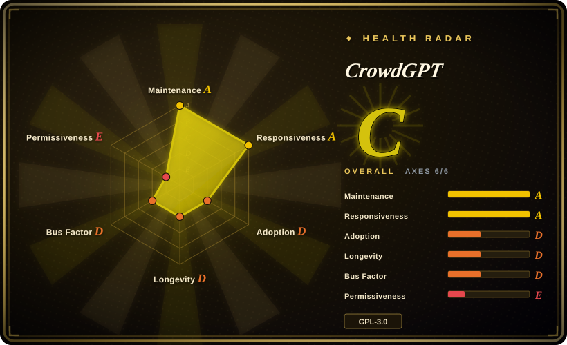
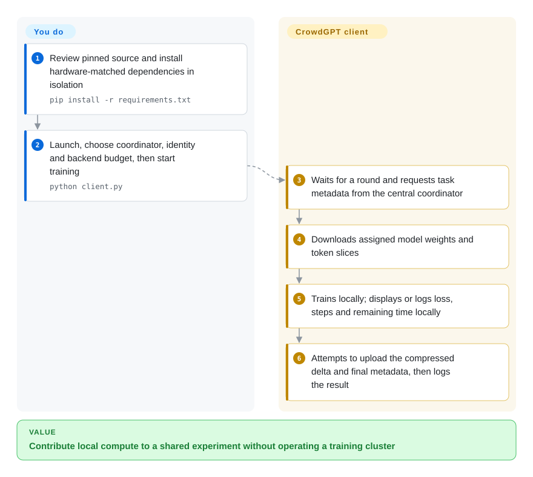
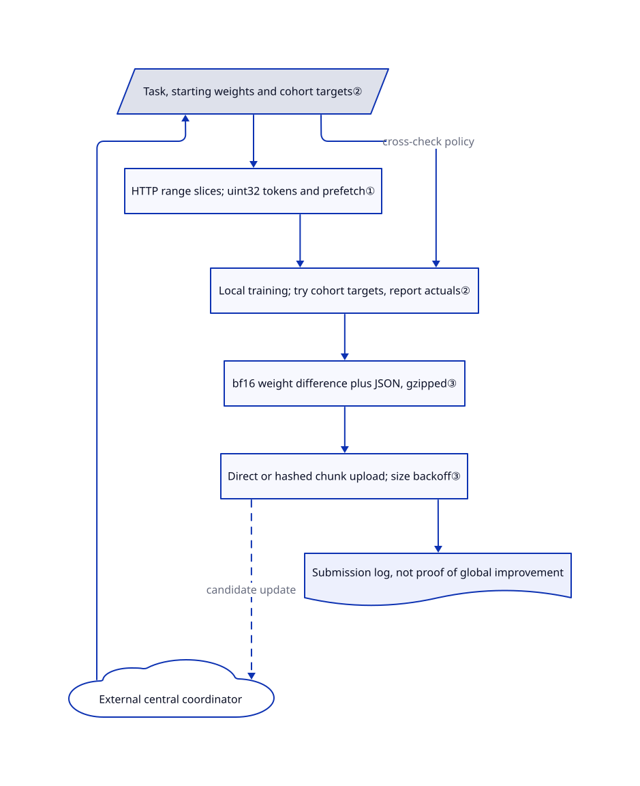

# CrowdGPT

You want your spare machine to contribute to a shared language model, not start another private fine-tune. CrowdGPT downloads an assigned training task, trains locally and uploads a weight difference to a central coordinator; this repository is the contributor client, not a chatbot or a complete self-hosted training service.

## When to use

You are a developer exploring volunteer training over home connections, or a participant willing to donate compute to CrowdGPT's model. You want to inspect a Python client with a desktop interface and a headless path, control its backend and placement budget, and watch task, loss and upload progress. The coordinator chooses tasks and global model state; you supply the machine, electricity, bandwidth and trust decision.

Choose it over a normal fine-tuning framework when participation in this particular shared experiment is the point. Choose a normal trainer when owning the dataset, target architecture and final checkpoint is the point. The [architecture document](https://github.com/Vxtzq/CrowdGPT/blob/02774d98580c9095361e16f75eb2b62bc44b3a5e/docs/ARCHITECTURE.md#L5-L19) explicitly describes a centralized coordinator. The fixed tree contains the client and optional verification helpers, but not the primary coordinator implementation; “without datacenters” does not mean coordinator-free or free of local resource costs.

## When NOT to use

- **You want to train your own chosen model on private data.** Choose [LlamaFactory](llamafactory.md) for configurable model/data recipes, or [Unsloth](unsloth.md) for a supported single-GPU fine-tune. CrowdGPT's reviewed client hard-codes its model configuration and defaults to tasks from the CrowdGPT coordinator; an editable server URL is not a complete general-purpose training platform.
- **You need a self-hostable, independently operated distributed-training stack.** Compare [Colossal-AI](colossalai.md), including its maintenance warning, for a cluster you control. CrowdGPT does not include the main server, acceptance policy or deployment package needed to reproduce its whole service.
- **You require a stable or unattended resource budget with durable restart recovery.** Prefer a pinned [LlamaFactory](llamafactory.md) workflow with your own scheduler and checkpoint policy. Here the default is repeated rounds, stopping before upload discards that round's contribution, and the inspected upload path holds compressed deltas in memory rather than saving a resumable pending job.
- **Your workstation must never execute downloaded code or replace its own application files.** Use an isolated [Unsloth](unsloth.md) training environment you audit and pin instead. CrowdGPT's updater replaces client files from moving `main`, and its tokenizer loader uses `trust_remote_code=True`; the architecture document's absolute safety language is not a sandbox guarantee. Review these paths before granting network or filesystem access.
- **You depend on one unambiguous license label or a single authoritative data-format document.** Prefer an independently pinned [LlamaFactory](llamafactory.md) recipe while resolving the conflict. The root license and September 20 history establish GPLv3 for this code, despite a remaining MIT badge. Data docs describe `uint16` and inconsistent shard sizes, while the reviewed client reads `uint32` tokens. Do not construct training shards from the prose alone.

## Comparison

| Alternative | In index | Our verdict | Tradeoff |
|---|---|---|---|
| [Unsloth](unsloth.md) | ✅ | Choose Unsloth for your own supported model and single-GPU fine-tune; choose CrowdGPT when donating a local round to its shared model is itself the objective. | Unsloth optimizes your training workflow; CrowdGPT supplies a contribution protocol and progress UI but leaves global model/data decisions to its coordinator. |
| [LlamaFactory](llamafactory.md) | ✅ | Choose LlamaFactory when a reviewable model/dataset/method recipe matters; choose CrowdGPT for joining its existing volunteer experiment without designing a recipe. | Broad configurable fine-tuning versus a narrow client for coordinator-assigned work, with less control over the shared model's outcome. |
| [Colossal-AI](colossalai.md) | ✅ | Choose Colossal-AI only when you own a GPU cluster and need distributed model-state sharding, after checking its maintenance caveat; choose CrowdGPT to study or join local-update uploads over participant connections. | Cluster topology and sharded training are yours with Colossal-AI; CrowdGPT avoids that participant-side orchestration but depends on a separately operated central service. |

## Quick start

Inspect a checkout pinned to the reviewed SHA and choose an isolated, hardware-matched Python environment. The [README](https://github.com/Vxtzq/CrowdGPT/blob/02774d98580c9095361e16f75eb2b62bc44b3a5e/README.md#L44-L85) favors one-line installers and marks manual installation deprecated, but still documents `pip install -r requirements.txt` for CPU/Apple and `python client.py` for launch, with separate CUDA/ROCm/DirectML requirements. The installer enforces Python 3.10 or newer, not the README's 3.8 badge; inspect it before use because it can install system dependencies, reset its source checkout and synchronize an application directory. In the client, choose the coordinator, account or anonymous mode, hardware backend and placement budget, then start; the client obtains weights and token shards, trains an assigned round and attempts to upload the compressed delta. Progress events display or log loss, steps and remaining time locally; final upload metadata includes loss, completed steps and actual cohort values, not remaining time. The [headless parser](https://github.com/Vxtzq/CrowdGPT/blob/02774d98580c9095361e16f75eb2b62bc44b3a5e/client.py#L2490-L2515) also exposes `--rounds`, `--no-update` and `--no-tokenizer` for explicit execution control; `--dry-run` still contacts the coordinator and is not an offline check. Watch logs for upload success rather than treating process exit as acceptance: the headless loop can log a failed round and still return zero. Stop through the UI or a handled termination signal, let the worker exit, and preserve local settings and any needed checkpoint files before removal; a successful upload is not proof that the global model improved.

<!-- flow-steps:begin (generated from flows/crowdgpt.json by tools/flow_card.py — do not edit) -->

Text version of the flow

1. **You**: Review pinned source and install hardware-matched dependencies in isolation — `pip install -r requirements.txt`
2. **You**: Launch, choose coordinator, identity and backend budget, then start training — `python client.py`
3. **CrowdGPT**: Waits for a round and requests task metadata from the central coordinator
4. **CrowdGPT**: Downloads assigned model weights and token slices
5. **CrowdGPT**: Trains locally; displays or logs loss, steps and remaining time locally
6. **CrowdGPT**: Attempts to upload the compressed delta and final metadata, then logs the result

**Value**: Contribute local compute to a shared experiment without operating a training cluster

<!-- flow-steps:end -->

## Key techniques

<!-- mechanism:begin (generated from mechanisms/crowdgpt.json by tools/mechanism_card.py; do not edit) -->

Text version of the mechanism

- External central coordinator
- Task, starting weights and cohort targets②
- HTTP range slices; uint32 tokens and prefetch①
- Local training; try cohort targets, report actuals②
- bf16 weight difference plus JSON, gzipped③
- Direct or hashed chunk upload; size backoff③
- Submission log, not proof of global improvement

- External central coordinator → Task, starting weights and cohort targets②
- Task, starting weights and cohort targets② → HTTP range slices; uint32 tokens and prefetch①
- HTTP range slices; uint32 tokens and prefetch① → Local training; try cohort targets, report actuals②
- Task, starting weights and cohort targets② → Local training; try cohort targets, report actuals② (cross-check policy)
- Local training; try cohort targets, report actuals② → bf16 weight difference plus JSON, gzipped③
- bf16 weight difference plus JSON, gzipped③ → Direct or hashed chunk upload; size backoff③
- Direct or hashed chunk upload; size backoff③ → External central coordinator (candidate update) [optional/fallback]
- Direct or hashed chunk upload; size backoff③ → Submission log, not proof of global improvement

<!-- mechanism:end -->

### 1. Read assigned token shards by byte range and prefetch the next slice

- **Problem:** A volunteer client should not need the whole training corpus before taking a local step.
- **How:** The dataset discovers a chunk's size, requests a slice using HTTP `Range`, interprets it as `uint32` tokens and prepares a following slice on a worker thread. Participant slots offset the starting slice; ordinary mode advances after 500 batch requests, while cohort mode holds the slice fixed.
- **Limits:** This depends on compatible dataset bytes and server range behavior. The code does not establish that a range response is partial before reading its body. The published `uint16` documentation disagrees with the source, so mixing formats can invalidate training without being a network failure.
- **Source:** [range loading and token format](https://github.com/Vxtzq/CrowdGPT/blob/02774d98580c9095361e16f75eb2b62bc44b3a5e/client.py#L1078-L1125), [prefetch and cohort behavior](https://github.com/Vxtzq/CrowdGPT/blob/02774d98580c9095361e16f75eb2b62bc44b3a5e/client.py#L1127-L1186), [conflicting data description](https://github.com/Vxtzq/CrowdGPT/blob/02774d98580c9095361e16f75eb2b62bc44b3a5e/docs/DATA.md#L11-L16).

### 2. Try to align cohort settings and report actual execution

- **Problem:** A coordinator cannot compare local updates as peers if each client quietly uses different seeds, batches or step counts.
- **How:** Cohort metadata carries a seed, local-step target, batch target, accumulation count and autocast policy. The client tries to align these settings through prechecks, a fixed data slot and skipped speed calibration, then reports `crossCheckUsed`, actual seed, steps and batch size with the delta.
- **Limits:** Alignment is best effort, not a strict match-or-opt-out invariant. After the batch precheck, a model-build OOM retry can halve `bs` without clearing `cohort_mode`; `crossCheckUsed=true` can therefore accompany an `actualBatchSize` below the target. Later cohort-training OOM handling aborts, and an incomplete step count falls back to non-cohort submission, but neither repairs that earlier exception. This is static control-flow evidence, not a reproduced OOM. The flag proves neither identical parameters nor honest training; server-side enforcement is outside this tree.
- **Source:** [metadata completeness](https://github.com/Vxtzq/CrowdGPT/blob/02774d98580c9095361e16f75eb2b62bc44b3a5e/client.py#L1823-L1845), [batch precheck and build retry](https://github.com/Vxtzq/CrowdGPT/blob/02774d98580c9095361e16f75eb2b62bc44b3a5e/client.py#L1923-L1953), [later cohort checks](https://github.com/Vxtzq/CrowdGPT/blob/02774d98580c9095361e16f75eb2b62bc44b3a5e/client.py#L1968-L2003), [reported facts and upload metadata](https://github.com/Vxtzq/CrowdGPT/blob/02774d98580c9095361e16f75eb2b62bc44b3a5e/client.py#L2184-L2242).

### 3. Compress local weight differences and adapt uploads to request limits

- **Problem:** A local training round produces a large update that may exceed a server's single-request limit.
- **How:** The client subtracts the starting weights, stores the difference as bf16, prepends JSON metadata and gzip-compresses it. Small payloads try direct upload; larger ones use initialization, indexed chunks and finalization with whole-payload and per-chunk SHA-256 values. A size rejection halves chunks down to an 8 MiB floor.
- **Limits:** Deltas still cover dense base-model parameters; this is not sparse-gradient magic. Gzip output and upload slices live in memory, and this path does not persist an upload ID for restart recovery. Chunk-level rate limiting can continue waiting without consuming the ordinary retry counter; a 200 response only establishes what the client logs, not independently audited model promotion.
- **Source:** [delta and gzip](https://github.com/Vxtzq/CrowdGPT/blob/02774d98580c9095361e16f75eb2b62bc44b3a5e/client.py#L1770-L1801), [chunk protocol and retries](https://github.com/Vxtzq/CrowdGPT/blob/02774d98580c9095361e16f75eb2b62bc44b3a5e/client.py#L1643-L1698), [submission routing and cleanup](https://github.com/Vxtzq/CrowdGPT/blob/02774d98580c9095361e16f75eb2b62bc44b3a5e/client.py#L2227-L2287).

## Tech stack

- Python and PyTorch model/training code; NumPy token handling, Requests networking, gzip/struct payloads and safetensors weights.
- pywebview desktop shell with a local HTML/JavaScript interface; a separate headless CLI uses the same round implementation.
- Additional HiveMind bridge and held-out-loss receipt modules are present. They are integration building blocks, not evidence that the separately operated coordinator has deployed them; the collaboration document remains explicitly proposed.

## Dependencies

- A working Python 3.10+ installation per the installer, a compatible PyTorch backend and substantial model/optimizer RAM. The client offers CPU, CUDA, ROCm, MPS, XPU and DirectML paths, not a measured promise of equal support or speed.
- The default requirements name `torch>=2.6.0`, NumPy, Requests, Rich, psutil, safetensors, huggingface_hub, transformers, sentencepiece, tiktoken and pywebview; hardware-specific files alter that environment. This is not a fully locked dependency graph.
- Network access to a coordinator, Hugging Face weights/data/tokenizers and GitHub update files. Weights and data are external artifacts with their own terms; the repository's code license does not settle their provenance or rights.
- No paid model API key is required for the training path. Electricity, GPU occupancy, bandwidth, account data sent to the coordinator and separately hosted infrastructure are still real costs or trust boundaries.

## Ops difficulty

**Medium to high for a participant; incomplete as a self-hosted service.** Starting the GUI is only one part: match GPU wheels and drivers, audit remote tokenizer code and updates, budget model downloads and memory, and monitor actual upload results. The installer uses moving source branches, may overwrite an existing checkout and writes launch integration; pinning the initial download does not freeze subsequent updates. Settings and weights remain under the working directory's `checkpoints/`, with automatic cache pruning; the updater also prunes old backup files. Stop training before removing the app. Removing local files cannot retract an uploaded delta or delete a coordinator account, and the inspected repository provides no complete account/data-deletion workflow.

## Health & viability

- **Maintenance, 2026-10-27:** active and not archived, with recent hardware-install and training changes. The release named `CrowdGPT` from October 16 distributes an installer that fetches later scripts; it is not a frozen v1.5 client release. README changelog text warns that server/security work may break contribution submission.
- **Governance and age, 2026-10-27:** user-owned, created 2026-08-18, about ten weeks old; the contributor sample is strongly owner-dominated, although merged HiveMind contributions are independently visible in PRs 22 and 28. No dedicated governance, security policy, contribution guide or CI/test tree appears in the fixed inventory. [推断：based on age, concentrated commits and moving installer behavior] Treat it as an inspectable community experiment, not a durable training platform with a strong Lindy record.
- **License history, 2026-10-27:** the complete root license is GPLv3. September 20 commits explicitly change MIT to GPL and replace a custom GPL text with GNU GPLv3. The README and website still display MIT; use the root text, retain notices and resolve redistribution questions before embedding code. The proposed collaboration document says contributions here are GPL-3.0 and separately identifies model weights as MIT, but that is not an independent audit of external artifacts.
- **Adoption and risk, 2026-10-27:** stars and hardware issue reports show interest and attempted use, not a verified participant count, global-model quality or successful scaling. Optional Multi-Krum and loss-receipt helpers do not establish live coordinator enforcement. The README's zero-cost and absolute safety framing should not override the actual updater, tokenizer and central-service trust boundaries.

## Caveats (unverified)

- [未验证：upstream execution, installation, model/data downloads and browser use were prohibited] No installation, authentication, training, memory limit, upload recovery or performance claim was runtime-tested. Neither model improvement nor server availability is certified.
- [未验证：the main coordinator implementation and live deployment were not provided in this repository] Aggregation, anti-poisoning, receipt enforcement, account retention and model-promotion behavior remain outside the inspected client. The public contribution PRs and proposed agreement are not deployment proof.
- [未验证：no independent model/data rights audit was performed] Source review resolves the code's GPLv3/MIT badge conflict using license history, not every external artifact's license. Keep GPL notices and verify model/data terms separately.
- [推断：based on the opened indexed pages and inspected input/output boundaries] Comparison verdicts concern who controls the training task, not measured model quality, cost or throughput.
