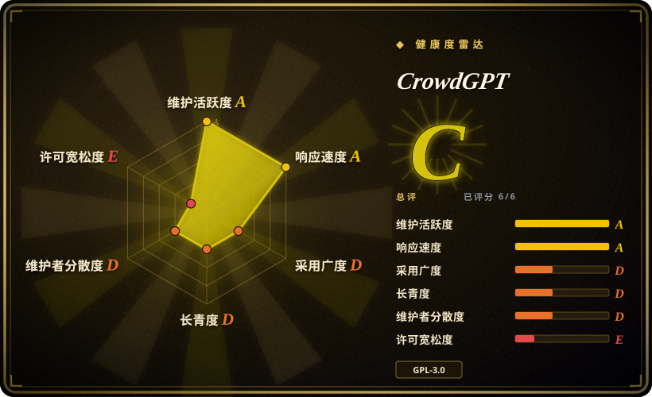
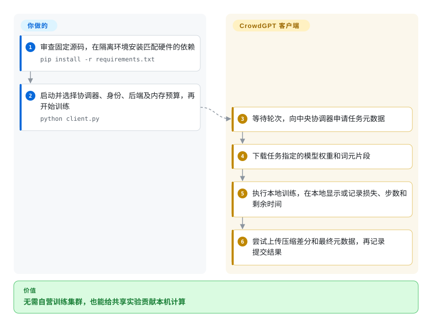
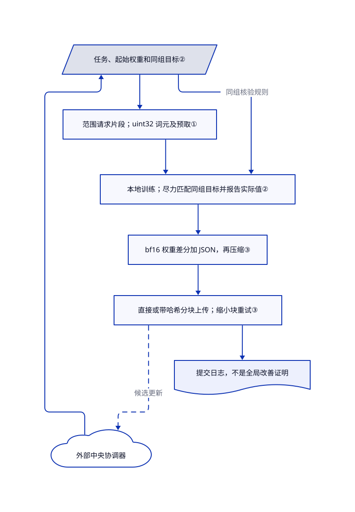

# CrowdGPT

你想让闲置机器参与训练共享语言模型，而非再做一次私人微调。CrowdGPT 下载分配的任务，在本地训练后把权重差分交给中央协调器；此仓库是贡献者客户端，不是聊天应用，也不是完整的自托管训练服务。

## 何时使用

你是研究家庭网络协作训练的开发者，或愿意给 CrowdGPT 模型贡献算力的参与者。你希望阅读带桌面界面和无界面入口的 Python 客户端，控制计算后端与放置预算，并查看任务、损失和上传进度。协调器决定任务及全局模型状态；机器、电费、带宽和信任判断由你承担。

目标就是加入这个共享实验时，选它而非普通微调框架。目标是自己决定数据、模型架构和最终检查点时，选普通训练器。[架构文档](https://github.com/Vxtzq/CrowdGPT/blob/02774d98580c9095361e16f75eb2b62bc44b3a5e/docs/ARCHITECTURE.md#L5-L19) 明说采用中央协调器。固定树含客户端与可选验证组件，却没有主要协调器实现；“不用数据中心”不等于没有中央节点，也不等于不消耗本机资源。

## 何时不用

- **你要用私有数据训练自己选择的模型。** 需要可配置模型和数据配方时，选 [LlamaFactory](llamafactory.zh.md)；做受支持的单卡微调时，选 [Unsloth](unsloth.zh.md)。核验的客户端固定了模型配置，默认接收 CrowdGPT 协调器的任务；能修改服务器地址，不等于具备通用训练平台。
- **你需要可自行部署、独立运营的分布式训练栈。** 有自有集群时可比较 [Colossal-AI](colossalai.zh.md)，但先读其维护提醒。CrowdGPT 没有附带复现完整服务所需的主服务端、接纳规则和部署包。
- **你要求稳定、无人值守的资源预算和持久重启恢复。** 优先用固定版本的 [LlamaFactory](llamafactory.zh.md) 流程，自己管理调度与检查点。这里默认反复执行轮次，上传前停止会放弃本轮贡献；已读上传路径把压缩差分留在内存，没有保存可恢复的待传任务。
- **工作站绝不能运行下载代码或替换自身应用文件。** 改用自己审计并固定版本的独立 [Unsloth](unsloth.zh.md) 训练环境。CrowdGPT 更新器会从变化的 `main` 替换客户端文件，分词器加载使用 `trust_remote_code=True`；架构文档中的绝对安全表述不是沙箱保证。授权联网及文件访问前先审查这些路径。
- **你要求单一明确的许可标签或唯一可信的数据格式文档。** 冲突解决前，优先采用独立固定的 [LlamaFactory](llamafactory.zh.md) 配方。根许可和九月二十日的历史确立代码为 GPLv3，但仍残留 MIT 徽章。数据文档描述 `uint16`，分片大小也自相矛盾，核验客户端却读取 `uint32`。不要只按介绍正文制作训练分片。

## 横向对比

| 替代品 | 是否收录 | 我们的评价 | 取舍 |
|---|---|---|---|
| [Unsloth](unsloth.zh.md) | 已收录 | 要自己选择受支持模型并做单卡微调时，选 Unsloth；目标就是给共享模型捐出一轮本机计算时，选 CrowdGPT。 | Unsloth 优化你自己的训练流程；CrowdGPT 提供贡献协议和进度界面，但全局模型与数据决策归协调器。 |
| [LlamaFactory](llamafactory.zh.md) | 已收录 | 重视可审查的模型、数据和训练方法配方时，选 LlamaFactory；不设计配方、只加入现有志愿实验时，选 CrowdGPT。 | 广泛可配置的微调，对比分配任务的专用客户端；后者对共享模型结果的控制更少。 |
| [Colossal-AI](colossalai.zh.md) | 已收录 | 拥有 GPU 集群并需要切分模型状态时，核对维护风险后选 Colossal-AI；要研究或参与家庭网络上的本地更新上传时，选 CrowdGPT。 | Colossal-AI 的集群拓扑和分片训练由你运营；CrowdGPT 省去参与端的这部分编排，却依赖另行运营的中央服务。 |

## 快速上手

先审查固定到核验提交的源码，选择隔离且匹配硬件的 Python 环境。[README](https://github.com/Vxtzq/CrowdGPT/blob/02774d98580c9095361e16f75eb2b62bc44b3a5e/README.md#L44-L85) 主推单行安装器，把手工安装标为弃用，但仍列出 CPU／Apple 的 `pip install -r requirements.txt` 和启动命令 `python client.py`，另有 CUDA／ROCm／DirectML 依赖文件。安装器要求 Python 3.10 或更新版本，不是徽章中的 3.8；使用前先审查，因为它可能安装系统依赖、重置源码工作目录并同步应用目录。在客户端选择协调器、账号或匿名模式、计算后端及放置预算，再开始；客户端取得权重和词元分片，训练分配轮次并尝试上传压缩差分。进度事件在本地显示或记录损失、步数和剩余时间；最终上传元数据包含损失、完成步数及实际同组参数，不含剩余时间。[无界面参数](https://github.com/Vxtzq/CrowdGPT/blob/02774d98580c9095361e16f75eb2b62bc44b3a5e/client.py#L2490-L2515) 还提供 `--rounds`、`--no-update` 和 `--no-tokenizer` 控制执行；`--dry-run` 仍联系协调器，不是离线检查。应查看日志中的上传成功信息，不能把进程退出当作接纳证明：无界面循环可能记录轮次失败后仍返回零。通过界面或已处理的终止信号停止，等工作线程退出，移除前保留需要的本地设置和检查点；上传成功也不证明全局模型改善。

<!-- flow-steps:begin (generated from flows/crowdgpt.json by tools/flow_card.py — do not edit) -->

流程文字版

1. **你**：审查固定源码，在隔离环境安装匹配硬件的依赖 — `pip install -r requirements.txt`
2. **你**：启动并选择协调器、身份、后端及内存预算，再开始训练 — `python client.py`
3. **CrowdGPT**：等待轮次，向中央协调器申请任务元数据
4. **CrowdGPT**：下载任务指定的模型权重和词元片段
5. **CrowdGPT**：执行本地训练，在本地显示或记录损失、步数和剩余时间
6. **CrowdGPT**：尝试上传压缩差分和最终元数据，再记录提交结果

**价值**：无需自营训练集群，也能给共享实验贡献本机计算

<!-- flow-steps:end -->

## 技术要点

<!-- mechanism:begin (generated from mechanisms/crowdgpt.json by tools/mechanism_card.py; do not edit) -->

机制文字版

- 外部中央协调器
- 任务、起始权重和同组目标②
- 范围请求片段；uint32 词元及预取①
- 本地训练；尽力匹配同组目标并报告实际值②
- bf16 权重差分加 JSON，再压缩③
- 直接或带哈希分块上传；缩小块重试③
- 提交日志，不是全局改善证明

- 外部中央协调器 → 任务、起始权重和同组目标②
- 任务、起始权重和同组目标② → 范围请求片段；uint32 词元及预取①
- 范围请求片段；uint32 词元及预取① → 本地训练；尽力匹配同组目标并报告实际值②
- 任务、起始权重和同组目标② → 本地训练；尽力匹配同组目标并报告实际值②（同组核验规则）
- 本地训练；尽力匹配同组目标并报告实际值② → bf16 权重差分加 JSON，再压缩③
- bf16 权重差分加 JSON，再压缩③ → 直接或带哈希分块上传；缩小块重试③
- 直接或带哈希分块上传；缩小块重试③ → 外部中央协调器（候选更新）〔可选／兜底〕
- 直接或带哈希分块上传；缩小块重试③ → 提交日志，不是全局改善证明

<!-- mechanism:end -->

### 1. 按字节范围读取任务词元分片，并预取下一段

- **解决：** 志愿客户端不应下载整个语料，才能开始一个本地训练步骤。
- **做法：** 数据集先发现块大小，用 HTTP `Range` 请求片段，按 `uint32` 词元解释，并在线程中准备下一段。参与者槽位决定初始偏移；普通模式每取五百批后换段，同组核验模式则固定片段。
- **边界：** 依赖兼容的数据字节及服务端范围请求行为。代码读取响应体前，没有确认返回的确为部分内容。公开的 `uint16` 说明与源码不符，混用格式会让训练失效，却不一定表现为网络错误。
- **源码：** [范围读取与词元格式](https://github.com/Vxtzq/CrowdGPT/blob/02774d98580c9095361e16f75eb2b62bc44b3a5e/client.py#L1078-L1125)、[预取与同组行为](https://github.com/Vxtzq/CrowdGPT/blob/02774d98580c9095361e16f75eb2b62bc44b3a5e/client.py#L1127-L1186)、[冲突的数据说明](https://github.com/Vxtzq/CrowdGPT/blob/02774d98580c9095361e16f75eb2b62bc44b3a5e/docs/DATA.md#L11-L16)。

### 2. 尽力匹配同组参数，并报告实际执行值

- **解决：** 各客户端悄悄使用不同随机种子、批量或步数时，协调器无法把本地更新当作可比较的同组结果。
- **做法：** 同组元数据包含随机种子、本地步数、批量、累积次数和自动精度规则。客户端通过预检查、固定数据槽位和跳过速度校准尽力匹配这些参数，再随差分上报是否使用同组核验及实际种子、步数和批量。
- **边界：** 这不是“严格同参，否则退出”的不变量。批量预检查之后，构建模型的显存不足重试可把 `bs` 减半，却不清除 `cohort_mode`；因此 `crossCheckUsed=true` 仍可伴随小于目标的 `actualBatchSize`。后续同组训练遇到显存不足会中止，步数不足会退回普通提交，但两者不能补上先前的例外。这是静态控制流证据，不是实际显存不足复现。该标志既不证明严格同参，也不证明诚实训练；服务端执行规则不在本树中。
- **源码：** [元数据完整性](https://github.com/Vxtzq/CrowdGPT/blob/02774d98580c9095361e16f75eb2b62bc44b3a5e/client.py#L1823-L1845)、[批量预检查与构建重试](https://github.com/Vxtzq/CrowdGPT/blob/02774d98580c9095361e16f75eb2b62bc44b3a5e/client.py#L1923-L1953)、[后续同组检查](https://github.com/Vxtzq/CrowdGPT/blob/02774d98580c9095361e16f75eb2b62bc44b3a5e/client.py#L1968-L2003)、[实际状态及上传元数据](https://github.com/Vxtzq/CrowdGPT/blob/02774d98580c9095361e16f75eb2b62bc44b3a5e/client.py#L2184-L2242)。

### 3. 压缩本地权重差分，按请求上限调整上传

- **解决：** 本地训练产生的大更新可能超过服务器单请求限制。
- **做法：** 客户端减去起始权重，用 bf16 保存差分，前置 JSON 元数据后以 gzip 压缩。小载荷先直接上传，大载荷走初始化、编号分块和最终确认，并带整包及逐块 SHA-256。收到大小拒绝时，块大小减半，最低八 MiB。
- **边界：** 差分仍覆盖稠密底座参数，不是稀疏梯度魔法。压缩输出和上传切片驻留内存，此路径未持久化上传标识供重启恢复。分块限流等待可不消耗普通重试次数；收到二百状态只代表客户端记录的结果，不是独立审计过的模型晋级。
- **源码：** [差分与压缩](https://github.com/Vxtzq/CrowdGPT/blob/02774d98580c9095361e16f75eb2b62bc44b3a5e/client.py#L1770-L1801)、[分块协议与重试](https://github.com/Vxtzq/CrowdGPT/blob/02774d98580c9095361e16f75eb2b62bc44b3a5e/client.py#L1643-L1698)、[提交路由和清理](https://github.com/Vxtzq/CrowdGPT/blob/02774d98580c9095361e16f75eb2b62bc44b3a5e/client.py#L2227-L2287)。

## 技术栈

- Python／PyTorch 模型及训练代码；NumPy 处理词元，Requests 联网，gzip／struct 编码载荷，safetensors 存权重。
- pywebview 桌面壳配本地 HTML／JavaScript 界面；独立无界面命令行复用同一轮次实现。
- 另有 HiveMind 桥接和保留集损失收据模块。它们是集成组件，不证明另行运营的协调器已经部署；合作文档仍明确标为提案。

## 依赖

- 安装器要求可用的 Python 3.10+、兼容的 PyTorch 后端和足够的模型及优化器内存。客户端提供 CPU、CUDA、ROCm、MPS、XPU 和 DirectML 路径，不等于实测保证同等支持或速度。
- 默认清单包含 `torch>=2.6.0`、NumPy、Requests、Rich、psutil、safetensors、huggingface_hub、transformers、sentencepiece、tiktoken 和 pywebview；硬件专用文件会改变环境。依赖图没有完整锁定。
- 需要连接协调器、Hugging Face 权重／数据／分词器及 GitHub 更新文件。权重和数据是有独立条款的外部材料，仓库代码许可不解决它们的来源和权利。
- 训练路径不要求付费模型 API 密钥。电费、GPU 占用、带宽、发给协调器的账号数据及另行托管的基础设施，仍是成本或信任边界。

## 运维难度

**参与端为中到高；作为自托管服务则不完整。** 启动界面只是开始，还要匹配 GPU 安装包和驱动、审查远程分词器代码与更新、预算模型下载和内存，并监控实际上传结果。安装器使用变化的源码分支，可能覆盖现有工作目录，还会写入启动集成；固定首次下载不等于冻结后续更新。设置和权重留在工作目录的 `checkpoints/` 下，缓存会自动裁剪，更新器也会清理旧备份。移除应用前先停止训练。删除本地文件不能撤回已上传差分，也不能删除协调器账号；已读仓库没有完整的账号及数据删除流程。

## 健康度与可持续性

- **维护，2026-10-27：** 活跃且未归档，近期有硬件安装及训练修改。十月十六日名为 `CrowdGPT` 的发布分发会继续取最新脚本的安装器，不是冻结的 v1.5 客户端版本。README 更新说明警告服务端及安全改造可能破坏贡献提交。
- **治理与年龄，2026-10-27：** 用户账号所有，2026-08-18 创建，约十周；贡献者样本高度集中在所有者，但第二十二及第二十八号合入请求可独立证明 HiveMind 贡献。固定清单没有专门治理、安全政策、贡献指南或持续集成及测试目录。[推断：依据是年龄、提交集中度及变化的安装器行为] 把它当作可审阅的社区实验，不当作已有长期记录的可靠训练平台。
- **许可历史，2026-10-27：** 根目录完整许可为 GPLv3。九月二十日提交明确把 MIT 改成 GPL，再把自定义 GPL 文本替换为 GNU GPLv3。README 和网站仍显示 MIT；应按根正文保留通知，嵌入代码前解决再分发问题。合作提案说明本仓贡献按 GPL-3.0 分发，另把模型权重标作 MIT，但这不是外部材料的独立权利审计。
- **采用与风险，2026-10-27：** 星数和硬件问题记录说明有人关注并尝试，不证明参与者数量、全局模型质量或扩展成功。可选 Multi-Krum 及损失收据组件不证明线上协调器已强制执行。README 的零成本和绝对安全表述，不能覆盖真实更新器、分词器及中央服务的信任边界。

## 存疑（未验证）

- [未验证：本轮禁止执行上游、安装、下载模型及数据和浏览器操作] 安装、认证、训练、内存限制、上传恢复及性能均未运行验证，不保证模型改善或服务器可用性。
- [未验证：本仓库没有提供主协调器实现及线上部署] 聚合、抗投毒、收据执行、账号保留及模型晋级行为超出已读客户端；公开贡献请求和合作提案不是部署证明。
- [未验证：没有独立审计模型及数据权利] 依据许可历史解决的是代码 GPLv3 与 MIT 徽章冲突，不是所有外部材料的许可。应保留 GPL 通知，并分别核对模型及数据条款。
- [推断：依据是实际打开的索引页及输入输出边界] 对比结论针对谁控制训练任务，不是模型质量、费用或吞吐对测。
