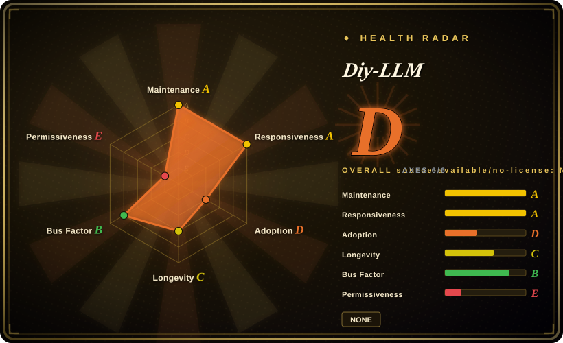
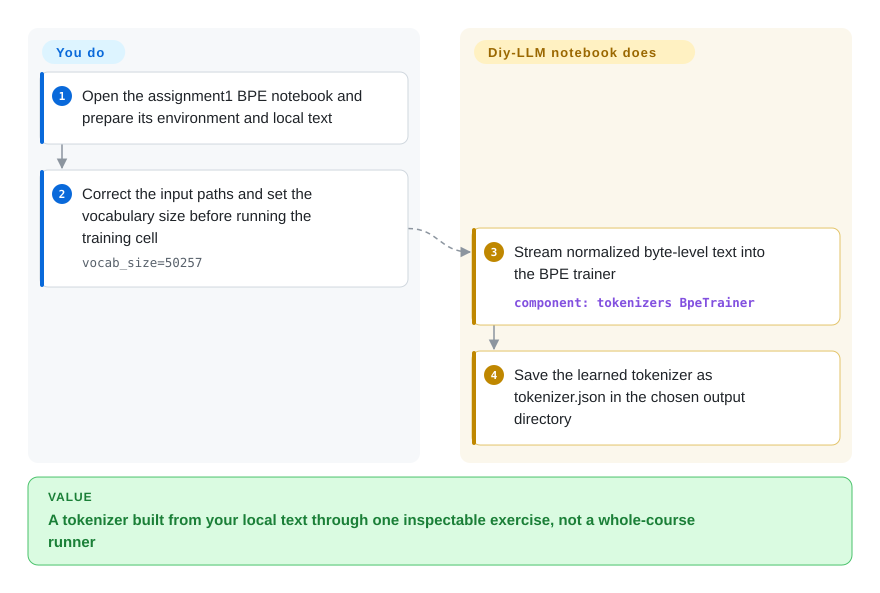
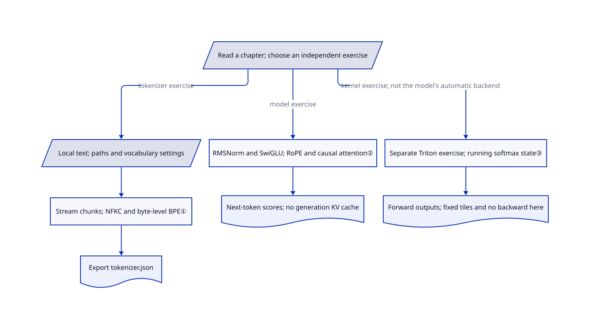

# Diy-LLM

You can call a model trainer but cannot explain how text becomes token IDs or why attention needs so much memory. Diy-LLM puts Chinese CS336-based explanations beside worked notebooks and scripts, so you can trace those steps instead of treating a trainer as a black box.

## When to use

You know Python and PyTorch and are studying language-model training, but the course slide says “tokenizer → Transformer → distributed training” while you cannot find the code that joins the ideas. You want Chinese explanations plus implementations to inspect: the repository has six exercise groups covering model basics, systems, scaling, data, alignment and evaluation. Choose it over a single small-model speedrun when understanding the systems and data chapters matters as much as training one toy model.

Treat this as course material and reference code, not a package to import into a production trainer. The reviewed tree contains 87 Python files and 10 notebooks, including real training and attention implementations; those counts do not establish authorship. [The course map and prerequisites](https://github.com/datawhalechina/diy-llm/blob/95a3b81d4b2686d33afc2d533b0f91d295ec9b78/README.md#L25-L82) define the intended audience.

## When NOT to use

- **You need a fine-tuned deliverable, not a learning exercise.** Prefer [Unsloth](../unsloth.md) for a supported-model training workflow; Diy-LLM leaves environment setup, corpus selection and experiment correctness to you.
- **You want one small model carried through a Chinese-first training curriculum.** Prefer [MiniMind](minimind.md); Diy-LLM offers separate assignments rather than one automatic six-stage pipeline.
- **You only need a compact GPT-2 pretraining reference on a laptop.** [nanoGPT](nanogpt.md) is narrower and documents CPU/MPS paths, but it is deprecated upstream; use it as historical reference, not a newly maintained dependency.
- **You want alignment objectives compared on the same small backbone.** Prefer [Train LLM From Scratch](train-llm-from-scratch.md) for its explicit reward-model/PPO/DPO/GRPO comparison; Diy-LLM spreads attention across systems, data and course theory.
- **You require a single permissive license for copied code.** Do not treat this entry as that permission: the [root README](https://github.com/datawhalechina/diy-llm/blob/95a3b81d4b2686d33afc2d533b0f91d295ec9b78/README.md#L242-L253) declares CC BY-NC-SA 4.0, [assignment4](https://github.com/datawhalechina/diy-llm/blob/95a3b81d4b2686d33afc2d533b0f91d295ec9b78/coursework/assignment4-data/LICENSE#L1-L7) retains Stanford's MIT text, and the [math grader](https://github.com/datawhalechina/diy-llm/blob/95a3b81d4b2686d33afc2d533b0f91d295ec9b78/coursework/assignment5-alignment/cs336_alignment/drgrpo_grader.py#L1-L19) retains Garena's Apache-2.0 header. Assignment2's [copied attention tests](https://github.com/datawhalechina/diy-llm/blob/95a3b81d4b2686d33afc2d533b0f91d295ec9b78/coursework/assignment2-systems/tests/test_attention.py#L1-L104) match the [original course file](https://github.com/stanford-cs336/assignment2-systems/blob/e495ed740080661ab084914674d3e10048778889/tests/test_attention.py#L1-L104), whose [MIT license](https://github.com/stanford-cs336/assignment2-systems/blob/e495ed740080661ab084914674d3e10048778889/LICENSE#L1-L7) is absent from that assignment directory. The intended cross-directory scope is unresolved, not a finding of infringement; for a clearly scoped compact code reference, evaluate nanoGPT's MIT code separately from its data.
- **You need a training kernel, not a systems exercise.** Use Unsloth's supported training path rather than transplanting this Triton exercise: the inspected file implements forward only and lacks handling for arbitrary sequence tails.

## Comparison

| Alternative | In index | Our verdict | Tradeoff |
|---|---|---|---|
| [MiniMind](minimind.md) | Yes | Choose MiniMind to follow one Chinese-first small-model training chain; choose Diy-LLM when Chinese explanations of GPU systems, data processing and scaling are the main learning gap. | MiniMind focuses the work around a small model; Diy-LLM gives broader course coverage but separate environments and exercises. |
| [nanoGPT](nanogpt.md) | Yes | Choose nanoGPT as a compact GPT-2 pretraining reference with CPU/MPS paths, accepting its upstream deprecation; choose Diy-LLM for contemporary architecture and systems coursework. | nanoGPT is easier to read as one training loop but stops before alignment; Diy-LLM covers more subjects without one uniform executable path. |
| [Train LLM From Scratch](train-llm-from-scratch.md) | Yes | Choose Train LLM From Scratch when you need to compare alignment losses on the same English backbone; choose Diy-LLM when the Chinese course narrative and systems assignments decide the choice. | The alternative keeps post-training methods on one evaluation axis; Diy-LLM adds tokenizer, data and kernel exercises, with more setup and unresolved license scope in assignment2. |

## Quick start

Use the [README clone path](https://github.com/datawhalechina/diy-llm/blob/95a3b81d4b2686d33afc2d533b0f91d295ec9b78/README.md#L85-L98), then open assignment1's `CS336_Assignment1_BPE.ipynb`, the notebook that builds a tokenizer, a converter from text to numeric pieces. Its setup cells name `tokenizers`, `tqdm` and `psutil`; you supply the notebook environment, a local text corpus and the compute time. Set the input paths, vocabulary size and output directory before running the selected cells, correcting the inconsistent `GPt4`/`GPT4` filename case in the example. The notebook streams text into a BPE trainer, which learns frequently combined byte pieces, and saves `bpe_tokenizer/tokenizer.json`. It also feeds the optional validation file into tokenizer training, so omit that input if you need an untouched evaluation corpus. This is one exercise's usage path, not automatic execution of all six assignments, and no course code was run for this review.

<!-- flow-steps:begin (generated from flows/diy-llm.json by tools/flow_card.py — do not edit) -->

Text version of the flow

1. **You**: Open the assignment1 BPE notebook and prepare its environment and local text
2. **You**: Correct the input paths and set the vocabulary size before running the training cell — `vocab_size=50257`
3. **Diy-LLM**: Stream normalized byte-level text into the BPE trainer — component: `tokenizers BpeTrainer`
4. **Diy-LLM**: Save the learned tokenizer as tokenizer.json in the chosen output directory

**Value**: A tokenizer built from your local text through one inspectable exercise, not a whole-course runner

<!-- flow-steps:end -->

## Key techniques

<!-- mechanism:begin (generated from mechanisms/diy-llm.json by tools/mechanism_card.py; do not edit) -->

Text version of the mechanism

- Read a chapter; choose an independent exercise
- Local text; paths and vocabulary settings
- Stream chunks; NFKC and byte-level BPE①
- Export tokenizer.json
- RMSNorm and SwiGLU; RoPE and causal attention②
- Next-token scores; no generation KV cache
- Separate Triton exercise; running softmax state③
- Forward outputs; fixed tiles and no backward here

- Read a chapter; choose an independent exercise → Local text; paths and vocabulary settings (tokenizer exercise)
- Local text; paths and vocabulary settings → Stream chunks; NFKC and byte-level BPE①
- Stream chunks; NFKC and byte-level BPE① → Export tokenizer.json
- Read a chapter; choose an independent exercise → RMSNorm and SwiGLU; RoPE and causal attention② (model exercise)
- RMSNorm and SwiGLU; RoPE and causal attention② → Next-token scores; no generation KV cache
- Read a chapter; choose an independent exercise → Separate Triton exercise; running softmax state③ (kernel exercise; not the model's automatic backend)
- Separate Triton exercise; running softmax state③ → Forward outputs; fixed tiles and no backward here

<!-- mechanism:end -->

### 1. Stream text into a library tokenizer trainer

- **Problem:** Loading the whole text corpus at once makes a tokenizer experiment harder to inspect and fit in memory.
- **How:** The BPE notebook yields text chunks to Hugging Face `tokenizers`, applies NFKC Unicode normalization and byte-level splitting, then exports a JSON tokenizer. The merge algorithm comes from `BpeTrainer`; this is not a handwritten BPE implementation.
- **Limits:** The optional validation file joins the training iterator; `num_chunks` is not used by that iterator, and progress counts characters rather than actual UTF-8 bytes. Chunked input alone does not bound the trainer's internal memory.
- **Source:** [BPE notebook, streaming reader and training cells](https://github.com/datawhalechina/diy-llm/blob/95a3b81d4b2686d33afc2d533b0f91d295ec9b78/coursework/assignment1-basics/CS336_Assignment1_BPE.ipynb).

### 2. Expose modern model components in a small Transformer

- **Problem:** A general trainer hides which operation changes token vectors and which one enforces next-token prediction.
- **How:** Assignment1 writes RMSNorm, a root-mean-square normalization, and SwiGLU, a gated feed-forward layer, explicitly. RoPE rotates query/key vectors to encode position; residual blocks combine these with causal attention, using PyTorch's scaled-dot-product API when present.
- **Limits:** API availability does not guarantee a FlashAttention GPU backend. The generation loop recomputes the cropped context instead of caching past keys/values, and the example falls back to random weights when its checkpoint is absent.
- **Source:** [Components and attention:37–154](https://github.com/datawhalechina/diy-llm/blob/95a3b81d4b2686d33afc2d533b0f91d295ec9b78/coursework/assignment1-basics/model.py#L37-L154), [generation:174–196](https://github.com/datawhalechina/diy-llm/blob/95a3b81d4b2686d33afc2d533b0f91d295ec9b78/coursework/assignment1-basics/model.py#L174-L196), [checkpoint example:327–375](https://github.com/datawhalechina/diy-llm/blob/95a3b81d4b2686d33afc2d533b0f91d295ec9b78/coursework/assignment1-basics/model.py#L327-L375).

### 3. Carry softmax state across attention tiles

- **Problem:** Materializing every query/key score creates a sequence-length-squared intermediate matrix.
- **How:** The separate Triton exercise assigns a query block to each GPU program and loops over key/value blocks. It carries a running maximum, normalization sum and output accumulator, rescaling previous state when the maximum changes, then writes normalized outputs and log-sum-exp values.
- **Limits:** This file implements forward only, fixes both block sizes at 64 and uses floor division for the query grid without tail handling; key/value loads also lack boundary checks. It is a mechanism reference, not a complete arbitrary-shape training kernel or a measured speed claim.
- **Source:** [Block pointers and online state:40–166](https://github.com/datawhalechina/diy-llm/blob/95a3b81d4b2686d33afc2d533b0f91d295ec9b78/coursework/assignment2-systems/cs336_systems/flash_attention_triton.py#L40-L166), [wrapper and grid:169–206](https://github.com/datawhalechina/diy-llm/blob/95a3b81d4b2686d33afc2d533b0f91d295ec9b78/coursework/assignment2-systems/cs336_systems/flash_attention_triton.py#L169-L206).

## Tech stack

- Python and Jupyter notebooks for exercises; PyTorch for model/training code, `tokenizers` for the BPE example, Triton for the separate GPU-kernel exercise.
- Assignment5 uses Transformers, vLLM, FlashAttention and math-answer verification; this is not the same environment as the BPE exercise.
- VitePress/Vue and pnpm build the reading website only. The root Node manifest does not install the Python training environment.

## Dependencies

- BPE path: a notebook kernel, `tokenizers`, `tqdm`, `psutil`, local text files and disk for the exported tokenizer. [Assignment1's README](https://github.com/datawhalechina/diy-llm/blob/95a3b81d4b2686d33afc2d533b0f91d295ec9b78/coursework/assignment1-basics/README.md#L5-L25) separately lists PyTorch, NumPy, Transformers and plotting packages for the broader model exercise.
- Assignment2's [manifest](https://github.com/datawhalechina/diy-llm/blob/95a3b81d4b2686d33afc2d533b0f91d295ec9b78/coursework/assignment2-systems/pyproject.toml#L1-L26) requires Python 3.12 or newer and PyTorch 2.9.1 or newer; the inspected kernel also imports Triton directly.
- Assignment4's [manifest](https://github.com/datawhalechina/diy-llm/blob/95a3b81d4b2686d33afc2d533b0f91d295ec9b78/coursework/assignment4-data/pyproject.toml#L1-L37) uses Python 3.11 or newer, NumPy below 2 and its own PyTorch constraints, plus text/data tooling. Do not collapse the assignment manifests into one environment.
- Assignment5's [manifest](https://github.com/datawhalechina/diy-llm/blob/95a3b81d4b2686d33afc2d533b0f91d295ec9b78/coursework/assignment5-alignment/pyproject.toml#L1-L34) restricts Python to 3.11–3.12 and pins vLLM 0.7.2 and FlashAttention 2.7.4.post1. Its [GRPO defaults](https://github.com/datawhalechina/diy-llm/blob/95a3b81d4b2686d33afc2d533b0f91d295ec9b78/coursework/assignment5-alignment/cs336_alignment/grpo.py#L34-L79) point to an author-local model path, local JSONL files and separate CUDA devices for policy and evaluation.

## Ops difficulty

**Low for reading; medium for exercises.** There is no course service to operate, but you manage notebook state, incompatible assignment environments, datasets and training artifacts yourself. GPU and distributed exercises add CUDA/Triton setup and compute costs; no universal hardware or runtime estimate is established here. Keep data, checkpoints and generated-code evaluation in a disposable environment without secrets: the [evaluation demo](https://github.com/datawhalechina/diy-llm/blob/95a3b81d4b2686d33afc2d533b0f91d295ec9b78/coursework/assignment6-evaluation/lm_eval_demo.py#L1-L47) opts into code execution and takes one example per task, and the supplied submission script [ignores pytest failure before making an archive](https://github.com/datawhalechina/diy-llm/blob/95a3b81d4b2686d33afc2d533b0f91d295ec9b78/coursework/assignment2-systems/test_and_make_submission.sh#L1-L12), so an archive is not a passing-test certificate.

## Health & viability

- **Maintenance, 2026-10-26:** the repository is unarchived; release V0.2 was published on 2026-08-17, and the reviewed main revision is `95a3b81d`. Pin that revision when discussing exercises rather than assuming the release packages a stable Python API.
- **Governance:** the README names three project leads and assigns chapters and exercises to them. That is an editorial team signal, not proof of a release SLA; the contribution instructions are in the README, with no separate governance file in the reviewed tree.
- **Longevity and adoption:** created on 2025-11-24, it is 336 days old at review. [推断：based on observed age and the README team, without verified support commitments] Continued commits and a named team support using it as living study material, but its short history does not establish a strong Lindy prior or production support; stars and forks measure attention rather than validated training outcomes.
- **License and source boundaries:** Stanford starter/tests and the externally attributed math grader are present alongside the course's reference implementations. Keep the README's noncommercial content declaration, assignment4 MIT and grader Apache-2.0 separate; assignment2's intended license scope remains unresolved. The automated radar records `NONE` and risk-license E, also capping the aggregate, because its limited license-file lookup misses the nested assignment4 file and README declaration; this is not evidence that the repository contains no license, nor ownership certification.

## Caveats (unverified)

- [未验证：the reviewed files do not state assignment2's intended coverage] Assignment2's intended license coverage is not stated in the reviewed files: its source MIT text exists under assignment4, not assignment2, while the root README makes a broad CC BY-NC-SA declaration. This is a scope gap, not a legal conclusion or permission for commercial use or redistribution.
- [未验证：no upstream code or training was executed] No course, notebook, training, dependency installation, model/data download or generated-code evaluation was executed in this review. Training quality, test pass rates, runtime, memory use and compatibility across machines remain unmeasured.
- [推断：classification follows the independent scripts, notebooks and assignment manifests] `type: app` denotes a runnable exercise collection within this schema, not a production SDK, trained model product or unified course runner. That classification follows the separate scripts, notebooks and assignment manifests.
- [推断：dated metadata and the README team, without verified funding or support contracts] The viability judgment uses the observed project age, README team and commit/release evidence, not a verified funding commitment or support guarantee.
