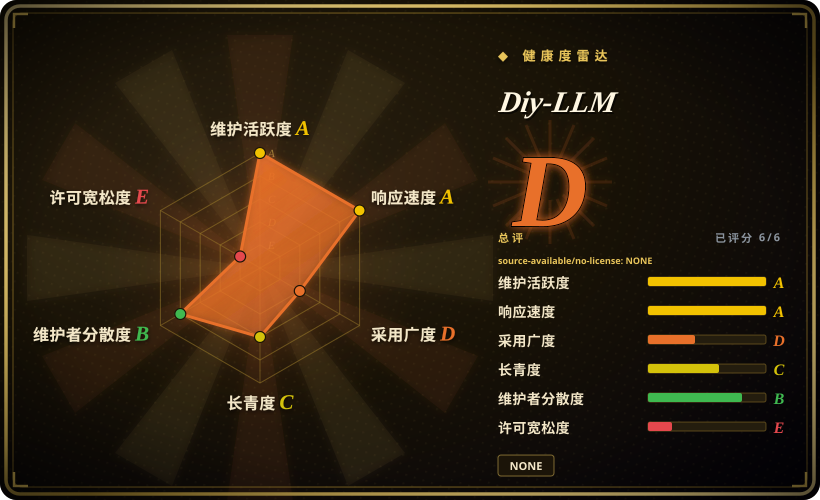
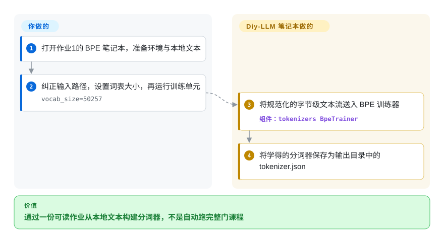
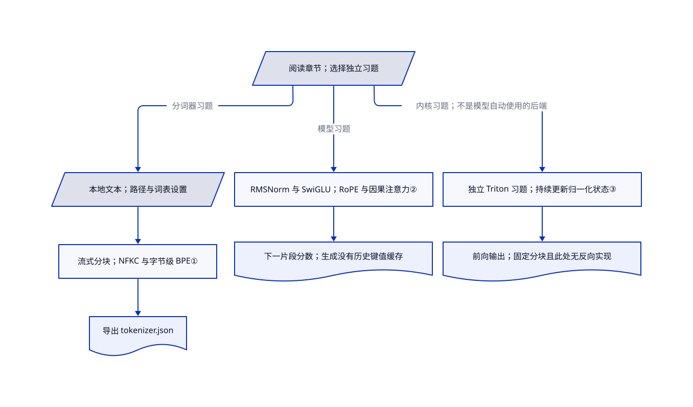

# Diy-LLM

你会调用训练器，却说不清一段文字怎样变成数字，也不知道注意力为何吃显存。Diy-LLM 把基于 CS336 的中文讲解与作业笔记本、脚本放在一起，让你沿着代码理解这些步骤。

## 何时使用

你会 Python 和 PyTorch，正在学习语言模型训练。课件画着“分词器→Transformer→分布式训练”，你却找不到这些概念对应的代码。这里有模型基础、系统优化、缩放定律、数据、对齐和评估六组作业，能把中文讲解与参考实现对照阅读。当你既想学小模型，也想理解系统和数据工程时，它比只围绕一个小模型的跟练路线覆盖更广。

把它当讲义与参考代码，不要当生产训练器的依赖包。核验树中有 87 个 Python 文件和 10 个笔记本，确有训练和注意力实现；文件数量不证明原创权属。[课程目录与前置要求](https://github.com/datawhalechina/diy-llm/blob/95a3b81d4b2686d33afc2d533b0f91d295ec9b78/README.md#L25-L82)说明了它面向的学习者。

## 何时不用

- **交付目标是微调模型，而不是学习过程。** 优先看 [Unsloth](../unsloth.zh.md) 的受支持模型训练路线；Diy-LLM 把环境、语料和实验正确性留给你负责。
- **想沿着同一个中文小模型跑完整条学习链路。** 选 [MiniMind](minimind.zh.md)；Diy-LLM 是多份独立作业，不会自动串起六个阶段。
- **只想在笔记本电脑上读极简 GPT-2 预训练。** [nanoGPT](nanogpt.zh.md) 更集中，也有 CPU/MPS 使用路径，但上游已宣布废弃；把它当历史参考，不当新项目的持续维护依赖。
- **想在同一小模型上对照各种对齐目标。** 选 [Train LLM From Scratch](train-llm-from-scratch.zh.md)，它将奖励模型、PPO、DPO、GRPO 放到一条对照轴；Diy-LLM 把篇幅分给系统、数据和课程理论。
- **要求复制的代码全部具有同一宽松许可。** 本条目不提供这种授权：[根 README](https://github.com/datawhalechina/diy-llm/blob/95a3b81d4b2686d33afc2d533b0f91d295ec9b78/README.md#L242-L253)声明 CC BY-NC-SA 4.0，[作业4](https://github.com/datawhalechina/diy-llm/blob/95a3b81d4b2686d33afc2d533b0f91d295ec9b78/coursework/assignment4-data/LICENSE#L1-L7)保留 Stanford 的 MIT 文本，[数学评分器](https://github.com/datawhalechina/diy-llm/blob/95a3b81d4b2686d33afc2d533b0f91d295ec9b78/coursework/assignment5-alignment/cs336_alignment/drgrpo_grader.py#L1-L19)保留 Garena 的 Apache-2.0 文件头。作业2的[注意力测试](https://github.com/datawhalechina/diy-llm/blob/95a3b81d4b2686d33afc2d533b0f91d295ec9b78/coursework/assignment2-systems/tests/test_attention.py#L1-L104)与[原课文件](https://github.com/stanford-cs336/assignment2-systems/blob/e495ed740080661ab084914674d3e10048778889/tests/test_attention.py#L1-L104)逐字相同，却未在该作业目录保留原课 [MIT 许可](https://github.com/stanford-cs336/assignment2-systems/blob/e495ed740080661ab084914674d3e10048778889/LICENSE#L1-L7)。跨目录覆盖范围仍未写明，不作侵权定论；若要范围更明确的极简代码参考，可单独评估 nanoGPT 的 MIT 代码，数据另查。
- **要训练内核，而不是系统习题。** 应看 Unsloth 的受支持训练路线，不直接移植此处的 Triton 习题：已读文件只有前向计算，也没有任意序列尾块的处理。

## 横向对比

| 替代品 | 是否收录 | 我们的评价 | 取舍 |
|---|---|---|---|
| [MiniMind](minimind.zh.md) | 已收录 | 想围绕同一个中文小模型学习整条训练链，选 MiniMind；主要缺口是 GPU 系统、数据处理和缩放定律的中文讲解，选 Diy-LLM。 | MiniMind 把工作集中到小模型；Diy-LLM 课程更广，但作业与环境分开管理。 |
| [nanoGPT](nanogpt.zh.md) | 已收录 | 要带 CPU/MPS 路径的极简 GPT-2 预训练参考，且接受上游已废弃，选 nanoGPT；要现代架构与系统课程练习，选 Diy-LLM。 | nanoGPT 可当作一条训练循环来读，但不含对齐；Diy-LLM 主题更多，却没有统一执行入口。 |
| [Train LLM From Scratch](train-llm-from-scratch.zh.md) | 已收录 | 想在同一英文模型上对照对齐损失，选 Train LLM From Scratch；中文课程叙事和系统作业更重要时，选 Diy-LLM。 | 前者将后训练方法放到同一评估轴；后者增加分词、数据和内核练习，代价是更多环境工作及作业2未明的许可范围。 |

## 快速上手

按 [README 的克隆路径](https://github.com/datawhalechina/diy-llm/blob/95a3b81d4b2686d33afc2d533b0f91d295ec9b78/README.md#L85-L98)取得源码，再打开作业1的 `CS336_Assignment1_BPE.ipynb`，它用来构建把文字转成数字片段的分词器。安装单元列出 `tokenizers`、`tqdm` 和 `psutil`，你负责笔记本环境、本地文本语料和计算时间。运行所需单元前，先设置输入路径、词表大小和输出目录，并纠正示例文件名中 `GPt4` 与 `GPT4` 的大小写差异。笔记本把文本分块送给 BPE 训练器，学习常合并的字节片段，再保存 `bpe_tokenizer/tokenizer.json`。可选验证文件也会进入分词器训练；若要保留未见评估语料，就不传这份输入。这只是一个作业的使用路线，不是自动执行全部六组作业，本次核验也没有运行课程代码。

<!-- flow-steps:begin (generated from flows/diy-llm.json by tools/flow_card.py — do not edit) -->

流程文字版

1. **你**：打开作业1的 BPE 笔记本，准备环境与本地文本
2. **你**：纠正输入路径，设置词表大小，再运行训练单元 — `vocab_size=50257`
3. **Diy-LLM**：将规范化的字节级文本流送入 BPE 训练器 — 组件：`tokenizers BpeTrainer`
4. **Diy-LLM**：将学得的分词器保存为输出目录中的 tokenizer.json

**价值**：通过一份可读作业从本地文本构建分词器，不是自动跑完整门课程

<!-- flow-steps:end -->

## 技术要点

<!-- mechanism:begin (generated from mechanisms/diy-llm.json by tools/mechanism_card.py; do not edit) -->

机制文字版

- 阅读章节；选择独立习题
- 本地文本；路径与词表设置
- 流式分块；NFKC 与字节级 BPE①
- 导出 tokenizer.json
- RMSNorm 与 SwiGLU；RoPE 与因果注意力②
- 下一片段分数；生成没有历史键值缓存
- 独立 Triton 习题；持续更新归一化状态③
- 前向输出；固定分块且此处无反向实现

- 阅读章节；选择独立习题 → 本地文本；路径与词表设置（分词器习题）
- 本地文本；路径与词表设置 → 流式分块；NFKC 与字节级 BPE①
- 流式分块；NFKC 与字节级 BPE① → 导出 tokenizer.json
- 阅读章节；选择独立习题 → RMSNorm 与 SwiGLU；RoPE 与因果注意力②（模型习题）
- RMSNorm 与 SwiGLU；RoPE 与因果注意力② → 下一片段分数；生成没有历史键值缓存
- 阅读章节；选择独立习题 → 独立 Triton 习题；持续更新归一化状态③（内核习题；不是模型自动使用的后端）
- 独立 Triton 习题；持续更新归一化状态③ → 前向输出；固定分块且此处无反向实现

<!-- mechanism:end -->

### 1. 将文本流送给现成的分词训练器

- **解决：** 一次载入整份语料，既难观察，也容易占满内存。
- **做法：** BPE 笔记本按块向 Hugging Face `tokenizers` 供给文本，先做 NFKC 字符规范化与字节级切分，训练后导出 JSON 分词器。合并算法由 `BpeTrainer` 提供，不是手写 BPE 实现。
- **边界：** 可选验证文件会加入训练迭代器；该迭代器没有使用 `num_chunks`，进度统计数的是字符而非实际 UTF-8 字节。输入分块也不等于训练器内部内存有上限。
- **源码：** [BPE 笔记本的流式读取与训练单元](https://github.com/datawhalechina/diy-llm/blob/95a3b81d4b2686d33afc2d533b0f91d295ec9b78/coursework/assignment1-basics/CS336_Assignment1_BPE.ipynb)。

### 2. 在小型 Transformer 中展开现代组件

- **解决：** 通用训练器隐藏了词向量怎样变化，以及哪些操作限制模型只能预测后文。
- **做法：** 作业1显式写出均方根归一化 RMSNorm 和带门控的前馈层 SwiGLU。RoPE 通过旋转查询与键向量编码位置，残差块将它们接到因果注意力；若存在对应 API，就调用 PyTorch 的缩放点积注意力。
- **边界：** API 存在不代表一定使用 FlashAttention GPU 后端。生成循环每步重算裁剪后的上下文，没有缓存历史键和值；示例找不到检查点时还会改用随机权重。
- **源码：** [组件与注意力第 37–154 行](https://github.com/datawhalechina/diy-llm/blob/95a3b81d4b2686d33afc2d533b0f91d295ec9b78/coursework/assignment1-basics/model.py#L37-L154)、[生成循环第 174–196 行](https://github.com/datawhalechina/diy-llm/blob/95a3b81d4b2686d33afc2d533b0f91d295ec9b78/coursework/assignment1-basics/model.py#L174-L196)、[检查点示例第 327–375 行](https://github.com/datawhalechina/diy-llm/blob/95a3b81d4b2686d33afc2d533b0f91d295ec9b78/coursework/assignment1-basics/model.py#L327-L375)。

### 3. 在注意力分块之间传递归一化状态

- **解决：** 一次存下全部查询与键的分数，会产生随序列长度平方增长的中间矩阵。
- **做法：** 独立的 Triton 习题为每个 GPU 程序分配一个查询块，再逐块遍历键和值。它持续维护最大值、归一化分母和输出累积；最大值变化时重缩放旧状态，最后写回归一化输出与对数求和值。
- **边界：** 此文件只有前向计算，两个块大小固定为 64；查询网格用向下整除，没有尾块处理，键和值的读取也没有边界检查。它是机制参考，不是支持任意形状的完整训练内核，也不是实测加速结论。
- **源码：** [块指针与在线状态第 40–166 行](https://github.com/datawhalechina/diy-llm/blob/95a3b81d4b2686d33afc2d533b0f91d295ec9b78/coursework/assignment2-systems/cs336_systems/flash_attention_triton.py#L40-L166)、[封装与网格第 169–206 行](https://github.com/datawhalechina/diy-llm/blob/95a3b81d4b2686d33afc2d533b0f91d295ec9b78/coursework/assignment2-systems/cs336_systems/flash_attention_triton.py#L169-L206)。

## 技术栈

- 作业使用 Python 与 Jupyter 笔记本；模型和训练代码使用 PyTorch，BPE 示例使用 `tokenizers`，独立 GPU 内核习题使用 Triton。
- 作业5使用 Transformers、vLLM、FlashAttention 与数学答案校验，不是 BPE 习题的同一套环境。
- VitePress/Vue 与 pnpm 仅构建阅读网站；根目录 Node 清单不负责安装 Python 训练环境。

## 依赖

- BPE 路线需要笔记本内核、`tokenizers`、`tqdm`、`psutil`、本地文本文件及导出分词器的磁盘空间。[作业1说明](https://github.com/datawhalechina/diy-llm/blob/95a3b81d4b2686d33afc2d533b0f91d295ec9b78/coursework/assignment1-basics/README.md#L5-L25)另外列出模型习题所用的 PyTorch、NumPy、Transformers 和绘图库。
- 作业2[清单](https://github.com/datawhalechina/diy-llm/blob/95a3b81d4b2686d33afc2d533b0f91d295ec9b78/coursework/assignment2-systems/pyproject.toml#L1-L26)要求 Python 3.12 及以上、PyTorch 2.9.1 及以上；已读内核还直接导入 Triton。
- 作业4[清单](https://github.com/datawhalechina/diy-llm/blob/95a3b81d4b2686d33afc2d533b0f91d295ec9b78/coursework/assignment4-data/pyproject.toml#L1-L37)要求 Python 3.11 及以上、NumPy 低于 2，并有自己的 PyTorch 约束及文本数据工具。不要把各作业清单合成一个环境。
- 作业5[清单](https://github.com/datawhalechina/diy-llm/blob/95a3b81d4b2686d33afc2d533b0f91d295ec9b78/coursework/assignment5-alignment/pyproject.toml#L1-L34)限定 Python 3.11–3.12，固定 vLLM 0.7.2 与 FlashAttention 2.7.4.post1。[GRPO 默认配置](https://github.com/datawhalechina/diy-llm/blob/95a3b81d4b2686d33afc2d533b0f91d295ec9b78/coursework/assignment5-alignment/cs336_alignment/grpo.py#L34-L79)还指向作者本地模型目录、本地 JSONL 文件，并为策略与评估分别指定 CUDA 设备。

## 运维难度

**阅读低，作业中。** 不需要常驻课程服务，但你要自己管理笔记本状态、互不兼容的作业环境、数据和训练产物。GPU 与分布式习题还增加 CUDA/Triton 配置及计算费用，本页没有确立通用硬件或耗时估计。数据、检查点与生成代码评测应留在没有秘密信息的可丢弃环境中：[评估示例](https://github.com/datawhalechina/diy-llm/blob/95a3b81d4b2686d33afc2d533b0f91d295ec9b78/coursework/assignment6-evaluation/lm_eval_demo.py#L1-L47)启用了代码执行，每项任务只取一个样本，提交脚本还会[忽略 pytest 失败再打包](https://github.com/datawhalechina/diy-llm/blob/95a3b81d4b2686d33afc2d533b0f91d295ec9b78/coursework/assignment2-systems/test_and_make_submission.sh#L1-L12)，不能把压缩包当测试通过证明。

## 健康度与可持续性

- **维护，2026-10-26。** 仓库未归档，V0.2 于 2026-08-17 发布，本次核验 main 版本为 `95a3b81d`。讨论练习时锁定该版本，不把课程发布当作稳定 Python API。
- **治理。** README 列出三位负责人并分配章节、作业，这是编辑团队信号，不是发布服务承诺。贡献说明写在 README 中，核验树没有独立治理文件。
- **年限与采用。** 仓库创建于 2025-11-24，核验时为 336 天。[推断：依据仓库年限、README团队与提交记录，未核实支持承诺] 持续提交和具名团队支持把它当仍在更新的学习材料，但短历史不足以建立强林迪先验或生产支持承诺；关注和派生数量也不等于训练效果已获验证。
- **许可与来源边界。** 原课底座、测试及注明外部出处的数学评分器，与课程参考实现并存。根 README 的非商业内容声明、作业4 MIT、评分器 Apache-2.0 必须分开，作业2的许可覆盖范围仍未解决。自动雷达记录 `NONE`、许可风险 E，总分也受封顶限制，因为有限路径查找没有覆盖嵌套的作业4许可及 README 声明；它不证明仓库全无许可，也不认证权属。

## 存疑（未验证）

- [未验证：已读文件未说明作业2适用范围] 已读文件没有说明作业2预期的许可覆盖：原课 MIT 文本位于作业4而非作业2，根 README 则作了笼统的 CC BY-NC-SA 声明。这是范围缺口，不是法律定论，也不授予商用或再分发权限。
- [未验证：本轮未执行上游代码或训练] 本次没有执行课程、笔记本、训练、依赖安装、模型或数据下载、生成代码评测。训练质量、测试通过率、耗时、内存和跨机器兼容性均未实测。
- [推断：依据独立脚本、笔记本及各作业清单] `type: app` 在本契约中表示可运行的作业集合，不代表生产 SDK、训练成品或统一课程执行器；分类依据是独立脚本、笔记本和各作业清单。
- [推断：据已核元数据与团队信息，未核实经费或支持合同] 可持续性判断来自已观察的年限、README 团队及提交和发布证据，不是已核实的经费或支持承诺。
