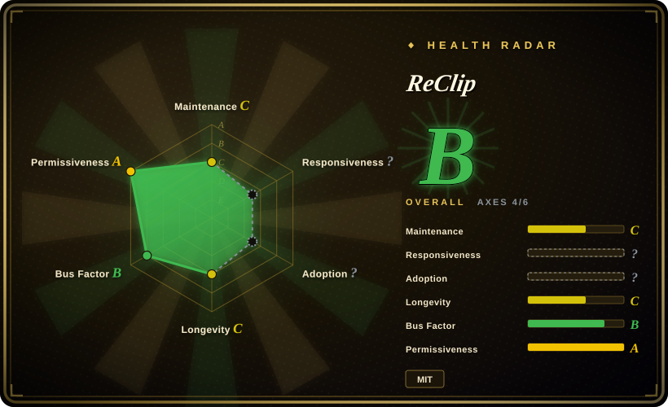
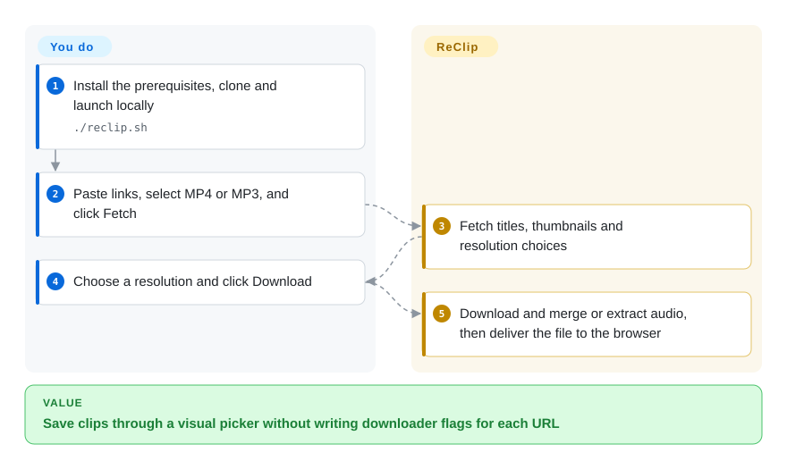
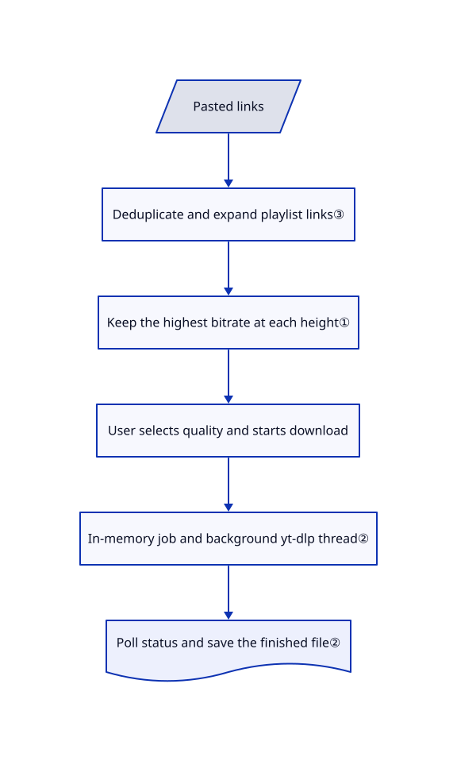

# ReClip

You have several video links to save, but do not want to assemble downloader flags for each one. ReClip puts a resolution picker and MP4/MP3 buttons in front of a local yt-dlp process.

## When to use

You are collecting a few public talks or clips for offline review on your own machine. You paste several links, fetch their titles and thumbnails, choose a resolution, and save the result through a browser. Choose ReClip over the yt-dlp command line when that small visual workflow matters more than advanced extraction options; choose it over cobalt when you want a small Flask application using the yt-dlp engine rather than a separate frontend/API stack.

Keep this a trusted personal tool. The [reviewed source](https://github.com/averygan/reclip/blob/1d161d15a4fe93d9b3371377f0a421dc3e965b10/app.py) has no authentication, persistent job queue, or automatic expiry of finished downloads.

## When NOT to use

- **An internet-facing or multi-user download service.** Use local [yt-dlp](yt-dlp.md) invocations instead, or build an authenticated, quota-controlled service before sharing ReClip. Its APIs accept arbitrary URL strings without host validation, start one thread per download, and retain output files. Docker publishes port 8899 beyond loopback by default. Open [security report 93](https://github.com/averygan/reclip/issues/93) describes the same resource-control gap.
- **Untrusted callers or links.** Prefer a locally invoked yt-dlp command under your control. The wrapper passes the URL as an argument without an option terminator; [proposed fix 79](https://github.com/averygan/reclip/pull/79) is not in the reviewed commit. Do not mistake argument arrays for protection against downloader-option injection.
- **Long recordings, restart-safe archives, cookies, or detailed downloader tuning.** Use yt-dlp directly. ReClip's worker has a fixed 300-second timeout, jobs live only in a Python dictionary, and the UI does not expose login-cookie configuration. Increasing Gunicorn workers splits that dictionary across processes rather than scaling a shared queue.
- **Guaranteed playback on a particular phone or editor.** Download with yt-dlp using explicit codec constraints instead. ReClip picks the highest-bitrate video at each height and requests an MP4 merge, not a codec conversion; [proposal 95](https://github.com/averygan/reclip/pull/95) addresses H.264/AAC preferences but is not merged into this snapshot.

## Comparison

| Alternative | In index | Our verdict | Tradeoff |
|---|---|---|---|
| [yt-dlp](yt-dlp.md) | ✅ | Choose yt-dlp for scripted archives, cookies and format rules; choose ReClip for a few interactive downloads with a resolution picker. | Direct CLI control avoids a permanently running unauthenticated web service, but users must learn options. |
| [cobalt](cobalt.md) | ✅ | Choose cobalt for its separate browser/API product; choose ReClip when a single Flask backend over yt-dlp is the desired integration surface. | cobalt separates processing and UI and has different licenses for each; ReClip is smaller but leaves access control and retention to you. |
| [you-get](you-get.md) | ✅ | Choose you-get only when its specific extractor works better for your target and a CLI is acceptable; choose ReClip for a yt-dlp-backed visual picker. | you-get has its own extraction catalog and no service to operate, but its indexed page records a long maintenance pause. |

## Quick start

The [README](https://github.com/averygan/reclip/blob/1d161d15a4fe93d9b3371377f0a421dc3e965b10/README.md#L22-L45) installs yt-dlp and ffmpeg, clones the repository, and starts `./reclip.sh`. The script also needs Python, creates a virtual environment, and installs Flask and yt-dlp; it updates yt-dlp on each launch unless you set `RECLIP_NO_UPDATE=1`. Open `http://localhost:8899`, paste links, choose MP4 or MP3, and click Fetch. ReClip returns titles and quality choices; you select the quality and click Download, then the page polls until it can save the file. You supply lawful source URLs, outbound access and disk space, and handle version pinning, network isolation and cleanup yourself. This path was verified by reading sources, not by executing the application.

<!-- flow-steps:begin (generated from flows/reclip.json by tools/flow_card.py — do not edit) -->

Text version of the flow

1. **You**: Install the prerequisites, clone and launch locally — `./reclip.sh`
2. **You**: Paste links, select MP4 or MP3, and click Fetch
3. **ReClip**: Fetch titles, thumbnails and resolution choices
4. **You**: Choose a resolution and click Download
5. **ReClip**: Download and merge or extract audio, then deliver the file to the browser

**Value**: Save clips through a visual picker without writing downloader flags for each URL

<!-- flow-steps:end -->

## Key techniques

<!-- mechanism:begin (generated from mechanisms/reclip.json by tools/mechanism_card.py; do not edit) -->

Text version of the mechanism

- Pasted links
- Deduplicate and expand playlist links③
- Keep the highest bitrate at each height①
- User selects quality and starts download
- In-memory job and background yt-dlp thread②
- Poll status and save the finished file②

- Pasted links → Deduplicate and expand playlist links③
- Deduplicate and expand playlist links③ → Keep the highest bitrate at each height①
- Keep the highest bitrate at each height① → User selects quality and starts download
- User selects quality and starts download → In-memory job and background yt-dlp thread②
- In-memory job and background yt-dlp thread② → Poll status and save the finished file②

<!-- mechanism:end -->

### 1. Reduce stream choices to one video per resolution

- **Problem:** A downloader can report many codecs and bitrates at the same resolution.
- **How:** The info route calls yt-dlp for JSON, groups formats with video by height, retains the largest total bitrate, and sorts heights descending. The worker combines the selected format with best audio and asks for an MP4 merge.
- **Limits:** Height and bitrate are not playback-compatibility checks. The fallback can choose a different format, and MP4 output does not promise H.264/AAC codecs.
- **Source:** [Selection and download arguments](https://github.com/averygan/reclip/blob/1d161d15a4fe93d9b3371377f0a421dc3e965b10/app.py#L32-L48), [quality grouping](https://github.com/averygan/reclip/blob/1d161d15a4fe93d9b3371377f0a421dc3e965b10/app.py#L104-L136).

### 2. Hand background work back through a job identifier

- **Problem:** A browser request should not wait for a whole media download.
- **How:** The API assigns an identifier, stores a job in memory, and starts a daemon thread. The page polls status every second and triggers a file download after completion; the container uses one Gunicorn worker with four request threads.
- **Limits:** Request threads do not cap the separately spawned download threads. Restarts lose job metadata even when a Docker volume retains files; there is no expiry, cancellation or durable retry queue.
- **Source:** [Thread and status routes](https://github.com/averygan/reclip/blob/1d161d15a4fe93d9b3371377f0a421dc3e965b10/app.py#L166-L204), [browser polling](https://github.com/averygan/reclip/blob/1d161d15a4fe93d9b3371377f0a421dc3e965b10/templates/index.html#L655-L689), [single worker](https://github.com/averygan/reclip/blob/1d161d15a4fe93d9b3371377f0a421dc3e965b10/Dockerfile#L28).

### 3. Expand playlists before fetching individual metadata

- **Problem:** A pasted playlist needs individual cards rather than one opaque collection.
- **How:** The page splits and deduplicates pasted strings, expands links containing `list=` through a flat-playlist endpoint, then fetches each entry's metadata sequentially. Single-item metadata parsing takes the first nonempty JSON line.
- **Limits:** The playlist test is a substring check, not a site-aware parser. Expansion has no pagination, the page has no stop control, and the JSON helper does not skip a malformed first nonempty line despite its docstring saying first valid object.
- **Source:** [URL parsing and expansion](https://github.com/averygan/reclip/blob/1d161d15a4fe93d9b3371377f0a421dc3e965b10/templates/index.html#L420-L512), [JSON parser](https://github.com/averygan/reclip/blob/1d161d15a4fe93d9b3371377f0a421dc3e965b10/app.py#L16-L29), [playlist endpoint](https://github.com/averygan/reclip/blob/1d161d15a4fe93d9b3371377f0a421dc3e965b10/app.py#L143-L163).

## Tech stack

- Python/Flask backend and one HTML/CSS/JavaScript template; GitHub identifies HTML as the primary language. No frontend build system or database.
- External yt-dlp subprocesses perform extraction; ffmpeg merges streams or extracts MP3 audio. Docker uses Python 3.12, a non-root user and Gunicorn.

## Dependencies

- Python, Flask, yt-dlp and ffmpeg; `requirements.txt` leaves Python packages unpinned. Site-specific requirements still belong to yt-dlp, not this wrapper.
- Writable `downloads/` storage and outbound network access. The frontend also requests Google Fonts and remote thumbnails, so self-hosted does not mean no third-party browser requests.
- Docker is optional. The compose file mounts a named downloads volume; the Dockerfile does not install a JavaScript runtime for newer YouTube challenges. [Proposal 84](https://github.com/averygan/reclip/pull/84) reports that missing runtime and solver extras; its tests were not reproduced here.

## Ops difficulty

**Low for one trusted local user; high if exposed.** The local script binds to loopback, but the container binds to all interfaces and compose publishes its port. Operators must add authentication and egress controls before sharing, cap resources externally, and remove old files. Startup downloads a newer yt-dlp by default, which trades extractor freshness for reproducibility; disable that behavior and test upgrades if repeatable deployments matter. The [startup script](https://github.com/averygan/reclip/blob/1d161d15a4fe93d9b3371377f0a421dc3e965b10/docker-entrypoint.sh) continues with the installed version when an update fails.

## Health & viability

- **Radar coverage:** the generated B grade covers four of six axes. Responsiveness has no qualifying window signal, and adoption has no package channel to score; neither unknown means measured success. The permissiveness axis grades MIT terms, not application security or copyright provenance.
- **2026-10-28 maintenance:** no published GitHub releases or tags; main last changed on 2026-07-09. The fixed tree contains no tests or CI. Treat open feature proposals as proposals, not shipped capabilities.
- **Governance:** user-owned repository; four contributors appear in the API, with the owner contributing 12 of the 19 attributed commits. No governance, security-policy or funding file appears in the reviewed tree.
- **Age and adoption:** created 2026-03-31, about seven months old, with 11,010 stars and 1,641 forks at observation. [推断：based on repository age and the July-to-October commit pause] This is an unproven long-term dependency; stars do not establish supported deployments or a strong Lindy prior.
- **License and risk:** a real MIT grant exists, but its copyright line names no holder. Public security reports and unmerged fixes make a private, restricted deployment the defensible starting point, not a public downloader service.

## Caveats (unverified)

- [未验证：upstream execution and dependency installation were prohibited for this intake] No live download, container build, throughput or platform-support claim was reproduced. The README's broad site count inherits yt-dlp support, not a ReClip compatibility test.
- [未验证：the LICENSE contains only a year, with no named holder] The grant is MIT text, but copyright ownership is not established by that file. Source/history review found no specific copied bundle; it cannot prove originality.
- [未验证：reports 79, 84, 92 and 95 were read but not exploited or reproduced] Their reported option-injection impact, YouTube dependency effects, internal-network disclosure and codec compatibility outcomes are upstream reports. The wrapper's missing input checks and missing runtime are directly visible in source.
- [推断：repository age and commit timestamps, not a durability measurement] The weak long-term-maintenance verdict is a selection judgment; future maintenance and actual user adoption remain unknown.
