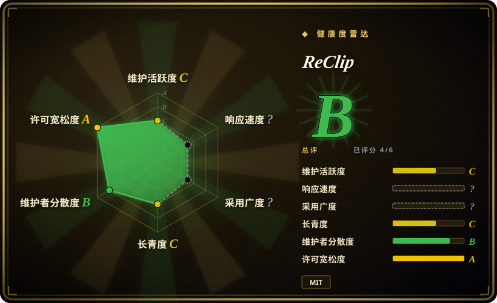
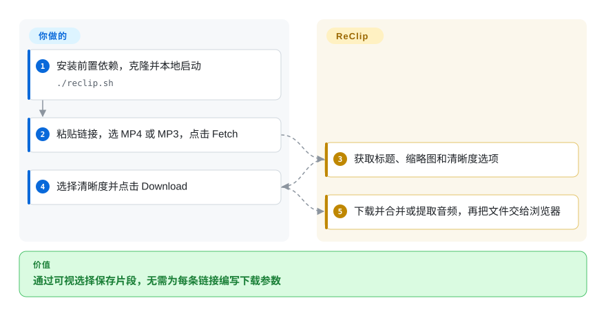
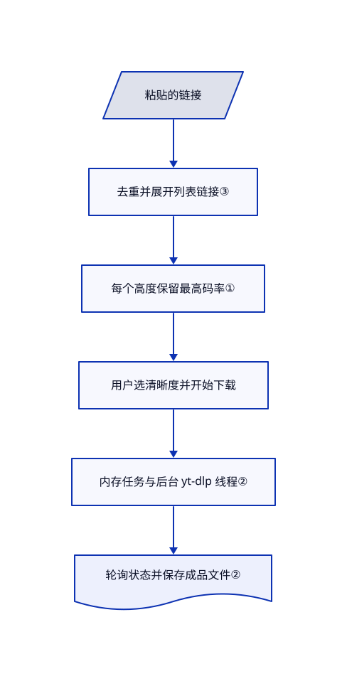

# ReClip

你要保存几条视频链接，却不想逐条拼下载参数。ReClip 在本地 yt-dlp 进程前加上清晰度选择和 MP4／MP3 按钮。

## 何时使用

你在自己的电脑上收集公开演讲或短片，准备离线观看。你粘贴多条链接，取回标题和缩略图，选定清晰度，再通过浏览器保存结果。当少量交互下载比高级提取参数更重要时，选 ReClip 而非 yt-dlp 命令行；当你想要一个调用 yt-dlp 的小型 Flask 应用，而非前后端分开的服务时，选它而非 cobalt。

把它限制在可信个人环境。[本次审阅源码](https://github.com/averygan/reclip/blob/1d161d15a4fe93d9b3371377f0a421dc3e965b10/app.py)没有身份认证、持久任务队列或成品文件自动过期机制。

## 何时不用

- **公网或多人共享下载服务。** 改用本地 [yt-dlp](yt-dlp.zh.md)，或者先为 ReClip 配置认证和配额再共享。API 不校验目标主机，每次下载都新建线程，且保留成品文件。Docker 默认把 8899 端口发布到回环地址之外。未关闭的[安全报告 93](https://github.com/averygan/reclip/issues/93)也描述了资源控制缺口。
- **接收不可信调用或链接。** 优先使用由你控制参数的本地 yt-dlp 命令。包装层传递 URL 时没有添加选项终止符；[修复提案 79](https://github.com/averygan/reclip/pull/79)尚未进入审阅版本。参数数组不等于防止下载器选项注入。
- **长视频、重启后继续归档、登录凭据或细粒度调参。** 直接用 yt-dlp。下载线程固定超时 300 秒，任务只存在 Python 字典中，页面也没有登录 Cookie 配置。增加 Gunicorn 工作进程会拆散字典，而不是扩容共享队列。
- **必须在指定手机或编辑器播放。** 用 yt-dlp 明确限制编码格式。ReClip 只按高度选择最高码率，要求合并成 MP4，并不转换编码。[提案 95](https://github.com/averygan/reclip/pull/95)处理 H.264／AAC 偏好，但不属于当前版本。

## 横向对比

| 替代品 | 是否收录 | 我们的评价 | 取舍 |
|---|---|---|---|
| [yt-dlp](yt-dlp.zh.md) | 已收录 | 脚本归档、登录凭据和格式规则选 yt-dlp；少量交互下载且需要清晰度选择器时选 ReClip。 | 直接命令行无需常驻无认证服务，但使用者需要学习参数。 |
| [cobalt](cobalt.zh.md) | 已收录 | 要独立的浏览器和处理 API 产品时选 cobalt；想用单个 Flask 后端调用 yt-dlp 时选 ReClip。 | cobalt 分离处理与页面，两部分许可不同；ReClip 更小，但访问控制和文件保留由你负责。 |
| [you-get](you-get.zh.md) | 已收录 | 只有目标站点的特定提取器更好用且接受命令行时才选 you-get；要基于 yt-dlp 的可视选择器则选 ReClip。 | you-get 自带提取目录，无需运维服务，但索引页记录了长期维护停顿。 |

## 快速上手

[README](https://github.com/averygan/reclip/blob/1d161d15a4fe93d9b3371377f0a421dc3e965b10/README.md#L22-L45)先安装 yt-dlp 和 ffmpeg，再克隆仓库并执行 `./reclip.sh`。脚本还需要 Python，会创建虚拟环境并安装 Flask 和 yt-dlp；除非设置 `RECLIP_NO_UPDATE=1`，每次启动都会更新 yt-dlp。打开 `http://localhost:8899`，粘贴链接，选择 MP4 或 MP3，再点 Fetch。ReClip 返回标题和清晰度；你选定后点 Download，页面轮询完成状态并保存文件。你负责提供有权下载的链接、外网访问和磁盘空间，并管理版本固定、网络隔离和清理。本次只从源码核实路径，没有运行应用。

<!-- flow-steps:begin (generated from flows/reclip.json by tools/flow_card.py — do not edit) -->

流程文字版

1. **你**：安装前置依赖，克隆并本地启动 — `./reclip.sh`
2. **你**：粘贴链接，选 MP4 或 MP3，点击 Fetch
3. **ReClip**：获取标题、缩略图和清晰度选项
4. **你**：选择清晰度并点击 Download
5. **ReClip**：下载并合并或提取音频，再把文件交给浏览器

**价值**：通过可视选择保存片段，无需为每条链接编写下载参数

<!-- flow-steps:end -->

## 技术要点

<!-- mechanism:begin (generated from mechanisms/reclip.json by tools/mechanism_card.py; do not edit) -->

机制文字版

- 粘贴的链接
- 去重并展开列表链接③
- 每个高度保留最高码率①
- 用户选清晰度并开始下载
- 内存任务与后台 yt-dlp 线程②
- 轮询状态并保存成品文件②

- 粘贴的链接 → 去重并展开列表链接③
- 去重并展开列表链接③ → 每个高度保留最高码率①
- 每个高度保留最高码率① → 用户选清晰度并开始下载
- 用户选清晰度并开始下载 → 内存任务与后台 yt-dlp 线程②
- 内存任务与后台 yt-dlp 线程② → 轮询状态并保存成品文件②

<!-- mechanism:end -->

### 1. 每个清晰度只保留一种视频流

- **解决：** 下载器可能在同一分辨率下列出多种编码和码率。
- **做法：** 信息接口调用 yt-dlp 获取 JSON，按高度分组有画面的格式，保留总码率最大者，再按高度降序排列。下载线程把所选视频与最佳音轨组合，请求合并为 MP4。
- **边界：** 高度和码率不代表播放兼容性。回退可能改选其他格式，MP4 容器也不保证采用 H.264／AAC 编码。
- **源码：** [下载参数](https://github.com/averygan/reclip/blob/1d161d15a4fe93d9b3371377f0a421dc3e965b10/app.py#L32-L48)、[清晰度分组](https://github.com/averygan/reclip/blob/1d161d15a4fe93d9b3371377f0a421dc3e965b10/app.py#L104-L136)。

### 2. 用任务标识衔接后台下载和浏览器

- **解决：** 浏览器请求不应一直等待整段媒体下载。
- **做法：** API 分配标识，把任务存入内存，再启动守护线程。页面每秒查询状态，完成后触发文件下载；容器使用一个 Gunicorn 工作进程和四个请求线程。
- **边界：** 请求线程数不限制另行创建的下载线程。重启会丢失任务信息，即使 Docker 卷还保留文件；没有过期、取消或持久重试队列。
- **源码：** [线程和状态接口](https://github.com/averygan/reclip/blob/1d161d15a4fe93d9b3371377f0a421dc3e965b10/app.py#L166-L204)、[页面轮询](https://github.com/averygan/reclip/blob/1d161d15a4fe93d9b3371377f0a421dc3e965b10/templates/index.html#L655-L689)、[单工作进程](https://github.com/averygan/reclip/blob/1d161d15a4fe93d9b3371377f0a421dc3e965b10/Dockerfile#L28)。

### 3. 先展开播放列表，再逐条读取信息

- **解决：** 用户粘贴播放列表后，需要单条视频卡片，而非一个无法选择的集合。
- **做法：** 页面分割并去重输入，遇到包含 `list=` 的链接就调用扁平列表接口，再顺序读取各条信息。单条信息解析只取第一个非空 JSON 行。
- **边界：** 列表判断只查子串，不理解站点和 URL 结构。展开后没有分页，页面不能停止；JSON 辅助函数也不会跳过首个非空坏行，与其“首个有效对象”的注释不同。
- **源码：** [输入解析和展开](https://github.com/averygan/reclip/blob/1d161d15a4fe93d9b3371377f0a421dc3e965b10/templates/index.html#L420-L512)、[JSON 解析](https://github.com/averygan/reclip/blob/1d161d15a4fe93d9b3371377f0a421dc3e965b10/app.py#L16-L29)、[播放列表接口](https://github.com/averygan/reclip/blob/1d161d15a4fe93d9b3371377f0a421dc3e965b10/app.py#L143-L163)。

## 技术栈

- Python／Flask 后端和单个 HTML／CSS／JavaScript 模板；GitHub 将 HTML 识别为主语言。没有前端构建系统和数据库。
- 外部 yt-dlp 子进程负责提取，ffmpeg 合并音视频或提取 MP3。Docker 使用 Python 3.12、非 root 用户和 Gunicorn。

## 依赖

- Python、Flask、yt-dlp 和 ffmpeg；`requirements.txt` 没有固定 Python 包版本。站点特定依赖仍由 yt-dlp 决定，包装层不会消除它们。
- 可写的 `downloads/` 目录和外网访问。前端还请求 Google Fonts 和远程缩略图，自托管不等于浏览器不请求第三方。
- Docker 可选，compose 使用命名卷保存下载文件。Dockerfile 没有安装新版 YouTube 挑战需要的 JavaScript 运行时。[提案 84](https://github.com/averygan/reclip/pull/84)报告了运行时与求解脚本依赖缺失；本次未复现其测试。

## 运维难度

**可信个人本地使用低，对外开放高。** 本地脚本默认只监听回环地址，但容器监听所有接口，compose 发布端口。共享前需要添加认证与出网控制，外部限制资源，并清理旧文件。默认启动时更新 yt-dlp，以提取器时效性换取可复现性；需要重复部署时应关闭自动更新并验证升级。[启动脚本](https://github.com/averygan/reclip/blob/1d161d15a4fe93d9b3371377f0a421dc3e965b10/docker-entrypoint.sh)在更新失败后仍继续使用已安装版本。

## 健康度与可持续性

- **雷达覆盖：** 自动生成的 B 级只覆盖六轴中的四轴。响应速度没有符合窗口的信号，采用广度没有可评分的包渠道，未知不代表已测得成功。许可宽松度只评价 MIT 条款，不评价应用安全或版权所有权。
- **2026-10-28 维护情况：** 没有 GitHub 发布或标签，主分支最后修改于 2026-07-09。固定源码树没有测试或持续集成配置。未合入的功能提案不能当作已交付能力。
- **治理：** 个人账号持有仓库，API 列出四位贡献者，作者贡献了可归属的 19 次提交中的 12 次。审阅树没有治理、安全策略或资助文件。
- **年龄和采用：** 创建于 2026-03-31，约七个月，观测时有 11,010 星和 1,641 个分叉。[推断：依据仓库年龄和七月至十月的提交停顿] 长期依赖价值尚未证明；星数不能证明生产采用，也不足以构成强林迪先验。
- **许可和风险：** 文件存在真实 MIT 授权条款，但版权行没有持有人。公开安全报告和未合入修复意味着，起点应是受限个人部署，而非公开下载服务。

## 存疑（未验证）

- [未验证：本次禁止运行上游及安装依赖] 未复现真实下载、镜像构建、吞吐或站点兼容性。README 的广泛站点数量来自 yt-dlp 支持范围，不是 ReClip 兼容测试。
- [未验证：LICENSE 只有年份，没有署名] 文件包含 MIT 授权，但不能据此确认版权所有权。源码与历史未显示具体被复制的软件包，仍不能证明原创性。
- [未验证：已读报告 79、84、92 和 95，但未利用或复现] 选项注入影响、YouTube 依赖效果、内网内容泄露和编码兼容结果属于上游报告；包装层缺少输入检查及镜像缺少运行时则可直接从源码确认。
- [推断：依据仓库年龄和提交时间，不是耐久性测量] 长期维护偏弱属于选型判断，未来维护和实际用户采用仍未知。
