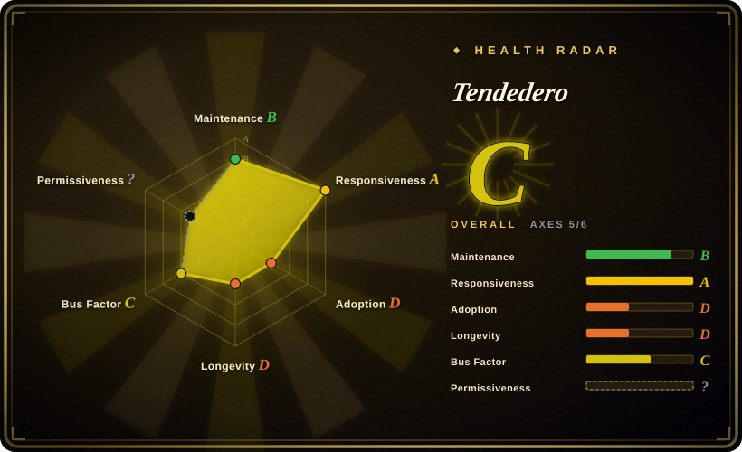
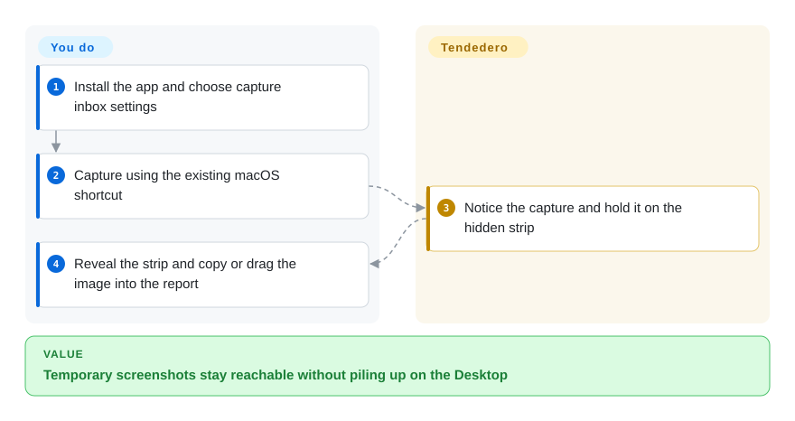
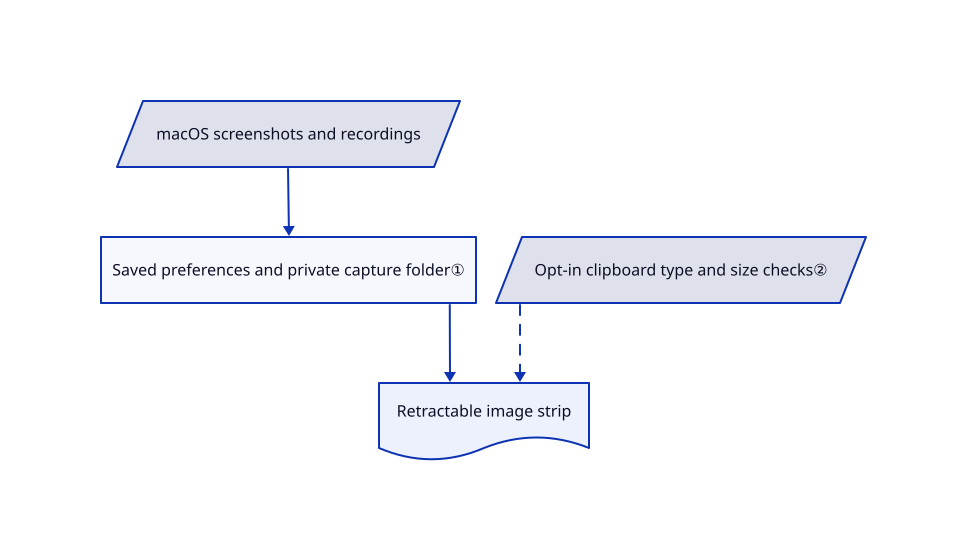

# Tendedero

Screenshots pile up on your Desktop before you paste them into a bug report. Tendedero holds recent captures on a retractable strip below the menu bar, ready to copy or drag out.

## When to use

You take several screenshots while reporting a UI defect and need them within reach without turning the Desktop into an inbox. Choose Tendedero when keeping the macOS capture shortcuts and a temporary visual shelf matters more than a full capture editor. It can redirect screenshots and recordings to its own folder, then expose copy, drag, system Markup and trim actions.

## When NOT to use

- **You need OCR or scrolling capture.** Choose [Shottr](https://shottr.cc/), a commercial desktop product with those features, rather than a temporary capture shelf.
- **You need cloud links and recording presentation tools.** Choose [CleanShot X](https://cleanshot.com/), accepting its commercial license and optional cloud service.
- **You do not want another app changing capture preferences.** Keep macOS Screenshot and Preview; inbox mode changes screenshot destinations and thumbnail settings, with restoration logic on exit.

## Comparison

| Alternative | In index | Our verdict | Tradeoff |
|---|---|---|---|
| macOS Screenshot + Preview | not a repo | Keep the built-in tools for occasional captures; choose Tendedero when juggling multiple temporary captures is the repeated problem. | OS-bundled closed applications avoid another background app but lack this retractable shelf. |
| Shottr | not a repo | Choose Shottr for OCR, scrolling capture and pixel inspection; choose Tendedero for a source-readable, focused holding strip. | Commercial desktop app; richer editing, activation and telemetry choices. |
| CleanShot X | not a repo | Choose CleanShot for recording polish and shareable cloud links; choose Tendedero for a local capture handoff with less product surface. | Paid closed app and optional cloud account versus a narrow open-code utility. |

## Quick start

Download the release disk image and move the app into Applications, or use the documented `brew install --cask alejandrobujan/tap/tendedero`. Decide whether it may manage screenshot destinations and whether copied-image capture should be enabled. Take a screenshot with the usual system shortcut, reveal the strip by resting the pointer at the menu bar, then click to copy or drag to the destination app. You decide which files to retain; dragging to a folder retains the file outside the shelf. This intake inspected source only and did not install the app or change macOS settings.

<!-- flow-steps:begin (generated from flows/tendedero.json by tools/flow_card.py — do not edit) -->

Text version of the flow

1. **You**: Install the app and choose capture inbox settings
2. **You**: Capture using the existing macOS shortcut
3. **Tendedero**: Notice the capture and hold it on the hidden strip
4. **You**: Reveal the strip and copy or drag the image into the report

**Value**: Temporary screenshots stay reachable without piling up on the Desktop

<!-- flow-steps:end -->

## Key techniques

<!-- mechanism:begin (generated from mechanisms/tendedero.json by tools/mechanism_card.py; do not edit) -->

Text version of the mechanism

- macOS screenshots and recordings
- Saved preferences and private capture folder①
- Opt-in clipboard type and size checks②
- Retractable image strip

- macOS screenshots and recordings → Saved preferences and private capture folder①
- Saved preferences and private capture folder① → Retractable image strip
- Opt-in clipboard type and size checks② → Retractable image strip [optional/fallback]

<!-- mechanism:end -->

### 1. Save and restore screenshot preferences

- **Problem:** Captures reach the Desktop or wait behind the system floating thumbnail.
- **How:** Inbox saves existing capture settings, redirects image and recording destinations into Application Support, and disables thumbnails using CFPreferences. Restoration runs only when its destination is still applied.
- **Limits:** These are shared system preferences; normal shutdown restoration is not a guarantee after every crash or conflict with another capture app.
- **Source:** [Inbox preference handling](https://github.com/alejandrobujan/tendedero/blob/32a3e47187fdea7b2fd43b3ab5a913f0ed33724a/Sources/Tendedero/Inbox.swift#L61-L112).

### 2. Filter clipboard types before reading image data

- **Problem:** Clipboard images can be private, huge, or just a rendered copy of text or a file icon.
- **How:** An opt-in watcher checks changeCount every half second, rejects text/file and concealed/transient types, bounds bytes and pixels, converts TIFF to PNG, and saves with owner-only permissions.
- **Limits:** Protection depends on source applications marking private data correctly; accepted images are still persisted locally.
- **Source:** [Clipboard watcher](https://github.com/alejandrobujan/tendedero/blob/32a3e47187fdea7b2fd43b3ab5a913f0ed33724a/Sources/Tendedero/ClipboardWatcher.swift#L26-L105).

## Tech stack

Swift, AppKit and SwiftUI; Swift Package Manager. The app uses native macOS capture preferences, clipboard and system editors.

## Dependencies

macOS 14 or later on Intel or Apple Silicon. Source builds need the Swift toolchain; packaged use does not require a server or account. Desktop-folder access may be requested, especially for ad-hoc rebuilds.

## Ops difficulty

**Low.** Install a native app and manage local captures. The sensitive operational choice is allowing screenshot-setting takeover and clipboard persistence, not running backend services. Forks must replace the excluded name and icon.

## Health & viability

- **2026-10-18:** created October 7, so only eleven days old. The repository contains 119 files, including the actual capture watchers and build scripts; a star spike cannot establish durability.
- **Judgment:** treat it as a reversible personal utility trial. Maintenance and packaging are visible, but one named creator and almost no history give little Lindy confidence.
- **License:** MIT text names Alejandro Buján; README separately excludes the name and icon. Preserve that distinction when redistributing.

## Caveats (unverified)

- [未验证：未安装运行] Capture-setting restoration after abnormal termination, notarization of the downloaded artifact and behavior across macOS releases were not tested.
- [未验证：未做全量网络审计] The README states no network or analytics; inspected capture modules are local, but this is not a complete egress audit.
