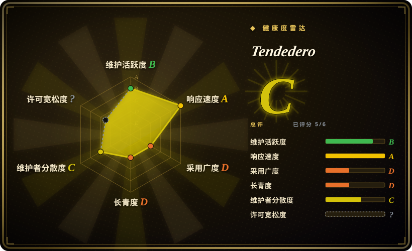
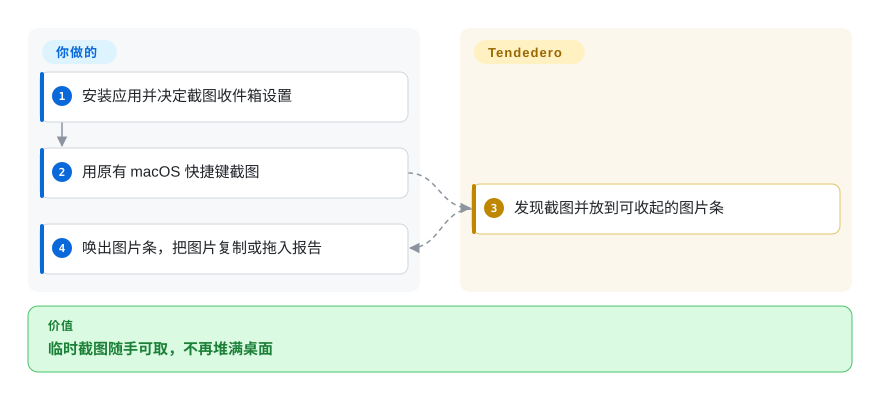
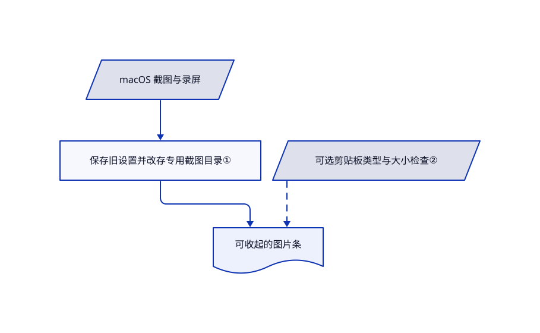

# Tendedero

缺陷报告还没写完，截图已经堆满桌面。Tendedero 把最近的截图放到菜单栏下方的可收起图片条，方便复制或拖出。

## 何时使用

你连续截取几个界面问题，需要随手取用，却不想让桌面成为收件箱。保留系统截图快捷键、临时放好图片，比完整截图编辑器更重要时，选 Tendedero。它可把截图和录屏改存到自己的目录，再提供复制、拖放、系统标注与裁剪录屏操作。

## 何时不用

- **需要文字识别或滚动截图。** 选提供这些功能的商业桌面应用 [Shottr](https://shottr.cc/)，而非临时图片条。
- **需要云端链接与录屏展示工具。** 选 [CleanShot X](https://cleanshot.com/)，接受商业授权和可选云服务。
- **不想让另一个应用修改截图设置。** 保留系统“截屏”和“预览”；收件箱模式会改变截图目录与缩略图设置，退出时再尝试恢复。

## 横向对比

| 替代品 | 是否收录 | 我们的评价 | 取舍 |
|---|---|---|---|
| macOS 截屏与预览 | 非仓库 | 偶尔截图保留系统工具；反复搬运多张临时截图时，选 Tendedero。 | 系统闭源应用无需增加后台进程，但没有这种可收起图片条。 |
| Shottr | 非仓库 | 文字识别、滚动截图与像素检查选 Shottr；只要源码可读的临时图片条，选 Tendedero。 | 商业桌面应用提供更丰富编辑，也带来激活和分析设置。 |
| CleanShot X | 非仓库 | 录屏润色与云分享链接选 CleanShot；只要本地截图交接，选 Tendedero。 | 付费闭源应用和可选云账号，对比功能集中的开源代码工具。 |

## 快速上手

下载发布磁盘映像，把应用拖到 Applications，或使用文档中的 `brew install --cask alejandrobujan/tap/tendedero`。决定是否允许它管理截图目录，以及是否开启剪贴板图片收集。按原有系统快捷键截图，把指针停在菜单栏唤出图片条，再点击复制或拖到目标应用。哪些文件长期保留由你决定；拖到文件夹会在图片条之外保存。本次仅阅读源码，未安装应用，也未改变 macOS 设置。

<!-- flow-steps:begin (generated from flows/tendedero.json by tools/flow_card.py — do not edit) -->

流程文字版

1. **你**：安装应用并决定截图收件箱设置
2. **你**：用原有 macOS 快捷键截图
3. **Tendedero**：发现截图并放到可收起的图片条
4. **你**：唤出图片条，把图片复制或拖入报告

**价值**：临时截图随手可取，不再堆满桌面

<!-- flow-steps:end -->

## 技术要点

<!-- mechanism:begin (generated from mechanisms/tendedero.json by tools/mechanism_card.py; do not edit) -->

机制文字版

- macOS 截图与录屏
- 保存旧设置并改存专用截图目录①
- 可选剪贴板类型与大小检查②
- 可收起的图片条

- macOS 截图与录屏 → 保存旧设置并改存专用截图目录①
- 保存旧设置并改存专用截图目录① → 可收起的图片条
- 可选剪贴板类型与大小检查② → 可收起的图片条〔可选／兜底〕

<!-- mechanism:end -->

### 1. 保存并恢复系统截图设置

- **解决：** 截图落到桌面，或先等待系统浮动缩略图。
- **做法：** Inbox 保存原设置，用 CFPreferences 把截图和录屏改存到 Application Support，并关闭缩略图。仅在当前目录仍由它接管时恢复旧值。
- **边界：** 这是共享系统设置；正常退出的恢复逻辑，不保证每次崩溃或与其他截图应用冲突后都能恢复。
- **源码：** [截图偏好处理](https://github.com/alejandrobujan/tendedero/blob/32a3e47187fdea7b2fd43b3ab5a913f0ed33724a/Sources/Tendedero/Inbox.swift#L61-L112)。

### 2. 先检查剪贴板类型，再读取图片

- **解决：** 剪贴板图片可能是敏感数据、超大图片，或文本和文件图标的附带图像。
- **做法：** 可选观察器每半秒检查 changeCount，排除文本、文件及隐私和临时标记，限制字节与像素，把 TIFF 转为 PNG，并设置仅文件所有者可读写。
- **边界：** 隐私保护依赖源应用正确标记；通过检查的图片仍会持久写入本地。
- **源码：** [剪贴板观察器](https://github.com/alejandrobujan/tendedero/blob/32a3e47187fdea7b2fd43b3ab5a913f0ed33724a/Sources/Tendedero/ClipboardWatcher.swift#L26-L105)。

## 技术栈

Swift、AppKit、SwiftUI 与 Swift Package Manager。应用使用 macOS 原生截图设置、剪贴板和系统编辑器。

## 依赖

Intel 或 Apple Silicon 上的 macOS 14 以上系统。源码构建需要 Swift 工具链；打包应用不需要服务端和账号。可能请求桌面目录访问权限，特别是临时签名的重建版本。

## 运维难度

**低。** 安装原生应用并管理本地截图即可。敏感选择是截图设置接管和剪贴板持久保存，而非运行后端服务。分发 fork 时应替换授权排除的名称与图标。

## 健康度与可持续性

- **截至 2026-10-18：** 仓库建于 10 月 7 日，仅十一天。119 个文件包含真实观察器和构建脚本；星数快速增长不能证明持续维护。
- **判断：** 适合作为可回退的个人工具试用。能看到维护与打包路径，但单个具名作者与极短历史，尚无长期存续证据。
- **许可：** MIT 实文署名 Alejandro Buján，README 另行排除名称与图标，分发时不能混为一谈。

## 存疑（未验证）

- [未验证：未安装运行] 未测试异常退出后的设置恢复、下载产物的公证状态和跨 macOS 版本行为。
- [未验证：未做全量网络审计] README 声称不联网且无分析；已读截图模块只做本地处理，但不等于完整外发审计。
