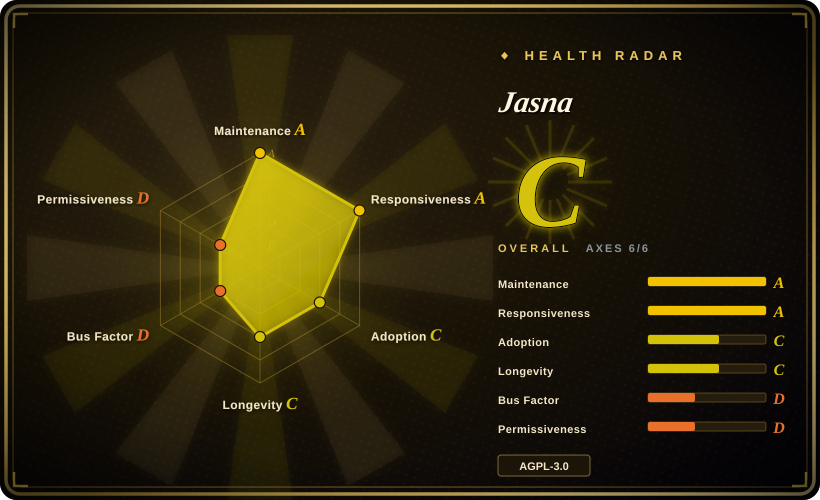
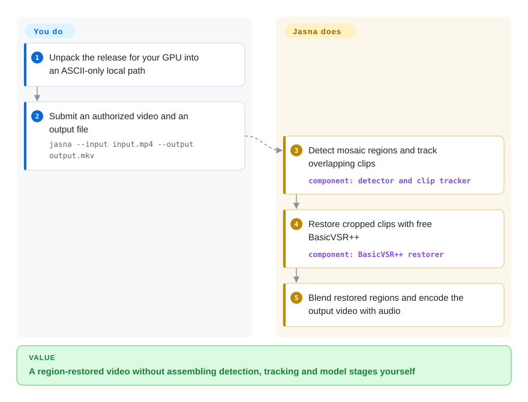
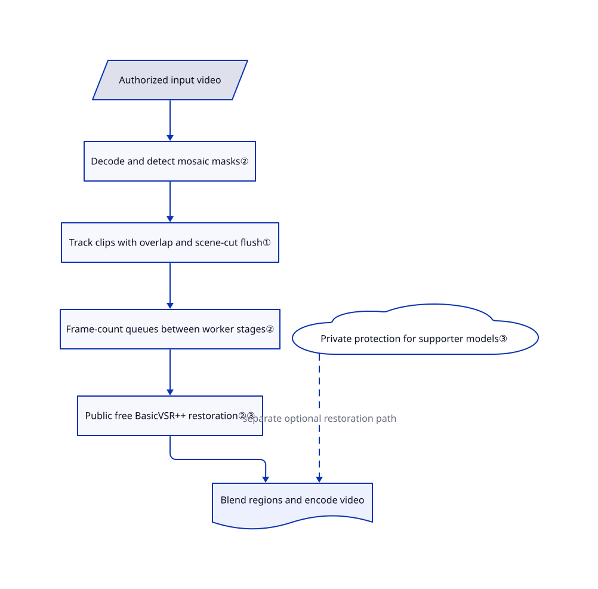

# Jasna

A mosaic follows a moving region through your video, so sharpening the whole frame cannot fix it. Jasna tracks that region across frames, restores cropped clips on the GPU and blends them back.

## When to use

You maintain a collection of videos you are authorized to process, and the same moving region stays pixelated while the surrounding picture is already sharp. You want a local queue or command-line job, not a whole-frame upscale. Jasna detects mosaic masks, follows them through short clips and applies the free BasicVSR++ restoration model only to those regions. Choose it over Video2X for tracked mosaic reconstruction, and over a hand-built FFmpeg pipeline when you need detection and temporal restoration together.

You can also preview selected time ranges or process side-by-side VR180 material through its GUI. Choose Jasna over Lada when its NVIDIA-focused acceleration and segment controls fit your workflow; do not treat the author's older speed comparison as a guarantee on your GPU. The free public-source workflow is a distinct choice from the official package's supporter-enabled features.

## When NOT to use

- **You need ordinary upscaling or frame interpolation.** Choose [Video2X](https://github.com/k4yt3x/video2x), whose Vulkan pipeline targets those jobs; Jasna's tracked-region restoration is not a general replacement for them.
- **You only need transcoding, trimming or a deterministic filter.** Use [FFmpeg](video-audio/transcoding-and-pipelines/ffmpeg.md). Jasna adds model weights, GPU memory requirements and generated reconstruction that a format conversion does not need.
- **You need Intel Arc or a CPU fallback for mosaic restoration.** Evaluate [Lada](https://codeberg.org/ladaapp/lada), which documents those paths. Jasna documents NVIDIA requirements and experimental AMD support, not a supported Apple Silicon or CPU workflow.
- **You must audit and rebuild every component you run.** Use Jasna's public-source free BasicVSR++ path, or evaluate Lada; do not choose the supporter-enabled official executable. Its protection implementation and final build driver are private. Packaged startup calls private runtime initialization even though the licensing document describes a narrower free-CLI boundary; see the entry-point source below.
- **You require forensic recovery of the original pixels.** Retain the original media and use FFmpeg for deterministic transformations instead. [推断：restoration models synthesize output from cropped frames; no original-pixel verification is implemented in the reviewed path] A plausible reconstruction is not evidence of what was hidden.
- **Your media must not be exposed to the network or unattended shell actions.** Keep to file export, disable post-export commands and poweroff, and avoid Jasna's streaming mode; use FFmpeg for a non-serving transform. Streaming binds all interfaces and loads a browser script from a public CDN. This is a configured feature boundary, not a demonstrated exploit.

## Comparison

| Alternative | In index | Our verdict | Tradeoff |
|---|---|---|---|
| [Lada](https://codeberg.org/ladaapp/lada) | not indexed | Choose Lada when Intel Arc, a documented CPU fallback or its Flatpak packaging decides the mosaic-restoration job; choose Jasna for its GPU-oriented pipeline and segment workflow. | Jasna reuses Lada's restoration model and acknowledges derived code; packaging and acceleration differ. Not added in this tab batch. |
| [Video2X](https://github.com/k4yt3x/video2x) | not indexed | Choose Video2X for whole-frame enlargement or smoother motion through Vulkan; choose Jasna when the problem is a moving mosaic region, not overall resolution. | Video2X combines upscalers and interpolation models; it is not the same detect-track-crop restoration workflow. Not added in this tab batch. |
| [FFmpeg](video-audio/transcoding-and-pipelines/ffmpeg.md) | ✅ | Choose FFmpeg for reproducible codec, container and filter jobs without learned reconstruction; choose Jasna when automatic mosaic detection and temporal restoration are the missing operations. | FFmpeg has broader media plumbing and no supporter activation; assembling Jasna's model pipeline yourself remains additional work. |

## Quick start

Download the official release for your operating system and GPU, verify its published archive checksums, and unpack to a local path containing only ASCII characters. For the free video path, run `jasna --input input.mp4 --output output.mkv`; the GUI instead accepts a queued video and starts with its play button. Jasna prepares GPU-specific models when needed, detects and restores mosaic clips, and writes the output video while preserving or converting audio for its container. You supply authorized media, sufficient GPU memory, output disk space and a visual check of the reconstruction; preserve the originals. Developers who exclude proprietary protection should follow the [source setup](https://github.com/Kruk2/jasna/blob/099af50a3aac06f14db8d048efd8c6562e2c3d25/docs/en/development.md#run), provide the documented weights, and use the free BasicVSR++ path rather than expecting supporter activation to work from the public checkout.

<!-- flow-steps:begin (generated from flows/jasna.json by tools/flow_card.py — do not edit) -->

Text version of the flow

1. **You**: Unpack the release for your GPU into an ASCII-only local path
2. **You**: Submit an authorized video and an output file — `jasna --input input.mp4 --output output.mkv`
3. **Jasna**: Detect mosaic regions and track overlapping clips — component: `detector and clip tracker`
4. **Jasna**: Restore cropped clips with free BasicVSR++ — component: `BasicVSR++ restorer`
5. **Jasna**: Blend restored regions and encode the output video with audio

**Value**: A region-restored video without assembling detection, tracking and model stages yourself

<!-- flow-steps:end -->

## Key techniques

<!-- mechanism:begin (generated from mechanisms/jasna.json by tools/mechanism_card.py; do not edit) -->

Text version of the mechanism

- Authorized input video
- Decode and detect mosaic masks②
- Track clips with overlap and scene-cut flush①
- Frame-count queues between worker stages②
- Public free BasicVSR++ restoration②③
- Private protection for supporter models③
- Blend regions and encode video

- Authorized input video → Decode and detect mosaic masks②
- Decode and detect mosaic masks② → Track clips with overlap and scene-cut flush①
- Track clips with overlap and scene-cut flush① → Frame-count queues between worker stages②
- Frame-count queues between worker stages② → Public free BasicVSR++ restoration②③
- Public free BasicVSR++ restoration②③ → Blend regions and encode video
- Private protection for supporter models③ → Blend regions and encode video (separate optional restoration path) [optional/fallback]

<!-- mechanism:end -->

### 1. Track overlapping clips rather than restoring isolated frames

- **Problem:** Frame-by-frame reconstruction can change abruptly when a region moves or a long shot is split.
- **How:** Bounding-box overlap associates detections with tracks. At the clip-size limit the tracker retains twice the overlap margin for the continuation; processing computes retained ranges and optional crossfade weights, and flushes tracks at detected scene cuts.
- **Limits:** Association depends on detection quality and box overlap, not verified object identity. Clip size, overlap and detection-gap settings affect GPU memory and continuity; the algorithm does not prove artifact-free output.
- **Source:** [Track matching and splitting:165–264](https://github.com/Kruk2/jasna/blob/099af50a3aac06f14db8d048efd8c6562e2c3d25/jasna/tracking/clip_tracker.py#L165-L264), [overlap handling:26–117](https://github.com/Kruk2/jasna/blob/099af50a3aac06f14db8d048efd8c6562e2c3d25/jasna/pipeline_processing.py#L26-L117), [scene-cut flush:143–159](https://github.com/Kruk2/jasna/blob/099af50a3aac06f14db8d048efd8c6562e2c3d25/jasna/pipeline_processing.py#L143-L159).

### 2. Separate GPU stages with frame-count backpressure

- **Problem:** Detection, model inference and encoding consume memory at different rates; counting queue items alone hides a large clip behind one item.
- **How:** Decode/detect, primary restoration, optional secondary restoration and blend/encode use separate loops. Their custom queue blocks producers by queued frame count; BasicVSR++ chooses TensorRT sub-engines on NVIDIA when available and otherwise uses its PyTorch model.
- **Limits:** An empty queue admits one oversized item, so the frame budget is not an absolute memory ceiling. Decoder fallback and optional stages also mean the entire job is not guaranteed to stay on the GPU or achieve the published benchmark speed.
- **Source:** [Frame queue:9–35](https://github.com/Kruk2/jasna/blob/099af50a3aac06f14db8d048efd8c6562e2c3d25/jasna/frame_queue.py#L9-L35), [stage loops:225–322](https://github.com/Kruk2/jasna/blob/099af50a3aac06f14db8d048efd8c6562e2c3d25/jasna/pipeline_threads.py#L225-L322), [restorer backend:30–69](https://github.com/Kruk2/jasna/blob/099af50a3aac06f14db8d048efd8c6562e2c3d25/jasna/restorer/basicvsrpp_mosaic_restorer.py#L30-L69).

### 3. Keep the public free path separate from protected models

- **Problem:** An unavailable private submodule should not make the independently reusable free application disappear.
- **How:** A small availability check distinguishes a real protection module from an empty namespace and rejects protected-model requests with an explicit error. Source-mode free workflows avoid that requirement; tests cover missing and empty modules. Frozen release startup separately initializes the private runtime.
- **Limits:** Public source cannot reproduce the complete official executable or audit activation transport. LTX-related source, model weights, vendor libraries and proprietary supporter artifacts have separate terms; the default AGPL label does not cover the whole release.
- **Source:** [Availability boundary:1–22](https://github.com/Kruk2/jasna/blob/099af50a3aac06f14db8d048efd8c6562e2c3d25/jasna/license_api.py#L1-L22), [public-source tests:12–95](https://github.com/Kruk2/jasna/blob/099af50a3aac06f14db8d048efd8c6562e2c3d25/tests/test_public_source.py#L12-L95), [frozen initialization:16–24](https://github.com/Kruk2/jasna/blob/099af50a3aac06f14db8d048efd8c6562e2c3d25/jasna/__main__.py#L16-L24), [license scope](https://github.com/Kruk2/jasna/blob/099af50a3aac06f14db8d048efd8c6562e2c3d25/LICENSING.md).

## Tech stack

- Python 3.12+, PyTorch, RF-DETR or YOLO detection, BasicVSR++ temporal restoration; CustomTkinter/Tk GUI.
- PyAV/FFmpeg media handling, optional custom VALI decoder; TensorRT and CUDA kernels on NVIDIA, ROCm/AMF paths on AMD.
- Optional LTX diffusion restoration and SD 1.5 image restoration are separate supporter paths, not requirements for free BasicVSR++ video export.

## Dependencies

- Documented baseline: NVIDIA compute capability 7.5+ with recent drivers; Radeon RX 7000/9000 support is experimental. Use local supported storage and an ASCII-only path; network disks are not supported by the documented package workflow.
- Source builds need the matching GPU extras from [pyproject.toml](https://github.com/Kruk2/jasna/blob/099af50a3aac06f14db8d048efd8c6562e2c3d25/pyproject.toml), `ffmpeg`/`ffprobe` 8, and libVLC 3 for GUI player audio. Official packages bundle their Python and media tools.
- Supply detection/restoration weights in `model_weights`; the corruption-tolerant VALI fork is optional, with a documented PyAV fallback. Do not assume a generic PyPI install reproduces the release decoder.
- Supporter activation is optional for free video restoration. Online activation delegates to private code; selected SD 1.5 downloads use Hugging Face. No hosted inference API is required by the reviewed free file-export path.

## Ops difficulty

**Medium for free desktop use; high for a reproducible custom GPU build.** GPU-specific compilation, driver compatibility and model caches dominate setup. Pin the source, dependencies and weights together; source 0.11.3, release v0.11.2 and a v0.11.1 correspondence document must not be assumed equivalent. Review output visually and keep originals rather than relying on model confidence.

Leave post-export actions at `none` unless you intentionally authorize shell execution or machine shutdown. [Post-export code:42–53,127–147](https://github.com/Kruk2/jasna/blob/099af50a3aac06f14db8d048efd8c6562e2c3d25/jasna/post_export_action.py#L42-L147) launches them with the application's privileges. [Streaming startup:628–641](https://github.com/Kruk2/jasna/blob/099af50a3aac06f14db8d048efd8c6562e2c3d25/jasna/streaming.py#L628-L641) listens on `0.0.0.0`, and its page uses [jsDelivr:27](https://github.com/Kruk2/jasna/blob/099af50a3aac06f14db8d048efd8c6562e2c3d25/jasna/streaming.py#L27). The [HTTP handler:125–288](https://github.com/Kruk2/jasna/blob/099af50a3aac06f14db8d048efd8c6562e2c3d25/jasna/streaming.py#L125-L288) has no authentication check, permits cross-origin requests and accepts a local media path through `/open`; firewall or isolate this mode rather than trusting its printed localhost URL.

## Health & viability

- **Maintenance, 2026-10-19:** unarchived, default-branch work on 2026-10-18, latest release v0.11.2 on 2026-10-17; the source already reports 0.11.3. Recent issues include LTX worker startup, multi-GPU behavior and audio/video timing, so pin and qualify an actual package before a long batch.
- **Governance and backing:** a user-owned project; the sampled contributor endpoint lists Kruk2 with 68 commits and four other contributors with eight combined. The README describes support funding GPU training. There is no foundation guarantee in those sources.
- **Age and durability:** created 2026-01-18, roughly nine months old and still active. [推断：age and current activity support an active-experiment verdict, not a long-lived maintenance guarantee] Treat it as a young application, not a mature media infrastructure standard.
- **Adoption and risk:** 2,578 stars are interest, not independently verified installations. The substantial public tests are a useful review surface, but were not run here. Private protection, mixed component terms and stale source-correspondence notices are more important selection constraints than the star count.

## Caveats (unverified)

- [未验证：no upstream code, model or media was executed] Reconstruction quality, GPU compatibility, compilation time and speed claims were not reproduced. README benchmarks use older Jasna/Lada versions and specific RTX 5090 inputs.
- [推断：based on learned restoration of cropped clips, with no original-pixel verifier in the reviewed path] Output may be visually plausible without matching the hidden original; do not use it as forensic evidence.
- [未验证：the protection implementation is private] Activation's exact network destination, device-identity handling, telemetry claims and supporter-runtime behavior cannot be independently checked from this checkout. Packaged startup imports protection, contrary to the narrower free-CLI claim in LICENSING.md.
- [未验证：the LTX revision cited upstream returned HTTP 422 from GitHub's tree API] Exact LTX source correspondence and whole-release license compatibility were not established. Model notices describe v0.11.0 candidates while RELEASE_SOURCES.md describes v0.11.1; verify the specific distributed artifacts before redistribution.
- [推断：repository age and current commits are the evidence, not a support commitment] Nine months of activity does not establish long-term sustainability or a low maintainer bus factor.
