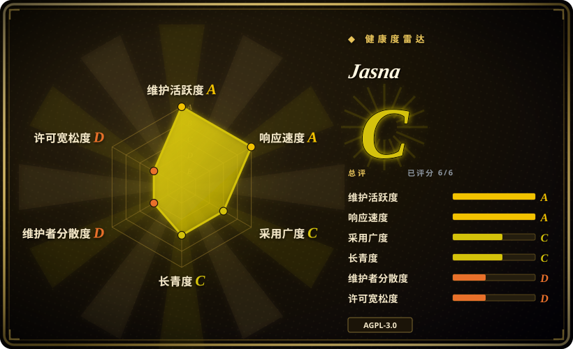
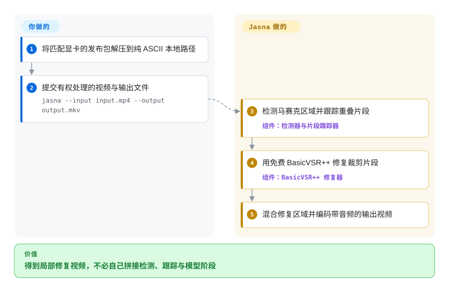
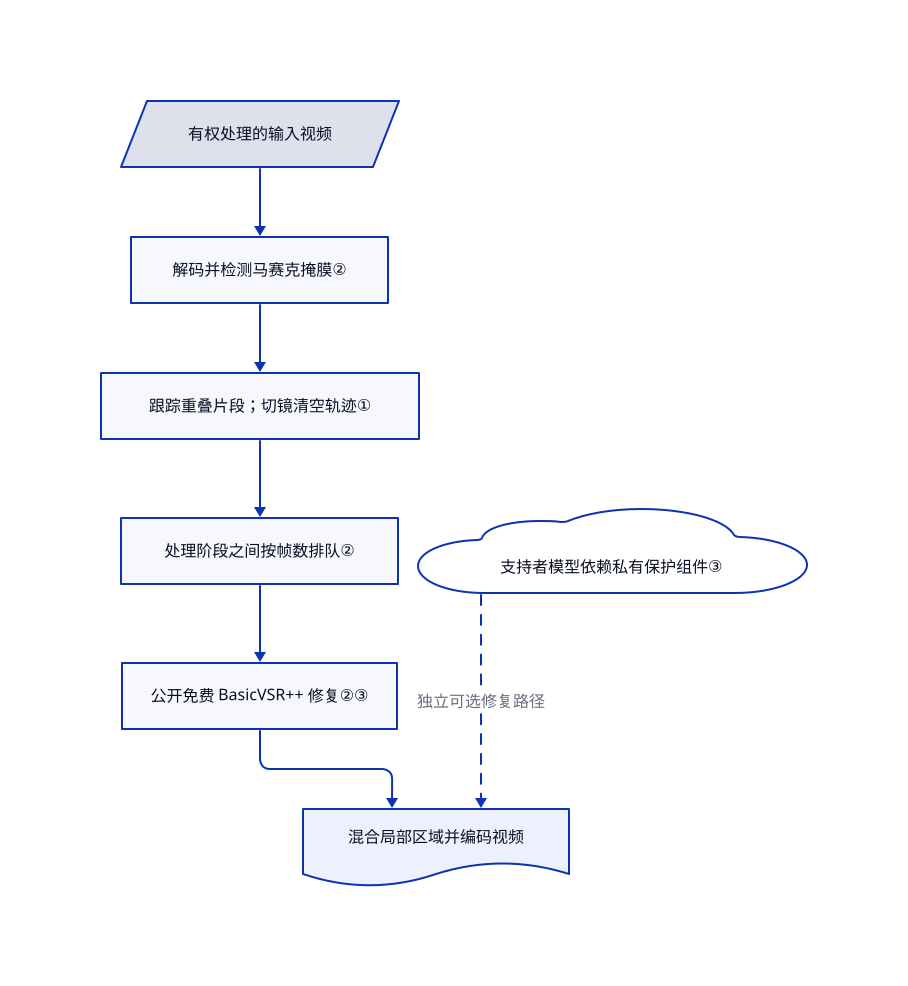

# Jasna

视频里的马赛克跟着区域移动，锐化整幅画面也无济于事。Jasna 跨帧追踪该区域，用 GPU 修复裁出的视频片段，再贴回原画面。

## 何时使用

你维护一批有权处理的视频。同一区域一直被像素块覆盖，周围画面却很清楚。你要的是本地队列或命令行批处理，不是整幅画面放大。Jasna 检测马赛克掩膜，跨帧跟踪，并用免费的 BasicVSR++ 模型修复短片段。要处理移动马赛克而非整体分辨率时，选它而不是 Video2X；需要检测与时序修复一起工作时，不必自己拼接 FFmpeg 管线。

你也可以在图形界面预览指定时间段，或处理左右并排的 VR180 视频。如果 NVIDIA 加速和片段控制符合工作流，可以选 Jasna 而不是 Lada。但不要把作者的旧版本速度对比当成你显卡上的保证。免费公开源码流程与官方包里的支持者功能，是两种不同的选择。

## 何时不用

- **只需普通放大或补帧。** 选 [Video2X](https://github.com/k4yt3x/video2x)，其 Vulkan 管线面向这些任务。Jasna 的局部跟踪修复不能全面替代它。
- **只需转码、剪切或确定性滤镜。** 用 [FFmpeg](video-audio/transcoding-and-pipelines/ffmpeg.zh.md)。格式转换不需要 Jasna 额外引入的模型权重、显存需求和生成式重建。
- **要在 Intel Arc 或 CPU 上修复马赛克。** 评估 [Lada](https://codeberg.org/ladaapp/lada)，它明确记录了这些路径。Jasna 文档要求 NVIDIA，AMD 仍属实验支持；没有承诺 Apple Silicon 或 CPU 工作流。
- **必须审计和重建全部运行组件。** 用 Jasna 公开源码的免费 BasicVSR++ 路径，或评估 Lada；不要选支持者版官方可执行文件。保护组件及最终构建驱动未公开。入口源码显示打包版启动会初始化私有运行时，比许可文档描述的免费命令行边界更宽。
- **要取证级恢复原始像素。** 保留原件，用 FFmpeg 做确定性变换。[推断：修复模型根据裁剪帧生成输出，已读路径没有原始像素验证器] 看起来合理的重建，不等于被遮住内容的证据。
- **媒体不能暴露到网络，也不能无人值守执行命令。** 只用文件导出，关闭导出后命令与关机，避免流媒体模式；不需推理时用 FFmpeg。流媒体监听全部网络接口，浏览器页面还加载公共 CDN 脚本。这是已定位的功能边界，不是攻击实验结论。

## 横向对比

| 替代品 | 是否收录 | 我们的评价 | 取舍 |
|---|---|---|---|
| [Lada](https://codeberg.org/ladaapp/lada) | 未收录 | 马赛克修复若以 Intel Arc、文档明确的 CPU 回退或 Flatpak 分发为决定条件，选 Lada；若需要偏重 GPU 的管线与片段控制，选 Jasna。 | Jasna 复用了 Lada 修复模型，并注明派生代码；分发与加速方式不同。本批不新增。 |
| [Video2X](https://github.com/k4yt3x/video2x) | 未收录 | 要通过 Vulkan 放大整幅画面或平滑运动，选 Video2X；痛点是随物体移动的马赛克区域时，选 Jasna。 | Video2X 组合放大与补帧模型，不是相同的检测、跟踪、裁剪修复流程。本批不新增。 |
| [FFmpeg](video-audio/transcoding-and-pipelines/ffmpeg.zh.md) | 已收录 | 要可复现的编解码、封装与滤镜任务，选 FFmpeg；缺的是自动马赛克检测与时序修复时，选 Jasna。 | FFmpeg 的媒体基础能力更广，也不需要支持者激活；但自己搭建 Jasna 的模型管线仍有额外工作。 |

## 快速上手

下载匹配操作系统和显卡的官方发布包，核对公开的压缩包校验和，解压到只含 ASCII 字符的本地路径。免费视频路径使用 `jasna --input input.mp4 --output output.mkv`；图形界面则添加视频后点击播放按钮。Jasna 按需准备显卡专用模型，检测并修复马赛克片段，输出视频，同时保留音频或按封装格式转换音频。你负责提供有权处理的媒体、足够显存与输出空间，并检查重建效果；务必保留原件。不接受私有保护组件的开发者，应按[源码安装说明](https://github.com/Kruk2/jasna/blob/099af50a3aac06f14db8d048efd8c6562e2c3d25/docs/en/development.md#run)配置环境和权重，使用免费 BasicVSR++ 路径，不要期待公开检出能激活支持者模型。

<!-- flow-steps:begin (generated from flows/jasna.json by tools/flow_card.py — do not edit) -->

流程文字版

1. **你**：将匹配显卡的发布包解压到纯 ASCII 本地路径
2. **你**：提交有权处理的视频与输出文件 — `jasna --input input.mp4 --output output.mkv`
3. **Jasna**：检测马赛克区域并跟踪重叠片段 — 组件：`检测器与片段跟踪器`
4. **Jasna**：用免费 BasicVSR++ 修复裁剪片段 — 组件：`BasicVSR++ 修复器`
5. **Jasna**：混合修复区域并编码带音频的输出视频

**价值**：得到局部修复视频，不必自己拼接检测、跟踪与模型阶段

<!-- flow-steps:end -->

## 技术要点

<!-- mechanism:begin (generated from mechanisms/jasna.json by tools/mechanism_card.py; do not edit) -->

机制文字版

- 有权处理的输入视频
- 解码并检测马赛克掩膜②
- 跟踪重叠片段；切镜清空轨迹①
- 处理阶段之间按帧数排队②
- 公开免费 BasicVSR++ 修复②③
- 支持者模型依赖私有保护组件③
- 混合局部区域并编码视频

- 有权处理的输入视频 → 解码并检测马赛克掩膜②
- 解码并检测马赛克掩膜② → 跟踪重叠片段；切镜清空轨迹①
- 跟踪重叠片段；切镜清空轨迹① → 处理阶段之间按帧数排队②
- 处理阶段之间按帧数排队② → 公开免费 BasicVSR++ 修复②③
- 公开免费 BasicVSR++ 修复②③ → 混合局部区域并编码视频
- 支持者模型依赖私有保护组件③ → 混合局部区域并编码视频（独立可选修复路径）〔可选／兜底〕

<!-- mechanism:end -->

### 1. 跟踪重叠片段，不逐帧独立重建

- **解决：** 区域移动或长镜头被切段后，逐帧修复容易突然改变观感。
- **做法：** 用检测框的重合程度关联轨迹。片段达到长度上限时，为续段保留两倍重叠边界；处理层计算保留区间与可选交叉淡化权重，在检测到镜头切换时清空轨迹。
- **边界：** 关联依赖检测质量与框重叠，不是已验证的物体身份。片段长度、重叠和检测间隔会影响显存与连续性；算法不保证没有伪影。
- **源码：** [轨迹匹配与切段第 165–264 行](https://github.com/Kruk2/jasna/blob/099af50a3aac06f14db8d048efd8c6562e2c3d25/jasna/tracking/clip_tracker.py#L165-L264)、[重叠处理第 26–117 行](https://github.com/Kruk2/jasna/blob/099af50a3aac06f14db8d048efd8c6562e2c3d25/jasna/pipeline_processing.py#L26-L117)、[切镜清空第 143–159 行](https://github.com/Kruk2/jasna/blob/099af50a3aac06f14db8d048efd8c6562e2c3d25/jasna/pipeline_processing.py#L143-L159)。

### 2. 按帧数控制流水线积压

- **解决：** 检测、模型推理和编码消耗显存的速度不同，按队列项计数会把大段视频藏在一个项目里。
- **做法：** 解码检测、主修复、可选二次修复及混合编码各有循环。自定义队列按积压帧数阻塞生产者；BasicVSR++ 在 NVIDIA 上优先使用可用的 TensorRT 子引擎，否则执行 PyTorch 模型。
- **边界：** 空队列仍接受一个超大项目，因此帧预算不是绝对内存上限。解码回退和可选阶段也意味着不能保证全程驻留 GPU，更不能保证达到公布的跑分速度。
- **源码：** [帧队列第 9–35 行](https://github.com/Kruk2/jasna/blob/099af50a3aac06f14db8d048efd8c6562e2c3d25/jasna/frame_queue.py#L9-L35)、[处理阶段第 225–322 行](https://github.com/Kruk2/jasna/blob/099af50a3aac06f14db8d048efd8c6562e2c3d25/jasna/pipeline_threads.py#L225-L322)、[修复后端第 30–69 行](https://github.com/Kruk2/jasna/blob/099af50a3aac06f14db8d048efd8c6562e2c3d25/jasna/restorer/basicvsrpp_mosaic_restorer.py#L30-L69)。

### 3. 将公开免费路径与受保护模型分开

- **解决：** 缺少私有子模块，不应让可独立复用的免费应用一起失效。
- **做法：** 可用性检查区分真实保护模块与空命名空间，对受保护模型请求明确报错。源码模式的免费流程不需要该组件；测试覆盖缺失和空模块。打包版启动则另行初始化私有运行时。
- **边界：** 公开源码不能复现完整官方程序，也不能审计激活传输。LTX 相关源码、权重、厂商库与专有支持者产物各有条款，默认 AGPL 不能覆盖整个发布包。
- **源码：** [可用性边界第 1–22 行](https://github.com/Kruk2/jasna/blob/099af50a3aac06f14db8d048efd8c6562e2c3d25/jasna/license_api.py#L1-L22)、[公开源码测试第 12–95 行](https://github.com/Kruk2/jasna/blob/099af50a3aac06f14db8d048efd8c6562e2c3d25/tests/test_public_source.py#L12-L95)、[打包版初始化第 16–24 行](https://github.com/Kruk2/jasna/blob/099af50a3aac06f14db8d048efd8c6562e2c3d25/jasna/__main__.py#L16-L24)、[许可范围](https://github.com/Kruk2/jasna/blob/099af50a3aac06f14db8d048efd8c6562e2c3d25/LICENSING.md)。

## 技术栈

- Python 3.12+、PyTorch、RF-DETR 或 YOLO 检测，以及 BasicVSR++ 时序修复；图形界面使用 CustomTkinter／Tk。
- PyAV／FFmpeg 处理媒体，可选定制 VALI 解码器；NVIDIA 使用 TensorRT 与 CUDA 内核，AMD 使用 ROCm／AMF 路径。
- LTX 扩散修复和 SD 1.5 图像修复是独立支持者路径，不是免费 BasicVSR++ 视频导出的前提。

## 依赖

- 文档基线为计算能力 7.5+ 的 NVIDIA 显卡和较新驱动；Radeon RX 7000／9000 支持仍属实验性质。使用文档支持的本地存储及纯 ASCII 路径；发布包工作流不支持网络磁盘。
- 源码运行需要 [pyproject.toml](https://github.com/Kruk2/jasna/blob/099af50a3aac06f14db8d048efd8c6562e2c3d25/pyproject.toml) 内对应显卡的依赖、`ffmpeg`／`ffprobe` 8，以及图形播放器音频所需的 libVLC 3。官方包自带 Python 与媒体工具。
- 在 `model_weights` 提供检测与修复权重；容错 VALI 分支可选，文档说明缺少时回退 PyAV。不能假设普通 PyPI 安装能复现发布包解码器。
- 免费修复视频不需要支持者激活。在线激活交给私有代码；选用 SD 1.5 时会从 Hugging Face 下载模型。已读免费文件导出路径不要求托管推理接口。

## 运维难度

**免费桌面使用为中，自建可复现 GPU 环境为高。** 显卡专用编译、驱动兼容与模型缓存占据主要配置成本。固定源码、依赖和权重组合；源码 0.11.3、发布版 v0.11.2 与 v0.11.1 源码对应文档不能直接视为同一产物。检查视觉输出并保留原件，不要依赖模型信心替代验收。

除非明确授权执行 shell 或关机，否则让导出后动作保持 `none`。[导出后动作第 42–53、127–147 行](https://github.com/Kruk2/jasna/blob/099af50a3aac06f14db8d048efd8c6562e2c3d25/jasna/post_export_action.py#L42-L147)以应用进程权限启动操作。[流媒体启动第 628–641 行](https://github.com/Kruk2/jasna/blob/099af50a3aac06f14db8d048efd8c6562e2c3d25/jasna/streaming.py#L628-L641)监听 `0.0.0.0`，页面使用 [jsDelivr 第 27 行](https://github.com/Kruk2/jasna/blob/099af50a3aac06f14db8d048efd8c6562e2c3d25/jasna/streaming.py#L27)。[请求处理器第 125–288 行](https://github.com/Kruk2/jasna/blob/099af50a3aac06f14db8d048efd8c6562e2c3d25/jasna/streaming.py#L125-L288)没有鉴权检查，允许跨域请求，还通过 `/open` 接受本地媒体路径。应使用防火墙或隔离环境，不能因为日志打印 localhost 就认为仅本机可访问。

## 健康度与可持续性

- **维护，截至 2026-10-19：** 未归档，默认分支最近提交为 2026-10-18，最新发布为 2026-10-17 的 v0.11.2，源码已写 0.11.3。近期问题包含 LTX 工作进程启动、多显卡行为与音画同步；长批处理前应固定并验收具体发布包。
- **治理与支持：** 仓库归个人用户所有。抽样贡献者接口列出 Kruk2 的 68 次提交，其余四位合计八次；README 说明支持款用于 GPU 训练。这些来源没有基金会保障。
- **年龄与耐久性：** 仓库创建于 2026-01-18，约九个月，仍有活跃开发。[推断：依据年龄和近期提交，可判断为活跃实验，不能推出长期维护承诺] 应把它当年轻应用，而不是成熟媒体基础设施标准。
- **采用与风险：** 2,578 个星标反映关注，不是独立验证的安装量。大量公开测试便于检查，但本次未执行。私有保护组件、混合许可与滞后的源码对应说明，比星标更影响选型。

## 存疑（未验证）

- [未验证：本次未执行上游代码、模型或媒体] 没有复现重建质量、显卡兼容性、编译耗时或速度。README 跑分来自旧版 Jasna／Lada 与特定 RTX 5090 输入。
- [推断：依据裁剪片段上的学习式修复，已读路径没有原始像素验证器] 输出可能看似合理却不等于被遮住的原件，不可当成取证证据。
- [未验证：保护实现未公开] 不能从本检出独立核对激活的准确网络地址、设备身份处理、遥测声明及支持者运行时行为。打包版入口导入保护组件，与 LICENSING.md 较窄的免费命令行声明不一致。
- [未验证：上游引用的 LTX 修订在 GitHub 树接口返回 HTTP 422] 未确立 LTX 精确源码对应关系或整个发布包的许可兼容性。模型通知仍写 v0.11.0 候选产物，RELEASE_SOURCES.md 则写 v0.11.1；再分发前必须核对实际产物。
- [推断：证据只有仓库年龄与近期提交，不是支持承诺] 九个月活跃不能证明长期可持续性或低维护者集中风险。
