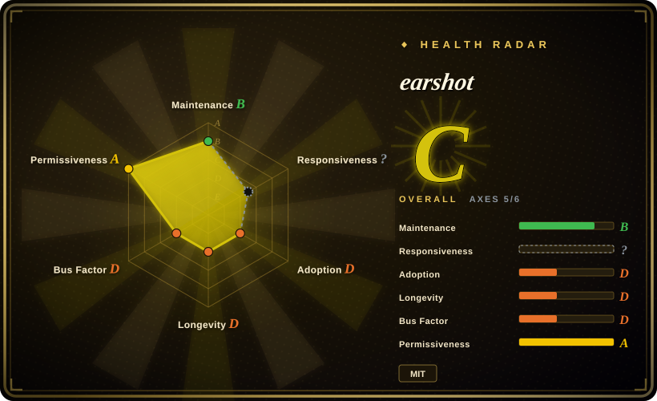
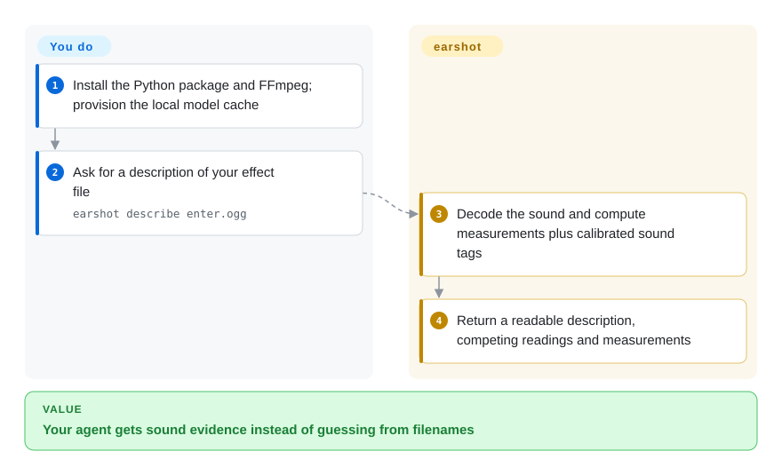
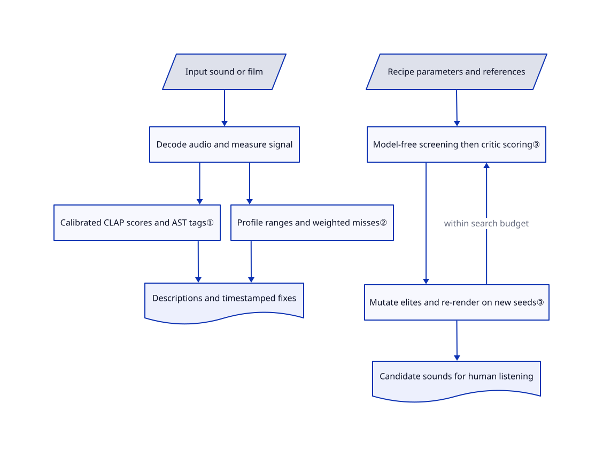

# earshot

Your agent can render a product film but cannot tell whether its clicks sound wrong or its hits miss the cuts. earshot turns those sounds into descriptions, measurements and timestamped fixes it can inspect.

## When to use

You build code-rendered demos or game interfaces with a coding agent. It keeps choosing a mouse click for a keyboard press, or placing a hit after the screen changes. You want local evidence about sound identity, loudness and timing rather than another agent asserting that the soundtrack feels polished. earshot combines text-based sound matching, measurements, visual-cut timing and a reference-film scorecard behind a CLI, Python API and MCP server, the tool interface coding agents can call. Unlike a generic audio library, it supplies agent-readable interpretations and competing readings instead of leaving you to design every feature and threshold.

You can also generate short effects from parameterized synthesis recipes, fit recordings into editable recipes, or render its shipped sound bank. Keep your editor and mixing pipeline: earshot helps choose, inspect and iterate on sounds; it does not replace human listening or grant rights to reference recordings.

## When NOT to use

- **You need spoken words or subtitles.** Choose [Whisper](../video-audio/speech-and-subtitles/whisper.md); earshot detects voice but explicitly does not transcribe it.
- **You only need conversion, trimming or fixed loudness processing.** Choose [FFmpeg](../video-audio/transcoding-and-pipelines/ffmpeg.md) directly. Loading semantic audio models buys little for a deterministic media transform.
- **You need custom music-analysis features rather than agent verdicts.** Choose librosa (not indexed; not added in this tab batch). earshot's calibrated vocabulary and launch-film profile encode a particular workflow, not a universal music-quality metric.
- **You need an artistic approval or a rights decision.** Use a human sound editor and read the original asset licenses. The documented scorecard follows seven selected launch films; event labels inside busy mixes are hints, and a realness score does not establish provenance.
- **You need instant per-file semantic calls on a small CPU.** Prefer a warm earshot MCP process over repeated CLI invocations, or use FFmpeg alone when measurements suffice. Upstream reports substantial model cold starts; this page did not benchmark them.
- **You need a fail-closed media acceptance gate.** Use a separate FFmpeg/input-validation stage and human review, not earshot's success exit alone. Open [issue 12](https://github.com/Leonxlnx/earshot/issues/12) reports NaN/Inf samples producing wrong successful results; [PR 13](https://github.com/Leonxlnx/earshot/pull/13) is still open at this snapshot. This report was not runtime-reproduced here.

## Comparison

| Alternative | In index | Our verdict | Tradeoff |
|---|---|---|---|
| [FFmpeg](../video-audio/transcoding-and-pipelines/ffmpeg.md) | Yes | Choose FFmpeg for prescribed trims, filters and encoding; choose earshot when the agent needs to compare what a sound resembles or inspect soundtrack fixes. | FFmpeg avoids the semantic-model layer, but you must assemble interpretation and reference comparisons yourself; earshot also depends on FFmpeg for decoding. |
| librosa | not indexed | Choose librosa for a Python research pipeline with your own audio features; choose earshot for ready-made sound descriptions and film-oriented diagnostics. | Lower-level feature control trades away the packaged verdict vocabulary and agent tools; not added in this tab batch. |
| [OpenAI Whisper](../video-audio/speech-and-subtitles/whisper.md) | Yes | Choose Whisper when the deliverable is a transcript; choose earshot when the question is whether an effect matches a description or a cut. | These solve different listening tasks: words and subtitles versus nonverbal sound evidence. Neither substitutes for the other's output. |

## Quick start

Follow the [pinned installation instructions](https://github.com/Leonxlnx/earshot/blob/591fa3e028032e6dce56620a20e932e35667e8d8/README.md#install): clone the repository, create a Python environment, install CPU PyTorch and the editable package with the documented extras, and put FFmpeg plus ffprobe on PATH. Run `earshot describe enter.ogg` with your own effect file at that path; the command returns a description, competing tags and measurements. First semantic use downloads the pinned models, reported upstream as roughly 1.1 GB; provision the cache first and set `EARSHOT_OFFLINE=1` when downloads must be forbidden. You supply lawful input recordings, accept the storage and CPU cost, and listen to the final choice; earshot computes the evidence, not artistic approval. For repeated agent calls, use the documented MCP configuration so models stay loaded. These are source-verified instructions, not an installation or audio-quality test performed for this entry.

<!-- flow-steps:begin (generated from flows/earshot.json by tools/flow_card.py — do not edit) -->

Text version of the flow

1. **You**: Install the Python package and FFmpeg; provision the local model cache
2. **You**: Ask for a description of your effect file — `earshot describe enter.ogg`
3. **earshot**: Decode the sound and compute measurements plus calibrated sound tags
4. **earshot**: Return a readable description, competing readings and measurements

**Value**: Your agent gets sound evidence instead of guessing from filenames

<!-- flow-steps:end -->

## Key techniques

<!-- mechanism:begin (generated from mechanisms/earshot.json by tools/mechanism_card.py; do not edit) -->

Text version of the mechanism

- Input sound or film
- Decode audio and measure signal
- Calibrated CLAP scores and AST tags①
- Profile ranges and weighted misses②
- Descriptions and timestamped fixes
- Recipe parameters and references
- Model-free screening then critic scoring③
- Mutate elites and re-render on new seeds③
- Candidate sounds for human listening

- Input sound or film → Decode audio and measure signal
- Decode audio and measure signal → Calibrated CLAP scores and AST tags①
- Decode audio and measure signal → Profile ranges and weighted misses②
- Calibrated CLAP scores and AST tags① → Descriptions and timestamped fixes
- Profile ranges and weighted misses② → Descriptions and timestamped fixes
- Recipe parameters and references → Model-free screening then critic scoring③
- Model-free screening then critic scoring③ → Mutate elites and re-render on new seeds③
- Mutate elites and re-render on new seeds③ → Model-free screening then critic scoring③ (within search budget)
- Mutate elites and re-render on new seeds③ → Candidate sounds for human listening

<!-- mechanism:end -->

### 1. Calibrate sound descriptions instead of trusting raw similarity

- **Problem:** A busy sound can score highly against many unrelated descriptions, so one similarity value is hard to interpret.
- **How:** CLAP embeds audio and text into comparable vectors. The vocabulary subtracts description bias measured from reference recordings, then expresses each score relative to the vocabulary scores for that sound; describe adds independent AudioSet tags and physical measurements.
- **Limits:** A standardized score is not a probability of correctness. Long-file descriptions sample at most six windows; music mood and genre are explicitly unvalidated hints.
- **Source:** [Calibration and sampling](https://github.com/Leonxlnx/earshot/blob/591fa3e028032e6dce56620a20e932e35667e8d8/earshot/vocab.py#L137-L148), [bias and standardized scores](https://github.com/Leonxlnx/earshot/blob/591fa3e028032e6dce56620a20e932e35667e8d8/earshot/vocab.py#L266-L289), [description assembly](https://github.com/Leonxlnx/earshot/blob/591fa3e028032e6dce56620a20e932e35667e8d8/earshot/describe.py#L161-L239).

### 2. Turn a reference-film profile into actionable diagnostics

- **Problem:** A soundtrack can have sound everywhere yet open silently, clip peaks, or miss picture changes.
- **How:** The scorecard compares measured features with profile ranges, widened by metric tolerances. Loudness and peak use separate delivery rules; critical, major and minor misses carry different weights and feed a timestamped repair list.
- **Limits:** The default profile reflects seven selected launch films, not universal taste. An onset near a cut and a swell spanning a cut are distinct tests; the score does not prove the film feels good.
- **Source:** [Score definitions and event distinction](https://github.com/Leonxlnx/earshot/blob/591fa3e028032e6dce56620a20e932e35667e8d8/earshot/critique.py#L12-L34), [metric specifications and range construction](https://github.com/Leonxlnx/earshot/blob/591fa3e028032e6dce56620a20e932e35667e8d8/earshot/critique.py#L47-L144), [documented limits](https://github.com/Leonxlnx/earshot/blob/591fa3e028032e6dce56620a20e932e35667e8d8/docs/LIMITS.md#L18-L52).

### 3. Search synthesis parameters with cheap screening before model scoring

- **Problem:** Testing every synthesized candidate with audio models costs CPU, and one lucky noise seed can mislead selection.
- **How:** Recipes render parameterized sounds. A model-free screen compares tonal balance, envelope and artifacts with references before the critic scores selected candidates; evolutionary search mutates elites, while robust re-renders and diversity selection check multiple seeds and distinct outputs.
- **Limits:** The optimizer can satisfy its own critic without improving perceived sound. Licensed reference recordings are not bundled, and generated fits retain the source recording's licensing obligations.
- **Source:** [Search contract](https://github.com/Leonxlnx/earshot/blob/591fa3e028032e6dce56620a20e932e35667e8d8/earshot/forge/search.py#L1-L41), [optimizer](https://github.com/Leonxlnx/earshot/blob/591fa3e028032e6dce56620a20e932e35667e8d8/earshot/forge/search.py#L504-L665), [Goodhart and fit limitations](https://github.com/Leonxlnx/earshot/blob/591fa3e028032e6dce56620a20e932e35667e8d8/README.md#L130-L171).

## Tech stack

- Python 3.10+, NumPy/SciPy, librosa, soundfile, soxr and pyloudnorm for signal processing; Matplotlib/Pillow for visual reports.
- PyTorch and Transformers run CLAP and AST on CPU. Optional `mcp` supplies agent tools; optional `requests` supports Gemini critique.
- CLI, Python API and a local MCP process share the package; synthesis recipes and bank parameters are code/data, not bundled audio recordings.

## Dependencies

- FFmpeg and ffprobe on PATH; a Python environment with the manifest's dependencies, including `torch>=2.6` and `transformers>=4.40`.
- Semantic tools need model files and writable decode/embedding caches. The [model resolver](https://github.com/Leonxlnx/earshot/blob/591fa3e028032e6dce56620a20e932e35667e8d8/earshot/models/hub.py#L158-L219) uses pinned downloads or local folders and honors offline flags; no database or GPU service is required.
- The README declares separate Apache-2.0 CLAP and BSD-3-Clause AST model licenses; MIT covers repository code, not all external weights and recordings.
- Optional Gemini critique sends audio to Google only with an environment API key and explicit `--yes-upload` or `consent=True`. See the [two-part gate](https://github.com/Leonxlnx/earshot/blob/591fa3e028032e6dce56620a20e932e35667e8d8/earshot/llm.py#L453-L483); usage may be billed.

## Ops difficulty

**Medium.** There is no database or GPU server to operate, but model provisioning, CPU latency, persistent-process memory and local caches need planning. Objective `measure` and bank `sfx`/`kit` paths do not load models, although the package still declares its full dependency set. Treat decoded media and optional upload permission as explicit trust boundaries; keep FFmpeg patched and do not expose unrestricted local-file MCP access to untrusted callers.

## Health & viability

- **2026-10-28 verdict:** an exploratory tool worth trialing on noncritical media work, not an established quality authority. The repository was created 2026-10-15; thirteen days and a recent release provide almost no longevity evidence. [推断：based on creation date, alpha classifier and release history, not production observations]
- **Maintenance:** v0.4.0 was published 2026-10-22 and the reviewed default-branch commit is the same release target. The repository is not archived; the API exposes one contributor with 40 contributions, concentrating continuity in the author.
- **Backing and adoption:** user-owned, with 3093 stars at this snapshot. Stars establish attention, not production adoption or independent listening validation; no foundation governance is claimed.
- **Measured coverage:** the generated aggregate is C with five of six axes scored. Responsiveness is unknown because the scorer found no qualifying response in its sampled window (`no_window_signal`), not because the repository has no issues. Open [PR 14](https://github.com/Leonxlnx/earshot/pull/14) and [PR 15](https://github.com/Leonxlnx/earshot/pull/15) concern stale video-cut caches and failed scene scans; do not assume these proposed fixes are in v0.4.0.
- **Risk:** the actual root MIT license names Leon Lin, matching the package author. README discloses the same author's vendored Cinetic mastering script; fitted-source credits are separate. Private licensed benchmark recordings prevent independent reproduction from the repository alone.

## Caveats (unverified)

- [未验证：upstream execution, dependency installation and model downloads were excluded from this research] CPU startup time, accuracy, subjective sound quality and benchmark results were not reproduced; upstream measurements are not guarantees.
- [未验证：runtime reproduction was excluded] Open issues/PRs describe non-finite samples, failed video scene scans and cache refresh defects. Their reported symptoms are source-review risks, not tests run for this entry; open proposals are not shipped fixes.
- [未验证：external weights and individual recording license pages were not independently audited] Model license statements and fitted CC0 credits above describe upstream declarations, not a complete third-party rights audit.
- [推断：based on creation date, alpha metadata and one-contributor API snapshot] The project lacks a longevity record; the exploratory-use verdict is a selection judgment, not a forecast of abandonment.
