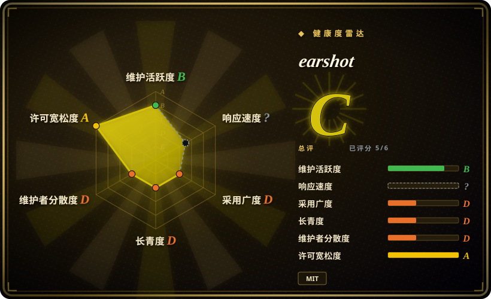
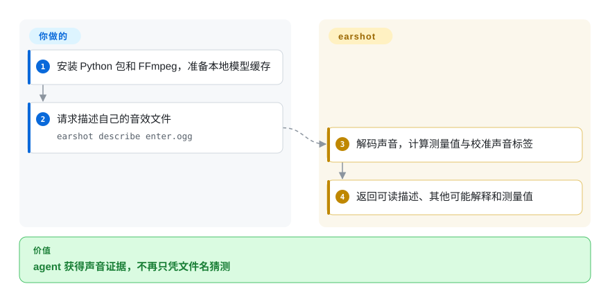
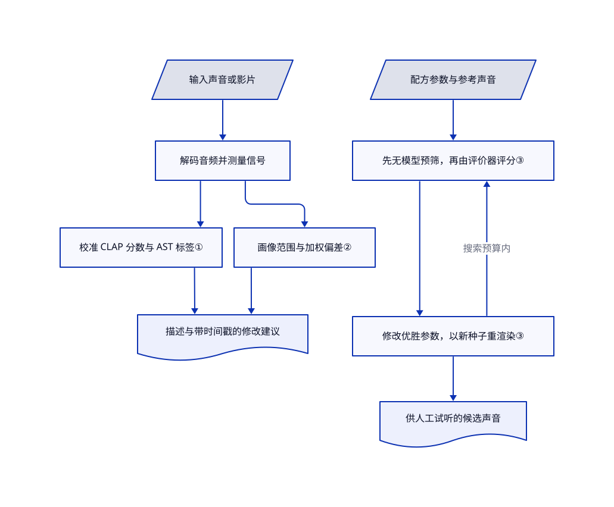

# earshot

你的 agent 能渲染产品片，却不知道按键音是否选错、撞击声是否落后于切镜。earshot 把声音转成文字、测量值和带时间戳的修改建议，供它核对。

## 何时使用

你用编码 agent 制作产品演示或游戏界面。它反复把鼠标点击当成键盘声，或者画面切完才放撞击音。你需要声音类别、响度和时间位置的本地证据，而不是另一句“配乐很高级”。earshot 把文字匹配声音、客观测量、画面切点对齐和参考影片评分装进命令行、Python 接口及 MCP 服务。MCP 是 agent 调用外部工具的接口。相比通用音频库，它直接输出可读判断和其他可能解释，不要求你自己设计每个特征和阈值。

你还可用参数化合成配方生成短音效，把录音拟合成可编辑配方，或渲染自带音效库。保留原来的剪辑和混音流程：earshot 帮你选择、检查、迭代声音，不替代人工试听，也不替参考录音授予许可。

## 何时不用

- **要台词或字幕。** 选 [Whisper](../video-audio/speech-and-subtitles/whisper.zh.md)。earshot 能检测人声，但明确不转写内容。
- **只要转码、裁切或固定响度处理。** 直接选 [FFmpeg](../video-audio/transcoding-and-pipelines/ffmpeg.zh.md)。确定性的媒体变换不值得额外加载语义音频模型。
- **要自定义音乐分析特征，而非 agent 判断。** 选 librosa（未收录；本批不添加，not added in this tab batch）。earshot 的校准词表与发布片评分对应特定流程，不是通用音乐质量指标。
- **要艺术审批或版权裁决。** 请人工声音编辑试听，并读原始素材许可。默认评分来自七部发布片；繁忙混音中的事件标签只是提示，“像真录音”不代表来源合法。
- **小型 CPU 上要求语义调用即刻返回。** 多次调用选常驻 earshot MCP 进程，不要反复启动命令行；只需测量时可选 FFmpeg。上游报告模型冷启动较慢，本页没有复测耗时。
- **要失败即拒绝的媒体验收门禁。** 使用独立 FFmpeg／输入验证步骤和人工复核，不要只相信 earshot 的成功退出码。[问题 12](https://github.com/Leonxlnx/earshot/issues/12)报告 NaN／Inf 样本导致错误的成功结果；[修复提案 13](https://github.com/Leonxlnx/earshot/pull/13)在本次快照仍未合并。本次没有运行复现该报告。

## 横向对比

| 替代品 | 是否收录 | 我们的评价 | 取舍 |
|---|---|---|---|
| [FFmpeg](../video-audio/transcoding-and-pipelines/ffmpeg.zh.md) | 已收录 | 已知裁切、滤镜和编码参数时选 FFmpeg；需要比较声音像什么、检查配乐修改点时选 earshot。 | FFmpeg 不引入语义模型，但解释与参考对比需自行编排；earshot 解码本身也依赖 FFmpeg。 |
| librosa | 未收录 | 要自行设计音频特征的 Python 研究流程时选 librosa；要现成声音描述和影片诊断时选 earshot。 | 得到更底层的特征控制，放弃打包好的判断词表与 agent 工具；本批不添加，not added in this tab batch。 |
| [OpenAI Whisper](../video-audio/speech-and-subtitles/whisper.zh.md) | 已收录 | 交付物是台词文本时选 Whisper；问题是音效是否匹配描述或画面切点时选 earshot。 | 前者输出文字与字幕，后者输出非语言声音证据；两者不能互相代替。 |

## 快速上手

按[固定提交的安装说明](https://github.com/Leonxlnx/earshot/blob/591fa3e028032e6dce56620a20e932e35667e8d8/README.md#install)克隆仓库、创建 Python 环境，安装 CPU 版 PyTorch 和带文档所列扩展的可编辑包，并将 FFmpeg 与 ffprobe 放入 PATH。将自己的音效文件放在示例路径，运行 `earshot describe enter.ogg`，获取描述、竞争标签和测量值。首次语义调用会下载固定版本模型，上游称约 1.1 GB；禁止下载时应先准备缓存，再设置 `EARSHOT_OFFLINE=1`。你负责输入录音的权利、磁盘和 CPU 成本，以及最终试听；它负责计算证据，不负责艺术审批。agent 连续调用时，按文档配置 MCP，让模型常驻。这些步骤经过源码核对，本次没有安装运行或试听验证。

<!-- flow-steps:begin (generated from flows/earshot.json by tools/flow_card.py — do not edit) -->

流程文字版

1. **你**：安装 Python 包和 FFmpeg，准备本地模型缓存
2. **你**：请求描述自己的音效文件 — `earshot describe enter.ogg`
3. **earshot**：解码声音，计算测量值与校准声音标签
4. **earshot**：返回可读描述、其他可能解释和测量值

**价值**：agent 获得声音证据，不再只凭文件名猜测

<!-- flow-steps:end -->

## 技术要点

<!-- mechanism:begin (generated from mechanisms/earshot.json by tools/mechanism_card.py; do not edit) -->

机制文字版

- 输入声音或影片
- 解码音频并测量信号
- 校准 CLAP 分数与 AST 标签①
- 画像范围与加权偏差②
- 描述与带时间戳的修改建议
- 配方参数与参考声音
- 先无模型预筛，再由评价器评分③
- 修改优胜参数，以新种子重渲染③
- 供人工试听的候选声音

- 输入声音或影片 → 解码音频并测量信号
- 解码音频并测量信号 → 校准 CLAP 分数与 AST 标签①
- 解码音频并测量信号 → 画像范围与加权偏差②
- 校准 CLAP 分数与 AST 标签① → 描述与带时间戳的修改建议
- 画像范围与加权偏差② → 描述与带时间戳的修改建议
- 配方参数与参考声音 → 先无模型预筛，再由评价器评分③
- 先无模型预筛，再由评价器评分③ → 修改优胜参数，以新种子重渲染③
- 修改优胜参数，以新种子重渲染③ → 先无模型预筛，再由评价器评分③（搜索预算内）
- 修改优胜参数，以新种子重渲染③ → 供人工试听的候选声音

<!-- mechanism:end -->

### 1. 校准声音描述，不直接相信相似度

- **解决：** 繁忙声音可能对很多无关描述都得高分，单个相似度难以解释。
- **做法：** CLAP 把音频和文字变成可比较的向量。词表减去参考录音测得的描述偏差，再按当前声音对应词表的分数分布标准化；描述模块另附 AudioSet 标签和物理测量。
- **边界：** 标准分不是判断正确的概率。长文件描述最多抽六个窗口；音乐情绪和风格明确属于未校验提示。
- **源码：** [窗口采样](https://github.com/Leonxlnx/earshot/blob/591fa3e028032e6dce56620a20e932e35667e8d8/earshot/vocab.py#L137-L148)、[偏差与标准分](https://github.com/Leonxlnx/earshot/blob/591fa3e028032e6dce56620a20e932e35667e8d8/earshot/vocab.py#L266-L289)、[描述组装](https://github.com/Leonxlnx/earshot/blob/591fa3e028032e6dce56620a20e932e35667e8d8/earshot/describe.py#L161-L239)。

### 2. 把参考影片画像变成具体诊断

- **解决：** 全片有声音，仍可能开场空白、峰值削波，或声音没跟上画面。
- **做法：** 评分卡把测量特征与参考范围对比，并按指标容差放宽范围。响度和峰值另用交付规则；严重、主要、次要偏差分配不同权重，汇总为带时间戳的修改清单。
- **边界：** 默认画像来自七部发布片，不是普遍审美。切点附近出现新起音，与渐强音跨过切点是两种检测；分数不能证明影片好听。
- **源码：** [评分与事件区别](https://github.com/Leonxlnx/earshot/blob/591fa3e028032e6dce56620a20e932e35667e8d8/earshot/critique.py#L12-L34)、[指标与范围构造](https://github.com/Leonxlnx/earshot/blob/591fa3e028032e6dce56620a20e932e35667e8d8/earshot/critique.py#L47-L144)、[已知局限](https://github.com/Leonxlnx/earshot/blob/591fa3e028032e6dce56620a20e932e35667e8d8/docs/LIMITS.md#L18-L52)。

### 3. 先便宜筛选，再用模型评合成参数

- **解决：** 每个合成候选都过音频模型会消耗 CPU，单个幸运噪声种子也会误导选择。
- **做法：** 配方按参数渲染声音。不用模型的预筛先比较频段平衡、包络和伪影，再让评价器给入围者打分；进化搜索修改优胜参数，多种子重渲染与多样性选择检查稳定性和输出差异。
- **边界：** 优化器可能讨好自己的评价器，却没有改善听感。仓库不附带授权参考录音；拟合生成的配方仍受原录音许可约束。
- **源码：** [搜索合同](https://github.com/Leonxlnx/earshot/blob/591fa3e028032e6dce56620a20e932e35667e8d8/earshot/forge/search.py#L1-L41)、[优化器](https://github.com/Leonxlnx/earshot/blob/591fa3e028032e6dce56620a20e932e35667e8d8/earshot/forge/search.py#L504-L665)、[指标失效与拟合局限](https://github.com/Leonxlnx/earshot/blob/591fa3e028032e6dce56620a20e932e35667e8d8/README.md#L130-L171)。

## 技术栈

- Python 3.10 及以上，NumPy／SciPy、librosa、soundfile、soxr 和 pyloudnorm 处理信号；Matplotlib／Pillow 生成可视化报告。
- PyTorch 和 Transformers 在 CPU 上运行 CLAP 与 AST。可选 `mcp` 提供 agent 工具，可选 `requests` 支持 Gemini 点评。
- 命令行、Python 接口和本地 MCP 进程共享包；合成配方与音效库参数是代码和数据，不是捆绑录音。

## 依赖

- PATH 中需要 FFmpeg 和 ffprobe；Python 环境需清单声明的依赖，包括 `torch>=2.6` 与 `transformers>=4.40`。
- 语义工具需要模型文件，以及可写的解码和向量缓存。[模型解析器](https://github.com/Leonxlnx/earshot/blob/591fa3e028032e6dce56620a20e932e35667e8d8/earshot/models/hub.py#L158-L219)支持固定版本下载或本地目录，遵守离线开关；无需数据库或 GPU 服务。
- README 声明 CLAP 模型适用 Apache-2.0，AST 适用 BSD-3-Clause；MIT 覆盖仓库代码，不覆盖所有外部权重与录音。
- 可选 Gemini 点评只有环境变量含 API 密钥，且显式传入 `--yes-upload` 或 `consent=True`，才向 Google 发送音频。见[双重门禁](https://github.com/Leonxlnx/earshot/blob/591fa3e028032e6dce56620a20e932e35667e8d8/earshot/llm.py#L453-L483)；调用可能计费。

## 运维难度

**中。** 无需运维数据库或 GPU 服务，但要规划模型缓存、CPU 延迟、常驻进程内存和本地缓存。客观 `measure` 与音效库 `sfx`／`kit` 不加载模型，但包仍声明整套依赖。解码媒体和可选上传权限应作为明确的信任边界；及时更新 FFmpeg，不向不可信调用方开放不受限的本地文件 MCP 访问。

## 健康度与可持续性

- **2026-10-28 判断：** 适合非关键媒体任务试用，不是已建立的质量权威。仓库于 2026-10-15 创建；十三天历史加近期发布，几乎不能提供长期存续证据。[推断：依据创建日期、alpha 分类与发布记录，不是生产观察]
- **维护：** v0.4.0 于 2026-10-22 发布，本次默认分支提交正是该发行目标。仓库未归档；API 只列出一名贡献者，贡献数为 40，持续性集中在作者。
- **支持与采用：** 仓库属于个人，本次快照有 3093 星。星数体现关注，不证明生产采用或独立试听验证；没有声称基金会治理。
- **测量覆盖：** 自动汇总为 C，六轴中五轴有分数。响应轴未知，因为评分窗口内没有合格回复样本（`no_window_signal`），不代表仓库没有问题。[提案 14](https://github.com/Leonxlnx/earshot/pull/14)和[提案 15](https://github.com/Leonxlnx/earshot/pull/15)涉及视频切点缓存过期和场景扫描失败；不能当作 v0.4.0 已含这些修复。
- **风险：** 实际根 MIT 许可署名 Leon Lin，与包作者一致。README 披露同作者 Cinetic 母带脚本复用，拟合源录音另有署名。私有授权评测录音使单靠仓库无法独立重现实验。

## 存疑（未验证）

- [未验证：本次禁止运行上游、安装依赖和下载模型] 未复现 CPU 冷启动、准确率、主观音质与基准结果；上游测量不是保证。
- [未验证：本次禁止运行复现] 未合并的问题与提案描述了非有限样本、视频场景扫描失败和缓存刷新缺陷。这里只把所报告症状列为源码审读风险，不冒充本次实测，也不把未合并提案当成已发布修复。
- [未验证：未逐一独立审计外部权重及录音原始许可页面] 上述模型许可和拟合 CC0 署名属于上游声明，不是完整的第三方权利审计。
- [推断：依据创建日期、alpha 元数据与单贡献者 API 快照] 项目尚无长期存续记录；探索性使用是选型判断，不是预测它会弃置。
