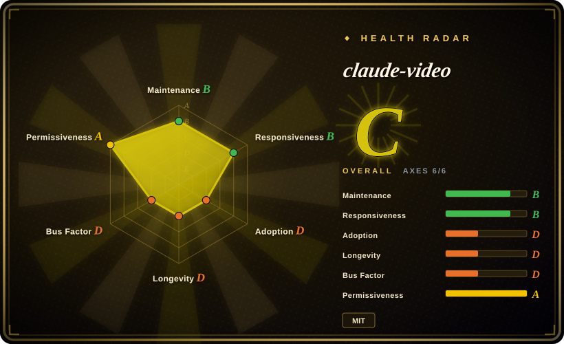
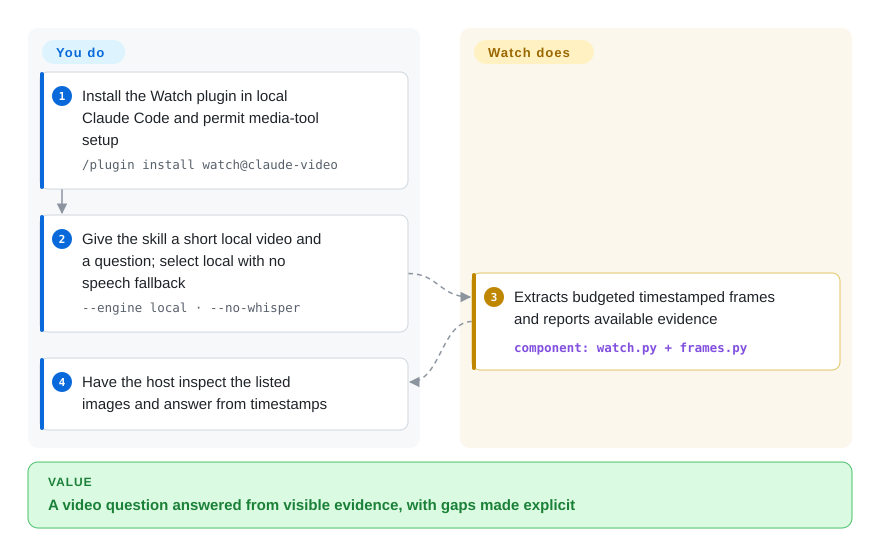
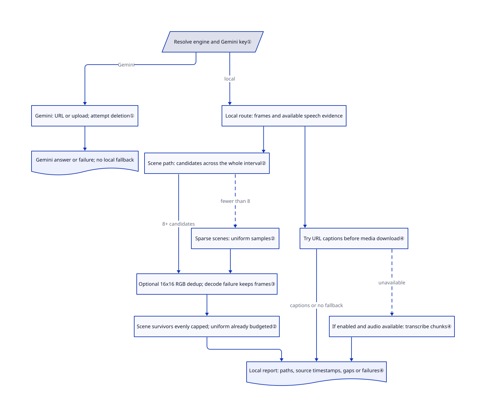

# claude-video

Your coding agent cannot explain a screen recording from its filename; Watch turns the video into timestamped images and speech evidence the agent can read.

## When to use

You are debugging a recorded UI failure and need to ask a local coding agent “what changed at 2:30?” Watch packages video extraction, captions and timestamped frame paths into a skill, so the agent can inspect evidence instead of guessing from a transcript. Choose it over raw FFmpeg when agent-facing evidence and bounded frame selection matter more than custom media-pipeline control.

Use a shell-capable Claude Code, Codex or other Agent Skills host. Choose `--engine local` explicitly for local extraction; the default `auto` chooses Gemini whenever a Gemini key resolves. Local extraction does not mean a private answer: the host may send the images and transcript to its model provider.

## When NOT to use

- **You need video generation, editing, transcoding, or production.** Use [MoviePy](../editing-and-cutting/moviepy.md), [FFmpeg](../transcoding-and-pipelines/ffmpeg.md), [MLT](../editing-and-cutting/mlt.md), or a video-production tool; claude-video is a video-understanding helper.
- **You only need raw transcription.** [OpenAI Whisper](whisper.md), native captions, or a dedicated ASR pipeline is simpler when frames are irrelevant.
- **You are using Claude Chat or Cowork.** This version does not support either surface; use a Claude Code session or a standalone FFmpeg/Whisper workflow. Cloud Code also has separate installation and network limits.
- **All content must stay on your device.** Use local FFmpeg/Whisper with an approved local model host; Watch's local extraction alone does not constrain the answering agent's egress. Gemini uploads local files, and Groq/OpenAI fallbacks upload audio.
- **The source blocks authorized download.** Use a permitted local export with FFmpeg rather than bypassing access restrictions; yt-dlp support grants no access or redistribution rights.
- **Every small edit or moment must be visible.** Use a purpose-built dense FFmpeg extraction pipeline. Focused Watch runs and `--no-dedup` help, but scene selection and thumbnail deduplication can miss subtle text changes; uncapped `token-burner` still does not mean every source frame.

## Comparison

| Alternative | In index | Our verdict | Tradeoff |
|---|---|---|---|
| [FFmpeg](../transcoding-and-pipelines/ffmpeg.md) | ✅ | Choose FFmpeg for precise extraction/transcoding under your pipeline's control; choose Watch for packaged agent evidence and timestamped questions. | FFmpeg exposes the media engine without agent orchestration; Watch adds sampling and host integration, with incomplete visual coverage. |
| [OpenAI Whisper](whisper.md) | ✅ | Choose Whisper when searchable speech is the whole result; choose Watch when the answer also depends on what appeared on screen. | Whisper offers local speech inference but no visual evidence; Watch combines modalities and can add optional cloud costs. |
| [MoviePy](../editing-and-cutting/moviepy.md) | ✅ | Choose MoviePy to create an edited clip in Python; choose Watch to understand the existing recording without authoring an edit. | MoviePy supplies a clip/layer API and renders output video; Watch supplies sampled evidence and leaves the answer to its host. |

## Quick start

In a local Claude Code session, enter `/plugin marketplace add bradautomates/claude-video`, then `/plugin install watch@claude-video`, and start a new session if activation requires it ([README.md:91–112](https://github.com/bradautomates/claude-video/blob/03ceb42f7fa2c4439aca01752118044baabffb8f/README.md#L91-L112)). Share a short local video folder and ask the watch skill to summarize your file with timestamps, explicitly choosing the local engine, balanced detail and captions-only (`none`) fallback. The skill checks Python/media tools, extracts selected frames, and gives the agent image paths plus any available transcript; a local file without speech fallback has no speech transcript. The agent reads those images and answers your question; you supply permitted media, approve missing-tool installation and check the answer against relevant timestamps. This path avoids Gemini and transcription API calls, but still consumes the host's image/model budget and can send evidence to its provider; use an approved local host if egress is forbidden.

<!-- flow-steps:begin (generated from flows/claude-video.json by tools/flow_card.py — do not edit) -->

Text version of the flow

1. **You**: Install the Watch plugin in local Claude Code and permit media-tool setup — `/plugin install watch@claude-video`
2. **You**: Give the skill a short local video and a question; select local with no speech fallback — `--engine local · --no-whisper`
3. **claude-video**: Extracts budgeted timestamped frames and reports available evidence — component: `watch.py + frames.py`
4. **You**: Have the host inspect the listed images and answer from timestamps

**Value**: A video question answered from visible evidence, with gaps made explicit

<!-- flow-steps:end -->

## Key techniques

<!-- mechanism:begin (generated from mechanisms/claude-video.json by tools/mechanism_card.py; do not edit) -->

Text version of the mechanism

- Resolve engine and Gemini key①
- Gemini: URL or upload; attempt deletion①
- Gemini answer or failure; no local fallback
- Local route: frames and available speech evidence
- Scene path: candidates across the whole interval②
- Sparse scenes: uniform samples②
- Optional 16x16 RGB dedup; decode failure keeps frames③
- Scene survivors evenly capped; uniform already budgeted②
- Try URL captions before media download④
- If enabled and audio available: transcribe chunks④
- Local report: paths, source timestamps, gaps or failures④

- Resolve engine and Gemini key① → Gemini: URL or upload; attempt deletion① (Gemini)
- Gemini: URL or upload; attempt deletion① → Gemini answer or failure; no local fallback
- Resolve engine and Gemini key① → Local route: frames and available speech evidence (local)
- Local route: frames and available speech evidence → Scene path: candidates across the whole interval②
- Scene path: candidates across the whole interval② → Optional 16x16 RGB dedup; decode failure keeps frames③ (8+ candidates)
- Scene path: candidates across the whole interval② → Sparse scenes: uniform samples② (fewer than 8) [optional/fallback]
- Sparse scenes: uniform samples② → Optional 16x16 RGB dedup; decode failure keeps frames③
- Optional 16x16 RGB dedup; decode failure keeps frames③ → Scene survivors evenly capped; uniform already budgeted②
- Scene survivors evenly capped; uniform already budgeted② → Local report: paths, source timestamps, gaps or failures④
- Local route: frames and available speech evidence → Try URL captions before media download④
- Try URL captions before media download④ → Local report: paths, source timestamps, gaps or failures④ (captions or no fallback)
- Try URL captions before media download④ → If enabled and audio available: transcribe chunks④ (unavailable) [optional/fallback]
- If enabled and audio available: transcribe chunks④ → Local report: paths, source timestamps, gaps or failures④

<!-- mechanism:end -->

### 1. Resolve the engine before processing media

- **Problem:** A cloud failure must not silently change the evidence route to local extraction.
- **How:** `auto` selects Gemini when a key resolves; explicit `local` avoids that engine. Gemini receives a YouTube URL or an uploaded copy of other media, and its failures return an unavailable-evidence report without local fallback.
- **Limits:** Upload deletion is attempted, but failure only emits a warning; temporary-directory removal ignores filesystem errors. Local extraction does not constrain where the answering host sends images or transcripts.
- **Source:** [config.py:112–129](https://github.com/bradautomates/claude-video/blob/03ceb42f7fa2c4439aca01752118044baabffb8f/skills/watch/scripts/config.py#L112-L129), [watch.py:33–91](https://github.com/bradautomates/claude-video/blob/03ceb42f7fa2c4439aca01752118044baabffb8f/skills/watch/scripts/watch.py#L33-L91), [engine dispatch:164–166](https://github.com/bradautomates/claude-video/blob/03ceb42f7fa2c4439aca01752118044baabffb8f/skills/watch/scripts/watch.py#L164-L166), [host reads image paths:376–390](https://github.com/bradautomates/claude-video/blob/03ceb42f7fa2c4439aca01752118044baabffb8f/skills/watch/scripts/watch.py#L376-L390).

### 2. Search the whole interval before spending the frame budget

- **Problem:** Capping scene detection itself would keep early cuts and lose the tail of a long video.
- **How:** The scene-based local path first detects candidates across the requested interval without a candidate cap, then evenly samples surviving frames to the budget. If fewer than eight scene candidates exist, it uses uniform sampling instead.
- **Limits:** This spreads sparse evidence across time; it does not show every event or source frame. The diagram's scene branch describes this path, not every detail mode.
- **Source:** [frames.py:25–33](https://github.com/bradautomates/claude-video/blob/03ceb42f7fa2c4439aca01752118044baabffb8f/skills/watch/scripts/frames.py#L25-L33), [scene selection and fallback:517–581](https://github.com/bradautomates/claude-video/blob/03ceb42f7fa2c4439aca01752118044baabffb8f/skills/watch/scripts/frames.py#L517-L581), [detail dispatch:240–260](https://github.com/bradautomates/claude-video/blob/03ceb42f7fa2c4439aca01752118044baabffb8f/skills/watch/scripts/watch.py#L240-L260).

### 3. Compare tiny color thumbnails to remove near-duplicates

- **Problem:** Held slides or nearly static recordings can consume the frame budget with repeated images.
- **How:** FFmpeg decodes 16×16 RGB thumbnails, and the script compares their average color-channel difference with the last kept frame. Scene-path deduplication runs before budget sampling; the uniform fallback also deduplicates its extracted frames.
- **Limits:** Tiny text edits can disappear at this resolution. A thumbnail decode or count failure skips deduplication and keeps the candidates rather than failing extraction; `--no-dedup` also bypasses it.
- **Source:** [frames.py:35–41](https://github.com/bradautomates/claude-video/blob/03ceb42f7fa2c4439aca01752118044baabffb8f/skills/watch/scripts/frames.py#L35-L41), [thumbnail decode and comparison:419–514](https://github.com/bradautomates/claude-video/blob/03ceb42f7fa2c4439aca01752118044baabffb8f/skills/watch/scripts/frames.py#L419-L514), [call order:549–580](https://github.com/bradautomates/claude-video/blob/03ceb42f7fa2c4439aca01752118044baabffb8f/skills/watch/scripts/frames.py#L549-L580).

### 4. Keep successful speech chunks and mark missing intervals

- **Problem:** One failed audio slice should not discard every successful transcript segment or masquerade as silence.
- **How:** The local route checks URL captions before downloading media; without usable captions it can use the selected speech fallback. Chunked transcription shifts successful chunks back to source timestamps, logs failed intervals and raises if every chunk fails.
- **Limits:** Captions, frames and speech fallback can each be unavailable; the report exposes partial evidence and missing transcript intervals. Exit 0 does not prove every modality or interval succeeded.
- **Source:** [watch.py:183–209](https://github.com/bradautomates/claude-video/blob/03ceb42f7fa2c4439aca01752118044baabffb8f/skills/watch/scripts/watch.py#L183-L209), [fallback handling:266–295](https://github.com/bradautomates/claude-video/blob/03ceb42f7fa2c4439aca01752118044baabffb8f/skills/watch/scripts/watch.py#L266-L295), [whisper.py:276–333](https://github.com/bradautomates/claude-video/blob/03ceb42f7fa2c4439aca01752118044baabffb8f/skills/watch/scripts/whisper.py#L276-L333), [gap reporting:345–357](https://github.com/bradautomates/claude-video/blob/03ceb42f7fa2c4439aca01752118044baabffb8f/skills/watch/scripts/watch.py#L345-L357).

## Tech stack

- **Python skill runtime** — `skills/watch/scripts/` contains the media orchestration code.
- **Agent packaging** — upstream includes Claude Code plugin metadata, Codex/Agent Skills plugin manifests, `skills/watch/SKILL.md`, and a build script for `.skill` bundles.
- **Media pipeline** — `yt-dlp` downloads / extracts captions, `ffmpeg` extracts frames/audio, and optional Whisper backends transcribe captionless audio.

## Dependencies

- **Local shell execution** for `yt-dlp`, `ffmpeg`, Python scripts, and temporary working directories.
- **Python 3.10+ and media tools** — FFmpeg/ffprobe and current yt-dlp for the local path; YouTube also needs the supported JavaScript/EJS setup. The skill does not bundle these tools.
- **Optional speech backends** — `none` uses captions only; managed WhisperX uses a separate Python 3.12 environment and models (upstream asks for 3 GB disk/8 GB RAM). Groq/OpenAI require their own keys and upload audio; legacy `auto` tries Groq then OpenAI, not local WhisperX.
- **Optional Gemini engine** — requires a Google key, sends YouTube URLs to Google and uploads other videos; cloud quota/pricing and retention are separate from the local pipeline. Engine failures do not automatically switch routes.
- **Agent image-reading context** — extracted frames are handed to Claude/agent context, so cost and context budget scale with frame count/resolution.
- **Platform package managers** — first-run setup may use Homebrew on macOS or print Linux/Windows install commands.

## Ops difficulty

**Low/medium personally, medium for shared workflows.** Plugin installation is not runtime provisioning. Maintain media tools, engine/fallback preferences, private key files, model caches and frame budgets. Local run artifacts remain until the host follows the skill's cleanup instruction; Gemini deletion is attempted and failures are reported. Do not assume automatic cleanup or model-provider privacy from the word “local.”

## Health & viability

- **Verdict, 2026-10-13:** a useful young integration, not long-established infrastructure. Main and the latest v0.3.2 release are from 2026-09-25; the repository includes offline tests and cross-platform CI. The prior English prose's responsiveness A and unknown license claim were inconsistent with its own block and are removed.
- **Adoption and support:** 18489 stars and downloadable skill releases show attention, not deployment guarantees. A personal-account project with a concentrated maintainer base lacks foundation/vendor support commitments.
- **Age/Lindy and license:** created 2026-04-24, under six months old, so historical durability is unproven. The root MIT license is verified; source access/permissions and provider terms remain separate.
- **Operational risk:** source-site changes, sparse frames, optional cloud uploads and model costs dominate selection more than star count. Keep engine selection and evidence gaps visible to reviewers.

## Caveats (unverified)

- [未验证：本次未运行上游管线或调用模型] README timing, supported-site behavior and platform install recipes were not reproduced; this re-verification reads source and release metadata only.
- [未验证：未取得宿主与供应商隐私配置] Local extraction does not establish where the answering agent sends images/transcripts or what providers retain; verify the chosen host and route before private-media use.
- [推断：源码采用抽样与缩略图去重] A successful report can still miss short events or tiny screen edits; no completeness or answer-accuracy guarantee follows from extraction success.
