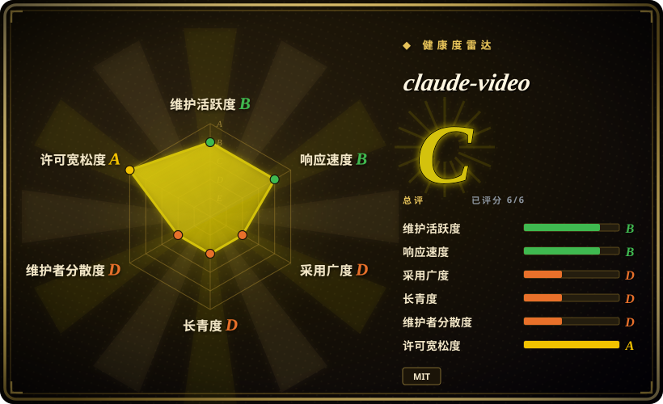
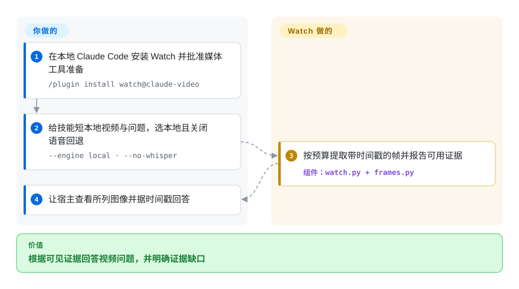
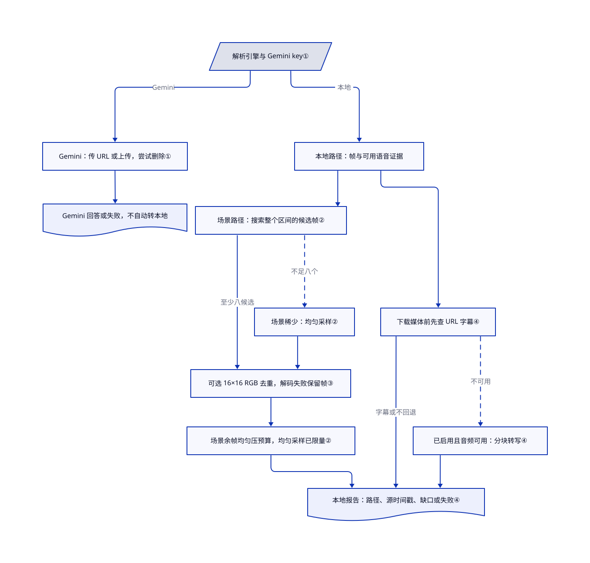

# claude-video

编程 agent 只看文件名无法解释录屏；Watch 把视频整理成带时间戳的图像与语音证据，交给 agent 阅读。

## 何时使用

你在排查录屏中的界面故障，想问本地编程 agent“2:30 有什么变化”。Watch 将视频提取、字幕和带时间戳的帧路径打包成技能，让 agent 查看证据，而非仅凭转录猜画面。需要现成的 agent 证据和有界抽帧时选它；要自定义媒体管线控制时选原始 FFmpeg。

用可执行 shell 的 Claude Code、Codex 或其它 Agent Skills 宿主。本地提取要明确选 `--engine local`；默认 `auto` 只要解析到 Gemini key 就选 Gemini。本地提取不等于私密回答：宿主仍可能把图像与转录发给模型供应商。

## 何时不用

- **你需要视频生成、剪辑、转码或生产流水线。** 用 [MoviePy](../editing-and-cutting/moviepy.zh.md)、[FFmpeg](../transcoding-and-pipelines/ffmpeg.zh.md)、[MLT](../editing-and-cutting/mlt.zh.md) 或视频生产工具；claude-video 是视频理解 helper。
- **你只需要纯转录。** 画面不重要时，[OpenAI Whisper](whisper.zh.md)、原生字幕或专用 ASR pipeline 更简单。
- **你在用 Claude Chat 或 Cowork。** 本版不支持两者；改用 Claude Code 会话或独立 FFmpeg/Whisper 工作流。云端 Code 也有独立安装与网络限制。
- **全部内容必须留在设备上。** 用本地 FFmpeg/Whisper 和获准本地模型宿主；Watch 的本地提取不能限制回答 agent 的外传。Gemini 上传本地文件，Groq/OpenAI 回退上传音频。
- **源站阻止获准下载。** 用合法本地导出和 FFmpeg，不绕访问限制；yt-dlp 支持不授予访问或再分发权。
- **每个微小编辑和瞬间都必须可见。** 用专门的密集 FFmpeg 提取管线。Watch 的聚焦运行和 `--no-dedup` 有帮助，但场景选择与缩略图去重会漏细小文本变化；无数量上限的 `token-burner` 也不等于源视频每一帧。

## 横向对比

| 替代品 | 是否收录 | 我们的评价 | 取舍 |
|---|---|---|---|
| [FFmpeg](../transcoding-and-pipelines/ffmpeg.zh.md) | ✅ | 要在自己的管线里精确提取或转码选 FFmpeg；要现成 agent 证据和时间戳问答选 Watch。 | FFmpeg 暴露媒体引擎，没有 agent 编排；Watch 增加抽样与宿主集成，但视觉覆盖不完整。 |
| [OpenAI Whisper](whisper.zh.md) | ✅ | 最终只要可搜索语音文本时选 Whisper；答案还依赖屏幕画面时选 Watch。 | Whisper 提供本地语音推理，没有视觉证据；Watch 组合模态，也可能增加云端费用。 |
| [MoviePy](../editing-and-cutting/moviepy.zh.md) | ✅ | 用 Python 制作剪辑选 MoviePy；理解现有录屏而不制作编辑结果选 Watch。 | MoviePy 提供片段与图层 API 并渲染视频；Watch 提供抽样证据，回答交给宿主。 |

## 快速上手

在本地 Claude Code 会话里依次输入 `/plugin marketplace add bradautomates/claude-video` 和 `/plugin install watch@claude-video`，如激活要求则开新会话（[README.md:91–112](https://github.com/bradautomates/claude-video/blob/03ceb42f7fa2c4439aca01752118044baabffb8f/README.md#L91-L112)）。共享含短视频的本地目录，请 watch 技能按时间戳总结该文件，明确选择本地引擎、balanced 细节和仅字幕（`none`）回退。技能检查 Python 与媒体工具、提取选定帧，并给 agent 图像路径和可用转录；关闭语音回退的本地文件没有语音转录。Agent 查看图像再回答，你负责提供获准媒体、批准缺失工具安装，并按时间戳核答案。这条路径不调用 Gemini 或转录 API，但仍消耗宿主的图像与模型预算，也可能向其供应商外传证据；禁止外传时须用获准本地宿主。

<!-- flow-steps:begin (generated from flows/claude-video.json by tools/flow_card.py — do not edit) -->

流程文字版

1. **你**：在本地 Claude Code 安装 Watch 并批准媒体工具准备 — `/plugin install watch@claude-video`
2. **你**：给技能短本地视频与问题，选本地且关闭语音回退 — `--engine local · --no-whisper`
3. **claude-video**：按预算提取带时间戳的帧并报告可用证据 — 组件：`watch.py + frames.py`
4. **你**：让宿主查看所列图像并据时间戳回答

**价值**：根据可见证据回答视频问题，并明确证据缺口

<!-- flow-steps:end -->

## 技术要点

<!-- mechanism:begin (generated from mechanisms/claude-video.json by tools/mechanism_card.py; do not edit) -->

机制文字版

- 解析引擎与 Gemini key①
- Gemini：传 URL 或上传，尝试删除①
- Gemini 回答或失败，不自动转本地
- 本地路径：帧与可用语音证据
- 场景路径：搜索整个区间的候选帧②
- 场景稀少：均匀采样②
- 可选 16×16 RGB 去重，解码失败保留帧③
- 场景余帧均匀压预算，均匀采样已限量②
- 下载媒体前先查 URL 字幕④
- 已启用且音频可用：分块转写④
- 本地报告：路径、源时间戳、缺口或失败④

- 解析引擎与 Gemini key① → Gemini：传 URL 或上传，尝试删除①（Gemini）
- Gemini：传 URL 或上传，尝试删除① → Gemini 回答或失败，不自动转本地
- 解析引擎与 Gemini key① → 本地路径：帧与可用语音证据（本地）
- 本地路径：帧与可用语音证据 → 场景路径：搜索整个区间的候选帧②
- 场景路径：搜索整个区间的候选帧② → 可选 16×16 RGB 去重，解码失败保留帧③（至少八候选）
- 场景路径：搜索整个区间的候选帧② → 场景稀少：均匀采样②（不足八个）〔可选／兜底〕
- 场景稀少：均匀采样② → 可选 16×16 RGB 去重，解码失败保留帧③
- 可选 16×16 RGB 去重，解码失败保留帧③ → 场景余帧均匀压预算，均匀采样已限量②
- 场景余帧均匀压预算，均匀采样已限量② → 本地报告：路径、源时间戳、缺口或失败④
- 本地路径：帧与可用语音证据 → 下载媒体前先查 URL 字幕④
- 下载媒体前先查 URL 字幕④ → 本地报告：路径、源时间戳、缺口或失败④（字幕或不回退）
- 下载媒体前先查 URL 字幕④ → 已启用且音频可用：分块转写④（不可用）〔可选／兜底〕
- 已启用且音频可用：分块转写④ → 本地报告：路径、源时间戳、缺口或失败④

<!-- mechanism:end -->

### 1. 处理媒体前先确定引擎

- **解决：** 云端调用失败，不应暗中换成本地提取，让证据来源发生变化。
- **做法：** `auto` 解析到 key 就选 Gemini，明确选 `local` 则避开该引擎。Gemini 接收 YouTube URL 或其它媒体的上传副本，失败就返回证据不可用的报告，不自动转本地。
- **边界：** 上传文件会尝试删除，但删除失败只告警；临时目录删除也忽略文件系统错误。本地提取不能限制回答宿主向哪里发送图片或转录。
- **源码：** [config.py:112–129](https://github.com/bradautomates/claude-video/blob/03ceb42f7fa2c4439aca01752118044baabffb8f/skills/watch/scripts/config.py#L112-L129)、[watch.py:33–91](https://github.com/bradautomates/claude-video/blob/03ceb42f7fa2c4439aca01752118044baabffb8f/skills/watch/scripts/watch.py#L33-L91)、[引擎分流：164–166](https://github.com/bradautomates/claude-video/blob/03ceb42f7fa2c4439aca01752118044baabffb8f/skills/watch/scripts/watch.py#L164-L166)、[宿主读取图像路径：376–390](https://github.com/bradautomates/claude-video/blob/03ceb42f7fa2c4439aca01752118044baabffb8f/skills/watch/scripts/watch.py#L376-L390)。

### 2. 先搜索整个区间，再分配帧预算

- **解决：** 如果检测场景时就限制数量，长视频只会留下早期切换，后半段会丢失。
- **做法：** 本地场景路径先在请求区间内不限候选数量地检测，再将保留下来的帧均匀抽到预算。场景候选不足八个时，改用均匀采样。
- **边界：** 这只是把稀疏证据分散到时间轴上，不会展示每个事件或每个原始帧。图中的场景分支只描述这条路径，不代表所有细节模式。
- **源码：** [frames.py:25–33](https://github.com/bradautomates/claude-video/blob/03ceb42f7fa2c4439aca01752118044baabffb8f/skills/watch/scripts/frames.py#L25-L33)、[场景选择与回退：517–581](https://github.com/bradautomates/claude-video/blob/03ceb42f7fa2c4439aca01752118044baabffb8f/skills/watch/scripts/frames.py#L517-L581)、[细节模式分流：240–260](https://github.com/bradautomates/claude-video/blob/03ceb42f7fa2c4439aca01752118044baabffb8f/skills/watch/scripts/watch.py#L240-L260)。

### 3. 用微型彩色缩略图去掉近重复帧

- **解决：** 停留的幻灯片或近乎静止的录屏，容易用重复图片耗尽帧预算。
- **做法：** FFmpeg 解码出 16×16 的 RGB 缩略图，脚本比较它与上一个保留帧的平均颜色通道差异。场景路径先去重再按预算抽样，均匀回退路径也对抽出的帧去重。
- **边界：** 微小文本编辑可能在这个分辨率下消失。缩略图解码或数量不匹配时跳过去重、保留候选，而非让提取失败；`--no-dedup` 也会绕过去重。
- **源码：** [frames.py:35–41](https://github.com/bradautomates/claude-video/blob/03ceb42f7fa2c4439aca01752118044baabffb8f/skills/watch/scripts/frames.py#L35-L41)、[缩略图解码与比较：419–514](https://github.com/bradautomates/claude-video/blob/03ceb42f7fa2c4439aca01752118044baabffb8f/skills/watch/scripts/frames.py#L419-L514)、[调用顺序：549–580](https://github.com/bradautomates/claude-video/blob/03ceb42f7fa2c4439aca01752118044baabffb8f/skills/watch/scripts/frames.py#L549-L580)。

### 4. 留下成功转写的片段，标出缺失区间

- **解决：** 一个音频块失败，不该丢掉其它成功片段，也不能被当成那段没有语音。
- **做法：** 本地路径先查 URL 字幕，再下载媒体；没有可用字幕时，可调用所选语音回退。分块转写将成功块移回源时间戳，记录失败区间；所有块都失败才抛错。
- **边界：** 字幕、帧和语音回退都可能不可用，报告会暴露部分证据与缺失转录区间。退出 0 不证明每种模态或每段区间都成功。
- **源码：** [watch.py:183–209](https://github.com/bradautomates/claude-video/blob/03ceb42f7fa2c4439aca01752118044baabffb8f/skills/watch/scripts/watch.py#L183-L209)、[回退处理：266–295](https://github.com/bradautomates/claude-video/blob/03ceb42f7fa2c4439aca01752118044baabffb8f/skills/watch/scripts/watch.py#L266-L295)、[whisper.py:276–333](https://github.com/bradautomates/claude-video/blob/03ceb42f7fa2c4439aca01752118044baabffb8f/skills/watch/scripts/whisper.py#L276-L333)、[缺口报告：345–357](https://github.com/bradautomates/claude-video/blob/03ceb42f7fa2c4439aca01752118044baabffb8f/skills/watch/scripts/watch.py#L345-L357)。

## 技术栈

- **Python skill runtime**——`skills/watch/scripts/` 包含媒体编排代码。
- **Agent packaging**——上游包含 Claude Code plugin metadata、Codex / Agent Skills plugin manifests、`skills/watch/SKILL.md` 和 `.skill` bundle 构建脚本。
- **Media pipeline**——`yt-dlp` 下载 / 提取字幕，`ffmpeg` 抽帧 / 抽音频，可选 Whisper backend 转录无字幕音频。

## 依赖

- **本地 shell 执行**，用于 `yt-dlp`、`ffmpeg`、Python 脚本和临时工作目录。
- **Python 3.10+ 与媒体工具**——本地路径需要 FFmpeg/ffprobe 和当前 yt-dlp；YouTube 另需受支持的 JavaScript/EJS 配置。技能不捆绑这些工具。
- **可选语音后端**——`none` 只读字幕；托管 WhisperX 用独立 Python 3.12 环境与模型（上游要求 3 GB 磁盘、8 GB RAM）。Groq/OpenAI 要各自 key 并上传音频；旧 `auto` 先找 Groq 再找 OpenAI，不是本地 WhisperX。
- **可选 Gemini 引擎**——需 Google key，向 Google 发送 YouTube URL 并上传其它视频；云额度、定价与保留策略独立于本地管线。引擎失败不会自动换路。
- **Agent image-reading context**——抽出的 frames 会进 Claude / agent 上下文，所以成本和 context budget 随帧数、分辨率增长。
- **平台 package manager**——首次 setup 可能在 macOS 调 Homebrew，或在 Linux / Windows 打印安装命令。

## 运维难度

**个人低中，团队中等。** 安装插件不等于准备好运行环境。要维护媒体工具、引擎与回退偏好、私密 key 文件、模型缓存和帧预算。本地运行产物会留到宿主执行技能的清理指令；Gemini 会尝试删除，失败会报告。不能从“本地”二字推得自动清理或供应商隐私保证。

## 健康度与可持续性

- **判断日期 2026-10-13：** 有用的年轻集成，不是长期成熟基础设施。默认分支与最新 v0.3.2 release 均为 2026-09-25；仓库包含离线测试和跨平台 CI。旧英文正文的响应 A 与许可未知断言和自己的块不符，已删除。
- **采用与支持：** 18489 stars 和技能发布包表示关注，不保证部署质量。个人账号项目、维护者集中，没有基金会或厂商支持承诺。
- **年龄、Lindy 与许可：** 创建于 2026-04-24，不足六个月，历史耐久性未建立。根 MIT 许可已核；媒体来源权限和供应商条款另计。
- **运行风险：** 源站变化、稀疏帧、可选云上传与模型费用，比 star 数更影响选型。让评审者看见引擎选择和证据缺口。

## 存疑（未验证）

- [未验证：本次未运行上游管线或调用模型] README 耗时、源站支持和平台安装方案没有复现；本次复核只读源码与发布元数据。
- [未验证：未取得宿主与供应商隐私配置] 本地提取不证明回答 agent 会向哪里发送图像与转录，也不证明供应商保留策略；处理私密媒体前核宿主和选路。
- [推断：源码采用抽样与缩略图去重] 成功报告仍会漏短暂事件或细小屏幕编辑；提取成功不能推出完整覆盖或答案准确。
