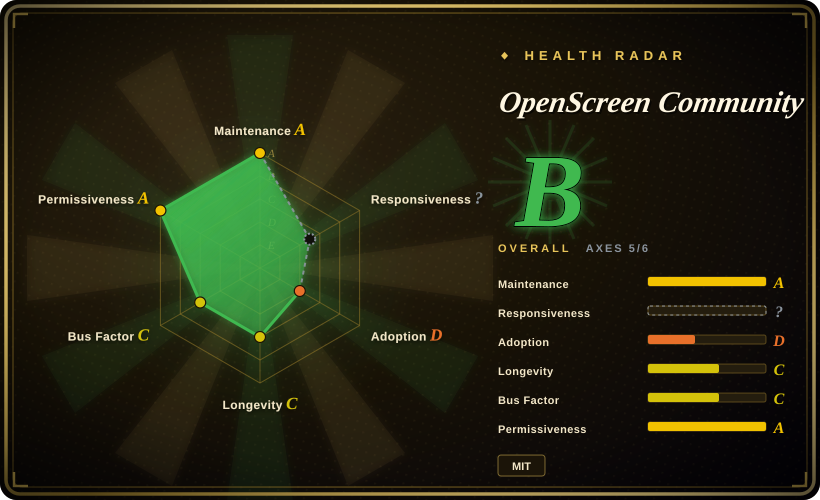
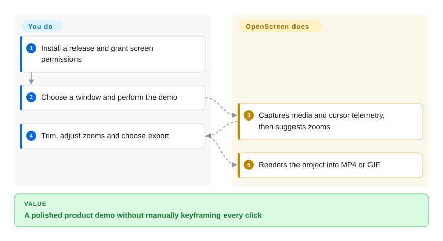
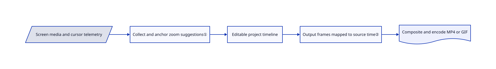

# OpenScreen Community

Your screen recording shows the whole desktop when viewers need to see one click. This maintained OpenScreen continuation adds cursor-driven zooms, editable captions and an export pipeline to the capture itself.

## When to use

You ship a small app and need a short walkthrough for a pull request or landing page. Raw capture leaves you manually keyframing every click. Choose this continuation over the archived [original OpenScreen](openscreen.md) for current fixes, native capture on three desktop platforms and optional agent-driven edits. Choose it over a general editor when cursor polish and recording-to-MP4/GIF matter more than a broad editorial toolbox.

## When NOT to use

- Need live production and streaming? Use OBS Studio; OpenScreen's main deliverable is an edited file, not a broadcast mixing workflow.
- Need general-purpose editing of arbitrary footage? Consider [Concat](concat.md) or a professional NLE; OpenScreen is designed around recordings and demos, not a substitute for every editorial workflow.
- Require a frozen project schema or CLI? Keep a tested version or use a mature commercial editor; the README explicitly warns that `.openscreen` and CLI contracts can break.
- Require no outbound requests at all? Disable usage counting and updates, avoid remote AI editing, and enforce network policy; otherwise use an offline recorder such as OBS with your own export process. `usage-ping.ts` enables a daily anonymous count by default and supports `DO_NOT_TRACK`.

## Comparison

| Alternative | In index | Our verdict | Tradeoff |
|---|---|---|---|
| [Original OpenScreen](openscreen.md) | ✅ | Choose this continuation for ongoing fixes; use the original only to reproduce an archived v1-era setup. | Shared lineage, not an unrelated clone; the continuation adds a Rust compositor and new automation surfaces while retaining MIT attribution. |
| [Concat](concat.md) | ✅ | Choose Concat for a general native editor; choose OpenScreen Community for capturing and polishing a software demo. | Broader editing model versus screen/cursor-specific automation; both require evaluating a young release line. |
| [OBS Studio](https://github.com/obsproject/obs-studio) | not indexed | Choose OBS for capture, composition and live streaming; choose OpenScreen for post-capture zooms, captions and a ready demo export. | Broadcast controls versus a demo-oriented timeline. Not added in this tab batch. |

## Quick start

Install a release build; macOS requires Screen Recording and Accessibility permission. Record a window or screen, then trim, adjust generated zooms and export MP4 or GIF. For automation, the documented CLI accepts `openscreen record --duration 20 --project demo.openscreen --json` and `openscreen export demo.openscreen -o demo.mp4 --json`. You supply the screen activity, permissions and editorial approval; the app captures and renders the project. Optional AI editing needs your own provider key and may send context to that provider; it is off by default.

<!-- flow-steps:begin (generated from flows/openscreen-community.json by tools/flow_card.py — do not edit) -->

Text version of the flow

1. **You**: Install a release and grant screen permissions
2. **You**: Choose a window and perform the demo
3. **OpenScreen Community**: Captures media and cursor telemetry, then suggests zooms
4. **You**: Trim, adjust zooms and choose export
5. **OpenScreen Community**: Renders the project into MP4 or GIF

**Value**: A polished product demo without manually keyframing every click

<!-- flow-steps:end -->

## Key techniques

<!-- mechanism:begin (generated from mechanisms/openscreen-community.json by tools/mechanism_card.py; do not edit) -->

Text version of the mechanism

- Screen media and cursor telemetry
- Collect and anchor zoom suggestions①
- Editable project timeline
- Output frames mapped to source time②
- Composite and encode MP4 or GIF

- Screen media and cursor telemetry → Collect and anchor zoom suggestions①
- Collect and anchor zoom suggestions① → Editable project timeline
- Editable project timeline → Output frames mapped to source time②
- Output frames mapped to source time② → Composite and encode MP4 or GIF

<!-- mechanism:end -->

### 1. Anchor cursor-derived zoom suggestions to actual clips

- **Problem:** Cursor telemetry arrives asynchronously, so a suggestion can become stale while the user trims clips.
- **How:** The shared apply path collects per-asset telemetry, generates suggestions against existing zooms and anchors ranges to clips. A clip-extent signature detects edits during collection and triggers one recollection.
- **Limits:** It retries once rather than spinning while the user edits; final write-time guards remain necessary. Imported footage without telemetry cannot supply the same click history.
- **Source:** [Collection, signature and anchoring](https://github.com/getopenscreen/openscreen/blob/9991ca7d050f638d206b24dcf84d57779a61266c/src/lib/ai-edition/timeline/apply-auto-zooms.ts#L17-L124).

### 2. Keep source time and output time distinct during rendering

- **Problem:** Cuts and speed changes make source timestamps differ from the exported video's clock.
- **How:** A shared Rust timeline walk maps each output frame to source time, advances screen/webcam decoders, samples cursor state and composites the frame. Programme time stays continuous across cuts; source time follows the media.
- **Limits:** GPU and codec support remain platform-dependent. A shared scene contract does not prove identical pixels or performance on every GPU.
- **Source:** [Speed spans and frame walk](https://github.com/getopenscreen/openscreen/blob/9991ca7d050f638d206b24dcf84d57779a61266c/crates/compositor/src/timeline_walk.rs#L375-L475), [native compositor](https://github.com/getopenscreen/openscreen/blob/9991ca7d050f638d206b24dcf84d57779a61266c/technical-documentation/architecture/native-compositor.md#L1-L57).

## Tech stack

Electron 41, React 18, TypeScript, Vite, Rust native compositor and FFmpeg. Native capture uses ScreenCaptureKit, Windows Graphics Capture or PipeWire; GPU paths use Metal, D3D11 or Vulkan. Local speech transcription and optional remote model editing are distinct features.

## Dependencies

macOS 13+, Windows 1903+ or a supported Linux desktop; README minimum 8 GB RAM. Linux native capture/audio needs PipeWire and the desktop portal; Wayland click detection also needs permitted input-device access. Release bundles carry native components; source builds require Node 22.22.1 plus platform toolchains. Optional model editing requires a paid/BYOK endpoint.

## Ops difficulty

**Low for recording, medium for automation.** Desktop installers avoid running servers. Permissions, Linux capture capabilities, project-format churn and native encoder differences remain integration work. For sensitive recordings, review network settings and remote AI context before enabling it.

## Health & viability

- On 2026-10-18, v2.1.1 was published the previous evening. This continuation was created on 2026-03-14; the original project's history is older, but its archive is not this repository's maintenance state.
- Etienne Lescot leads current development. The README records the original author's approval, and LICENSE retains both the original and contributor copyrights.
- [推断] Active releases and inherited code support adoption, but a seven-month continuation has not yet demonstrated long stewardship. Pin automation against CLI/project changes.
- MIT source has substantial new implementation: only 102 of 2,036 blobs match the archived original snapshot. Default-on anonymous usage counting is a privacy consideration, not evidence of uploading recordings.

## Caveats (unverified)

- [未验证] Native recording, local captions and export quality were not run; platform capabilities are source/documentation evidence only.
- [推断] Long-term stewardship remains uncertain because the continuation is young and current work is concentrated around its lead maintainer.
