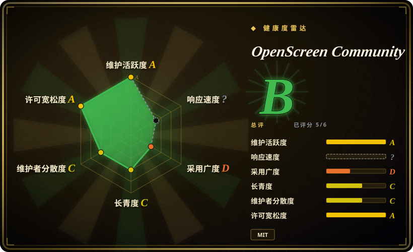
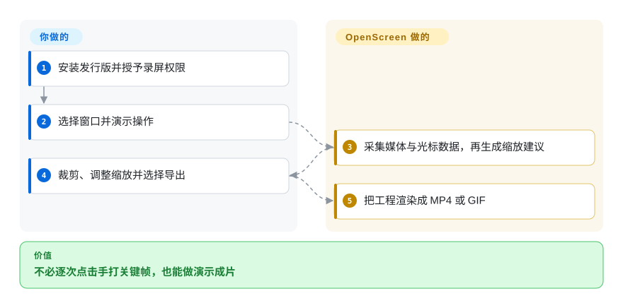
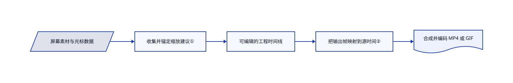

# OpenScreen Community

录屏铺满整个桌面，观众却只想看清你点了哪里。这个仍在维护的 OpenScreen 社区续作，把跟随光标的缩放、可编辑字幕和成片导出接到录制流程里。

## 何时使用

你给小应用的拉取请求或落地页做短演示，原始录屏却要逐次点击手打缩放关键帧。相比已归档的[原版 OpenScreen](openscreen.zh.md)，选这个续作可获得当前修复、三种桌面平台的原生录制与可选的模型辅助编辑。相比通用剪辑器，当你更需要光标润色和录屏直接导出 MP4／GIF，而非全面剪辑工具时选它。

## 何时不用

- 要直播与现场制作时，选 OBS Studio。这里主要产出剪辑后的文件，不是广播混流工作台。
- 要剪各种拍摄素材时，考虑 [Concat](concat.zh.md) 或专业剪辑器。这里围绕录屏演示设计，不覆盖所有编辑工作。
- 要冻结的工程格式或命令行合同时，固定经过测试的版本，或选成熟商业编辑器。README 明说 `.openscreen` 和命令行可能不兼容变更。
- 严禁任何出站请求时，关闭使用计数与更新，不启用远程模型，并加网络策略；否则选 OBS 等离线录制工具并自建导出流程。`usage-ping.ts` 默认启用每日匿名计数，支持 `DO_NOT_TRACK`。

## 横向对比

| 替代品 | 是否收录 | 我们的评价 | 取舍 |
|---|---|---|---|
| [原版 OpenScreen](openscreen.zh.md) | ✅ | 要持续修复时选社区续作；只有复现归档的一代版本环境才选原版。 | 同一谱系，不是无关克隆；续作增加 Rust 合成器与自动化入口，并保留 MIT 署名。 |
| [Concat](concat.zh.md) | ✅ | 要通用原生剪辑器时选 Concat；要录制并润色软件演示时选社区续作。 | 更广的剪辑模型，换录屏与光标专用自动化；两者都要评估年轻版本线。 |
| [OBS Studio](https://github.com/obsproject/obs-studio) | 未收录 | 要捕获、合成与直播时选 OBS；要录完自动缩放、字幕和演示成片时选社区续作。 | 广播控制换演示专用时间线；本批标签未安排收录。 |

## 快速上手

安装发行版；macOS 需授予屏幕录制与辅助功能权限。录制窗口或屏幕，再裁剪、调整自动缩放，并导出 MP4 或 GIF。自动化入口示例是 `openscreen record --duration 20 --project demo.openscreen --json` 与 `openscreen export demo.openscreen -o demo.mp4 --json`。你负责演示操作、授权和成片审查；应用负责采集与渲染工程。可选模型辅助编辑默认关闭，启用后需自备接口密钥，也可能向提供商发送上下文。

<!-- flow-steps:begin (generated from flows/openscreen-community.json by tools/flow_card.py — do not edit) -->

流程文字版

1. **你**：安装发行版并授予录屏权限
2. **你**：选择窗口并演示操作
3. **OpenScreen Community**：采集媒体与光标数据，再生成缩放建议
4. **你**：裁剪、调整缩放并选择导出
5. **OpenScreen Community**：把工程渲染成 MP4 或 GIF

**价值**：不必逐次点击手打关键帧，也能做演示成片

<!-- flow-steps:end -->

## 技术要点

<!-- mechanism:begin (generated from mechanisms/openscreen-community.json by tools/mechanism_card.py; do not edit) -->

机制文字版

- 屏幕素材与光标数据
- 收集并锚定缩放建议①
- 可编辑的工程时间线
- 把输出帧映射到源时间②
- 合成并编码 MP4 或 GIF

- 屏幕素材与光标数据 → 收集并锚定缩放建议①
- 收集并锚定缩放建议① → 可编辑的工程时间线
- 可编辑的工程时间线 → 把输出帧映射到源时间②
- 把输出帧映射到源时间② → 合成并编码 MP4 或 GIF

<!-- mechanism:end -->

### 1. 把光标生成的缩放建议锚定到真实片段

- **解决：** 光标数据异步返回，用户同时裁片段会让缩放建议过期。
- **做法：** 共享应用路径逐素材收集光标数据，结合已有缩放生成建议，再把范围锚定到片段。片段边界签名检测读取期间的变化，最多重收一次。
- **边界：** 用户持续编辑时不会无限重试，最终写入仍需检查。没有光标数据的导入素材，无法提供同样的点击历史。
- **源码：** [收集、签名与锚定](https://github.com/getopenscreen/openscreen/blob/9991ca7d050f638d206b24dcf84d57779a61266c/src/lib/ai-edition/timeline/apply-auto-zooms.ts#L17-L124)。

### 2. 渲染时区分源素材时间与输出时间

- **解决：** 剪切和变速会让素材时间戳与成片时钟不一致。
- **做法：** 共享 Rust 时间线遍历器把每个输出帧换算到源时间，推进屏幕和摄像头解码器，采样光标并合成。节目时间跨剪切持续前进，源时间则跟随素材。
- **边界：** 显卡与编解码能力仍受平台限制。共享场景合同不等于所有显卡的像素或性能完全一致。
- **源码：** [变速区间与逐帧遍历](https://github.com/getopenscreen/openscreen/blob/9991ca7d050f638d206b24dcf84d57779a61266c/crates/compositor/src/timeline_walk.rs#L375-L475)、[原生合成器](https://github.com/getopenscreen/openscreen/blob/9991ca7d050f638d206b24dcf84d57779a61266c/technical-documentation/architecture/native-compositor.md#L1-L57)。

## 技术栈

Electron 41、React 18、TypeScript、Vite、Rust 原生合成器和 FFmpeg。原生采集采用 ScreenCaptureKit、Windows Graphics Capture 或 PipeWire；显卡路径采用 Metal、D3D11 或 Vulkan。本地语音转写与可选远程模型编辑是两种不同功能。

## 依赖

macOS 13 以上、Windows 1903 以上或受支持的 Linux 桌面；README 最低内存为 8 GB。Linux 原生采集与音频需要 PipeWire 和桌面门户，Wayland 点击检测还需获准读取输入设备。发行包自带原生组件；源码构建要求 Node 22.22.1 及平台工具链。可选模型编辑需要自备接口。

## 运维难度

**录制低，自动化中。** 桌面安装器不要求自建服务。权限、Linux 采集能力、工程格式变更和原生编码器差异仍需集成处理。敏感录屏应先检查网络设置与远程模型上下文，再启用相关功能。

## 健康度与可持续性

- 截至 2026-10-18，v2.1.1 在前一天晚间发布。续作仓库创建于 2026-03-14；原项目更早，但原版归档不代表这个仓库停止维护。
- 当前开发由 Etienne Lescot 主导。README 记载原作者同意续作，许可证保留原作者与贡献者版权。
- [推断] 活跃发版与继承代码支持采用，但七个月的续作尚未证明长期维护能力。自动化接入应固定命令行与工程格式版本。
- MIT 源码已有大量新实现，2,036 个文件中仅 102 个与原版归档快照相同。默认匿名使用计数是隐私考虑，不等于上传录屏。

## 存疑（未验证）

- [未验证] 没有运行原生录屏、本地字幕或导出；平台能力只有源码与文档证据。
- [推断] 续作年轻，当前工作集中在主要维护者，长期延续性仍待观察。
