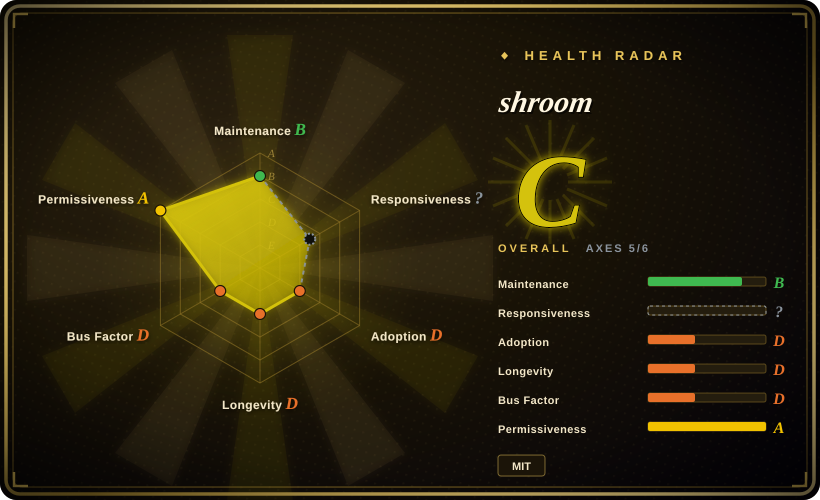
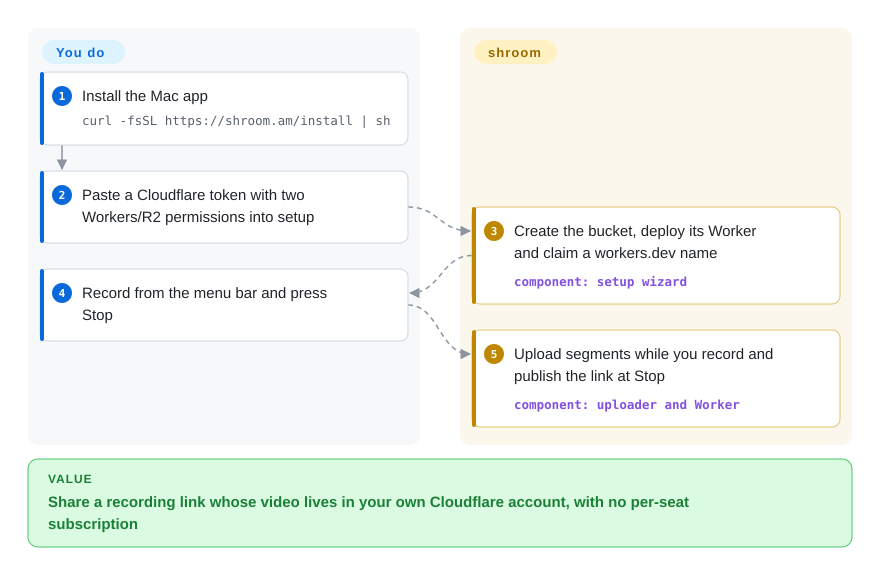
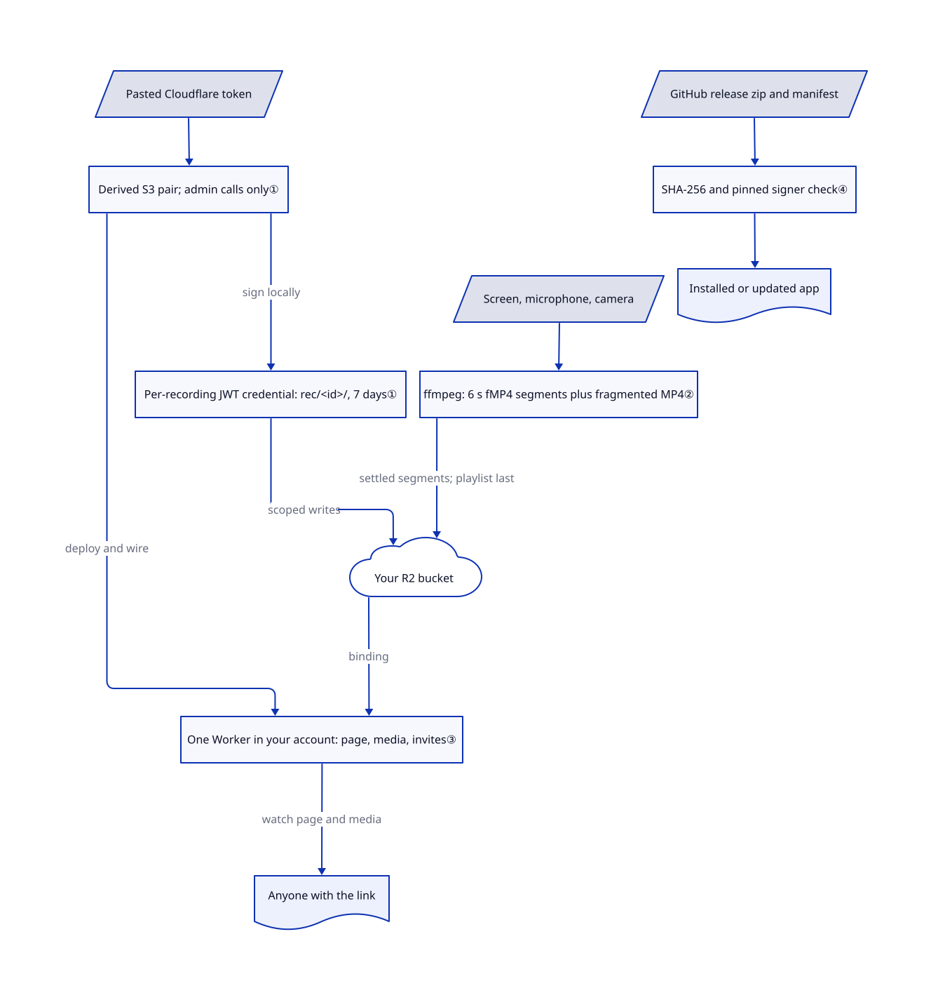

# shroom

A ten-person team on a per-seat recording service pays every month even when nobody records, and videos stay on someone else's server. shroom records from the Mac menu bar into your own Cloudflare storage and Worker; costs follow your Cloudflare usage and plans, not just storage or seat count.

## When to use

You lead a small engineering or support team on Apple-silicon Macs. People record two-minute walkthroughs for pull requests and bug reports, and you want Loom's "press Stop, the link is already in your clipboard" flow without a per-person subscription or a vendor holding the videos. Choose shroom when you already have, or are willing to open, a Cloudflare account: during a guided setup you paste one Cloudflare token, the app creates the R2 bucket (Cloudflare's object storage) and deploys a Worker (code that runs on Cloudflare's edge) to `v.<name>.workers.dev`, and from then on each recording streams up while you talk. The README's cost example is $0.85 a month for 20 people recording an hour each with 30-day cleanup. [Architecture overview](https://github.com/bagrat/shroom/blob/c3e64f28aa536df61ac20544116d7df2e87f423a/docs/ARCHITECTURE.md#L17-L27), [cost claim](https://github.com/bagrat/shroom/blob/c3e64f28aa536df61ac20544116d7df2e87f423a/README.md#L52-L61).

The deciding tradeoff against Cap or Loom is storage ownership and usage-based Cloudflare costs versus maturity: shroom has no server of its own to depend on, but it is a two-week-old public repository with one maintainer.

## When NOT to use

- **Anyone on your team uses Windows, Linux or an Intel Mac.** The installer refuses below macOS 14 and on Intel; there is no other client. Use Cap (not indexed), which ships for macOS and Windows, or OBS Studio (not indexed) everywhere. [Install refusals](https://github.com/bagrat/shroom/blob/c3e64f28aa536df61ac20544116d7df2e87f423a/docs/ARCHITECTURE.md#L926-L940).
- **Videos must be private to signed-in viewers.** A link's only secret is a 96-bit random id; whoever has the URL can watch, and pages are only marked `noindex`. Use a tool with viewer authentication, or put Cloudflare Access in front of the Worker yourself. [Recording id](https://github.com/bagrat/shroom/blob/c3e64f28aa536df61ac20544116d7df2e87f423a/docs/ARCHITECTURE.md#L584-L588).
- **You want a finished demo video with zooms and backgrounds.** shroom records, trims and shares; it does not auto-polish. Use [OpenScreen Community](openscreen-community.md) to produce an exported, cursor-zoomed file.
- **A recording might go viral.** On the Workers free plan the page answers 429 after 100,000 requests a day until midnight UTC, per the project's own constants table; you must move to a paid Workers plan. A hosted service such as Loom absorbs that traffic for you. [Constants](https://github.com/bagrat/shroom/blob/c3e64f28aa536df61ac20544116d7df2e87f423a/docs/ARCHITECTURE.md#L1113-L1133).
- **Your security policy requires notarized, Gatekeeper-checked apps.** Releases are signed with a pinned self-signed certificate; the `curl | sh` installer avoids the quarantine flag, so Gatekeeper never assesses the app. Choose a notarized recorder from a vendor, or build from source and review it. [Release signing](https://github.com/bagrat/shroom/blob/c3e64f28aa536df61ac20544116d7df2e87f423a/docs/ARCHITECTURE.md#L940-L956).
- **You need a long maintenance track record.** The public repository was created on 2026-10-15, has one human maintainer, and most commits are authored through Claude Code sessions. For a recorder you will rely on for years, OBS Studio has the far longer history.

## Comparison

| Alternative | In index | Our verdict | Tradeoff |
|---|---|---|---|
| Cap (CapSoftware/Cap) | not indexed | Choose Cap when you need Windows and macOS clients and a larger active project; choose shroom when videos must live in your own Cloudflare account with no extra server to run. | Cap is mostly AGPLv3 (camera/capture crates MIT) with a hosted cloud or a self-hosted server to operate; shroom is MIT and serverless on your Cloudflare, but macOS-only and two weeks old. Not added in this tab batch. |
| Loom | not a repo | Choose Loom when per-seat pricing is acceptable and you want enterprise viewer controls, analytics and multi-platform clients; choose shroom to avoid a recorder per-seat subscription while paying your own Cloudflare usage charges. | Closed hosted SaaS; mature sharing and permissions, but videos sit on the vendor and every seat is billed. |
| [OpenScreen Community](openscreen-community.md) | ✅ | Choose OpenScreen Community when the deliverable is a polished exported demo file; choose shroom when the deliverable is an instant share link for teammates. | Local editing with auto-zoom and no hosting; shroom adds hosting, team invites and live upload but little visual polish. |
| OBS Studio | not indexed | Choose OBS for cross-platform capture, scenes and streaming; choose shroom when you want recording and link sharing in one step. | GPL desktop compositor with no hosting or link sharing; shroom gives you a link but only a menu-bar recorder's controls. Not added in this tab batch. |

## Quick start

Install with `curl -fsSL https://shroom.am/install | sh` on macOS 14 or newer with Apple silicon; the script downloads the release zip, checks its SHA-256 and code signature, and places the app in `~/Applications`. On first launch a guided setup asks you to create a Cloudflare account if needed, then a Cloudflare API token — a key that lets the app manage parts of your account — with exactly Workers Scripts Edit and Workers R2 Storage Edit, which you paste into the app's window. If R2 is not yet enabled, Cloudflare asks you to add a payment card. shroom then creates the bucket, deploys its Worker and claims a `workers.dev` name. From then on you click the mushroom in the menu bar, record, and press Stop; the link is live while the tail uploads. You pay Cloudflare, keep the token safe, and invite teammates with a link; a coding agent can drive the same setup through `shroom setup` commands. [Install script](https://github.com/bagrat/shroom/blob/c3e64f28aa536df61ac20544116d7df2e87f423a/installer/install.sh#L1-L18), [token and provisioning](https://github.com/bagrat/shroom/blob/c3e64f28aa536df61ac20544116d7df2e87f423a/docs/ARCHITECTURE.md#L679-L741).

<!-- flow-steps:begin (generated from flows/shroom.json by tools/flow_card.py — do not edit) -->

Text version of the flow

1. **You**: Install the Mac app — `curl -fsSL https://shroom.am/install | sh`
2. **You**: Paste a Cloudflare token with two Workers/R2 permissions into setup
3. **shroom**: Create the bucket, deploy its Worker and claim a workers.dev name — component: `setup wizard`
4. **You**: Record from the menu bar and press Stop
5. **shroom**: Upload segments while you record and publish the link at Stop — component: `uploader and Worker`

**Value**: Share a recording link whose video lives in your own Cloudflare account, with no per-seat subscription

<!-- flow-steps:end -->

## Key techniques

<!-- mechanism:begin (generated from mechanisms/shroom.json by tools/mechanism_card.py; do not edit) -->

Text version of the mechanism

- Pasted Cloudflare token
- Derived S3 pair; admin calls only①
- Recording-scoped upload JWT: rec/&lt;id&gt;/, 1 hour①
- Screen, microphone, camera
- ffmpeg: 6 s fMP4 segments plus fragmented MP4②
- Your R2 bucket
- One Worker in your account: page, media, invites③
- Anyone with the link
- GitHub release zip and manifest
- SHA-256 and pinned signer check④
- Installed or updated app

- Pasted Cloudflare token → Derived S3 pair; admin calls only①
- Derived S3 pair; admin calls only① → One Worker in your account: page, media, invites③ (deploy and wire)
- Derived S3 pair; admin calls only① → Recording-scoped upload JWT: rec/&lt;id&gt;/, 1 hour① (sign locally)
- Screen, microphone, camera → ffmpeg: 6 s fMP4 segments plus fragmented MP4②
- ffmpeg: 6 s fMP4 segments plus fragmented MP4② → Your R2 bucket (settled segments; playlist last)
- Recording-scoped upload JWT: rec/&lt;id&gt;/, 1 hour① → Your R2 bucket (scoped writes)
- Your R2 bucket → One Worker in your account: page, media, invites③ (binding)
- One Worker in your account: page, media, invites③ → Anyone with the link (watch page and media)
- GitHub release zip and manifest → SHA-256 and pinned signer check④
- SHA-256 and pinned signer check④ → Installed or updated app

<!-- mechanism:end -->

### 1. Derive scoped, short-lived upload keys from one pasted token

- **Problem:** Keeping a full Cloudflare token on every teammate's Mac would let any of them delete the whole account's Workers and buckets.
- **How:** The token is used for admin calls only. Its S3-style key pair is derived locally (key id = token id, secret = SHA-256 of the token). Each recording uses an HS256 JWT that Cloudflare R2 accepts as a temporary credential, restricted to `rec/<id>/` and that recording's metadata file. The normal upload issuer uses a one-hour lifetime; the Mac renews credentials as expiry approaches. Macs without the token ask the Worker to sign the JWT under their device key.
- **Limits:** Removing a member stops new credentials, but one already minted runs until it expires; instant cut-off means rotating the parent token by hand. The derivation depends on Cloudflare's current token-to-S3 mapping.
- **Source:** [Upload TTL:2288–2291](https://github.com/bagrat/shroom/blob/c3e64f28aa536df61ac20544116d7df2e87f423a/worker/src/worker.js#L2288-L2291), [issuance path:2836–2841](https://github.com/bagrat/shroom/blob/c3e64f28aa536df61ac20544116d7df2e87f423a/worker/src/worker.js#L2836-L2841), [credential scope and renewal:694–709](https://github.com/bagrat/shroom/blob/c3e64f28aa536df61ac20544116d7df2e87f423a/docs/ARCHITECTURE.md#L694-L709), [local JWT mint:18–50](https://github.com/bagrat/shroom/blob/c3e64f28aa536df61ac20544116d7df2e87f423a/crates/shroom-cloud/src/mint.rs#L18-L50), [S3 pair derivation:164–172](https://github.com/bagrat/shroom/blob/c3e64f28aa536df61ac20544116d7df2e87f423a/crates/shroom-cloud/src/lib.rs#L164-L172).

### 2. Upload HLS segments during the recording, publish the playlist last

- **Problem:** Uploading a 20-minute file after Stop makes the link useless for minutes.
- **How:** One ffmpeg process per take encodes with the Mac's hardware H.264 encoder into 6-second fMP4 HLS segments, plus a fragmented MP4 that survives a crash. A segment file that has stopped changing for a moment is uploaded immediately. After Stop, the remaining segments go up and the variant playlist is written last, so the page never references missing media.
- **Limits:** One H.264 rendition only (no adaptive ladder yet). The single-file MP4 download appears later than the stream. R2 allows one write per second per key, and uploads retry six times before the core's own retry loop.
- **Source:** [Pipeline and pause:468–511](https://github.com/bagrat/shroom/blob/c3e64f28aa536df61ac20544116d7df2e87f423a/docs/ARCHITECTURE.md#L468-L511), [ffmpeg arguments:29–80](https://github.com/bagrat/shroom/blob/c3e64f28aa536df61ac20544116d7df2e87f423a/crates/shroom-encode/src/args.rs#L29-L80), [settled-segment upload:1–33](https://github.com/bagrat/shroom/blob/c3e64f28aa536df61ac20544116d7df2e87f423a/crates/shroom-upload/src/live.rs#L1-L33), [upload order:794–842](https://github.com/bagrat/shroom/blob/c3e64f28aa536df61ac20544116d7df2e87f423a/docs/ARCHITECTURE.md#L794-L842).

### 3. Serve every link from one Worker deployed into your account

- **Problem:** A self-hosted sharing service normally means a server, a database and TLS to maintain.
- **How:** The app deploys a single dependency-free JavaScript module (`worker.js`) bound to your bucket. It renders the watch page, serves media with Range support, handles invites, title edits and captions, and stores its registry as JSON in R2 using conditional writes. Only Macs holding the token redeploy it, and only over an older version.
- **Limits:** All viewer traffic counts against your Workers quota; optional AI titles and chapters use Workers AI on your account, so they also cost you. The Worker is 380 KB of hand-written code with no framework.
- **Source:** [Worker routes and bindings:743–792](https://github.com/bagrat/shroom/blob/c3e64f28aa536df61ac20544116d7df2e87f423a/docs/ARCHITECTURE.md#L743-L792), [worker.js](https://github.com/bagrat/shroom/blob/c3e64f28aa536df61ac20544116d7df2e87f423a/worker/src/worker.js).

### 4. Pin the release signer instead of relying on Gatekeeper

- **Problem:** Without a paid Apple Developer ID, macOS cannot notarize the app, yet users still need assurance that an update came from the author.
- **How:** Releases are signed with one pinned self-signed certificate. The installer checks the zip's SHA-256 from the release manifest, then requires `codesign` to match identifier `am.shroom` and that certificate's leaf hash. The updater verifies the same designated requirement, so macOS privacy grants carry across updates.
- **Limits:** Trust rests on the GitHub release and the hash embedded in the installer you fetched, not on Apple. Installing without quarantine means Gatekeeper never reviews the app.
- **Source:** [Signer check:157–167](https://github.com/bagrat/shroom/blob/c3e64f28aa536df61ac20544116d7df2e87f423a/installer/install.sh#L157-L167), [install, releases and updates:912–976](https://github.com/bagrat/shroom/blob/c3e64f28aa536df61ac20544116d7df2e87f423a/docs/ARCHITECTURE.md#L912-L976).

## Tech stack

A Tauri v2 menu-bar app with Svelte webviews and a Rust workspace of 14 crates (capture via ScreenCaptureKit, recording, encoding, S3 SigV4 storage client, Cloudflare provisioning, updater, CLI). A bundled LGPL FFmpeg 8.1.2 build encodes with VideoToolbox. The share page is a Cloudflare Worker in plain JavaScript with a vendored hls.js player. [Workspace manifest](https://github.com/bagrat/shroom/blob/c3e64f28aa536df61ac20544116d7df2e87f423a/Cargo.toml).

## Dependencies

An Apple-silicon Mac on macOS 14+; a Cloudflare account with R2 enabled (Cloudflare asks for a payment card to enable it) and an account API token limited to Workers Scripts Edit and Workers R2 Storage Edit. Workers AI is optional for automatic titles, chapters and captions. Viewers need only a browser.

## Ops difficulty

**Low for users, medium for the owner.** The token holder's Mac re-checks and repairs the setup at launch and every six hours awake, and runs cleanup sweeps. The owner remains responsible for the Cloudflare account: keeping the token, watching storage and Workers quotas, and rotating the token to revoke a leaked credential immediately. Deleting a video removes its files and leaves a tombstone. There is no shroom server to run.

## Health & viability

- **2026-11-01:** public repository created 2026-10-15, after the author republished it and moved earlier history to a private archive. Ten releases from v0.1.26-early.1 (2026-10-19) to v0.1.34 (2026-10-26), several per week.
- **Governance:** one maintainer, Bagrat Aznauryan. GitHub attributes 1,051 commits to `claude` and 147 to `bagrat`; contributor names do not establish which lines were agent-generated. The repository includes detailed specs and test plans, while the backlog and design notes live in a private repository.
- **Adoption:** four stars and no forks; there is no evidence of users outside the author's team yet. Lindy gives no support at two weeks old.
- **Contributor hazard:** the repository ships `.claude/settings.json` with a SessionStart hook and allowed tools. Locally the hook exits at once; in Claude Code cloud sessions it runs setup scripts and tells the agent to attach the author's private repository without asking. Review it before opening the clone in an agent. [Hook](https://github.com/bagrat/shroom/blob/c3e64f28aa536df61ac20544116d7df2e87f423a/.claude/hooks/session-start.sh#L15-L57).
- **License:** MIT, copyright Bagrat Aznauryan, with a 145 KB third-party notices file for bundled components.

## Caveats (unverified)

- [未验证: no Mac installation or upstream execution] Recording quality, setup time and the "link live at Stop" behavior were read from the architecture document and source, not exercised.
- [未验证: Cloudflare billing not independently checked] The README's $0.85/month team example depends on Cloudflare's R2 pricing and free tier at the time of writing.
- [未验证: commit contents not exhaustively audited] Contributor attribution does not measure the proportion of agent-generated code.
- [未验证: private development source unavailable] The private backlog, design notes and archived proof of concept could not be checked.
