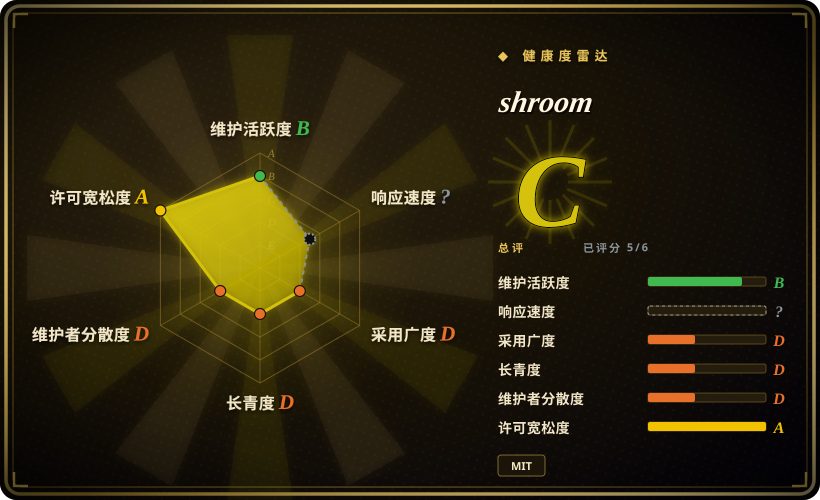
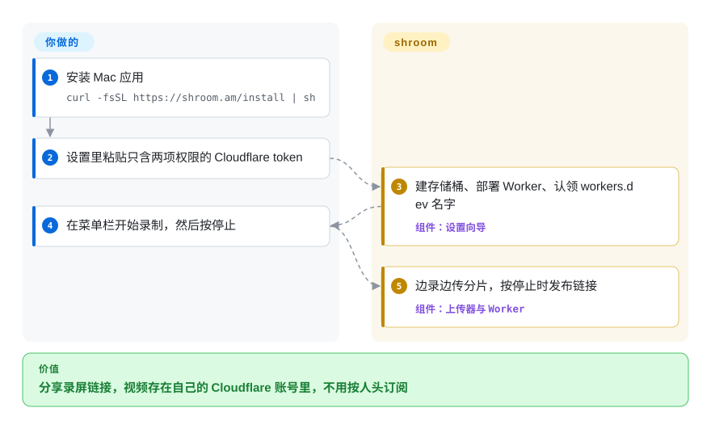
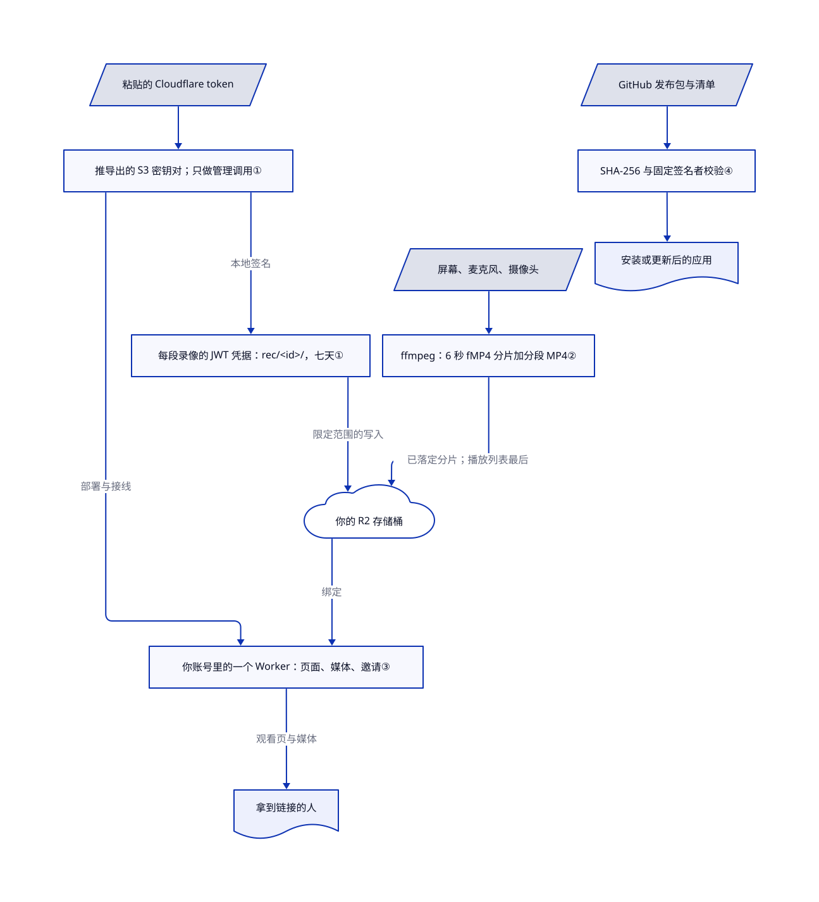

# shroom

十人团队用按人头收费的录屏服务，没人录也照样月月付钱，视频还存在别人的服务器上。shroom 从 Mac 菜单栏录屏，上传到你自己的 Cloudflare 存储和 Worker；费用取决于 Cloudflare 用量及套餐，不是只有存储费或席位费。

## 何时使用

你带一个用 Apple 芯片 Mac 的小型研发或客服团队。大家给 PR 和 bug 报告录两分钟的讲解，你想要 Loom 那种“一按停止、链接已在剪贴板”的体验，但不想按人头订阅，也不想让厂商保管视频。已经有、或愿意开一个 Cloudflare 账号时选 shroom：引导设置里你只粘贴一个 Cloudflare token，应用就会建好 R2 存储桶（Cloudflare 的对象存储），把一个 Worker（跑在 Cloudflare 边缘节点上的代码）部署到 `v.<name>.workers.dev`；之后每段录像都边录边传。README 举的成本例子是：20 人每人每月录一小时、30 天自动清理，每月 0.85 美元。[架构概览](https://github.com/bagrat/shroom/blob/c3e64f28aa536df61ac20544116d7df2e87f423a/docs/ARCHITECTURE.md#L17-L27)、[成本说法](https://github.com/bagrat/shroom/blob/c3e64f28aa536df61ac20544116d7df2e87f423a/README.md#L52-L61)。

和 Cap、Loom 比，决定性的取舍是“存储自己掌握、按视频量付费”对“成熟度”：shroom 不依赖任何它自己运营的服务器，但公开仓库才两周大，只有一位维护者。

## 何时不用

- **团队里有人用 Windows、Linux 或 Intel Mac。** 安装脚本会拒绝 macOS 14 以下和 Intel 机器，也没有其他客户端。请用同时支持 macOS 和 Windows 的 Cap（未收录），或全平台的 OBS Studio（未收录）。[安装拒绝条件](https://github.com/bagrat/shroom/blob/c3e64f28aa536df61ac20544116d7df2e87f423a/docs/ARCHITECTURE.md#L926-L940)。
- **视频只能给登录后的观看者看。** 链接唯一的秘密是 96 位的随机 id，拿到网址的人都能看，页面只是标了 `noindex`。请用有观看者认证的工具，或自己在 Worker 前加一层 Cloudflare Access。[录像 id](https://github.com/bagrat/shroom/blob/c3e64f28aa536df61ac20544116d7df2e87f423a/docs/ARCHITECTURE.md#L584-L588)。
- **要做带缩放和背景的成品演示视频。** shroom 负责录、剪、分享，不做自动美化。要导出带光标缩放的成片，请用 [OpenScreen Community](openscreen-community.zh.md)。
- **某段录像可能被大量转发。** 按项目自己的常量表，Workers 免费版每天超过 10 万次请求后会返回 429，直到 UTC 午夜；你得升级到付费的 Workers 套餐。Loom 这类托管服务会替你扛住流量。[常量表](https://github.com/bagrat/shroom/blob/c3e64f28aa536df61ac20544116d7df2e87f423a/docs/ARCHITECTURE.md#L1113-L1133)。
- **安全策略要求经过公证、由 Gatekeeper 检查的应用。** 发布包用一个固定的自签名证书签名；`curl | sh` 安装不带隔离标记，Gatekeeper 根本不会检查这个应用。请选厂商提供的已公证录屏工具，或者自己审读源码后编译。[发布签名](https://github.com/bagrat/shroom/blob/c3e64f28aa536df61ac20544116d7df2e87f423a/docs/ARCHITECTURE.md#L940-L956)。
- **需要长期的维护记录。** 公开仓库创建于 2026-10-15，只有一位真人维护者，大部分提交通过 Claude Code 会话完成。要用好几年的录屏工具，OBS Studio 的历史长得多。

## 横向对比

| 替代品 | 是否收录 | 我们的评价 | 取舍 |
|---|---|---|---|
| Cap（CapSoftware/Cap） | 未收录 | 需要 Windows 和 macOS 客户端、要更大更活跃的项目时选 Cap；视频必须放在自己的 Cloudflare 账号、又不想多运维一台服务器时选 shroom。 | Cap 大部分代码是 AGPLv3（摄像头和采集 crate 为 MIT），要用它的托管云或自建服务器；shroom 是 MIT，在你的 Cloudflare 上无服务器运行，但只支持 macOS、才两周大。本批标签收录未加入。 |
| Loom | 非仓库 | 能接受按人头收费、需要企业级观看权限、数据分析和多平台客户端时选 Loom；只想为存下的视频付钱时选 shroom。 | 闭源托管 SaaS；分享和权限成熟，但视频在厂商那里，每个席位都要付费。 |
| [OpenScreen Community](openscreen-community.zh.md) | ✅ | 交付物是精修过的演示成片时选 OpenScreen Community；交付物是发给同事的即时链接时选 shroom。 | 本地编辑、自动缩放、不托管；shroom 多了托管、团队邀请和边录边传，但几乎没有视觉美化。 |
| OBS Studio | 未收录 | 要跨平台采集、场景合成和直播时选 OBS；要一步完成录制和链接分享时选 shroom。 | GPL 桌面合成器，没有托管和链接分享；shroom 给你链接，但控制项只有菜单栏录屏工具那么多。本批标签收录未加入。 |

## 快速上手

在 macOS 14 或更新、Apple 芯片的 Mac 上运行 `curl -fsSL https://shroom.am/install | sh`；脚本会下载发布包、校验 SHA-256 和代码签名，再把应用放进 `~/Applications`。首次启动时，引导设置会在需要时让你注册 Cloudflare 账号，再让你创建一个 Cloudflare API token（让应用管理账号部分资源的钥匙），权限只给 Workers Scripts Edit 和 Workers R2 Storage Edit，然后粘贴进应用窗口。如果 R2 还没开通，Cloudflare 会要求你绑定一张付款卡。随后 shroom 建桶、部署 Worker、认领一个 `workers.dev` 名字。之后你点菜单栏的蘑菇图标录制，按停止时链接已经能看，剩下的尾巴还在上传。你负责付 Cloudflare 的钱、保管 token、用链接邀请同事；编程 agent 也可以用 `shroom setup` 系列命令带你走完同样的设置。[安装脚本](https://github.com/bagrat/shroom/blob/c3e64f28aa536df61ac20544116d7df2e87f423a/installer/install.sh#L1-L18)、[token 与开通流程](https://github.com/bagrat/shroom/blob/c3e64f28aa536df61ac20544116d7df2e87f423a/docs/ARCHITECTURE.md#L679-L741)。

<!-- flow-steps:begin (generated from flows/shroom.json by tools/flow_card.py — do not edit) -->

流程文字版

1. **你**：安装 Mac 应用 — `curl -fsSL https://shroom.am/install | sh`
2. **你**：设置里粘贴只含两项权限的 Cloudflare token
3. **shroom**：建存储桶、部署 Worker、认领 workers.dev 名字 — 组件：`设置向导`
4. **你**：在菜单栏开始录制，然后按停止
5. **shroom**：边录边传分片，按停止时发布链接 — 组件：`上传器与 Worker`

**价值**：分享录屏链接，视频存在自己的 Cloudflare 账号里，不用按人头订阅

<!-- flow-steps:end -->

## 技术要点

<!-- mechanism:begin (generated from mechanisms/shroom.json by tools/mechanism_card.py; do not edit) -->

机制文字版

- 粘贴的 Cloudflare token
- 推导出的 S3 密钥对；只做管理调用①
- 每段录像的 JWT 凭据：rec/&lt;id&gt;/，七天①
- 屏幕、麦克风、摄像头
- ffmpeg：6 秒 fMP4 分片加分段 MP4②
- 你的 R2 存储桶
- 你账号里的一个 Worker：页面、媒体、邀请③
- 拿到链接的人
- GitHub 发布包与清单
- SHA-256 与固定签名者校验④
- 安装或更新后的应用

- 粘贴的 Cloudflare token → 推导出的 S3 密钥对；只做管理调用①
- 推导出的 S3 密钥对；只做管理调用① → 你账号里的一个 Worker：页面、媒体、邀请③（部署与接线）
- 推导出的 S3 密钥对；只做管理调用① → 每段录像的 JWT 凭据：rec/&lt;id&gt;/，七天①（本地签名）
- 屏幕、麦克风、摄像头 → ffmpeg：6 秒 fMP4 分片加分段 MP4②
- ffmpeg：6 秒 fMP4 分片加分段 MP4② → 你的 R2 存储桶（已落定分片；播放列表最后）
- 每段录像的 JWT 凭据：rec/&lt;id&gt;/，七天① → 你的 R2 存储桶（限定范围的写入）
- 你的 R2 存储桶 → 你账号里的一个 Worker：页面、媒体、邀请③（绑定）
- 你账号里的一个 Worker：页面、媒体、邀请③ → 拿到链接的人（观看页与媒体）
- GitHub 发布包与清单 → SHA-256 与固定签名者校验④
- SHA-256 与固定签名者校验④ → 安装或更新后的应用

<!-- mechanism:end -->

### 1. 从一个粘贴的 token 派生出范围小、时效短的上传密钥

- **解决：** 每个同事的 Mac 上都放一份完整的 Cloudflare token，任何一台都能删掉整个账号的 Worker 和存储桶。
- **做法：** token 只用于管理类调用。它对应的 S3 式密钥对在本地推导（密钥 id = token id，密钥 = token 的 SHA-256）。每段录像由应用签一个 HS256 JWT，R2 会把它当作临时凭据接受，范围只限 `rec/<id>/` 和这段录像的元数据文件，有效期七天；没有 token 的 Mac 用设备密钥请 Worker 签同样的 JWT。
- **边界：** 移除成员只能阻止新凭据，已签出的要等到过期；想立即切断，只能手动轮换父 token。这种推导依赖 Cloudflare 当前的 token 到 S3 密钥的映射方式。
- **源码：** [凭据表第 679–709 行](https://github.com/bagrat/shroom/blob/c3e64f28aa536df61ac20544116d7df2e87f423a/docs/ARCHITECTURE.md#L679-L709)、[本地签 JWT 第 1–61 行](https://github.com/bagrat/shroom/blob/c3e64f28aa536df61ac20544116d7df2e87f423a/crates/shroom-cloud/src/mint.rs#L1-L61)、[S3 密钥推导第 164–172 行](https://github.com/bagrat/shroom/blob/c3e64f28aa536df61ac20544116d7df2e87f423a/crates/shroom-cloud/src/lib.rs#L164-L172)。

### 2. 录制中就上传 HLS 分片，最后才发布播放列表

- **解决：** 停止后才上传一个 20 分钟的文件，链接要等好几分钟才能用。
- **做法：** 每段录制起一个 ffmpeg 进程，用 Mac 的硬件 H.264 编码器切成 6 秒一段的 fMP4 HLS 分片，同时写一个崩溃也不坏的分段 MP4。分片文件停止变化片刻后立即上传。按停止后传完剩余分片，最后才写播放列表，所以页面永远不会引用缺失的媒体。
- **边界：** 只有一路 H.264 码率，还没有自适应码率阶梯。可下载的单文件 MP4 比流晚出现。R2 对同一个键每秒只允许写一次；上传会就地重试六次，然后再交给核心的重试循环。
- **源码：** [编码管线与暂停第 468–511 行](https://github.com/bagrat/shroom/blob/c3e64f28aa536df61ac20544116d7df2e87f423a/docs/ARCHITECTURE.md#L468-L511)、[ffmpeg 参数第 29–80 行](https://github.com/bagrat/shroom/blob/c3e64f28aa536df61ac20544116d7df2e87f423a/crates/shroom-encode/src/args.rs#L29-L80)、[已落定分片上传第 1–33 行](https://github.com/bagrat/shroom/blob/c3e64f28aa536df61ac20544116d7df2e87f423a/crates/shroom-upload/src/live.rs#L1-L33)、[上传顺序第 794–842 行](https://github.com/bagrat/shroom/blob/c3e64f28aa536df61ac20544116d7df2e87f423a/docs/ARCHITECTURE.md#L794-L842)。

### 3. 所有链接都由部署在你账号里的一个 Worker 提供

- **解决：** 自建分享服务通常意味着要维护服务器、数据库和 TLS 证书。
- **做法：** 应用部署一个没有依赖的 JavaScript 模块（`worker.js`），绑定到你的存储桶。它渲染观看页、按 Range 请求提供媒体、处理邀请、标题修改和字幕，并用条件写入把注册信息以 JSON 存在 R2 里。只有持有 token 的 Mac 会重新部署它，而且只覆盖更旧的版本。
- **边界：** 所有观看流量都计入你的 Workers 配额；可选的 AI 标题和章节用的是你账号上的 Workers AI，也要你付钱。这个 Worker 是 380 KB 的手写代码，没有框架。
- **源码：** [Worker 路由与绑定第 743–792 行](https://github.com/bagrat/shroom/blob/c3e64f28aa536df61ac20544116d7df2e87f423a/docs/ARCHITECTURE.md#L743-L792)、[worker.js](https://github.com/bagrat/shroom/blob/c3e64f28aa536df61ac20544116d7df2e87f423a/worker/src/worker.js)。

### 4. 固定发布签名者，而不是依赖 Gatekeeper

- **解决：** 没有付费的 Apple 开发者 ID，macOS 无法公证这个应用，但用户仍要确认更新确实来自作者。
- **做法：** 发布包用一个固定的自签名证书签名。安装脚本先按发布清单校验压缩包的 SHA-256，再要求 `codesign` 匹配标识符 `am.shroom` 和该证书叶子的哈希。更新器校验同一条指定要求，所以 macOS 的隐私授权在更新后依然有效。
- **边界：** 信任落在 GitHub 发布和你拿到的安装脚本里嵌的哈希上，而不是 Apple。不带隔离标记安装，意味着 Gatekeeper 从不审查这个应用。
- **源码：** [签名者校验第 157–167 行](https://github.com/bagrat/shroom/blob/c3e64f28aa536df61ac20544116d7df2e87f423a/installer/install.sh#L157-L167)、[安装、发布与更新第 912–976 行](https://github.com/bagrat/shroom/blob/c3e64f28aa536df61ac20544116d7df2e87f423a/docs/ARCHITECTURE.md#L912-L976)。

## 技术栈

Tauri v2 菜单栏应用，界面是 Svelte 网页视图，后面是 14 个 crate 组成的 Rust 工作区（基于 ScreenCaptureKit 的采集、录制、编码、S3 SigV4 存储客户端、Cloudflare 开通、更新器、命令行）。内置一个 LGPL 的 FFmpeg 8.1.2，用 VideoToolbox 编码。分享页是纯 JavaScript 写的 Cloudflare Worker，带一份内置的 hls.js 播放器。[工作区清单](https://github.com/bagrat/shroom/blob/c3e64f28aa536df61ac20544116d7df2e87f423a/Cargo.toml)。

## 依赖

macOS 14+ 的 Apple 芯片 Mac；开通了 R2 的 Cloudflare 账号（开通时 Cloudflare 要求绑定付款卡），以及一个只给 Workers Scripts Edit 和 Workers R2 Storage Edit 权限的账号 API token。自动标题、章节和字幕可选用 Workers AI。观看者只需要浏览器。

## 运维难度

**对使用者低，对所有者中等。** 持有 token 的 Mac 会在启动时和每清醒六小时重新检查、修复设置，并执行清理。所有者仍要对 Cloudflare 账号负责：保管 token、盯存储和 Workers 配额、需要立即作废泄漏的凭据时轮换 token。删除视频会删掉文件并留下删除标记。没有需要运行的 shroom 服务器。

## 健康度与可持续性

- **2026-11-01：** 公开仓库创建于 2026-10-15，此前作者重新发布了仓库，把更早的历史移进私有存档。从 v0.1.26-early.1（2026-10-19）到 v0.1.34（2026-10-26）共十个版本，每周好几次发布。
- **治理：** 只有一位维护者 Bagrat Aznauryan。GitHub 把 1,051 次提交记在 `claude` 名下，147 次记在 `bagrat` 名下；贡献者名字不证明哪些代码由 agent 生成。仓库内有详细规格和测试计划，待办和设计笔记则放在私有仓库。
- **采用情况：** 4 颗星、0 个 fork；目前看不到作者团队以外有人在用。两周大的项目，Lindy 先验无从谈起。
- **贡献者风险：** 仓库自带 `.claude/settings.json`，里面有 SessionStart hook 和预授权工具。本地运行时 hook 立即退出；在 Claude Code 云端会话里，它会执行安装脚本，并让 agent 不经询问就挂载作者的私有仓库。用 agent 打开克隆前先审读它。[hook](https://github.com/bagrat/shroom/blob/c3e64f28aa536df61ac20544116d7df2e87f423a/.claude/hooks/session-start.sh#L15-L57)。
- **许可：** MIT，版权人 Bagrat Aznauryan；另有 145 KB 的第三方声明文件，列出内置组件。

## 存疑（未验证）

- [未验证：未在 Mac 上安装运行] 录制质量、设置耗时和“按停止时链接已可看”的表现，都是读架构文档和源码得出的，没有实际跑过。
- [未验证：未核对 Cloudflare 账单] README 里团队每月 0.85 美元的例子，取决于撰写时 Cloudflare R2 的价格和免费额度。
- [未验证：未穷尽审阅提交内容] 贡献者归属不能衡量 agent 生成代码的比例。
- [未验证：私有仓库不可读] 私有待办、设计笔记和存档的概念验证版都无法核查。
