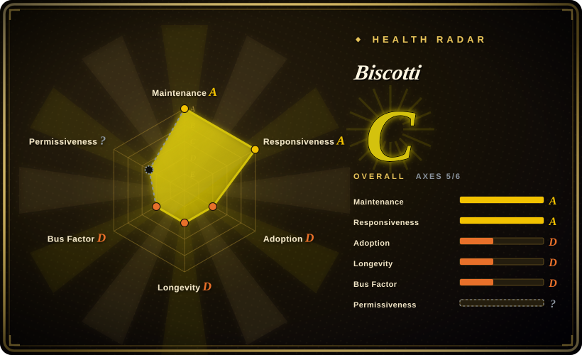
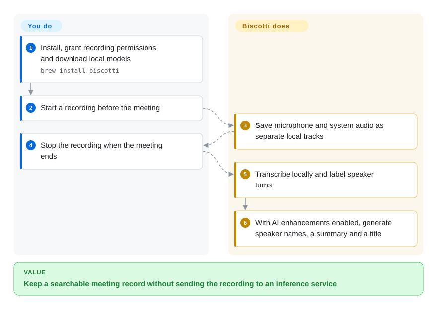
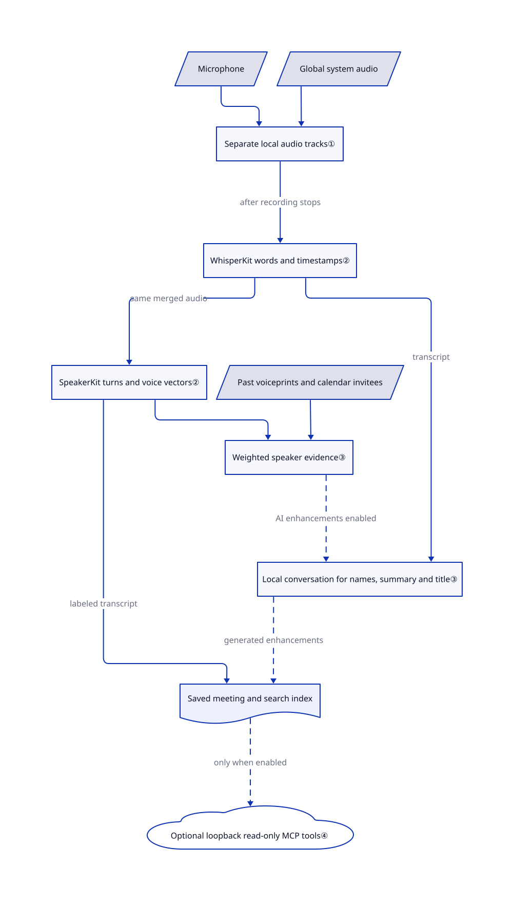

# Biscotti

You finish a call without a record of who promised what, but cannot send its audio to a transcription service. Biscotti records your Mac's microphone and system sound, then produces speaker-labeled text and summaries locally after you stop.

## When to use

You take client or engineering calls on an Apple Silicon Mac, and manually matching “Speaker 2” to yesterday's participant keeps consuming your afternoon. You want meeting recordings, speaker names, notes and summaries in one native app, without a bot joining the call or a hosted inference account. Biscotti combines microphone/system recording with local speech recognition, remembered voice patterns and calendar context. Unlike Call.md, the core analysis does not require sending meeting media to VideoDB; unlike standalone Whisper, you do not assemble recording, speaker labeling and meeting history yourself.

Choose it for a personal, post-call workflow on macOS 15 or later. Its optional MCP server lets an assistant search saved meetings, but it is not an agent that acts during the call. The source is available under a noncompete license, not a permissive open-source license.

## When NOT to use

- **You are building a competing recorder or meeting service.** The [license's Noncompete and Competition clauses](https://github.com/scosman/Biscotti/blob/273e3ff10cab1b14314685da697bc5ac53eb19d1/LICENSE.md) prohibit providing competing products, including free products or ports. Build on [OpenAI Whisper](../media-processing/video-audio/speech-and-subtitles/whisper.md) instead when you need MIT-licensed speech recognition that you can embed in your own product.
- **You need Windows/Linux support or an existing-file transcription pipeline.** Prefer [Meetily](https://github.com/Zackriya-Solutions/meeting-minutes) for a packaged Windows meeting app, or Whisper for batch audio files. Biscotti requires Apple Silicon and macOS 15+; audio-file import remains in open [PR #105](https://github.com/scosman/Biscotti/pull/105) and [PR #113](https://github.com/scosman/Biscotti/pull/113), not the reviewed main branch. CSV meeting import is a separate feature.
- **You need live coaching or tool calls while people speak.** Evaluate [Call.md](call-md.md) if you accept its VideoDB cloud dependency. Biscotti starts transcription after recording stops; its MCP tools read stored meetings rather than execute your business tools in-call.
- **Recording must isolate only the meeting app, or your headset must work without a trial call.** Prefer a Whisper workflow fed by a separately captured, approved audio track. Biscotti's global system tap includes other applications; open [issue #88](https://github.com/scosman/Biscotti/issues/88) and [PR #109](https://github.com/scosman/Biscotti/pull/109) concern AirPods audio loss, while [PR #115](https://github.com/scosman/Biscotti/pull/115) proposes a workaround for microphone contention. Do not treat a pending fix as shipped.
- **An assistant must not access confidential transcripts.** Keep Biscotti's MCP switch off, or use standalone Whisper without a tool server. Enabling Biscotti MCP makes meetings readable to local apps; a connected cloud-model client can subsequently send that text away. No meeting bot means no participant notification, not consent to record.

## Comparison

| Alternative | In index | Our verdict | Tradeoff |
|---|---|---|---|
| [Call.md](call-md.md) | ✅ | Choose Biscotti when media must remain on the Mac; choose Call.md when live coaching and in-call MCP actions justify a hosted pipeline. | Native Swift and local post-call models versus Electron and VideoDB-backed live intelligence; Biscotti's MCP surface only reads saved meetings. |
| [OpenAI Whisper](../media-processing/video-audio/speech-and-subtitles/whisper.md) | ✅ | Choose Whisper for existing audio files or an embeddable MIT speech engine; choose Biscotti for an integrated Mac meeting history with speaker identification and summaries. | Whisper leaves capture, diarization and note management to you; Biscotti supplies those but imposes Apple hardware and a noncompete license. |
| [Meetily](https://github.com/Zackriya-Solutions/meeting-minutes) | not indexed | Evaluate Meetily for Windows capture, live transcripts or configurable summary providers; choose Biscotti for a native Apple-only app with built-in local speaker recognition. | Meetily documents local and cloud provider choices plus separate PRO features; check the chosen edition and provider before assuming privacy or feature parity; not added in this tab batch. |

## Quick start

Install the app from the release DMG or run the README's `brew install biscotti`. On an M1-or-later Mac running macOS 15+, complete onboarding: authorize microphone/system-audio capture, optionally connect Calendar, and download the local models. Start recording before your call and stop when it ends; Biscotti then generates a labeled transcript and, when AI enhancements are enabled and their model is installed, a summary and title. You handle participant consent, permission troubleshooting, model disk space and protecting the saved recordings; the app handles capture and local analysis without an inference subscription. Leave MCP disabled unless you intend to share meeting text with other local software; [connection instructions](https://github.com/scosman/Biscotti/blob/273e3ff10cab1b14314685da697bc5ac53eb19d1/App/ConnectingMCP.md) explain this separate integration.

<!-- flow-steps:begin (generated from flows/biscotti.json by tools/flow_card.py — do not edit) -->

Text version of the flow

1. **You**: Install, grant recording permissions and download local models — `brew install biscotti`
2. **You**: Start a recording before the meeting
3. **Biscotti**: Save microphone and system audio as separate local tracks
4. **You**: Stop the recording when the meeting ends
5. **Biscotti**: Transcribe locally and label speaker turns
6. **Biscotti**: With AI enhancements enabled, generate speaker names, a summary and a title

**Value**: Keep a searchable meeting record without sending the recording to an inference service

<!-- flow-steps:end -->

## Key techniques

<!-- mechanism:begin (generated from mechanisms/biscotti.json by tools/mechanism_card.py; do not edit) -->

Text version of the mechanism

- Microphone
- Global system audio
- Separate local audio tracks①
- WhisperKit words and timestamps②
- SpeakerKit turns and voice vectors②
- Past voiceprints and calendar invitees
- Weighted speaker evidence③
- Local conversation for names, summary and title③
- Saved meeting and search index
- Optional loopback read-only MCP tools④

- Microphone → Separate local audio tracks①
- Global system audio → Separate local audio tracks①
- Separate local audio tracks① → WhisperKit words and timestamps② (after recording stops)
- WhisperKit words and timestamps② → SpeakerKit turns and voice vectors② (same merged audio)
- SpeakerKit turns and voice vectors② → Weighted speaker evidence③
- Past voiceprints and calendar invitees → Weighted speaker evidence③
- Weighted speaker evidence③ → Local conversation for names, summary and title③ (AI enhancements enabled) [optional/fallback]
- WhisperKit words and timestamps② → Local conversation for names, summary and title③ (transcript)
- SpeakerKit turns and voice vectors② → Saved meeting and search index (labeled transcript)
- Local conversation for names, summary and title③ → Saved meeting and search index (generated enhancements) [optional/fallback]
- Saved meeting and search index → Optional loopback read-only MCP tools④ (only when enabled) [optional/fallback]

<!-- mechanism:end -->

### 1. Capture microphone and global system audio separately

- **Problem:** Recording the loudspeaker through a microphone mixes your voice with remote participants and room echo.
- **How:** A private Core Audio process tap mixes system output to mono; a separate voice-processing microphone path records your side. A ring buffer hands system audio to a writer thread, keeping file encoding outside the real-time callback.
- **Limits:** The system tap excludes no processes, so unrelated apps can enter the recording. Buffer overflow is logged, and hardware-route recovery is not a guarantee against the headset failures reported in issues.
- **Source:** [System tap and writer:249–317](https://github.com/scosman/Biscotti/blob/273e3ff10cab1b14314685da697bc5ac53eb19d1/Packages/AudioCapture/Sources/AudioCapture/LiveSystemCaptureEngine.swift#L249-L317), [microphone engine](https://github.com/scosman/Biscotti/blob/273e3ff10cab1b14314685da697bc5ac53eb19d1/Packages/AudioCapture/Sources/AudioCapture/LiveMicCaptureEngine.swift).

### 2. Transcribe, then attach speaker turns on-device

- **Problem:** Speech recognition alone cannot reliably tell you which participant spoke each segment.
- **How:** The engine merges the two audio files, runs WhisperKit for words/timestamps, then SpeakerKit for speaker turns and voice vectors. It joins their results into segments; on machines with at most 8 GiB RAM, it unloads the speech model before loading the speaker model.
- **Limits:** This is post-recording processing, not streaming captions. The reviewed resolver selects the roughly 626 MB quantized large-v3 model, despite the README calling it “V3 Turbo”; model identity should come from the resolver, not that tagline.
- **Source:** [Processing order:78–109 and assembly:248–279](https://github.com/scosman/Biscotti/blob/273e3ff10cab1b14314685da697bc5ac53eb19d1/Packages/Transcription/Sources/Transcription/InProcessTranscriptionEngine.swift#L78-L109), [model and memory policy:25–76](https://github.com/scosman/Biscotti/blob/273e3ff10cab1b14314685da697bc5ac53eb19d1/Packages/Transcription/Sources/Transcription/MethodResolver.swift#L25-L76).

### 3. Use past voice patterns as evidence, then reuse one analysis conversation

- **Problem:** Anonymous speaker numbers change between meetings, and separately prompting for names, summaries and titles repeats the same transcript.
- **How:** The matcher scores nearby historical voice vectors, keeps one vote per meeting, weights human-confirmed labels and boosts calendar invitees. A local language-model conversation receives that evidence and the transcript, then generates speaker assignments, a streamed summary and a title in successive turns.
- **Limits:** Similar voices can yield an ambiguous result; inferred labels carry less weight but remain evidence. Generated names and summaries are not ground truth, and the shared conversation can carry an earlier naming error into later output.
- **Source:** [Voice scoring and ambiguity:208–405](https://github.com/scosman/Biscotti/blob/273e3ff10cab1b14314685da697bc5ac53eb19d1/Packages/BiscottiKit/Sources/VoiceprintMatching/VoiceprintMatcher.swift#L208-L405), [analysis conversation:53–219](https://github.com/scosman/Biscotti/blob/273e3ff10cab1b14314685da697bc5ac53eb19d1/Packages/BiscottiKit/Sources/Intelligence/MeetingAnalyzer.swift#L53-L219).

### 4. Expose saved meetings through a bounded, opt-in local tool server

- **Problem:** An assistant needs meeting context without direct access to the application's storage format.
- **How:** Three read-only MCP tools expose meeting queries, details and transcript windows over HTTP at `127.0.0.1:8516/mcp`. The listener caps connections at 16, request bodies at 1 MiB and idle time at 120 seconds; the documented switch defaults off.
- **Limits:** Loopback binding and origin checks do not make local processes trustworthy. The connection guide explicitly permits any app on the Mac to read meetings while enabled, and clients control whether returned content reaches a remote model.
- **Source:** [Tool catalog](https://github.com/scosman/Biscotti/blob/273e3ff10cab1b14314685da697bc5ac53eb19d1/Packages/BiscottiKit/Sources/MCPServer/MeetingToolCatalog.swift), [server constants:6–28](https://github.com/scosman/Biscotti/blob/273e3ff10cab1b14314685da697bc5ac53eb19d1/Packages/BiscottiKit/Sources/MCPServer/MCPServerConfiguration.swift#L6-L28), [privacy boundary:7–15](https://github.com/scosman/Biscotti/blob/273e3ff10cab1b14314685da697bc5ac53eb19d1/App/ConnectingMCP.md#L7-L15).

## Tech stack

- Swift 6 packages and a SwiftUI macOS app; Core Audio/AVFoundation capture, EventKit calendar access and XPC worker services for model execution.
- WhisperKit/SpeakerKit from `argmax-oss-swift` ≥1.1.0; `llama.swift` wraps llama.cpp for local Gemma 4 inference. The latter has an explicit upper version bound because its C API changed.
- SwiftData stores meetings and voiceprints; a separate SQLite FTS5 index supports text search. SwiftNIO and the pinned MCP Swift SDK provide the optional tool endpoint. See the [package manifests](https://github.com/scosman/Biscotti/tree/273e3ff10cab1b14314685da697bc5ac53eb19d1/Packages).

## Dependencies

- **Hardware/OS:** Apple Silicon M1 or later, macOS 15 or later; upstream recommends 16 GB RAM. Permission grants are needed for microphone and system audio; Calendar integration is optional.
- **Models/storage:** initial downloads are required for speech/speaker models and optional summaries. The [LLM catalog](https://github.com/scosman/Biscotti/blob/273e3ff10cab1b14314685da697bc5ac53eb19d1/Packages/LocalLLM/Sources/LocalLLM/LLMModel.swift#L53-L73) estimates 3 GB for E2B or 7 GB for 12B, before recording storage; [policy](https://github.com/scosman/Biscotti/blob/273e3ff10cab1b14314685da697bc5ac53eb19d1/Packages/BiscottiKit/Sources/Intelligence/ModelPolicy.swift#L11-L28) blocks 12B below 15 billion bytes of physical RAM and recommends it from 24 billion bytes.
- **Network/services:** no hosted transcription or LLM account is required. Model downloads and GitHub release checks use the network; “local inference” does not mean “no network activity.” MCP clients are optional and have their own data policies.
- **Source development:** Xcode, Swift, XcodeGen and the upstream build tools are needed to rebuild; package manifests and app project configuration define their versions. Repo-local MCP configs launch development tooling through `uvx`/`npx`; review them rather than automatically trusting a clone.

## Ops difficulty

**Low for personal use, medium to maintain a fork.** There is no server or database cluster to deploy, but permissions, headset behavior, model downloads and local recording backups remain your responsibility. Before a critical call, test the actual microphone/output route and check both tracks. Rebuilding adds signing, native dependency compatibility and model/hardware validation; the noncompete license also limits redistribution plans.

## Health & viability

- **Maintenance, 2026-10-21:** created 2026-06-05, not archived, with default-branch activity on the verification date. Releases progressed from v0.3.0 on September 1 to v1.0.0 on October 8 and v1.1.0 on October 21. [Release history](https://github.com/scosman/Biscotti/releases).
- **Governance/backing:** a personal repository owned by Steve Cosman, who has 577 of the 606 contributions listed by the contributors endpoint; no foundation backing is evidenced. The repo includes package tests, manual hardware-test scripts and a private security-reporting policy, but tests were not executed for this intake.
- **Age/Lindy:** [推断: based on its June creation and continuing October activity] ongoing releases support trying it, but four months of history do not establish long-term durability. Retain recordings and exports rather than relying only on generated summaries.
- **Adoption:** 384 stars and 36 forks at verification; these show attention, not verified deployments. The [v1.1.0 notes](https://github.com/scosman/Biscotti/releases/tag/v1.1.0) include a Homebrew-installation contribution, reducing onboarding friction without proving production reliability.
- **Risks:** the actual PolyForm Perimeter license is competition-restricting. The radar's license axis remains `?` because its parser cannot score this license (`license_unparsed`), not because the terms were unread. Open audio-route reports and pending import/microphone fixes are adoption blockers when those workflows are required; local storage and opt-in MCP need an explicit privacy policy of your own.

## Caveats (unverified)

- [未验证: source-only intake; upstream code and models were not executed] Recognition accuracy, speaker identity quality, summary fidelity, processing latency and real memory use were not measured. Model download sizes above are source catalog estimates, not observed resource use.
- [未验证: reported hardware failures were not reproduced] AirPods/system-audio and microphone-contention reports describe specific configurations; their prevalence and behavior on your Mac require a trial recording. The cited recovery PRs were open at verification.
- [推断: based on repository age and release dates, not a maintenance commitment] Four months of activity support a cautious personal trial, not a long-term support guarantee.
