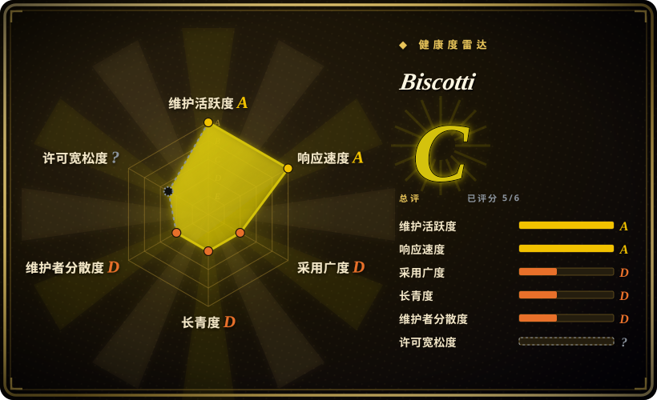
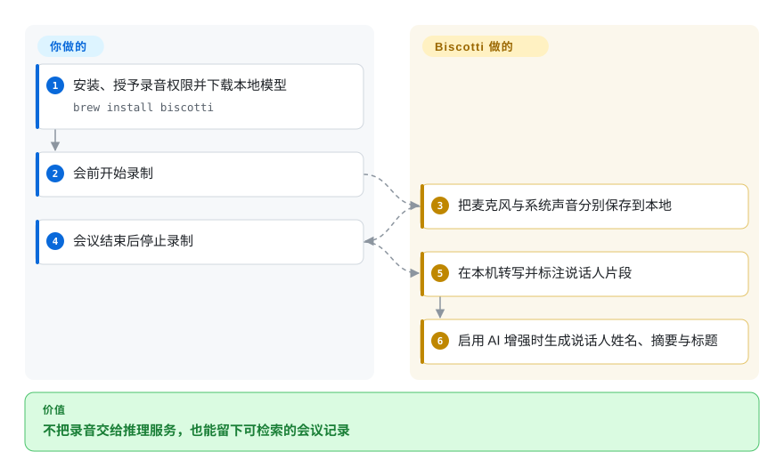
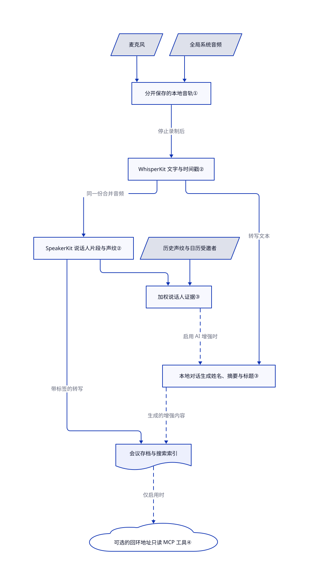

# Biscotti

会开完了，你却想不起谁答应做什么，又不能把录音交给云端转写。Biscotti 录下 Mac 麦克风与系统声音，停止录制后在本机生成带说话人标签的文字和摘要。

## 何时使用

你用 Apple Silicon Mac 开客户会或工程会，总得花半个下午把“说话人 2”对应回昨天的参会者。你想在一个原生应用里保存录音、姓名、笔记和摘要，不让机器人入会，也不注册云端推理账号。Biscotti 把双路录音、本地语音识别、历史声纹和日历线索串起来。与 Call.md 相比，核心分析不必把会议媒体交给 VideoDB；与单独使用 Whisper 相比，你不必自己拼装录音、说话人标注和会议历史。

适合在 macOS 15 及以上版本上做个人会后记录。可选 MCP 服务能让助手搜索已保存的会议，但不会在通话中替你执行操作。源码采用禁止竞争用途的许可证，不是宽松开源许可。

## 何时不用

- **你要开发竞争性录音器或会议服务。** [许可证中的禁止竞争条款](https://github.com/scosman/Biscotti/blob/273e3ff10cab1b14314685da697bc5ac53eb19d1/LICENSE.md)覆盖免费产品与跨平台移植。需要把语音识别嵌入自家产品时，改用 MIT 许可的 [OpenAI Whisper](../media-processing/video-audio/speech-and-subtitles/whisper.zh.md)。
- **你需要 Windows／Linux，或批量处理已有音频。** Windows 会议录制可评估 [Meetily](https://github.com/Zackriya-Solutions/meeting-minutes)，音频文件批处理可用 Whisper。Biscotti 要求 Apple Silicon 和 macOS 15 以上；音频文件导入仍在待合并的 [PR #105](https://github.com/scosman/Biscotti/pull/105) 和 [PR #113](https://github.com/scosman/Biscotti/pull/113) 中，不在本次阅读的主分支里。已有的 CSV 会议导入是另一件事。
- **你需要会中教练提示或自动调用工具。** 若能接受 VideoDB 云依赖，可评估 [Call.md](call-md.zh.md)。Biscotti 停止录音后才启动转写；它的 MCP 工具读取会议存档，不会在通话中执行你的业务工具。
- **你必须只录会议软件，或耳机不能先做试录。** 改用单独采集并确认合规的音轨，再交给 Whisper。Biscotti 的全局系统录音会收进其他应用声音；[问题 #88](https://github.com/scosman/Biscotti/issues/88) 和 [PR #109](https://github.com/scosman/Biscotti/pull/109)涉及 AirPods 音轨丢失，[PR #115](https://github.com/scosman/Biscotti/pull/115)提出麦克风争用的绕开方案。待合并修复不等于已经发布。
- **助手不能访问机密转写。** 关闭 Biscotti 的 MCP 开关，或只用没有工具服务的 Whisper。启用 MCP 后，本机应用可读会议；连接云模型的客户端随后仍可能把文字外发。没有机器人入会只代表不会通知其他参会者，不代表已经取得录音同意。

## 横向对比

| 替代品 | 是否收录 | 我们的评价 | 取舍 |
|---|---|---|---|
| [Call.md](call-md.zh.md) | 已收录 | 媒体不能离开 Mac 时选 Biscotti；会中提示和 MCP 自动操作足以抵偿云依赖时，选 Call.md。 | 原生 Swift 加本地会后分析，对比 Electron 加 VideoDB 实时智能；Biscotti 的 MCP 只读已保存会议。 |
| [OpenAI Whisper](../media-processing/video-audio/speech-and-subtitles/whisper.zh.md) | 已收录 | 已有音频文件或需要嵌入 MIT 语音引擎时选 Whisper；想要自带说话人识别、摘要和历史的 Mac 应用时选 Biscotti。 | Whisper 的录音、说话人分离和笔记管理要自己做；Biscotti 集成这些功能，却绑定苹果硬件并限制竞争用途。 |
| [Meetily](https://github.com/Zackriya-Solutions/meeting-minutes) | 未收录 | Windows 录制、实时转写或可切换摘要服务商更重要时，评估 Meetily；原生苹果应用和内置本地说话人识别更重要时选 Biscotti。 | Meetily 文档列出本地与云端服务选择，并另设 PRO 功能；应核对版本与服务商，不能默认隐私和功能相同；本次标签批次未添加（not added in this tab batch）。 |

## 快速上手

下载发布页的 DMG，或按 README 运行 `brew install biscotti`。在运行 macOS 15 以上的 M1 或更新 Mac 上完成引导：授予麦克风与系统音频权限，按需连接日历，并下载本地模型。会前点录制，结束后点停止；Biscotti 随后生成带标签的转写，启用 AI 增强且装好模型时还会生成摘要和标题。你负责参会者同意、权限排障、模型磁盘空间和录音保护；应用负责采集与本地分析，不收取推理订阅费。除非准备让其他本机软件读取会议，否则保持 MCP 关闭；[连接说明](https://github.com/scosman/Biscotti/blob/273e3ff10cab1b14314685da697bc5ac53eb19d1/App/ConnectingMCP.md)解释了这条独立集成路径。

<!-- flow-steps:begin (generated from flows/biscotti.json by tools/flow_card.py — do not edit) -->

流程文字版

1. **你**：安装、授予录音权限并下载本地模型 — `brew install biscotti`
2. **你**：会前开始录制
3. **Biscotti**：把麦克风与系统声音分别保存到本地
4. **你**：会议结束后停止录制
5. **Biscotti**：在本机转写并标注说话人片段
6. **Biscotti**：启用 AI 增强时生成说话人姓名、摘要与标题

**价值**：不把录音交给推理服务，也能留下可检索的会议记录

<!-- flow-steps:end -->

## 技术要点

<!-- mechanism:begin (generated from mechanisms/biscotti.json by tools/mechanism_card.py; do not edit) -->

机制文字版

- 麦克风
- 全局系统音频
- 分开保存的本地音轨①
- WhisperKit 文字与时间戳②
- SpeakerKit 说话人片段与声纹②
- 历史声纹与日历受邀者
- 加权说话人证据③
- 本地对话生成姓名、摘要与标题③
- 会议存档与搜索索引
- 可选的回环地址只读 MCP 工具④

- 麦克风 → 分开保存的本地音轨①
- 全局系统音频 → 分开保存的本地音轨①
- 分开保存的本地音轨① → WhisperKit 文字与时间戳②（停止录制后）
- WhisperKit 文字与时间戳② → SpeakerKit 说话人片段与声纹②（同一份合并音频）
- SpeakerKit 说话人片段与声纹② → 加权说话人证据③
- 历史声纹与日历受邀者 → 加权说话人证据③
- 加权说话人证据③ → 本地对话生成姓名、摘要与标题③（启用 AI 增强时）〔可选／兜底〕
- WhisperKit 文字与时间戳② → 本地对话生成姓名、摘要与标题③（转写文本）
- SpeakerKit 说话人片段与声纹② → 会议存档与搜索索引（带标签的转写）
- 本地对话生成姓名、摘要与标题③ → 会议存档与搜索索引（生成的增强内容）〔可选／兜底〕
- 会议存档与搜索索引 → 可选的回环地址只读 MCP 工具④（仅启用时）〔可选／兜底〕

<!-- mechanism:end -->

### 1. 分别采集麦克风与全局系统音频

- **解决：** 用麦克风直接录扬声器，会把本人、远端声音与房间回声混在一起。
- **做法：** 私有 Core Audio 音频抽头把系统输出混成单声道；独立的语音处理麦克风通道录制本人声音。系统音频先进入环形缓冲区，再交给写入线程，避免在实时回调里编码文件。
- **边界：** 系统抽头没有排除任何进程，其他应用声音也可能入录。缓冲区溢出会记日志；音频设备切换恢复逻辑不保证能避免问题区报告的耳机故障。
- **源码：** [系统抽头与写入线程第 249–317 行](https://github.com/scosman/Biscotti/blob/273e3ff10cab1b14314685da697bc5ac53eb19d1/Packages/AudioCapture/Sources/AudioCapture/LiveSystemCaptureEngine.swift#L249-L317)、[麦克风引擎](https://github.com/scosman/Biscotti/blob/273e3ff10cab1b14314685da697bc5ac53eb19d1/Packages/AudioCapture/Sources/AudioCapture/LiveMicCaptureEngine.swift)。

### 2. 本地先转写，再附上说话人片段

- **解决：** 语音识别只能给文字，不能可靠回答每段是谁说的。
- **做法：** 引擎合并两路音频，先用 WhisperKit 生成文字与时间戳，再用 SpeakerKit 生成说话人片段和声纹向量，最后合成结果。内存不超过 8 GiB 时，先卸载语音模型，再加载说话人模型。
- **边界：** 这是录制后的处理，不是流式字幕。当前模型解析器选用约 626 MB 的量化 large-v3，README 却称为“V3 Turbo”；应以解析器确认模型身份，不能照抄宣传描述。
- **源码：** [处理顺序第 78–109 行及结果拼装第 248–279 行](https://github.com/scosman/Biscotti/blob/273e3ff10cab1b14314685da697bc5ac53eb19d1/Packages/Transcription/Sources/Transcription/InProcessTranscriptionEngine.swift#L78-L109)、[模型与内存策略第 25–76 行](https://github.com/scosman/Biscotti/blob/273e3ff10cab1b14314685da697bc5ac53eb19d1/Packages/Transcription/Sources/Transcription/MethodResolver.swift#L25-L76)。

### 3. 用历史声纹作证据，复用同一轮分析对话

- **解决：** 匿名说话人编号每次会议都会变；姓名、摘要与标题分别请求，又会反复输入同一份转写。
- **做法：** 匹配器给邻近历史声纹打分，每次会议只算一票，提高人工确认标签的权重，并给日历受邀者加权。本地语言模型接收证据与转写，随后在同一段对话里依次生成姓名映射、流式摘要和标题。
- **边界：** 相近声音可能返回歧义结果；推断标签权重较低，但仍会参与评分。生成姓名和摘要不等于事实；共享对话也可能把早先的姓名错误带进后续输出。
- **源码：** [声纹评分与歧义判定第 208–405 行](https://github.com/scosman/Biscotti/blob/273e3ff10cab1b14314685da697bc5ac53eb19d1/Packages/BiscottiKit/Sources/VoiceprintMatching/VoiceprintMatcher.swift#L208-L405)、[分析对话第 53–219 行](https://github.com/scosman/Biscotti/blob/273e3ff10cab1b14314685da697bc5ac53eb19d1/Packages/BiscottiKit/Sources/Intelligence/MeetingAnalyzer.swift#L53-L219)。

### 4. 用默认关闭且有资源上限的本地工具服务读取会议

- **解决：** 助手需要会议上下文，却不应直接解析应用内部存储格式。
- **做法：** 三个只读 MCP 工具通过 `127.0.0.1:8516/mcp` 提供会议查询、详情和转写窗口。监听器最多接受 16 个连接，请求体上限 1 MiB，空闲超时 120 秒；文档规定开关默认关闭。
- **边界：** 回环地址与来源检查不能让本机进程自动可信。连接文档明确说明，开启后 Mac 上任意应用都能读会议；返回内容是否交给远端模型，由客户端决定。
- **源码：** [工具目录](https://github.com/scosman/Biscotti/blob/273e3ff10cab1b14314685da697bc5ac53eb19d1/Packages/BiscottiKit/Sources/MCPServer/MeetingToolCatalog.swift)、[服务常量第 6–28 行](https://github.com/scosman/Biscotti/blob/273e3ff10cab1b14314685da697bc5ac53eb19d1/Packages/BiscottiKit/Sources/MCPServer/MCPServerConfiguration.swift#L6-L28)、[隐私边界第 7–15 行](https://github.com/scosman/Biscotti/blob/273e3ff10cab1b14314685da697bc5ac53eb19d1/App/ConnectingMCP.md#L7-L15)。

## 技术栈

- Swift 6 软件包与 SwiftUI macOS 应用；Core Audio／AVFoundation 采集，EventKit 读取日历，XPC 工作进程执行模型。
- WhisperKit／SpeakerKit 来自 `argmax-oss-swift`，版本至少为 1.1.0；`llama.swift` 包装 llama.cpp，在本机运行 Gemma 4。后者因 C 接口变更而设置了明确版本上限。
- SwiftData 保存会议和声纹，独立 SQLite FTS5 索引提供全文检索。SwiftNIO 与固定版本 MCP Swift SDK 提供可选工具接口。见[软件包清单](https://github.com/scosman/Biscotti/tree/273e3ff10cab1b14314685da697bc5ac53eb19d1/Packages)。

## 依赖

- **硬件与系统：** Apple Silicon M1 或更新芯片，macOS 15 或更新系统；上游建议 16 GB 内存。需要麦克风与系统音频权限，日历集成为可选项。
- **模型与存储：** 语音、说话人和可选摘要模型均需首次下载。[语言模型目录](https://github.com/scosman/Biscotti/blob/273e3ff10cab1b14314685da697bc5ac53eb19d1/Packages/LocalLLM/Sources/LocalLLM/LLMModel.swift#L53-L73)估算 E2B 占 3 GB、12B 占 7 GB，另需录音空间；[产品策略](https://github.com/scosman/Biscotti/blob/273e3ff10cab1b14314685da697bc5ac53eb19d1/Packages/BiscottiKit/Sources/Intelligence/ModelPolicy.swift#L11-L28)在物理内存低于 150 亿字节时禁用 12B，达到 240 亿字节才推荐使用。
- **网络与服务：** 不需要托管转写或语言模型账号。模型下载与 GitHub 更新检查仍会联网；“本地推理”不等于“完全不联网”。MCP 客户端可选，并有自己的数据政策。
- **源码开发：** 重建需要 Xcode、Swift、XcodeGen 和上游构建工具，具体版本见清单与应用工程配置。仓库自带 MCP 配置会通过 `uvx`／`npx` 启动开发工具，克隆后应先审查，不应自动信任。

## 运维难度

**个人使用低，维护分支中等。** 不必部署服务或数据库集群，但权限、耳机兼容、模型下载和本地录音备份仍归你负责。重要会议前，用实际麦克风与输出设备试录，确认两路音轨。重建还要处理签名、原生依赖兼容和模型硬件验证；禁止竞争的许可也限制了再分发计划。

## 健康度与可持续性

- **维护，截至 2026-10-21：** 仓库创建于 2026-06-05，未归档，核验当天主分支仍有更新。版本从 9 月 1 日的 v0.3.0，推进到 10 月 8 日的 v1.0.0 与 10 月 21 日的 v1.1.0。见[发布历史](https://github.com/scosman/Biscotti/releases)。
- **治理与支持：** Steve Cosman 的个人仓库，贡献者接口所列 606 次贡献中有 577 次来自仓库所有者；未找到基金会支持证据。仓库包含软件包测试、人工硬件测试脚本和私密漏洞报告政策；本次未运行上游测试。
- **年龄与持续性：** [推断：依据六月建库与十月持续发布] 当前节奏支持试用，但四个月历史不足以证明长期持续性。应保留录音与导出，不应只依赖生成摘要。
- **采用情况：** 核验时 384 星、36 个 fork，只能说明关注度，不代表已验证的部署。[v1.1.0 说明](https://github.com/scosman/Biscotti/releases/tag/v1.1.0)包含 Homebrew 安装贡献，降低上手摩擦，但不证明生产可靠性。
- **风险：** 实际采用的 PolyForm Perimeter 限制竞争用途。雷达许可轴仍为 `?`，原因是评分器不能解析此许可（`license_unparsed`），不是没有阅读条款。音频设备问题和待合并的导入、麦克风修复，在这些工作流必需时构成选型阻碍；本地存储和可选 MCP 都需要你自行制定隐私政策。

## 存疑（未验证）

- [未验证：本次仅阅读源码，未运行上游程序与模型] 未测量识别准确率、说话人身份质量、摘要忠实度、耗时和真实内存占用。上面的模型下载大小来自源码目录估算，不是实测资源消耗。
- [未验证：未复现所报告的硬件故障] AirPods 系统音轨与麦克风争用报告针对具体配置；故障普遍程度和你自己 Mac 上的表现，需要试录确认。引用的恢复 PR 在核验时仍未合并。
- [推断：依据仓库年龄与发布日期，而非维护承诺] 四个月活跃记录支持谨慎个人试用，不代表长期支持保证。
