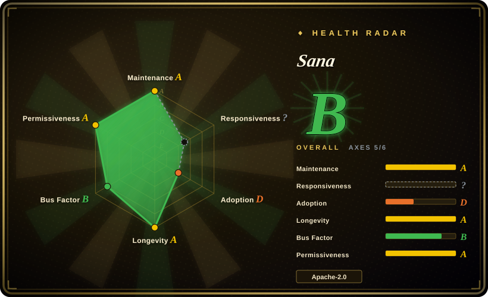
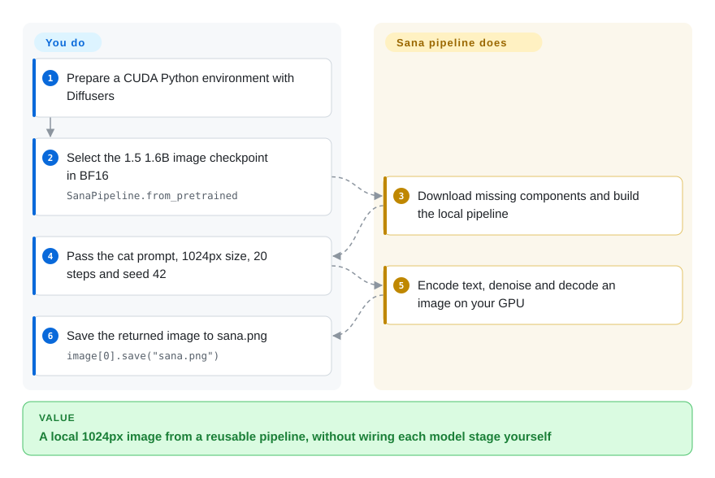
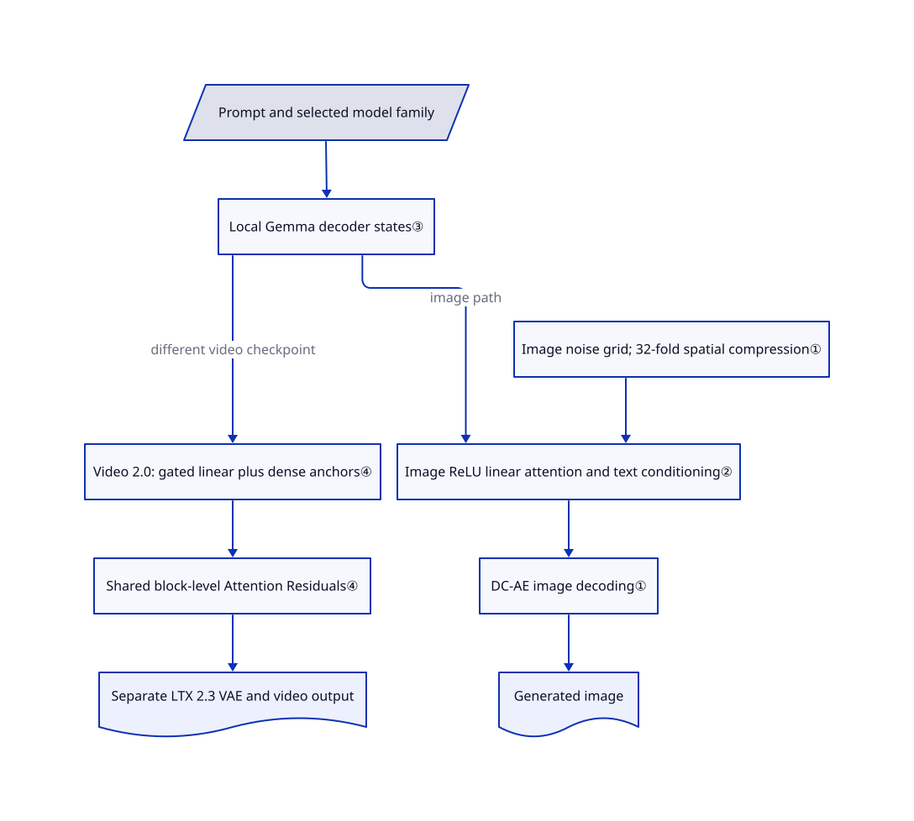

# Sana

Your image generator runs out of memory as you raise the resolution. Sana shrinks the image grid before generation and uses attention that avoids comparing every image position with every other one; its newer video models use a different, hybrid design.

## When to use

You build a local image-generation batch job or study efficient diffusion models. A 1024px request must fit alongside its text encoder, and moving to 4K makes the intermediate image grid expensive. Choose Sana when you want the compact image-model family, its deep-compression autoencoder, and the actual training and inference code together. Unlike a ComfyUI workflow, this is the model implementation you can modify; unlike PixArt-Σ's T5/SDXL-autoencoder recipe, the image path uses Gemma conditioning and 32-fold spatial compression.

You can also use the same repository to investigate short-video generation, but choose a specific checkpoint first. Original Sana has 0.6B/1.6B image variants; SANA-1.5 has 1.6B/4.8B image variants; Sprint is a separate one/few-step image family. SANA-Video is 2B, while Video 2.0 publishes a 5B-class checkpoint with a different autoencoder and attention stack. WM, Streaming and LongSANA are separate tasks, not switches that make every image checkpoint generate minute-long video. The [model zoo](https://github.com/NVlabs/Sana/blob/36a3b01773c6299e6f0df77640b57b5f3dd3fa14/docs/model_zoo.md) is the checkpoint boundary, not the repository's headline.

## When NOT to use

- **You want an artist-facing graph, not model research.** Pick [ComfyUI](../../on-device-ml/local-image-generation/comfyui.md), using the Sana custom-node workflow linked upstream. You gain visual composition; Sana's native Python/config interface leaves workflow design and integration to you. Review custom nodes separately.
- **Your policy requires an entirely Apache-2.0 weight stack.** Do not infer that from Sana's code license. Gemma has separate terms, and Video 2.0 requires an LTX 2.3 autoencoder covered by a community license. Evaluate [Wan2.2](https://github.com/Wan-Video/Wan2.2) and its exact component licenses instead. The int4 Sana card also retains a custom-license link that now returns 404.
- **You need released 14B Video 2.0 weights, or first-frame conditioning in its four-step preview.** Neither is supplied: the 14B architecture exists, but its config/checkpoint is not released; the four-step 5B preview is text-only. Use the released 50-step Video 2.0 5B checkpoint for first-frame input, or evaluate Wan2.2's released image-to-video models.
- **You need a proven latency or memory budget on your hardware.** Do not apply the image int4 “under 8 GB” claim to Video 2.0, WM or Streaming. Benchmark the exact Sana variant against Wan2.2 for video or PixArt-Σ for images. The numbers below are author reports, not independent acceptance tests.
- **You have no suitable GPU and want no model operations.** A hosted Sana endpoint on Replicate is a service rather than a repository; it moves inference operations to a provider, but sends your prompts to that provider and incurs its charges. The native installer targets NVIDIA CUDA, not a verified Mac/CPU deployment.

## Comparison

| Alternative | In index | Our verdict | Tradeoff |
|---|---|---|---|
| [PixArt-Σ](https://github.com/PixArt-alpha/PixArt-sigma) | not indexed | Pick PixArt-Σ to reproduce its T5/SDXL-autoencoder image-training recipe; pick Sana to study deep-compression image generation in an actively changing codebase. | PixArt offers a 0.6B image transformer and 2K recipes, but its default branch was last pushed in 2024-10; it is a historical baseline rather than the maintenance choice. Not added in this tab batch. |
| [Wan2.2](https://github.com/Wan-Video/Wan2.2) | not indexed | Pick Wan2.2 for its released 5B text/image-to-video path or A14B expert models; pick Sana Video 2.0 when hybrid linear attention and its training implementation are the object of study. | Wan2.2 publishes a consumer-card offload recipe; Sana's 5B 50-step and four-step exports have different input capabilities, and its 14B weights remain unavailable. No quality winner is established here. Not added in this tab batch. |
| [ComfyUI](../../on-device-ml/local-image-generation/comfyui.md) | ✅ | Pick ComfyUI when people must assemble and re-run visual generation workflows; pick Sana's repository when you must change the model, sampler or training loop. | ComfyUI is a runner, not a competing checkpoint. Sana custom nodes add a separate dependency and trust boundary; using them does not remove weight-license or GPU requirements. |

## Quick start

For the shortest image path, use the [README's real Diffusers example](https://github.com/NVlabs/Sana/blob/36a3b01773c6299e6f0df77640b57b5f3dd3fa14/README.md#inference-with--diffusers) in a CUDA-compatible Python environment; Diffusers is the library that loads and runs the pipeline. Load `Efficient-Large-Model/SANA1.5_1.6B_1024px_diffusers` with `SanaPipeline.from_pretrained`, use BF16, and move the pipeline, autoencoder and text encoder to the documented device/precision. Supply the example's cyberpunk-cat prompt, 1024×1024 size, guidance 4.5, 20 steps and CUDA seed 42; the example saves `sana.png`. The library downloads missing components and runs the generation locally; you supply hardware, disk, license review and output review. This usage was source-checked, not executed here; full-repository training/video work instead uses `environment_setup.sh`, which installs a much larger CUDA stack.

<!-- flow-steps:begin (generated from flows/sana.json by tools/flow_card.py — do not edit) -->

Text version of the flow

1. **You**: Prepare a CUDA Python environment with Diffusers
2. **You**: Select the 1.5 1.6B image checkpoint in BF16 — `SanaPipeline.from_pretrained`
3. **Sana**: Download missing components and build the local pipeline
4. **You**: Pass the cat prompt, 1024px size, 20 steps and seed 42
5. **Sana**: Encode text, denoise and decode an image on your GPU
6. **You**: Save the returned image to sana.png — `image[0].save("sana.png")`

**Value**: A local 1024px image from a reusable pipeline, without wiring each model stage yourself

<!-- flow-steps:end -->

## Key techniques

<!-- mechanism:begin (generated from mechanisms/sana.json by tools/mechanism_card.py; do not edit) -->

Text version of the mechanism

- Prompt and selected model family
- Local Gemma decoder states③
- Image noise grid; 32-fold spatial compression①
- Image ReLU linear attention and text conditioning②
- DC-AE image decoding①
- Generated image
- Video 2.0: gated linear plus dense anchors④
- Shared block-level Attention Residuals④
- Separate LTX 2.3 VAE and video output

- Prompt and selected model family → Local Gemma decoder states③
- Image noise grid; 32-fold spatial compression① → Image ReLU linear attention and text conditioning②
- Local Gemma decoder states③ → Image ReLU linear attention and text conditioning② (image path)
- Image ReLU linear attention and text conditioning② → DC-AE image decoding①
- DC-AE image decoding① → Generated image
- Local Gemma decoder states③ → Video 2.0: gated linear plus dense anchors④ (different video checkpoint)
- Video 2.0: gated linear plus dense anchors④ → Shared block-level Attention Residuals④
- Shared block-level Attention Residuals④ → Separate LTX 2.3 VAE and video output

<!-- mechanism:end -->

### 1. Generate on a smaller spatial grid

- **Problem:** High-resolution images create too many intermediate positions to process repeatedly.
- **How:** The image config selects DC-AE with 32 latent channels and a spatial downsample rate of 32. The pipeline generates on a height/32 by width/32 grid, then decodes it; the DC-AE implementation builds compression from successive stages.
- **Limits:** Compression does not eliminate decoding cost or guarantee fine-detail reconstruction. 4K needs its matching checkpoint and documented decoder tiling; Video 2.0 instead uses an LTX 2.3 video autoencoder with temporal compression too.
- **Source:** [Image configuration:43–48](https://github.com/NVlabs/Sana/blob/36a3b01773c6299e6f0df77640b57b5f3dd3fa14/configs/sana_config/1024ms/Sana_1600M_img1024.yaml#L43-L48), [latent dimensions and decoding:181–189,298–303](https://github.com/NVlabs/Sana/blob/36a3b01773c6299e6f0df77640b57b5f3dd3fa14/app/sana_pipeline.py#L181-L303), [compression ratio:551–555](https://github.com/NVlabs/Sana/blob/36a3b01773c6299e6f0df77640b57b5f3dd3fa14/diffusion/model/dc_ae/efficientvit/models/efficientvit/dc_ae.py#L551-L555).

### 2. Summarize image attention before querying it

- **Problem:** A table comparing every pair of image positions grows quadratically with image size.
- **How:** Image `LiteLA` applies ReLU to query/key features, first multiplies values by keys, then applies that compact summary to queries and normalizes the result. The configured Sana block combines this with text cross-attention and a convolutional feed-forward block.
- **Limits:** This is a different attention rule, not an exact implementation of softmax attention. The code retains higher-precision attention for numerical stability; an algebraic saving alone does not prove an end-to-end speedup.
- **Source:** [Linear attention:225–305](https://github.com/NVlabs/Sana/blob/36a3b01773c6299e6f0df77640b57b5f3dd3fa14/diffusion/model/nets/sana_blocks.py#L225-L305), [block composition:85–154](https://github.com/NVlabs/Sana/blob/36a3b01773c6299e6f0df77640b57b5f3dd3fa14/diffusion/model/nets/sana.py#L85-L154), [selected modes:29–30](https://github.com/NVlabs/Sana/blob/36a3b01773c6299e6f0df77640b57b5f3dd3fa14/configs/sana_config/1024ms/Sana_1600M_img1024.yaml#L29-L30).

### 3. Use decoder language-model states as text conditioning

- **Problem:** The image generator needs a detailed representation of the user's words without a separate hosted rewriting API.
- **How:** The builder loads Gemma's decoder locally. After prepending configured instruction examples, the tokenizer truncates overlong input before encoding. The pipeline then selects the first token and trailing configured state window for denoising; it does not encode arbitrarily long text before taking the tail.
- **Limits:** These instruction examples are context for hidden-state extraction, not a separate generated rewrite or an agent loop. The image config uses a 300-token conditioning window; Gemma remains a separate download and license dependency.
- **Source:** [Gemma builder:120–148](https://github.com/NVlabs/Sana/blob/36a3b01773c6299e6f0df77640b57b5f3dd3fa14/diffusion/model/builder.py#L120-L148), [context and state selection:223–247](https://github.com/NVlabs/Sana/blob/36a3b01773c6299e6f0df77640b57b5f3dd3fa14/app/sana_pipeline.py#L223-L247), [conditioning configuration:51–65](https://github.com/NVlabs/Sana/blob/36a3b01773c6299e6f0df77640b57b5f3dd3fa14/configs/sana_config/1024ms/Sana_1600M_img1024.yaml#L51-L65).

### 4. Give Video 2.0 periodic dense anchors and depth aggregation

- **Problem:** A video model must mix information across many frames without using dense attention in every layer.
- **How:** In 25% of layers, positions directly attend to one another: the dense softmax anchors. Other layers summarize information before gated linear attention exchanges it in both directions. A separate shared Attention Residual weights representations from earlier layer groups; the released 5B config uses eight layers per group.
- **Limits:** Dense anchor layers still have pairwise attention cost. Bidirectional Video 2.0 is not the causal streaming architecture, and the four-step preview changes the checkpoint/sampling contract rather than making every Video 2.0 export four-step.
- **Source:** [Anchor placement and depth aggregation:46–125](https://github.com/NVlabs/Sana/blob/36a3b01773c6299e6f0df77640b57b5f3dd3fa14/diffusion/model/nets/sana_video2.py#L46-L125), [gated attention variants:65–180](https://github.com/NVlabs/Sana/blob/36a3b01773c6299e6f0df77640b57b5f3dd3fa14/diffusion/model/nets/sana_video2_blocks.py#L65-L180), [5B configuration:25–42](https://github.com/NVlabs/Sana/blob/36a3b01773c6299e6f0df77640b57b5f3dd3fa14/configs/sana_video2/SanaVideo2_5B_720p.yaml#L25-L42).

## Tech stack

- Python ≥3.11; the full manifest pins PyTorch 2.9.1, torchvision 0.24.1, Transformers 4.57.3, Triton 3.5.1 and xformers 0.0.33.post2; Diffusers ≥0.37.0. The README's older “≥0.32.0” note is not the current full-environment contract.
- PyTorch model/sampler code, DC-AE image decoding, Gemma text conditioning, YAML/Pyrallis configs, DDP/FSDP training, WebDataset and Gradio examples. Video 2.0 uses LTX 2.3 decoding and distinct video blocks.
- Sprint, ControlNet, post-training, WM and Streaming have separate configs and dependencies. The `sol-engine` branch is another surface; its acceleration benchmarks are not measurements of the default image pipeline.

## Dependencies

- **Hardware reports, not measured requirements here:** the [image guide](https://github.com/NVlabs/Sana/blob/36a3b01773c6299e6f0df77640b57b5f3dd3fa14/docs/sana.md#hardware-requirements) reports A100 tests with 9 GB for 0.6B inference, 12 GB for 1.6B, under 8 GB for the separate 4-bit route, and 32 GB for training without a complete training profile. Do not treat the last number as a full-family training guarantee.

| Variant and setting | Author report | Independent measurement in this intake |
|---|---|---|
| Image 0.6B / 1.6B | A100 guide: 9 GB / 12 GB inference | None; no weights downloaded or models run |
| Image 4-bit | Under 8 GB; requires Nunchaku/SVDQuant route | None; not a Video 2.0/WM/Streaming budget |
| Sprint 1024px | README: 0.1 seconds on H100; 0.3 seconds on RTX 4090 | None; not a latency guarantee |
| Video 2.0 5B, 736×1280×81 | README: 30.9 seconds end-to-end on one H100, 40-step paper protocol | None; not the 193-frame 50-step or four-step demo |

- **Licenses are layered:** root [code LICENSE](https://github.com/NVlabs/Sana/blob/36a3b01773c6299e6f0df77640b57b5f3dd3fa14/LICENSE) is Apache-2.0 with NVIDIA copyright. The reviewed [1.5 image](https://huggingface.co/Efficient-Large-Model/SANA1.5_1.6B_1024px_diffusers/blob/b77948f2b4eed5c728e9b828ccff07f7427b43cc/LICENSE), [Sprint](https://huggingface.co/Efficient-Large-Model/Sana_Sprint_1.6B_1024px_diffusers/blob/19683c58b7ea290e55cedd8950ae1d86ada7ef96/LICENSE), [Video 2.0 50-step](https://huggingface.co/Efficient-Large-Model/SANA-Video_2.0_5B_720p/blob/f2d95fa06400f186fd1b077d12c69c8ac58aba48/LICENSE) and [four-step](https://huggingface.co/Efficient-Large-Model/SANA-Video_2.0_5B_720p_4step/blob/54ff42899312497caabce145ad9d15e012721622/LICENSE) exports carry Apache-2.0 LICENSE files. Their Gemma encoder separately carries [Gemma terms](https://ai.google.dev/gemma/terms); the DC-AE 1.1 [card declares MIT](https://huggingface.co/mit-han-lab/dc-ae-f32c32-sana-1.1-diffusers/blob/6f7b3f3b289a439a11ef4fb1034989fd4b9a4766/README.md). These are not one blanket license.
- Video 2.0 requires you to supply the local `LTX-2.3-Diffusers` autoencoder directory. The [LTX 2.3 card](https://huggingface.co/Lightricks/LTX-2.3/blob/c1521179de480464f366a98a9d9b2acc4cc097b9/README.md) links the [LTX-2 community agreement](https://github.com/Lightricks/LTX-2/blob/e98f6d927d83c92ef2be6aec76c8440b19306e39/LICENSE-2), which requires a paid commercial license for entities with annual revenues of at least US$10 million and imposes use/distribution restrictions. Review the exact VAE artifact before deployment. The [int4 card](https://huggingface.co/mit-han-lab/svdq-int4-sana-1600m/blob/03a45da0333879a503fcaa864b66dce8123364be/README.md) still says `nvidia-license`; its linked `LICENSE.txt` returned 404 on this verification.
- **Additional license limits:** The LTX agreement also prohibits uses directly competing with or replacing the licensor's commercial offerings without a separate commercial license; that clause has no revenue threshold. Being below US$10 million does not grant universal commercial use. See [restrictions:377–381](https://github.com/Lightricks/LTX-2/blob/e98f6d927d83c92ef2be6aec76c8440b19306e39/LICENSE-2#L377-L381). The reviewed int4 card is also deprecated and points to `nunchaku-tech/nunchaku-sana`; that replacement was not checked here, and the broken old license remains unresolved.
- **Model downloads and local inference:** `from_pretrained` and `hf://` download absent components; native Gemma maps to an Efficient-Large-Model mirror. The reviewed inference path encodes locally rather than calling a hosted generation API. See [Hub resolution](https://github.com/NVlabs/Sana/blob/36a3b01773c6299e6f0df77640b57b5f3dd3fa14/sana/tools/hf_utils.py).
- **Training reporting:** Shared config defaults to W&B and validation can upload images/captions when enabled; Video 2.0 5B explicitly sets `report_to: none`. See [reporting](https://github.com/NVlabs/Sana/blob/36a3b01773c6299e6f0df77640b57b5f3dd3fa14/train_scripts/train.py#L199-L209) and [defaults](https://github.com/NVlabs/Sana/blob/36a3b01773c6299e6f0df77640b57b5f3dd3fa14/diffusion/utils/config.py).
- **Demo services:** Gradio additionally downloads ShieldGemma and binds `0.0.0.0`; only `--share` opens a share tunnel. Online demos receive inputs remotely and are not local inference. See [startup](https://github.com/NVlabs/Sana/blob/36a3b01773c6299e6f0df77640b57b5f3dd3fa14/app/app_sana.py#L168-L211).

## Ops difficulty

**Medium for one image pipeline; high for full-repository training/video.** You own CUDA/driver compatibility, several model components, their caches and license records, and application-level queues/authentication. The native installer builds or installs mmcv, FlashAttention, Pi3 and optionally Transformer Engine in addition to the main manifest; this is not a small inference-only dependency set. Pin code and each model revision, keep untrusted checkpoints out, and isolate the demo before exposing it: the native loader accepts PyTorch checkpoints and the Gradio example listens on all interfaces. No installation, checkpoint loading or service exposure was performed here.

## Health & viability

- **Maintenance, 2026-10-23:** code reviewed at `36a3b017`; the later upstream snapshot is `f0a31406`. The intervening two commits change documentation/star history, not the cited implementation; their diff was reviewed. Core release v2.0.0 was published 2026-06-09, while the newer 2026-10-11 release is named `streamrender-h3-examples-v1`, not a new core model version. The package manifest independently says 0.2.0. Pin the artifact rather than equating these version lines.
- **Governance/backing:** NVIDIA organization ownership and NVIDIA/MIT-affiliated research code; the sampled contributor list is led by one contributor with 138 commits, followed by 20 and 14. No dedicated GOVERNANCE/CODEOWNERS document appeared in the reviewed tree; SECURITY routes reports to NVIDIA PSIRT. Corporate ownership is not a maintenance SLA.
- **Age/Lindy:** created 2024-10-11, about two years old and still active. [推断：based on age and current releases] This supports an active research bet, not a long-established API-stability prior.
- **Adoption:** 9,620 stars and 775 forks at observation; Diffusers pipelines, upstream-linked ComfyUI workflows and SGLang support are concrete integration signals, not proof of production reliability or benchmark superiority.
- **Issues and license drift:** [PR 547](https://github.com/NVlabs/Sana/pull/547) documents and fixes negative-prompt leakage across repeated native pipeline calls, with a regression test present in the reviewed commit. [Issue 443](https://github.com/NVlabs/Sana/issues/443) and the installation docs show why the Python/dependency version matters. README records the 2025-01 code relicensing to Apache-2.0; the stale int4 license link and Gemma/LTX component terms still need separate attention.

## Caveats (unverified)

- [未验证：no installation or GPU execution was authorized] Installation success, output quality, peak memory, latency and training convergence were not tested. All performance figures above are attributed to upstream; none establishes an independent comparison or transfers between variants.
- [未验证：the exact converted VAE distribution was not accessible through public HTTP] The guessed `Lightricks/LTX-2.3-Diffusers` model API returned 401. The native config requires a local directory, and the public LTX 2.3 card supplies the licensing context, but the exact redistributed VAE artifact still needs verification.
- [未验证：upstream license reference is broken] The reviewed int4 distribution is deprecated and points to `nunchaku-tech/nunchaku-sana`; its old NVIDIA `LICENSE.txt` link returned 404. Do not substitute the current code license. The replacement distribution was not verified here. DC-AE's card declares MIT but its file listing has no separate LICENSE.
- [推断：only reviewed paths, not a whole-program network audit] Native prompt encoding/generation is local in the cited path; dependencies, optional demos, training trackers and future code can have other network behavior. No claim of universally offline execution is made.
- [推断：two years of active research is not a stability study] The Lindy verdict weighs the observed age and maintenance, not an independently established survival probability.
