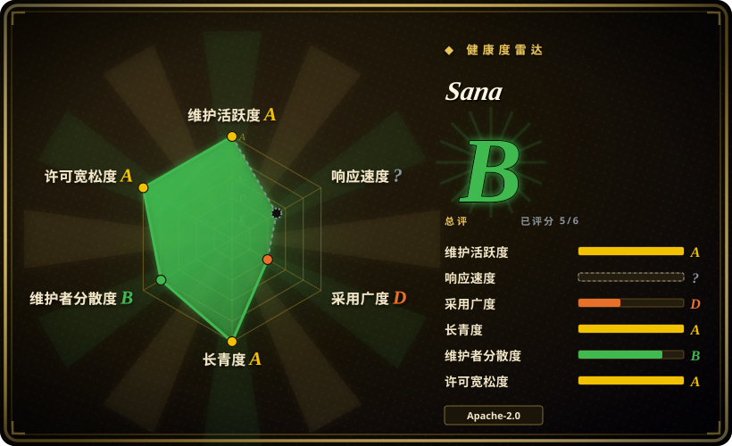
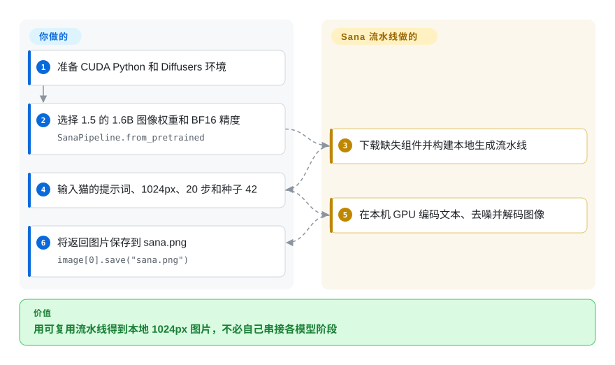
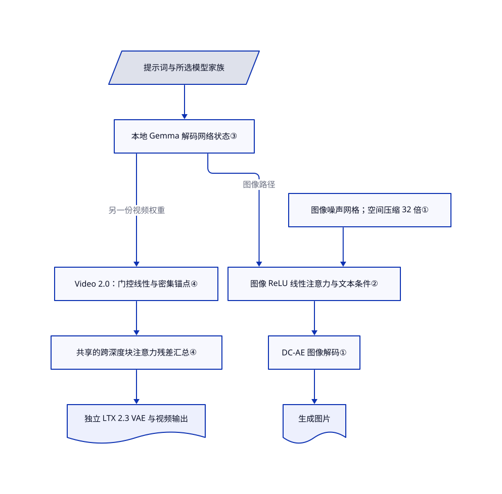

# Sana

图片分辨率一调高，生成任务就爆显存。Sana 先缩小生成用的图像网格，再避免逐一比较所有图像位置；新的视频模型则采用另一套混合设计。

## 何时使用

你在做本地图像生成批处理，或研究如何压低扩散模型开销。一次 1024px 请求还得给文本编码器留空间，升到 4K 后，中间图像网格又变得很贵。当你要把紧凑的图像模型、深度压缩自编码器及真实训练推理代码放在一起改，选 Sana。它不是 ComfyUI 那样的工作流界面，而是模型实现；相较 PixArt-Σ 的 T5／SDXL 自编码器配方，Sana 图像路径用 Gemma 编码文本，并将图像宽高各压缩 32 倍。

你也可在同仓库研究短视频，但要先选具体权重。原始 Sana 有 0.6B／1.6B 图像版本；SANA-1.5 有 1.6B／4.8B 图像版本；Sprint 是独立的一步／少步图像系列。SANA-Video 是 2B，Video 2.0 则发布了采用不同自编码器和注意力结构的 5B 级权重。WM、Streaming、LongSANA 是不同任务，不是打开一个开关就让所有图像权重生成一分钟视频。应以[模型表](https://github.com/NVlabs/Sana/blob/36a3b01773c6299e6f0df77640b57b5f3dd3fa14/docs/model_zoo.md)划定能力边界，不看仓库总标题。

## 何时不用

- **你要给创作者用的节点界面，不改模型。** 选 [ComfyUI](../../on-device-ml/local-image-generation/comfyui.zh.md)，配合上游链接的 Sana 自定义节点工作流。它便于可视化组合；Sana 原生 Python／配置接口仍要你自己集成。自定义节点须单独审查。
- **你的政策要求整套权重都是 Apache-2.0。** 不能从代码许可证推到全部组件。Gemma 有独立条款，Video 2.0 的 LTX 2.3 自编码器使用社区协议。改为评估 [Wan2.2](https://github.com/Wan-Video/Wan2.2)及其确切组件许可。Sana 的 int4 模型卡还保留了已返回 404 的自定义许可证链接。
- **你需要已发布的 Video 2.0 14B 权重，或四步预览的首帧条件输入。** 两者都不满足：14B 架构存在，但配置和权重尚未发布；四步 5B 预览只支持文生视频。首帧输入可选已发布的 50 步 Video 2.0 5B 权重，或评估 Wan2.2 的图生视频模型。
- **你要对本机延迟或显存作保证。** 图像 int4 的“低于 8 GB”不能套给 Video 2.0、WM 或 Streaming。请按具体变体实测，视频与 Wan2.2 比，图像与 PixArt-Σ 比。下文数字是作者报告，不是独立验收结果。
- **你没有合适 GPU，也不想维护模型。** 可选 Replicate 上的 Sana 托管端点；它是服务而非仓库，会接收你的提示词并收费。原生安装器面向 NVIDIA CUDA，不是经本次验证的 Mac／CPU 部署路线。

## 横向对比

| 替代品 | 是否收录 | 我们的评价 | 取舍 |
|---|---|---|---|
| [PixArt-Σ](https://github.com/PixArt-alpha/PixArt-sigma) | 未收录 | 要复现 T5／SDXL 自编码器图像训练配方，选 PixArt-Σ；要在仍变化的代码库研究深度压缩图像生成，选 Sana。 | PixArt 有 0.6B 图像骨干和 2K 配方，但默认分支最后推送在 2024-10；应当作历史基线，而非维护优先的选择。本批标签收录未扩收它。 |
| [Wan2.2](https://github.com/Wan-Video/Wan2.2) | 未收录 | 要已发布的 5B 文生／图生视频路径或 A14B 专家模型，选 Wan2.2；研究混合线性注意力及其训练实现，选 Sana Video 2.0。 | Wan2.2 公布消费卡卸载配方；Sana 的 50 步和四步导出支持不同输入，14B 权重仍不可用。本页不判画质冠军。本批标签收录未扩收它。 |
| [ComfyUI](../../on-device-ml/local-image-generation/comfyui.zh.md) | ✅ | 要让人可视化组合并重跑生成工作流，选 ComfyUI；要改模型、采样器或训练循环，选 Sana 仓库。 | ComfyUI 是运行器，不是另一份模型权重。Sana 自定义节点增加依赖和信任边界，不会消除权重许可或 GPU 要求。 |

## 快速上手

最短图像路径是照 [README 的真实 Diffusers 示例](https://github.com/NVlabs/Sana/blob/36a3b01773c6299e6f0df77640b57b5f3dd3fa14/README.md#inference-with--diffusers)，准备兼容 CUDA 的 Python 环境；Diffusers 就是加载并运行生成流水线的库。用 `SanaPipeline.from_pretrained` 加载 `Efficient-Large-Model/SANA1.5_1.6B_1024px_diffusers`，采用 BF16，并按示例配置流水线、自编码器和文本编码器的设备与精度。输入示例的赛博朋克猫提示词、1024×1024 尺寸、4.5 引导强度、20 步和 CUDA 随机种子 42，示例将图片保存为 `sana.png`。库会下载缺失组件，并在本地生成；硬件、磁盘、许可核验和出图审查由你负责。本次只核对源码，未运行示例；完整仓库的训练／视频路线另用 `environment_setup.sh`，安装的 CUDA 依赖多得多。

<!-- flow-steps:begin (generated from flows/sana.json by tools/flow_card.py — do not edit) -->

流程文字版

1. **你**：准备 CUDA Python 和 Diffusers 环境
2. **你**：选择 1.5 的 1.6B 图像权重和 BF16 精度 — `SanaPipeline.from_pretrained`
3. **Sana**：下载缺失组件并构建本地生成流水线
4. **你**：输入猫的提示词、1024px、20 步和种子 42
5. **Sana**：在本机 GPU 编码文本、去噪并解码图像
6. **你**：将返回图片保存到 sana.png — `image[0].save("sana.png")`

**价值**：用可复用流水线得到本地 1024px 图片，不必自己串接各模型阶段

<!-- flow-steps:end -->

## 技术要点

<!-- mechanism:begin (generated from mechanisms/sana.json by tools/mechanism_card.py; do not edit) -->

机制文字版

- 提示词与所选模型家族
- 本地 Gemma 解码网络状态③
- 图像噪声网格；空间压缩 32 倍①
- 图像 ReLU 线性注意力与文本条件②
- DC-AE 图像解码①
- 生成图片
- Video 2.0：门控线性与密集锚点④
- 共享的跨深度块注意力残差汇总④
- 独立 LTX 2.3 VAE 与视频输出

- 提示词与所选模型家族 → 本地 Gemma 解码网络状态③
- 图像噪声网格；空间压缩 32 倍① → 图像 ReLU 线性注意力与文本条件②
- 本地 Gemma 解码网络状态③ → 图像 ReLU 线性注意力与文本条件②（图像路径）
- 图像 ReLU 线性注意力与文本条件② → DC-AE 图像解码①
- DC-AE 图像解码① → 生成图片
- 本地 Gemma 解码网络状态③ → Video 2.0：门控线性与密集锚点④（另一份视频权重）
- Video 2.0：门控线性与密集锚点④ → 共享的跨深度块注意力残差汇总④
- 共享的跨深度块注意力残差汇总④ → 独立 LTX 2.3 VAE 与视频输出

<!-- mechanism:end -->

### 1. 在更小的空间网格上生成

- **解决：** 高分辨率图片产生太多中间位置，每轮生成都要处理。
- **做法：** 图像配置选用 DC-AE，潜变量有 32 个通道，空间下采样率为 32。流水线在高／32、宽／32 的网格生成后再解码；DC-AE 通过逐级网络构造压缩。
- **边界：** 压缩不消除解码成本，也不保证细节重建。4K 要用对应权重和文档中的分块解码；Video 2.0 则用还压缩时间维度的 LTX 2.3 视频自编码器。
- **源码：** [图像配置第 43–48 行](https://github.com/NVlabs/Sana/blob/36a3b01773c6299e6f0df77640b57b5f3dd3fa14/configs/sana_config/1024ms/Sana_1600M_img1024.yaml#L43-L48)、[潜变量尺寸与解码第 181–303 行](https://github.com/NVlabs/Sana/blob/36a3b01773c6299e6f0df77640b57b5f3dd3fa14/app/sana_pipeline.py#L181-L303)、[压缩率第 551–555 行](https://github.com/NVlabs/Sana/blob/36a3b01773c6299e6f0df77640b57b5f3dd3fa14/diffusion/model/dc_ae/efficientvit/models/efficientvit/dc_ae.py#L551-L555)。

### 2. 先汇总图像注意力，再查询

- **解决：** 若每个图像位置都和所有其他位置比较，计算表会随尺寸平方增长。
- **做法：** 图像 `LiteLA` 对查询和键特征使用 ReLU，先把值与键相乘，再把小型汇总用于查询并归一化。所选 Sana 模块将它与文本交叉注意力、卷积前馈模块组合。
- **边界：** 这是另一种注意力规则，不是精确实现 softmax 注意力。代码保留更高精度来控制数值问题；代数开销减少不等于端到端加速已经证实。
- **源码：** [线性注意力第 225–305 行](https://github.com/NVlabs/Sana/blob/36a3b01773c6299e6f0df77640b57b5f3dd3fa14/diffusion/model/nets/sana_blocks.py#L225-L305)、[模块组合第 85–154 行](https://github.com/NVlabs/Sana/blob/36a3b01773c6299e6f0df77640b57b5f3dd3fa14/diffusion/model/nets/sana.py#L85-L154)、[模式选择第 29–30 行](https://github.com/NVlabs/Sana/blob/36a3b01773c6299e6f0df77640b57b5f3dd3fa14/configs/sana_config/1024ms/Sana_1600M_img1024.yaml#L29-L30)。

### 3. 用解码式语言模型的状态作为文本条件

- **解决：** 图像生成器需要细致表达用户文字，又不想依赖托管提示词改写接口。
- **做法：** 构建器在本地加载 Gemma 的解码网络。图像流水线把指令示例放到提示词前；分词器先截断超长输入，再编码，并取首个词元和末尾指定窗口的状态，作为去噪条件。不是完整编码任意长提示后才保留末尾。
- **边界：** 指令示例用于抽取隐藏状态，不是另行生成一段改写，也不是 agent 循环。图像配置的条件窗口为 300 个词元；Gemma 仍是独立下载及许可依赖。
- **源码：** [Gemma 构建器第 120–148 行](https://github.com/NVlabs/Sana/blob/36a3b01773c6299e6f0df77640b57b5f3dd3fa14/diffusion/model/builder.py#L120-L148)、[上下文与状态选择第 223–247 行](https://github.com/NVlabs/Sana/blob/36a3b01773c6299e6f0df77640b57b5f3dd3fa14/app/sana_pipeline.py#L223-L247)、[文本条件配置第 51–65 行](https://github.com/NVlabs/Sana/blob/36a3b01773c6299e6f0df77640b57b5f3dd3fa14/configs/sana_config/1024ms/Sana_1600M_img1024.yaml#L51-L65)。

### 4. 给 Video 2.0 加周期性密集锚点和跨层汇总

- **解决：** 视频模型要跨多帧交换信息，又不想每层都做密集注意力。
- **做法：** Video 2.0 在四分之一的层让各位置直接互看，即密集 softmax 锚点；其余层先汇总信息，再用门控线性注意力双向交换。另一机制按权重汇总此前层块的表示，即共享的 Attention Residual；已发布 5B 配置每块八层。
- **边界：** 密集锚点仍有逐对注意力成本。双向 Video 2.0 不是因果流式架构；四步预览还更换了权重和采样契约，不能将所有 Video 2.0 导出都当成四步模型。
- **源码：** [锚点与跨层汇总第 46–125 行](https://github.com/NVlabs/Sana/blob/36a3b01773c6299e6f0df77640b57b5f3dd3fa14/diffusion/model/nets/sana_video2.py#L46-L125)、[门控注意力变体第 65–180 行](https://github.com/NVlabs/Sana/blob/36a3b01773c6299e6f0df77640b57b5f3dd3fa14/diffusion/model/nets/sana_video2_blocks.py#L65-L180)、[5B 配置第 25–42 行](https://github.com/NVlabs/Sana/blob/36a3b01773c6299e6f0df77640b57b5f3dd3fa14/configs/sana_video2/SanaVideo2_5B_720p.yaml#L25-L42)。

## 技术栈

- Python ≥3.11；完整依赖表固定 PyTorch 2.9.1、torchvision 0.24.1、Transformers 4.57.3、Triton 3.5.1、xformers 0.0.33.post2，并要求 Diffusers ≥0.37.0。README 较旧的“≥0.32.0”提示不是当前完整环境契约。
- PyTorch 模型与采样器、DC-AE 图像解码、Gemma 文本条件、YAML／Pyrallis 配置、DDP／FSDP 训练、WebDataset 和 Gradio 示例。Video 2.0 用 LTX 2.3 解码及独立的视频模块。
- Sprint、ControlNet、后训练、WM、Streaming 各有配置和依赖。`sol-engine` 分支是另一套入口，其加速基准不是默认图像流水线的测量结果。

## 依赖

- **以下是硬件报告，不是本次测得的要求：** [图像指南](https://github.com/NVlabs/Sana/blob/36a3b01773c6299e6f0df77640b57b5f3dd3fa14/docs/sana.md#hardware-requirements)称在 A100 测试，0.6B 推理需 9 GB，1.6B 需 12 GB，独立 4-bit 路线低于 8 GB；训练写为 32 GB，却未给完整训练参数，不能推成全家族训练保证。

| 变体与设置 | 作者报告 | 本次独立实测 |
|---|---|---|
| 图像 0.6B／1.6B | A100 指南：推理 9 GB／12 GB | 无；未下载权重或运行模型 |
| 图像 4-bit | 低于 8 GB；依赖 Nunchaku／SVDQuant 路线 | 无；不是 Video 2.0／WM／Streaming 预算 |
| Sprint 1024px | README：H100 为 0.1 秒；RTX 4090 为 0.3 秒 | 无；不构成延迟保证 |
| Video 2.0 5B，736×1280×81 | README：单 H100 端到端 30.9 秒，论文 40 步协议 | 无；不是 193 帧 50 步或四步演示 |

- **许可要分层看：** 根[代码许可证](https://github.com/NVlabs/Sana/blob/36a3b01773c6299e6f0df77640b57b5f3dd3fa14/LICENSE)是带 NVIDIA 版权的 Apache-2.0。本次核对的 [1.5 图像](https://huggingface.co/Efficient-Large-Model/SANA1.5_1.6B_1024px_diffusers/blob/b77948f2b4eed5c728e9b828ccff07f7427b43cc/LICENSE)、[Sprint](https://huggingface.co/Efficient-Large-Model/Sana_Sprint_1.6B_1024px_diffusers/blob/19683c58b7ea290e55cedd8950ae1d86ada7ef96/LICENSE)、[Video 2.0 50 步](https://huggingface.co/Efficient-Large-Model/SANA-Video_2.0_5B_720p/blob/f2d95fa06400f186fd1b077d12c69c8ac58aba48/LICENSE)与[四步](https://huggingface.co/Efficient-Large-Model/SANA-Video_2.0_5B_720p_4step/blob/54ff42899312497caabce145ad9d15e012721622/LICENSE)导出各带 Apache-2.0 文件。Gemma 编码器另受 [Gemma 条款](https://ai.google.dev/gemma/terms)约束；DC-AE 1.1 的[模型卡声明 MIT](https://huggingface.co/mit-han-lab/dc-ae-f32c32-sana-1.1-diffusers/blob/6f7b3f3b289a439a11ef4fb1034989fd4b9a4766/README.md)。它们不是一份总许可证。
- Video 2.0 要你提供本地 `LTX-2.3-Diffusers` 自编码器目录。[LTX 2.3 模型卡](https://huggingface.co/Lightricks/LTX-2.3/blob/c1521179de480464f366a98a9d9b2acc4cc097b9/README.md)指向 [LTX-2 社区协议](https://github.com/Lightricks/LTX-2/blob/e98f6d927d83c92ef2be6aec76c8440b19306e39/LICENSE-2)；协议要求年收入至少一千万美元的实体取得付费商业许可，并附使用与分发限制。部署前要核对确切 VAE 文件。另一个 [int4 模型卡](https://huggingface.co/mit-han-lab/svdq-int4-sana-1600m/blob/03a45da0333879a503fcaa864b66dce8123364be/README.md)仍写 `nvidia-license`，它链接的 `LICENSE.txt` 在本次核验返回 404。
- **许可补充：** LTX 协议还限制直接竞争或替代许可方商业产品的用途；未另获商业许可时禁止，该条不以千万美元营收为前提。低于营收门槛不等于普遍可商用。[用途限制第 377–381 行](https://github.com/Lightricks/LTX-2/blob/e98f6d927d83c92ef2be6aec76c8440b19306e39/LICENSE-2#L377-L381)。所审 int4 卡另已声明弃用，并指向 `nunchaku-tech/nunchaku-sana`；本次未核新分发，旧许可失效问题仍保留。
- **模型下载与本地推理：** `from_pretrained` 与 `hf://` 会下载缺失组件；原生 Gemma 映射到 Efficient-Large-Model 镜像。已读推理路径在本机编码，不调用托管生成接口。见 [Hub 解析](https://github.com/NVlabs/Sana/blob/36a3b01773c6299e6f0df77640b57b5f3dd3fa14/sana/tools/hf_utils.py)。
- **训练上报：** 共享配置默认上报 W&B，启用时验证过程可上传图片和提示词；Video 2.0 5B 显式设 `report_to: none`。见 [上报实现](https://github.com/NVlabs/Sana/blob/36a3b01773c6299e6f0df77640b57b5f3dd3fa14/train_scripts/train.py#L199-L209)与 [默认值](https://github.com/NVlabs/Sana/blob/36a3b01773c6299e6f0df77640b57b5f3dd3fa14/diffusion/utils/config.py)。
- **演示服务：** Gradio 图像入口还下载 ShieldGemma，监听 `0.0.0.0`；只有 `--share` 才打开分享隧道。在线演示直接在远端接收输入，不是本地推理。见 [启动实现](https://github.com/NVlabs/Sana/blob/36a3b01773c6299e6f0df77640b57b5f3dd3fa14/app/app_sana.py#L168-L211)。

## 运维难度

**单个图像流水线中等，完整训练／视频路线高。** 你负责 CUDA／驱动兼容、多份模型组件、缓存与许可记录，以及应用层队列和鉴权。原生安装器除主依赖外还安装或编译 mmcv、FlashAttention、Pi3，并可选安装 Transformer Engine，不是小型的纯推理依赖集。应固定代码及每份模型版本，不加载不可信权重，并在对外开放前隔离演示：原生加载器接受 PyTorch 权重，Gradio 示例监听所有网卡。本次没有安装、加载权重或暴露服务。

## 健康度与可持续性

- **维护，截至 2026-10-23：** 源码阅读提交为 `36a3b017`，稍后的上游快照为 `f0a31406`。中间两个提交仅改文档及星标图，未改引用的实现，差异已读。核心版本 v2.0.0 发布于 2026-06-09；较新的 2026-10-11 发布名为 `streamrender-h3-examples-v1`，不是新的核心模型版本。包依赖表独立写为 0.2.0。要固定具体产物，不能将几条版本线等同。
- **治理与支持：** NVIDIA 组织持有仓库，代码来自 NVIDIA／MIT 相关研究。抽样贡献列表首位有 138 次提交，随后为 20、14 次；已读目录没有独立 GOVERNANCE／CODEOWNERS，SECURITY 将报告引向 NVIDIA PSIRT。企业持有不等于维护服务承诺。
- **年龄与林迪：** 2024-10-11 创建，约两年，仍有活动。[推断：依据年龄与当前发布] 可以作为活跃研究方向下注，但不能据此认定 API 已有长期稳定记录。
- **采用信号：** 观测时有 9,620 星、775 分叉。Diffusers 流水线、上游链接的 ComfyUI 工作流与 SGLang 支持，是实际集成信号，不是生产可靠性或基准领先的证明。
- **问题与许可变化：** [PR 547](https://github.com/NVlabs/Sana/pull/547)记录并修复了原生流水线连续调用时负面提示词串到后续请求的问题，本次提交已有回归测试。[问题 443](https://github.com/NVlabs/Sana/issues/443)和安装文档说明 Python／依赖版本不能随意替换。README 记录代码在 2025-01 改为 Apache-2.0，但过期 int4 许可链接及 Gemma／LTX 组件条款仍须分开处理。

## 存疑（未验证）

- [未验证：未获安装或 GPU 执行授权] 未测试安装、画质、峰值显存、延迟或训练收敛。上文性能数字全部归于上游，不构成独立对比，也不能在变体间迁移。
- [未验证：公开 HTTP 无法访问确切转换后 VAE 分发] 试探的 `Lightricks/LTX-2.3-Diffusers` 模型 API 返回 401。原生配置要求本地目录，公开 LTX 2.3 模型卡提供许可背景，但具体再分发 VAE 产物仍待核对。
- [未验证：上游许可引用失效] 所审 int4 分发已声明弃用，指向 `nunchaku-tech/nunchaku-sana`；旧卡的 NVIDIA `LICENSE.txt` 链接返回 404，不能用当前代码许可替代。新分发未在本次核验。DC-AE 只核对到模型卡 MIT 声明，没有独立 LICENSE 文件。
- [推断：只阅读指定路径，未做全程序网络审计] 引用的原生路径在本机编码和生成；依赖、可选演示、训练上报及后续代码可能另有网络行为。本页不承诺所有入口均离线。
- [推断：两年活跃研究不等于稳定性研究] 林迪判断只权衡已见的年龄和维护，没有独立统计的存续概率。
