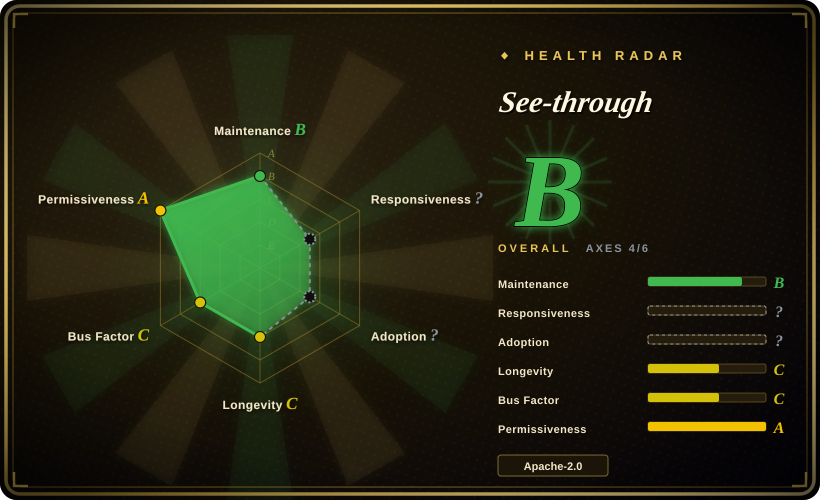
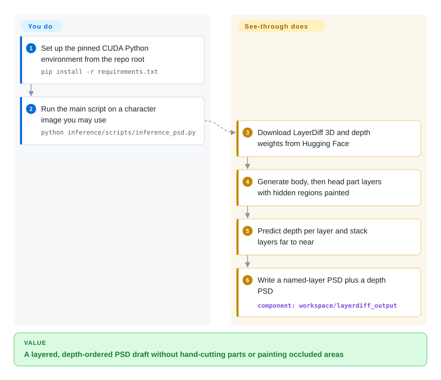
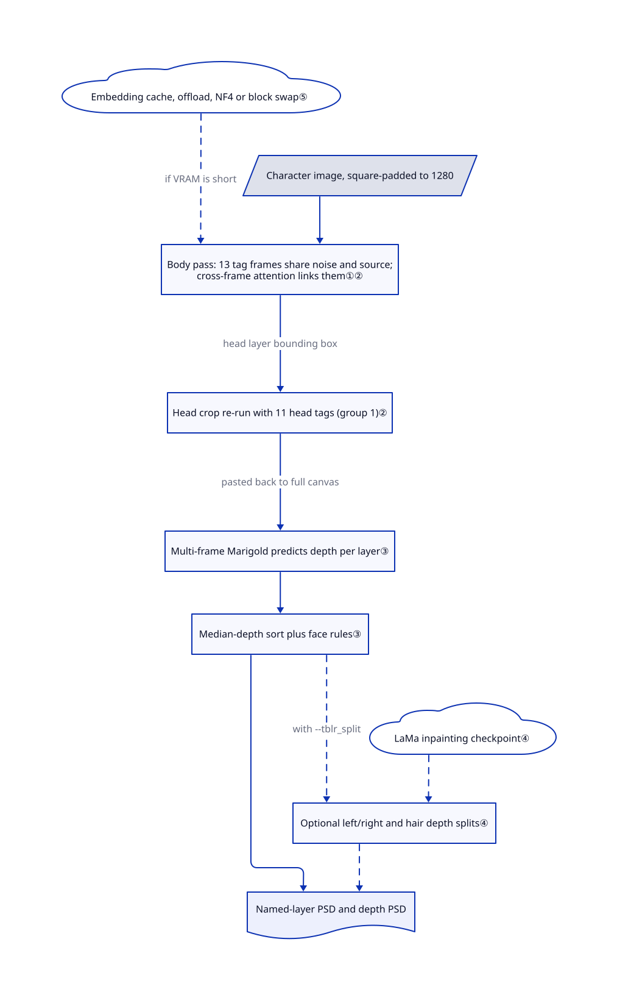

# See-through

You have one flat anime illustration, and turning it into a rig-ready PSD means hours of hand-cutting hair, eyes and clothing, then painting in the parts hidden behind other parts. See-through runs a diffusion model that generates up to 23 transparent body-part layers with their hidden regions already filled in, orders them by predicted depth, and writes a layered PSD.

## When to use

You prepare 2D characters for VTuber, Live2D-style or game puppet animation, and an artist hands you a single PNG of a girl with her hair falling over her shoulders. Cutting `front hair`, `back hair`, `face`, `irides`, `topwear` and `handwear` into separate layers is the easy half; the slow half is painting the shoulder that the hair covers, so that it does not show a hole once the hair swings. Reach for See-through when you want that whole first pass automated from one image on your own NVIDIA-class GPU: its main script outputs a PSD whose layers carry body-part names and inpainted occluded pixels, plus a companion depth PSD.

Pick it over a general layer decomposer such as Qwen-Image-Layered when the input is an anime character and you need *named* body-part layers in a convention downstream rigging tools already read; pick it over a segment-then-inpaint pipeline (SAM plus an inpainter) because it generates each part's hidden region jointly with the other parts instead of cutting masks and patching holes one at a time. You pay for this with a heavy CUDA stack, an output that still needs an artist's cleanup, and weights whose licence is not simply Apache-2.0.

## When NOT to use

- **You need an animatable Live2D model, not layers.** The README's own [Image-to-Live2D discussion](https://github.com/shitagaki-lab/see-through/blob/df019de5129d6c4b406587a14c3501669441a783/README.md#L239-L261) states that rigging, deformation meshes, physics and artist-designed splits are out of scope. Use it as the first step and rig in Live2D Cubism (closed) or an open tool such as StretchyStudio, which the README lists as consuming its PSDs.
- **Your images are photos, UI mock-ups, posters or non-anime art.** The layer tags and the depth model are trained on anime characters built from Live2D model parts. For general images, evaluate Qwen-Image-Layered, which decomposes arbitrary images into a chosen number of RGBA layers without fixed body-part semantics.
- **You only need the visible cut-outs, not hidden pixels.** If masks are enough (a background removal, a sticker), a segmenter such as SAM 2 or rembg is lighter and deterministic; See-through spends an SDXL-scale diffusion pass and still invents the hidden pixels it paints.
- **You cannot run CUDA.** The main pipeline moves every model to `'cuda'` in [`inference_utils.py`](https://github.com/shitagaki-lab/see-through/blob/df019de5129d6c4b406587a14c3501669441a783/common/utils/inference_utils.py#L65-L71); the Apple Silicon PR [#33](https://github.com/shitagaki-lab/see-through/pull/33) was closed unmerged with depth maps not reproduced by the maintainer. ROCm users get install notes only. Without a suitable GPU, use the authors' Hugging Face or ModelScope demos (hosted, rate-limited) instead of a local install.
- **You will ship it inside a commercial service and treat everything as Apache-2.0.** Code is Apache-2.0, but the maintainer [confirmed in issue #43](https://github.com/shitagaki-lab/see-through/issues/43) that the LayerDiff 3D and depth weights inherit Open RAIL licences from Animagine XL 4.0/LayerDiffuse and Marigold v1.1: a service must pass the use restrictions on to its users. If you need a weight stack without use-based restrictions, this one does not qualify.
- **You need an exact-size, aligned PSD with no post-processing.** The PSD canvas is the square padded inference canvas (`src_img.png`, 1280 by default), not the original image size, and an open bug ([#46](https://github.com/shitagaki-lab/see-through/issues/46)) reports width and height swapped in `save_psd` for non-square canvases. Plan a crop/scale step, or wait for the fix PR [#48](https://github.com/shitagaki-lab/see-through/pull/48).
- **You plan to redistribute the bundled annotation UI as Apache-2.0.** 32 of 41 `ui/ui/*.py` filenames also exist in the first author's GPL-3.0 BallonsTranslator, and four files are blob-identical to it; see Caveats. If you need the UI in a product, clear its licence first or rebuild it.

## Comparison

| Alternative | In index | Our verdict | Tradeoff |
|---|---|---|---|
| [Qwen-Image-Layered](https://github.com/QwenLM/Qwen-Image-Layered) | not indexed | Choose Qwen-Image-Layered for photos, posters and general art where you want N editable RGBA layers; choose See-through for anime characters that need named body-part layers and depth order for rigging. | Qwen is a single general diffusers pipeline from a large vendor (README says the prompt cannot control individual layers' semantics); See-through fixes the tag set, which helps puppet workflows and fails on anything else. Not added in this tab batch. |
| [LayerDiffuse](https://github.com/lllyasviel/LayerDiffuse) | not indexed | Choose LayerDiffuse to *generate* new transparent foreground/background layers from a prompt; choose See-through to *decompose* an existing character image. | See-through builds on its latent-transparency idea and a transparent VAE, but adds multi-layer joint generation and depth; LayerDiffuse has had no push since 2024-06. Not added in this tab batch. |
| [SAM 2](https://github.com/facebookresearch/sam2) + an inpainter | not indexed | Choose a segment-then-inpaint pipeline when you need fast, controllable masks on any image and can live with patched holes; choose See-through when occluded regions must look drawn rather than smeared. | Segmentation is predictable and cheap but leaves the hidden area to a separate inpainting step per layer; See-through paints all layers in one joint pass but you cannot steer individual masks. Not added in this tab batch. |
| [ComfyUI](../../on-device-ml/local-image-generation/comfyui.md) + ComfyUI-See-through | ✅ (ComfyUI) | Choose the ComfyUI node route when you already run ComfyUI and want See-through as one node in a larger graph; choose this repo directly for scripted batch runs, training code and the low-VRAM variants. | The third-party node wraps the same models with in-browser PSD export; you inherit its maintainer's update lag and NaN-sorting fixes (issue #25 was found there). The node repo itself is not indexed. |
| Manual cut in Photoshop / Clip Studio | not a repo | Choose manual cutting when the layer split must follow a rigger's deformation plan exactly; use See-through to remove the tedious first pass. | Manual work gives full artistic control at hours per character; See-through gives a minutes-per-image draft that an artist still corrects. Closed commercial tools. |

## Quick start

Follow the [README setup](https://github.com/shitagaki-lab/see-through/blob/df019de5129d6c4b406587a14c3501669441a783/README.md#L44-L76): create a Python 3.12 conda environment, install the pinned CUDA 12.8 PyTorch wheels, run `pip install -r requirements.txt` (it installs the bundled `common` and `annotators` packages in editable mode), and create the `assets` symlink, always working from the repository root. Then run `python inference/scripts/inference_psd.py --srcp <image or folder> --save_to_psd`. On first run it downloads the LayerDiff 3D and depth weights from Hugging Face — the model-hosting site — generates the body and head layers, predicts a depth value per layer, and writes `<name>.psd` and `<name>_depth.psd` under `workspace/layerdiff_output/`. You supply a GPU (the README reports about 12–16 GB at 1280 px; `--group_offload`, `inference_psd_quantized.py` and `inference_psd_blockswap.py` trade speed for ~8–10 GB), the rights to the input art, and the artist's cleanup and rigging afterwards; it does not rig, animate or guarantee clean edges. Nothing was installed or run for this page.

<!-- flow-steps:begin (generated from flows/see-through.json by tools/flow_card.py — do not edit) -->

Text version of the flow

1. **You**: Set up the pinned CUDA Python environment from the repo root — `pip install -r requirements.txt`
2. **You**: Run the main script on a character image you may use — `python inference/scripts/inference_psd.py`
3. **See-through**: Download LayerDiff 3D and depth weights from Hugging Face
4. **See-through**: Generate body, then head part layers with hidden regions painted
5. **See-through**: Predict depth per layer and stack layers far to near
6. **See-through**: Write a named-layer PSD plus a depth PSD — component: `workspace/layerdiff_output`

**Value**: A layered, depth-ordered PSD draft without hand-cutting parts or painting occluded areas

<!-- flow-steps:end -->

## Key techniques

<!-- mechanism:begin (generated from mechanisms/see-through.json by tools/mechanism_card.py; do not edit) -->

Text version of the mechanism

- Character image, square-padded to 1280
- Body pass: 13 tag frames share noise and source; cross-frame attention links them①②
- Head crop re-run with 11 head tags (group 1)②
- Multi-frame Marigold predicts depth per layer③
- Median-depth sort plus face rules③
- Optional left/right and hair depth splits④
- LaMa inpainting checkpoint④
- Embedding cache, offload, NF4 or block swap⑤
- Named-layer PSD and depth PSD

- Character image, square-padded to 1280 → Body pass: 13 tag frames share noise and source; cross-frame attention links them①②
- Body pass: 13 tag frames share noise and source; cross-frame attention links them①② → Head crop re-run with 11 head tags (group 1)② (head layer bounding box)
- Head crop re-run with 11 head tags (group 1)② → Multi-frame Marigold predicts depth per layer③ (pasted back to full canvas)
- Embedding cache, offload, NF4 or block swap⑤ → Body pass: 13 tag frames share noise and source; cross-frame attention links them①② (if VRAM is short) [optional/fallback]
- Multi-frame Marigold predicts depth per layer③ → Median-depth sort plus face rules③
- Median-depth sort plus face rules③ → Optional left/right and hair depth splits④ (with --tblr_split) [optional/fallback]
- LaMa inpainting checkpoint④ → Optional left/right and hair depth splits④ [optional/fallback]
- Median-depth sort plus face rules③ → Named-layer PSD and depth PSD
- Optional left/right and hair depth splits④ → Named-layer PSD and depth PSD [optional/fallback]

<!-- mechanism:end -->

### 1. Generate all part layers as frames of one sample

- **Problem:** Generating each body part independently lets two parts both claim the same pixels, or leaves neither painting the region one of them hides.
- **How:** The SDXL-based UNet treats each tag prompt (`front hair`, `topwear`, …) as one "frame"; every frame starts from the same noise and the same encoded source image, and inserted cross-frame transformer blocks attend across frames at each spatial position. The 2D model is converted to this 3D form by zero-initialising the new blocks' output, so training starts from the 2D model's behaviour.
- **Limits:** The tag set is fixed by training (13 body plus 11 head tags in V3); there is no per-layer mask control, and hidden pixels are generated, not recovered.
- **Source:** [cross-frame block:95–150](https://github.com/shitagaki-lab/see-through/blob/df019de5129d6c4b406587a14c3501669441a783/common/modules/layerdiffuse/transformer3d.py#L95-L150), [residual mixing:410–432](https://github.com/shitagaki-lab/see-through/blob/df019de5129d6c4b406587a14c3501669441a783/common/modules/layerdiffuse/transformer3d.py#L410-L432), [shared condition and noise:352–391](https://github.com/shitagaki-lab/see-through/blob/df019de5129d6c4b406587a14c3501669441a783/common/modules/layerdiffuse/diffusers_kdiffusion_sdxl.py#L352-L391), [zero init:996–1004](https://github.com/shitagaki-lab/see-through/blob/df019de5129d6c4b406587a14c3501669441a783/common/modules/layerdiffuse/layerdiff3d.py#L996-L1004).

### 2. Re-run the head at full resolution

- **Problem:** Eyes, eyelashes and mouths are a few dozen pixels in a full-body image, too small to separate cleanly in one pass.
- **How:** The first pass generates body tags including a `head` layer; the code takes that layer's alpha bounding box, pads and crops the original image to it, and runs a second pass with eleven head tags. A learned group embedding (index 0 body, 1 head) is added to the text conditioning, and the head results are pasted back into the full canvas.
- **Limits:** Two sequential diffusion passes make it slower than the paper's single-pass description, as the README notes; a wrong head layer in pass one misplaces the whole second pass.
- **Source:** [two-pass logic:104–180](https://github.com/shitagaki-lab/see-through/blob/df019de5129d6c4b406587a14c3501669441a783/common/utils/inference_utils.py#L104-L180), [group embedding:533–545](https://github.com/shitagaki-lab/see-through/blob/df019de5129d6c4b406587a14c3501669441a783/common/modules/layerdiffuse/layerdiff3d.py#L533-L545), [applied to conditioning:1626–1628](https://github.com/shitagaki-lab/see-through/blob/df019de5129d6c4b406587a14c3501669441a783/common/modules/layerdiffuse/layerdiff3d.py#L1626-L1628).

### 3. Order layers by predicted depth, then patch with rules

- **Problem:** A PSD needs a stacking order, and a single image does not say whether a hand is in front of or behind the skirt.
- **How:** A Marigold depth model, converted to the same multi-frame form, predicts a depth map for every generated layer at once; each part's median depth becomes its sort key, and `dump_parts_psd` stacks layers far-to-near into the colour PSD and a matching greyscale depth PSD. Hard-coded rules then force nose, mouth and eyes in front of the face and ears behind it.
- **Limits:** One median per layer cannot express a part that is both in front and behind (issue #40: generated skirt pixels cover legwear); an empty part yields a NaN median that breaks sorting (issue #25, fix PR #44 still open).
- **Source:** [per-layer depth:188–324](https://github.com/shitagaki-lab/see-through/blob/df019de5129d6c4b406587a14c3501669441a783/common/utils/inference_utils.py#L188-L324), [face rules:527–535](https://github.com/shitagaki-lab/see-through/blob/df019de5129d6c4b406587a14c3501669441a783/common/utils/inference_utils.py#L527-L535), [sort and save:548–562](https://github.com/shitagaki-lab/see-through/blob/df019de5129d6c4b406587a14c3501669441a783/common/utils/inference_utils.py#L548-L562), [PSD writer:498–519](https://github.com/shitagaki-lab/see-through/blob/df019de5129d6c4b406587a14c3501669441a783/common/utils/io_utils.py#L498-L519).

### 4. Split left/right and front/back parts with classic vision

- **Problem:** A rigger needs the left and right eye, hand or ear as separate layers, but the model emits one `handwear` layer.
- **How:** With `--tblr_split`, connected-component analysis separates the two largest blobs by horizontal centre; a hair layer can be split into two depth clusters with KMeans and the gap filled by a LaMa inpainting model. `heuristic_partseg.py` re-applies depth or left/right splits to an existing PSD.
- **Limits:** These are heuristics, not learned splits: issue #19 reports `seg_wlr` failing on handwear, and LaMa downloads a separate checkpoint by URL.
- **Source:** [eye and L/R split:436–500](https://github.com/shitagaki-lab/see-through/blob/df019de5129d6c4b406587a14c3501669441a783/common/utils/inference_utils.py#L436-L500), [depth clustering with LaMa:56–159](https://github.com/shitagaki-lab/see-through/blob/df019de5129d6c4b406587a14c3501669441a783/common/utils/torchcv.py#L56-L159), [PSD post-split CLI:1–37](https://github.com/shitagaki-lab/see-through/blob/df019de5129d6c4b406587a14c3501669441a783/inference/scripts/heuristic_partseg.py#L1-L37).

### 5. Fit an SDXL-scale pipeline into 8–12 GB

- **Problem:** Two diffusion models plus two text encoders exceed a consumer GPU at 1280 px.
- **How:** Tag text embeddings are computed once, cached, and both text encoders are deleted from the GPU. Optional diffusers group offload keeps one block on the GPU; the quantized script switches to pre-quantized NF4 (4-bit) weight repos; the block-swap script registers forward hooks that move each UNet block to the GPU just before it runs and back to the CPU after.
- **Limits:** Offload is about 1.5× slower per the README; the NF4 quality figures (PSNR ~30 dB, SSIM ~0.96 vs bf16) and VRAM numbers are author-reported; block swap still needs CUDA.
- **Source:** [embedding cache:242–274](https://github.com/shitagaki-lab/see-through/blob/df019de5129d6c4b406587a14c3501669441a783/common/modules/layerdiffuse/diffusers_kdiffusion_sdxl.py#L242-L274), [NF4 repo map:366–376](https://github.com/shitagaki-lab/see-through/blob/df019de5129d6c4b406587a14c3501669441a783/inference/scripts/inference_psd_quantized.py#L366-L376), [block-swap hooks:73–158](https://github.com/shitagaki-lab/see-through/blob/df019de5129d6c4b406587a14c3501669441a783/inference/scripts/inference_psd_blockswap.py#L73-L158), [README low-VRAM notes:159–200](https://github.com/shitagaki-lab/see-through/blob/df019de5129d6c4b406587a14c3501669441a783/README.md#L159-L200).

## Tech stack

- Python 3.12, PyTorch 2.8 (CUDA 12.8 wheels), diffusers 0.37, transformers 5.0, accelerate, safetensors, psd-tools 1.14; pinned in [`requirements.txt`](https://github.com/shitagaki-lab/see-through/blob/df019de5129d6c4b406587a14c3501669441a783/requirements.txt).
- Models: an SDXL-architecture LayerDiff 3D UNet with a transparent VAE (fine-tuned from Animagine XL 4.0), a multi-frame Marigold v1.1 depth model, and a SAM-HQ body-parsing model; bundled copies of SAM, Depth Anything V2 and Marigold code.
- Optional tiers: detectron2, SAM 2 and mmcv/mmdet annotators; bitsandbytes for NF4; DeepSpeed for training; PyQt6 for the annotation UI.

## Dependencies

- **Hardware:** an NVIDIA (or ROCm) GPU. The README reports ~12–16 GB VRAM for the default bf16 path at 1280 px and ~8 GB for the NF4 or block-swap paths; training used 8× H200.
- **Weights from Hugging Face:** `layerdifforg/seethroughv0.0.2_layerdiff3d` (Open RAIL++), `layerdifforg/seethroughv0.0.1_marigold` (Open RAIL++; the code's `24yearsold/…` default redirects there), NF4 variants under `24yearsold/`, and `24yearsold/l2d_sam_iter2` (Apache-2.0), per the model-card licence fields read 2026-11-01. The hair-split path also fetches a LaMa checkpoint from `dreMaz/AnimeMangaInpainting`.
- **Several git-pinned dependencies** (`timm`, `convnext_perceptual_loss`, and for the optional tiers detectron2 and SAM 2) need network access and, for detectron2, a C++ compiler; their install order matters because of an iopath version conflict noted in the requirement files.
- **Training data:** not shipped; the separate CubismPartExtr repo extracts layers from Live2D `.moc3` models you must source yourself.

## Ops difficulty

**Medium-high for inference, high for training.** Inference is a script, not a service: you maintain a pinned CUDA/PyTorch environment, about 13.4 GB of default-path model repos in the Hugging Face cache (10.16 GB LayerDiff 3D plus 3.28 GB depth, per the Hub file listing on 2026-11-01), and the rule that scripts run from the repository root with the `assets` symlink. Offline runs were broken until PR #42 (2026-09-24) made the scheduler load from the checkpoint instead of an unrelated Hub repo. Outputs accumulate under `workspace/layerdiff_output/<name>/` (per-tag PNGs, depth maps, `info.json`) beside each PSD; nothing cleans them up. Training needs multi-GPU DeepSpeed, licensed Live2D source models and the data pipeline; the annotation UI expects a prepared `workspace/datasets/` tree.

## Health & viability

- **Maintenance, as of 2026-11-01:** last main commit 2026-10-05 (merge of PR #45); about monthly activity since the April releases of NF4 inference and training code. No GitHub releases or tags; model versions are carried in the Hugging Face repo names (`v0.0.1`, `v0.0.2`).
- **Governance and bus factor:** an organization repo, but the contributor list shows six people, with `ljsabc` (corresponding author) at 31 commits and `dmMaze` (first author) at 7. External PRs are reviewed slowly and selectively — MPS support (#33) and a Windows fix (#32) were closed unmerged, the NaN-sort fix (#44) waits for a real reproduction image.
- **Backing:** a SIGGRAPH 2026 paper from Saint Francis University (Hong Kong) with Spellbrush, UPenn and Shitagaki Lab authors, funded by a Hong Kong RGC grant per the README. Academic code tends to slow after publication [推断: general pattern for paper repos, not observed here yet].
- **Age and Lindy:** created 2026-03-31, seven months old. Young and still active; no Lindy credit.
- **Adoption:** 5,279 stars and 463 forks (2026-11-01); README lists five third-party integrations (ComfyUI node, PachiPakuGen, StretchyStudio, Anime2.5DRig, PNGAL); Hugging Face reports ~29.7k downloads for the LayerDiff 3D repo.
- **Risk flags:** Open RAIL use restrictions on two of three weight sets; the UI subtree's GPL-3.0 lineage; hard-coded CUDA.

## Caveats (unverified)

- [未验证: no install, download or GPU run was authorized] VRAM figures (12–16 GB, ~10 GB, ~8 GB), the ~1.5× offload slowdown, NF4 PSNR/SSIM and 2–3 min per image on the hosted demo are author statements from the README, not reproduced.
- [未验证: legal analysis out of scope] Whether the `ui/ui` code, which shares 32 of 41 filenames with GPL-3.0 BallonsTranslator and has four blob-identical files, was relicensed by all its copyright holders. The first author is BallonsTranslator's main committer, but other contributors exist there; no GPL notice is present in the reviewed `ui/` files that were read.
- [未验证: model cards read via the Hugging Face API without pinned revisions] Weight licence fields (openrail++ / apache-2.0) and the maintainer's licence summary in issue #43 were read 2026-11-01; they are not a legal clearance for commercial use or for rights in the training data.
- [推断: based on reading `load_parts` and `center_square_pad_resize`, not on a run] The PSD canvas is the square padded inference canvas, so outputs need cropping back to the source aspect ratio; issue #46's width/height swap would only bite when a non-square canvas reaches `save_psd`.
- [未验证: quality not measured] How well the decomposition holds up on non-standard poses, side views, heavy effects or non-anime styles; issues #39, #40 and #25 show face detail, overlap and ordering failures.
- [推断: paper repos commonly slow after publication] Future maintenance beyond the current monthly cadence is not evidenced either way.
