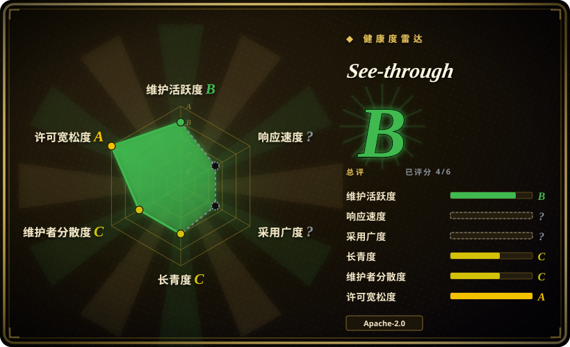
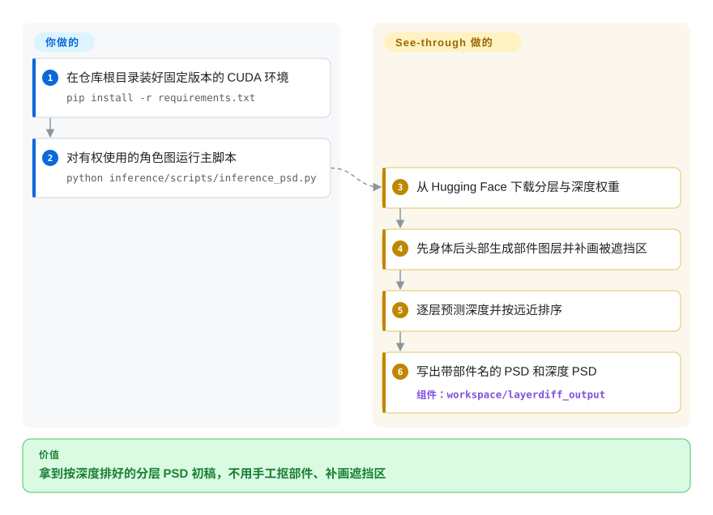
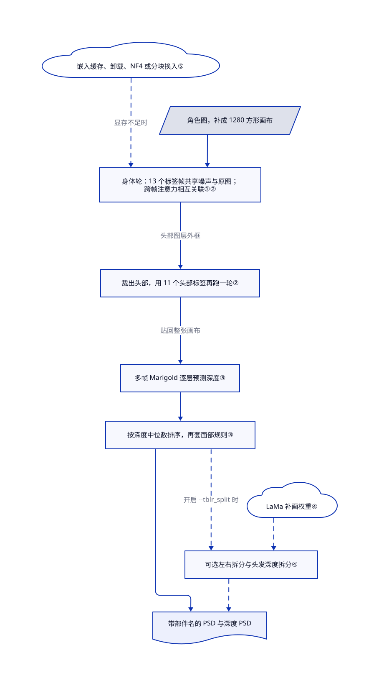

# See-through

手里只有一张平面二次元立绘，想做成能绑骨的 PSD，就得手工抠头发、眼睛、衣服，还要把被别的部件挡住的地方一块块补画出来，一张图耗掉几个小时。See-through 用扩散模型一次生成最多 23 个透明的身体部件图层，被遮挡的部分已经补好，再按预测深度排出上下顺序，直接写成分层 PSD。

## 何时使用

你在给 VTuber、类 Live2D 或游戏立绘动画准备素材，画师交来一张 PNG：角色的长发搭在肩上。把 `front hair`、`back hair`、`face`、`irides`、`topwear`、`handwear` 拆成单独图层只是容易的一半；慢的是把被头发盖住的肩膀补画出来，否则头发一摆动，底下就露出一个洞。想在自己的 NVIDIA 类显卡上把这整个第一遍自动做完，就找 See-through：主脚本输出一个 PSD，每层带部件名、被遮挡像素已补全，另附一份深度 PSD。

输入是二次元角色、而且你要下游绑骨工具认得的“带名字的部件层”时，选它而不是 Qwen-Image-Layered 这类通用分层模型；它也优于“先分割再补洞”的流程（SAM 加一个补画模型），因为它把每个部件被挡住的区域和其他部件放在一起联合生成，而不是先切蒙版、再逐层打补丁。代价是：一套很重的 CUDA 环境，产出仍需画师修整，权重的许可也不只是 Apache-2.0。

## 何时不用

- **你要的是能动的 Live2D 模型，而不只是图层。** README 自己的 [Image-to-Live2D 讨论](https://github.com/shitagaki-lab/see-through/blob/df019de5129d6c4b406587a14c3501669441a783/README.md#L239-L261)写明：绑骨、变形网格、物理参数和画师按变形需求设计的拆分都不在范围内。把它当第一步，绑骨交给 Live2D Cubism（闭源）或 README 列出、能直接吃它 PSD 的开源工具 StretchyStudio。
- **你的图是照片、界面稿、海报或非二次元画风。** 图层标签和深度模型都是用 Live2D 模型部件拼出的二次元角色训练的。通用图片请评估 Qwen-Image-Layered，它能把任意图拆成指定数量的 RGBA 图层，不绑定固定的身体部件语义。
- **你只要看得见的抠图，不要被挡住的像素。** 只要蒙版（去背景、做贴纸）时，SAM 2 或 rembg 这类分割工具更轻、结果可预期；See-through 要跑一遍 SDXL 规模的扩散，被挡住的像素还是模型编出来的。
- **你跑不了 CUDA。** 主流程在 [`inference_utils.py`](https://github.com/shitagaki-lab/see-through/blob/df019de5129d6c4b406587a14c3501669441a783/common/utils/inference_utils.py#L65-L71) 里把所有模型都放到 `'cuda'`；Apple Silicon 的 PR [#33](https://github.com/shitagaki-lab/see-through/pull/33) 因维护者复现不出正确深度图而未合并关闭，ROCm 只有安装说明。没有合适显卡时，用作者在 Hugging Face 或魔搭上的在线演示（托管、限次），别在本地硬装。
- **你要把它放进商业服务，还把一切当 Apache-2.0。** 代码是 Apache-2.0，但维护者在 [issue #43](https://github.com/shitagaki-lab/see-through/issues/43) 确认：LayerDiff 3D 和深度两套权重分别从 Animagine XL 4.0／LayerDiffuse 与 Marigold v1.1 继承 Open RAIL 许可，做成服务时必须把使用限制条款转给你的用户。你需要不带用途限制的权重栈，这套不满足。
- **你要和原图尺寸一致、对得齐、不用后处理的 PSD。** PSD 画布是推理用的方形补边画布（`src_img.png`，默认 1280），不是原图尺寸；另有未关闭的 [#46](https://github.com/shitagaki-lab/see-through/issues/46) 报告 `save_psd` 对非方形画布把宽高写反。要么安排一步裁切缩放，要么等修复 PR [#48](https://github.com/shitagaki-lab/see-through/pull/48)。
- **你打算把附带的标注界面当 Apache-2.0 再分发。** `ui/ui/*.py` 的 41 个文件里有 32 个文件名也出现在第一作者的 GPL-3.0 项目 BallonsTranslator 中，其中 4 个文件 blob 完全相同，详见存疑。产品里要用这个界面，先把许可理清或自己重写。

## 横向对比

| 替代品 | 是否收录 | 我们的评价 | 取舍 |
|---|---|---|---|
| [Qwen-Image-Layered](https://github.com/QwenLM/Qwen-Image-Layered) | 未收录 | 照片、海报、通用插画要拆成 N 个可编辑 RGBA 图层，选 Qwen-Image-Layered；二次元角色要带名字的部件层和深度顺序去绑骨，选 See-through。 | Qwen 是大厂出的单一通用 diffusers 流程（README 说提示词不能控制单个图层的语义）；See-through 固定了标签集，对立绘动画有利，换别的图就失灵。本批标签收录未添加。 |
| [LayerDiffuse](https://github.com/lllyasviel/LayerDiffuse) | 未收录 | 要按提示词“生成”新的透明前景／背景层，选 LayerDiffuse；要把已有角色图“拆开”，选 See-through。 | See-through 沿用了它的潜空间透明思路和透明 VAE，又加了多层联合生成与深度；LayerDiffuse 自 2024-06 起没有推送。本批标签收录未添加。 |
| [SAM 2](https://github.com/facebookresearch/sam2) 加补画模型 | 未收录 | 要对任意图快速出可控蒙版、能接受补丁式补洞，选“先分割再补画”；被挡区域要像画出来而不是糊出来，选 See-through。 | 分割结果可预期、成本低，但被挡区域要每层另跑一次补画；See-through 一次联合画完所有层，代价是没法单独调某个蒙版。本批标签收录未添加。 |
| [ComfyUI](../../on-device-ml/local-image-generation/comfyui.zh.md) 加 ComfyUI-See-through | ✅（ComfyUI） | 已经在用 ComfyUI、想把 See-through 当大图里的一个节点，走节点路线；要脚本批处理、训练代码和低显存变体，直接用本仓库。 | 第三方节点包了同一批模型，还能在浏览器里导出 PSD；但你要承受节点维护者的跟进延迟，深度排序的 NaN 问题（issue #25）就是在那边发现的。节点仓库本身未收录。 |
| Photoshop／Clip Studio 手工拆分 | 非仓库 | 图层拆法必须完全贴合绑骨师的变形方案时，手工拆；想省掉繁琐的第一遍，用 See-through。 | 手工拆完全可控，但每个角色要几个小时；See-through 几分钟出一版初稿，画师仍要修。二者是闭源商业软件。 |

## 快速上手

按 [README 安装说明](https://github.com/shitagaki-lab/see-through/blob/df019de5129d6c4b406587a14c3501669441a783/README.md#L44-L76)：建一个 Python 3.12 的 conda 环境，装固定版本的 CUDA 12.8 PyTorch，运行 `pip install -r requirements.txt`（它会以可编辑方式装上仓库里的 `common` 和 `annotators` 两个包），再建好 `assets` 软链接；所有命令都要在仓库根目录下执行。然后运行 `python inference/scripts/inference_psd.py --srcp <图片或文件夹> --save_to_psd`。首次运行时它会从 Hugging Face（模型托管网站）下载 LayerDiff 3D 和深度权重，先后生成身体和头部图层，为每层预测一个深度值，在 `workspace/layerdiff_output/` 下写出 `<name>.psd` 和 `<name>_depth.psd`。你要负责的是：显卡（README 称 1280 像素约需 12–16 GB；`--group_offload`、`inference_psd_quantized.py`、`inference_psd_blockswap.py` 用更慢的速度换到约 8–10 GB）、输入图的使用权，以及之后画师的修整和绑骨；它不绑骨、不做动画，也不保证边缘干净。本页没有安装或运行任何东西。

<!-- flow-steps:begin (generated from flows/see-through.json by tools/flow_card.py — do not edit) -->

流程文字版

1. **你**：在仓库根目录装好固定版本的 CUDA 环境 — `pip install -r requirements.txt`
2. **你**：对有权使用的角色图运行主脚本 — `python inference/scripts/inference_psd.py`
3. **See-through**：从 Hugging Face 下载分层与深度权重
4. **See-through**：先身体后头部生成部件图层并补画被遮挡区
5. **See-through**：逐层预测深度并按远近排序
6. **See-through**：写出带部件名的 PSD 和深度 PSD — 组件：`workspace/layerdiff_output`

**价值**：拿到按深度排好的分层 PSD 初稿，不用手工抠部件、补画遮挡区

<!-- flow-steps:end -->

## 技术要点

<!-- mechanism:begin (generated from mechanisms/see-through.json by tools/mechanism_card.py; do not edit) -->

机制文字版

- 角色图，补成 1280 方形画布
- 身体轮：13 个标签帧共享噪声与原图； 跨帧注意力相互关联①②
- 裁出头部，用 11 个头部标签再跑一轮②
- 多帧 Marigold 逐层预测深度③
- 按深度中位数排序，再套面部规则③
- 可选左右拆分与头发深度拆分④
- LaMa 补画权重④
- 嵌入缓存、卸载、NF4 或分块换入⑤
- 带部件名的 PSD 与深度 PSD

- 角色图，补成 1280 方形画布 → 身体轮：13 个标签帧共享噪声与原图； 跨帧注意力相互关联①②
- 身体轮：13 个标签帧共享噪声与原图； 跨帧注意力相互关联①② → 裁出头部，用 11 个头部标签再跑一轮②（头部图层外框）
- 裁出头部，用 11 个头部标签再跑一轮② → 多帧 Marigold 逐层预测深度③（贴回整张画布）
- 嵌入缓存、卸载、NF4 或分块换入⑤ → 身体轮：13 个标签帧共享噪声与原图； 跨帧注意力相互关联①②（显存不足时）〔可选／兜底〕
- 多帧 Marigold 逐层预测深度③ → 按深度中位数排序，再套面部规则③
- 按深度中位数排序，再套面部规则③ → 可选左右拆分与头发深度拆分④（开启 --tblr_split 时）〔可选／兜底〕
- LaMa 补画权重④ → 可选左右拆分与头发深度拆分④〔可选／兜底〕
- 按深度中位数排序，再套面部规则③ → 带部件名的 PSD 与深度 PSD
- 可选左右拆分与头发深度拆分④ → 带部件名的 PSD 与深度 PSD〔可选／兜底〕

<!-- mechanism:end -->

### 1. 把所有部件层当成同一样本的多帧来生成

- **解决：** 各部件独立生成时，两个部件可能抢同一片像素，或者谁都没去补被挡住的那块。
- **做法：** 基于 SDXL 的 UNet 把每个标签提示词（`front hair`、`topwear` 等）当成一“帧”；所有帧从同一份噪声、同一张编码后的原图出发，插入的跨帧 Transformer 块在每个像素位置上跨帧做注意力。2D 模型转成这种 3D 形式时，新块的输出层初始化为零，所以训练从 2D 模型原有的行为起步。
- **边界：** 标签集由训练固定（V3 是 13 个身体标签加 11 个头部标签），不能逐层控制蒙版；被挡住的像素是生成的，不是还原的。
- **源码：** [跨帧块第 95–150 行](https://github.com/shitagaki-lab/see-through/blob/df019de5129d6c4b406587a14c3501669441a783/common/modules/layerdiffuse/transformer3d.py#L95-L150)、[残差混合第 410–432 行](https://github.com/shitagaki-lab/see-through/blob/df019de5129d6c4b406587a14c3501669441a783/common/modules/layerdiffuse/transformer3d.py#L410-L432)、[共享条件与噪声第 352–391 行](https://github.com/shitagaki-lab/see-through/blob/df019de5129d6c4b406587a14c3501669441a783/common/modules/layerdiffuse/diffusers_kdiffusion_sdxl.py#L352-L391)、[零初始化第 996–1004 行](https://github.com/shitagaki-lab/see-through/blob/df019de5129d6c4b406587a14c3501669441a783/common/modules/layerdiffuse/layerdiff3d.py#L996-L1004)。

### 2. 头部单独放大再跑一轮

- **解决：** 全身图里眼睛、睫毛、嘴只有几十个像素，一轮里很难拆干净。
- **做法：** 第一轮生成包含 `head` 层在内的身体标签；代码取这一层透明度的外接框，在原图上扩边裁出头部，用 11 个头部标签跑第二轮。一个可学习的分组嵌入（0 表示身体，1 表示头部）叠加到文本条件上，头部结果再贴回整张画布。
- **边界：** 两轮扩散串行，比论文描述的单轮更慢，README 也这样说明；第一轮的头部层错了，第二轮整体就会错位。
- **源码：** [两轮逻辑第 104–180 行](https://github.com/shitagaki-lab/see-through/blob/df019de5129d6c4b406587a14c3501669441a783/common/utils/inference_utils.py#L104-L180)、[分组嵌入第 533–545 行](https://github.com/shitagaki-lab/see-through/blob/df019de5129d6c4b406587a14c3501669441a783/common/modules/layerdiffuse/layerdiff3d.py#L533-L545)、[叠加到条件第 1626–1628 行](https://github.com/shitagaki-lab/see-through/blob/df019de5129d6c4b406587a14c3501669441a783/common/modules/layerdiffuse/layerdiff3d.py#L1626-L1628)。

### 3. 按预测深度排图层，再用规则修补

- **解决：** PSD 需要上下顺序，可单张图看不出手在裙子前面还是后面。
- **做法：** 同样改成多帧形式的 Marigold 深度模型一次为所有生成层预测深度图；每个部件取深度中位数作为排序键，`dump_parts_psd` 从远到近叠成彩色 PSD 和对应的灰度深度 PSD。之后写死的规则强制鼻子、嘴、眼睛在脸前，耳朵在脸后。
- **边界：** 每层一个中位数，表达不了“一部分在前、一部分在后”的部件（issue #40：生成出的裙子像素盖住了腿）；空部件的中位数是 NaN，会打乱排序（issue #25，修复 PR #44 尚未合并）。
- **源码：** [逐层深度第 188–324 行](https://github.com/shitagaki-lab/see-through/blob/df019de5129d6c4b406587a14c3501669441a783/common/utils/inference_utils.py#L188-L324)、[面部规则第 527–535 行](https://github.com/shitagaki-lab/see-through/blob/df019de5129d6c4b406587a14c3501669441a783/common/utils/inference_utils.py#L527-L535)、[排序与保存第 548–562 行](https://github.com/shitagaki-lab/see-through/blob/df019de5129d6c4b406587a14c3501669441a783/common/utils/inference_utils.py#L548-L562)、[PSD 写入第 498–519 行](https://github.com/shitagaki-lab/see-through/blob/df019de5129d6c4b406587a14c3501669441a783/common/utils/io_utils.py#L498-L519)。

### 4. 用传统视觉方法拆左右、拆前后

- **解决：** 绑骨师要左右眼、左右手、左右耳各自成层，模型却只给一个 `handwear` 层。
- **做法：** 开启 `--tblr_split` 后，连通域分析按水平中心把最大的两块分开；头发层可以用 KMeans 按深度分成两簇，缺口交给 LaMa 补画模型填。`heuristic_partseg.py` 能对已有 PSD 再做一次深度或左右拆分。
- **边界：** 这些是启发式规则，不是学出来的拆分：issue #19 报告 `seg_wlr` 拆不开手部；LaMa 还要按网址另下一个权重文件。
- **源码：** [眼睛与左右拆分第 436–500 行](https://github.com/shitagaki-lab/see-through/blob/df019de5129d6c4b406587a14c3501669441a783/common/utils/inference_utils.py#L436-L500)、[深度聚类加 LaMa 第 56–159 行](https://github.com/shitagaki-lab/see-through/blob/df019de5129d6c4b406587a14c3501669441a783/common/utils/torchcv.py#L56-L159)、[PSD 后处理命令第 1–37 行](https://github.com/shitagaki-lab/see-through/blob/df019de5129d6c4b406587a14c3501669441a783/inference/scripts/heuristic_partseg.py#L1-L37)。

### 5. 把 SDXL 规模的流程塞进 8–12 GB 显存

- **解决：** 两个扩散模型加两个文本编码器，在 1280 像素下超出消费级显卡的显存。
- **做法：** 标签的文本嵌入只算一次并缓存，随后把两个文本编码器从显卡上删掉。可选的 diffusers 分组卸载让显卡上只留一个块；量化脚本改用预先量化好的 NF4（4 位）权重仓库；分块换入脚本注册前向钩子，每个 UNet 块运行前才搬上显卡，跑完搬回内存。
- **边界：** README 称卸载会慢约 1.5 倍；NF4 的质量数字（相对 bf16 PSNR 约 30 dB、SSIM 约 0.96）和显存数字都是作者自报；分块换入仍然需要 CUDA。
- **源码：** [嵌入缓存第 242–274 行](https://github.com/shitagaki-lab/see-through/blob/df019de5129d6c4b406587a14c3501669441a783/common/modules/layerdiffuse/diffusers_kdiffusion_sdxl.py#L242-L274)、[NF4 仓库映射第 366–376 行](https://github.com/shitagaki-lab/see-through/blob/df019de5129d6c4b406587a14c3501669441a783/inference/scripts/inference_psd_quantized.py#L366-L376)、[分块换入钩子第 73–158 行](https://github.com/shitagaki-lab/see-through/blob/df019de5129d6c4b406587a14c3501669441a783/inference/scripts/inference_psd_blockswap.py#L73-L158)、[README 低显存说明第 159–200 行](https://github.com/shitagaki-lab/see-through/blob/df019de5129d6c4b406587a14c3501669441a783/README.md#L159-L200)。

## 技术栈

- Python 3.12、PyTorch 2.8（CUDA 12.8 版）、diffusers 0.37、transformers 5.0、accelerate、safetensors、psd-tools 1.14；版本固定在 [`requirements.txt`](https://github.com/shitagaki-lab/see-through/blob/df019de5129d6c4b406587a14c3501669441a783/requirements.txt)。
- 模型：SDXL 架构的 LayerDiff 3D UNet 加透明 VAE（从 Animagine XL 4.0 微调）、多帧 Marigold v1.1 深度模型、SAM-HQ 身体解析模型；仓库内附带 SAM、Depth Anything V2 和 Marigold 的代码副本。
- 可选层：detectron2、SAM 2 和 mmcv／mmdet 标注器；NF4 用 bitsandbytes；训练用 DeepSpeed；标注界面用 PyQt6。

## 依赖

- **硬件：** NVIDIA（或 ROCm）显卡。README 称默认 bf16 路径在 1280 像素约需 12–16 GB 显存，NF4 或分块换入路径约 8 GB；训练用的是 8 张 H200。
- **来自 Hugging Face 的权重：** `layerdifforg/seethroughv0.0.2_layerdiff3d`（Open RAIL++）、`layerdifforg/seethroughv0.0.1_marigold`（Open RAIL++；代码默认的 `24yearsold/…` 会重定向到这里）、`24yearsold/` 下的 NF4 版本，以及 `24yearsold/l2d_sam_iter2`（Apache-2.0），许可字段于 2026-11-01 从模型卡读取。头发拆分路径还会从 `dreMaz/AnimeMangaInpainting` 下载 LaMa 权重。
- **若干按 git 提交固定的依赖**（`timm`、`convnext_perceptual_loss`，可选层里的 detectron2 和 SAM 2）安装时要联网，detectron2 还要 C++ 编译器；依赖文件注明 iopath 版本冲突，安装顺序不能乱。
- **训练数据：** 不随仓库提供；另一个仓库 CubismPartExtr 负责从 Live2D `.moc3` 模型里提取图层，模型要你自己找来源。

## 运维难度

**推理中偏高，训练高。** 推理是脚本，不是服务：你要维护一套固定版本的 CUDA／PyTorch 环境，Hugging Face 缓存里默认路径的模型仓库约 13.4 GB（LayerDiff 3D 10.16 GB 加深度 3.28 GB，按 2026-11-01 的 Hub 文件列表），并且记住脚本必须在仓库根目录、带着 `assets` 软链接运行。离线运行在 PR #42（2026-09-24）之前一直会失败，原因是调度器配置要从一个无关的 Hub 仓库读取，修复后改从权重仓库本身读。每张图在 `workspace/layerdiff_output/<name>/` 下留下各标签 PNG、深度图和 `info.json`，与 PSD 并排堆积，没有自动清理。训练要多卡 DeepSpeed、有授权的 Live2D 源模型和数据流水线；标注界面要求事先准备好 `workspace/datasets/` 目录。

## 健康度与可持续性

- **维护（截至 2026-11-01）：** 主分支最后一次提交在 2026-10-05（合并 PR #45）；自 4 月发布 NF4 推理和训练代码后，大约每月有活动。没有 GitHub 发布或标签，模型版本写在 Hugging Face 仓库名里（`v0.0.1`、`v0.0.2`）。
- **治理与巴士系数：** 仓库属于组织，但贡献者列表只有 6 人，通讯作者 `ljsabc` 31 次提交，第一作者 `dmMaze` 7 次。外部 PR 审得慢且有取舍：MPS 支持（#33）和一个 Windows 修复（#32）都未合并关闭，NaN 排序修复（#44）在等一张真实复现图。
- **背后支持：** SIGGRAPH 2026 论文，作者来自香港圣方济各大学，以及 Spellbrush、宾夕法尼亚大学和 Shitagaki Lab；README 写明由香港研资局资助。论文代码在发表后往往放慢更新 [推断：论文仓库的普遍规律，本仓库尚未观察到]。
- **年龄与林迪：** 2026-03-31 创建，7 个月大。年轻且仍在活动，拿不到林迪加分。
- **采用度：** 2026-11-01 时 5,279 星、463 个分叉；README 列出 5 个第三方集成（ComfyUI 节点、PachiPakuGen、StretchyStudio、Anime2.5DRig、PNGAL）；Hugging Face 显示 LayerDiff 3D 仓库约 2.97 万次下载。
- **风险信号：** 三套权重中两套带 Open RAIL 用途限制；界面子目录有 GPL-3.0 来源；CUDA 写死。

## 存疑（未验证）

- [未验证：未获授权安装、下载或在显卡上运行] 显存数字（12–16 GB、约 10 GB、约 8 GB）、卸载约慢 1.5 倍、NF4 的 PSNR／SSIM，以及在线演示每张 2–3 分钟，都是 README 里作者的说法，没有复现。
- [未验证：法律分析不在范围内] `ui/ui` 代码与 GPL-3.0 的 BallonsTranslator 有 41 个文件中 32 个同名、4 个 blob 相同，是否已由全部著作权人同意改许可。第一作者是 BallonsTranslator 的主要提交者，但那边还有其他贡献者；读过的 `ui/` 文件里没有 GPL 声明。
- [未验证：通过 Hugging Face API 读取模型卡，未固定版本] 权重许可字段（openrail++／apache-2.0）和维护者在 issue #43 的许可说明于 2026-11-01 读取；它们不等于商业使用或训练数据权利的法律许可。
- [推断：依据阅读 `load_parts` 与 `center_square_pad_resize`，未实际运行] PSD 画布是方形补边的推理画布，产出需要裁回原图比例；issue #46 的宽高颠倒只在非方形画布进入 `save_psd` 时才会出现。
- [未验证：未测质量] 在非常规姿势、侧脸、重特效或非二次元画风上的拆分效果如何；issue #39、#40、#25 已显示面部细节、重叠和排序方面的失败。
- [推断：论文仓库发表后常放慢] 当前每月一次的节奏之后能维持多久，正反证据都没有。
