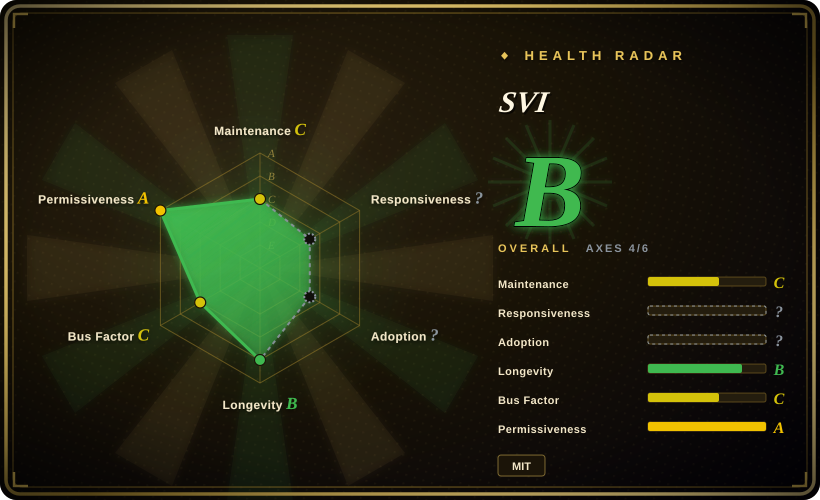
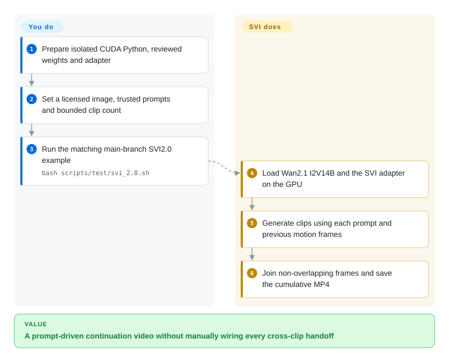
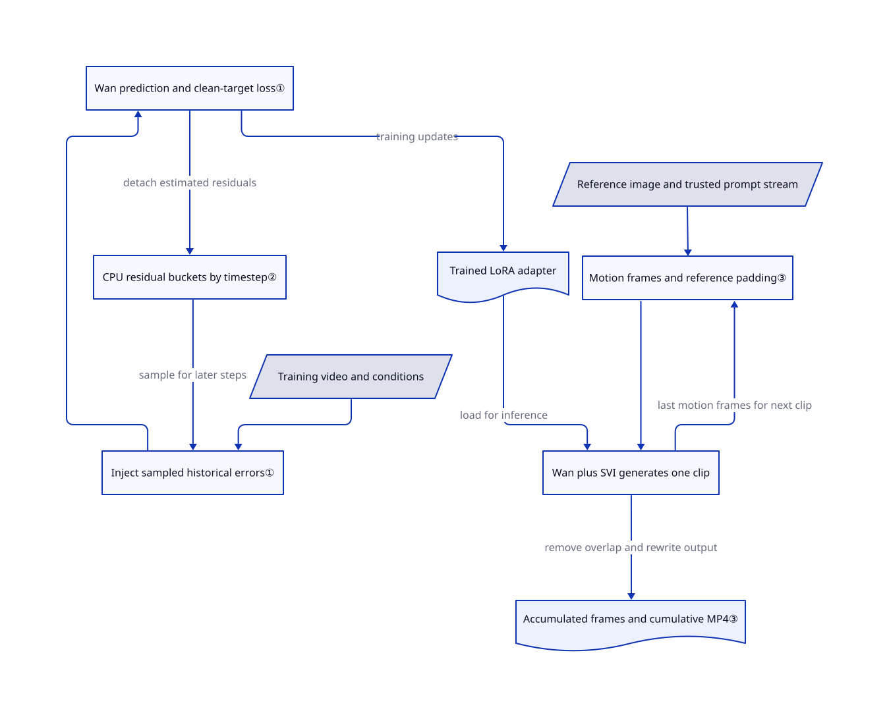

# Stable Video Infinity

You extend a generated video using its last frames, but the subject and colors change with each continuation. Stable Video Infinity (SVI) trains on its own past numerical errors, then joins generated clips using a reference image and a stream of prompts.

> [!WARNING]
> **Information entry with unresolved provenance/license retention risk, not a blanket adoption clearance.** At the reviewed main commit, 191 of 319 file blobs match DiffSynth-Studio v1.1.2 exactly, including 140 of 202 Python files. The root [MIT license](https://github.com/vita-epfl/Stable-Video-Infinity/blob/557afca50d5766514c67ae39000b03e0dd66d6e5/LICENSE) can cover SVI's additions; it does not replace the borrowed engine's [Apache-2.0 redistribution conditions](https://github.com/modelscope/DiffSynth-Studio/blob/a66203a3914b6ee54240b3cdd1b03408c4f11ec7/LICENSE#L89-L128). The complete tree has no conventionally named Apache license file or unchanged upstream LICENSE blob. The cached 17 SVI texts did not reveal a full copy; this is **not** a legal audit of all 319 file bodies or every distribution channel. Retention remains unresolved, not a finding of infringement or invalid MIT. `NOASSERTION` avoids representing the whole bundle as MIT. The automated license axis reads a narrower root-license signal and cannot resolve this issue.
>
> **Do not load untrusted prompt files:** the assignment-form parser uses Python `exec`. The Gradio wrapper defaults to `0.0.0.0:7860`, not loopback; omitting `--share` does not make it local-only.

## When to use

You research image-to-video continuation and already have a working Wan GPU environment. A character changes clothes or a static background shifts color after several clips; simply feeding the last frame into an unmodified generator does not address the training mismatch. Choose SVI when you need the actual fine-tuning code that exposes the model to earlier prediction errors, plus per-clip text control, rather than only a base short-video checkpoint or a GUI workflow.

This page reviews `main` at `557afca5`: Wan2.1, the SVI1.0 family and its SVI2.0 inference example. The [branch map](https://github.com/vita-epfl/Stable-Video-Infinity/blob/557afca50d5766514c67ae39000b03e0dd66d6e5/README.md#L53-L59) separately places Wan2.2 and SVI2.0 Pro on `svi_wan22`. That branch's [documentation](https://github.com/vita-epfl/Stable-Video-Infinity/blob/bab066229ea530a09587bed52c41ed6089bd509f/README.md#L174-L197) was read, not its implementation; the mechanisms below do not certify Pro.

## When NOT to use

- **You need a redistribution-ready, uniformly permissive bundle.** Do not clear SVI on its MIT badge. Evaluate the original [Wan2.1](https://github.com/Wan-Video/Wan2.1) distribution and its individual component terms, or defer distribution until SVI's Apache-copy retention is resolved. Neither option grants rights to training data or likenesses.
- **You need low-latency causal video interaction.** Evaluate [Self Forcing](https://github.com/guandeh17/Self-Forcing), whose training rolls out an autoregressive generator with an attention-history cache. SVI generates a whole bidirectional clip before continuing; it is not a verified real-time service.
- **Your decisive constraint is a consumer GPU memory budget.** Evaluate [FramePack](https://github.com/lllyasviel/FramePack), which packs history into a fixed input context and publishes a low-memory desktop path. Its memory numbers remain author reports; SVI's A100 80GB environment report is not a minimum-memory promise for every variant.
- **You need unlimited duration, constant memory or no quality drift as a hard guarantee.** FramePack is a more direct candidate for fixed-context generation; conventional editing of independently reviewed Wan clips is safer when duration must be bounded. SVI's current loop keeps cumulative frames, rewrites the cumulative MP4, indexes only 10,000 seeds, and normally caps clips by the available prompts. Its [FAQ](https://github.com/vita-epfl/Stable-Video-Infinity/blob/557afca50d5766514c67ae39000b03e0dd66d6e5/docs/FAQ.md#L23-L41) acknowledges reconstruction errors and out-of-distribution degradation.
- **You accept arbitrary user prompt files or need an Internet-facing app.** Do not expose the research entrypoint unchanged; prefer a hardened application around Wan with a data-only parser, access control and a bounded job queue. SVI's [parser](https://github.com/vita-epfl/Stable-Video-Infinity/blob/557afca50d5766514c67ae39000b03e0dd66d6e5/test_svi.py#L31-L60) executes assignment-form text, and its [demo wrapper](https://github.com/vita-epfl/Stable-Video-Infinity/blob/557afca50d5766514c67ae39000b03e0dd66d6e5/gradio_demo.sh#L112-L146) listens on all interfaces by default.

## Comparison

| Alternative | In index | Our verdict | Tradeoff |
|---|---|---|---|
| [Wan2.1](https://github.com/Wan-Video/Wan2.1) | not indexed | Choose the base Wan distribution for independent short clips; choose SVI when you need error-recycling fine-tuning and a prompt stream driving continuation. | Wan removes the SVI adapter/workflow layer but does not supply SVI's error banks or continuation recipe. Review exact weight/component licenses. Not added in this batch; intake is limited to three named repositories. |
| [Self Forcing](https://github.com/guandeh17/Self-Forcing) | not indexed | Choose Self Forcing to study causal rollout and streaming latency; choose SVI for reference-image-guided, clip-by-clip story generation. | Its documented reference path uses Wan2.1 T2V 1.3B and cached attention history; SVI's reviewed path uses I2V 14B with bidirectional processing inside a clip. No independent speed or quality ranking was run. Not added in this batch; scope is fixed. |
| [FramePack](https://github.com/lllyasviel/FramePack) | not indexed | Evaluate FramePack first when fitting progressive image-to-video generation on a small GPU matters more than modifying SVI's training loop. | FramePack packs historical context and offers a desktop interface; SVI exposes error-injection/banking training and per-clip prompts. FramePack's published 6GB claim was not reproduced here. Not added in this batch; scope is fixed. |

## Quick start

After reviewing the license issue, follow the [main README](https://github.com/vita-epfl/Stable-Video-Infinity/blob/557afca50d5766514c67ae39000b03e0dd66d6e5/README.md#L328-L379): create an isolated Python 3.10 environment, install this checkout with `pip install -e .`, then its documented FlashAttention and FFmpeg dependencies. Obtain the Wan2.1 I2V 14B base and matching SVI2.0 LoRA—a small adapter of learned weight changes—at the documented local paths, after checking their individual terms. Supply a licensed reference image and a **trusted** prompt file, then edit the paths and clip limit in [the real example](https://github.com/vita-epfl/Stable-Video-Infinity/blob/557afca50d5766514c67ae39000b03e0dd66d6e5/scripts/test/svi_2.0.sh#L3-L13) before using `bash scripts/test/svi_2.0.sh`. SVI loads the base and adapter, continues clips, and writes a cumulative MP4 under a timestamped output directory. You provide GPU capacity, input rights, version pinning, output review and cleanup; it is not a production queue or an automatic rights checker. This path was source-checked only: no installation, model download, inference, training or demo launch was performed.

<!-- flow-steps:begin (generated from flows/stable-video-infinity.json by tools/flow_card.py — do not edit) -->

Text version of the flow

1. **You**: Prepare isolated CUDA Python, reviewed weights and adapter
2. **You**: Set a licensed image, trusted prompts and bounded clip count
3. **You**: Run the matching main-branch SVI2.0 example — `bash scripts/test/svi_2.0.sh`
4. **SVI**: Load Wan2.1 I2V14B and the SVI adapter on the GPU
5. **SVI**: Generate clips using each prompt and previous motion frames
6. **SVI**: Join non-overlapping frames and save the cumulative MP4

**Value**: A prompt-driven continuation video without manually wiring every cross-clip handoff

<!-- flow-steps:end -->

## Key techniques

<!-- mechanism:begin (generated from mechanisms/stable-video-infinity.json by tools/mechanism_card.py; do not edit) -->

Text version of the mechanism

- Training video and conditions
- Inject sampled historical errors①
- Wan prediction and clean-target loss①
- CPU residual buckets by timestep②
- Trained LoRA adapter
- Reference image and trusted prompt stream
- Motion frames and reference padding③
- Wan plus SVI generates one clip
- Accumulated frames and cumulative MP4③

- Training video and conditions → Inject sampled historical errors①
- CPU residual buckets by timestep② → Inject sampled historical errors① (sample for later steps)
- Inject sampled historical errors① → Wan prediction and clean-target loss①
- Wan prediction and clean-target loss① → CPU residual buckets by timestep② (detach estimated residuals)
- Wan prediction and clean-target loss① → Trained LoRA adapter (training updates)
- Trained LoRA adapter → Wan plus SVI generates one clip (load for inference)
- Reference image and trusted prompt stream → Motion frames and reference padding③
- Motion frames and reference padding③ → Wan plus SVI generates one clip
- Wan plus SVI generates one clip → Motion frames and reference padding③ (last motion frames for next clip)
- Wan plus SVI generates one clip → Accumulated frames and cumulative MP4③ (remove overlap and rewrite output)

<!-- mechanism:end -->

### 1. Train against clean targets after injecting past errors

- **Problem:** A generator trained only on clean conditions has not learned to recover from its own imperfect earlier output.
- **How:** The training step samples past errors and adds them to noise, compressed video representations or image conditions. It builds a target pointing back toward the clean video representation, computes weighted mean-squared prediction error, then estimates residuals for future replay.
- **Limits:** This updates a video diffusion network, not prompts or a coding-agent controller. Clean-input probability, error strength and task-specific data remain training choices; a loss function does not prove indefinite visual consistency.
- **Source:** [Error injection, target and residuals:1099–1183](https://github.com/vita-epfl/Stable-Video-Infinity/blob/557afca50d5766514c67ae39000b03e0dd66d6e5/train_svi.py#L1099-L1183), [LoRA attachment and frozen base:940–965](https://github.com/vita-epfl/Stable-Video-Infinity/blob/557afca50d5766514c67ae39000b03e0dd66d6e5/train_svi.py#L940-L965).

### 2. Replay numerical errors from timestep buckets

- **Problem:** Errors produced at different denoising stages are not interchangeable, and storing every historical tensor would grow without bound.
- **How:** The code maps a sampled timestep to its nearest configured inference timestep, detaches residual tensors to CPU buckets, and samples them back onto the training device. It supports random, FIFO and distance-based replacement; warmup gathers errors across GPUs, then switches to local updates.
- **Limits:** Bounded entries do not mean small tensors or cheap distance comparisons. The Shot script's 50 buckets, capacity 500 and `l2_batch` policy are an example configuration, not universal defaults or measured quality guarantees; error-bank CPU memory still needs budgeting.
- **Source:** [Grid mapping and storage:685–938](https://github.com/vita-epfl/Stable-Video-Infinity/blob/557afca50d5766514c67ae39000b03e0dd66d6e5/train_svi.py#L685-L938), [distributed/local updates:1162–1183](https://github.com/vita-epfl/Stable-Video-Infinity/blob/557afca50d5766514c67ae39000b03e0dd66d6e5/train_svi.py#L1162-L1183), [Shot parameters:16–29](https://github.com/vita-epfl/Stable-Video-Infinity/blob/557afca50d5766514c67ae39000b03e0dd66d6e5/scripts/train/svi_shot.sh#L16-L29).

### 3. Carry motion frames and reference-image padding across clips

- **Problem:** Each new clip needs both recent motion and a persistent visual reference rather than an unrelated restart.
- **How:** Inference passes the previous clip's last motion frames into the next call. The pipeline encodes those frames, builds a condition mask, and fills remaining positions with zeros, selected reference-image padding or a repeated reference image; the loop removes overlapping frames and saves the joined result.
- **Limits:** Padding and motion-frame counts must match the chosen family: the reviewed SVI2.0 example uses five frames and full reference padding, unlike the one-frame Shot example. Repeated encoding/decoding can still introduce artifacts, and cumulative output storage is not constant-memory streaming.
- **Source:** [Adaptive condition construction:291–364](https://github.com/vita-epfl/Stable-Video-Infinity/blob/557afca50d5766514c67ae39000b03e0dd66d6e5/diffsynth/pipelines/svi_video.py#L291-L364), [clip loop and accumulation:395–483](https://github.com/vita-epfl/Stable-Video-Infinity/blob/557afca50d5766514c67ae39000b03e0dd66d6e5/test_svi.py#L395-L483), [SVI2.0 parameters:3–13](https://github.com/vita-epfl/Stable-Video-Infinity/blob/557afca50d5766514c67ae39000b03e0dd66d6e5/scripts/test/svi_2.0.sh#L3-L13).

## Tech stack

- Python, PyTorch video diffusion, Wan2.1 image/text encoders and video autoencoder, bundled DiffSynth engine, PEFT LoRA, Lightning and DeepSpeed training.
- The [manifest](https://github.com/vita-epfl/Stable-Video-Infinity/blob/557afca50d5766514c67ae39000b03e0dd66d6e5/requirements.txt) pins PyTorch 2.5.0, torchvision 0.20.0, Transformers 4.46.2 and PEFT 0.17; it also includes CUDA12 CuPy, Diffusers, Gradio, xformers, xfuser and media libraries. Several other dependencies have only lower bounds.
- [Package metadata](https://github.com/vita-epfl/Stable-Video-Infinity/blob/557afca50d5766514c67ae39000b03e0dd66d6e5/setup.py#L15-L30) still identifies `diffsynth` 1.1.2. This is a bundled research checkout, not evidence that an unrelated registry package installs SVI.

## Dependencies

- **GPU and environment:** the [README](https://github.com/vita-epfl/Stable-Video-Infinity/blob/557afca50d5766514c67ae39000b03e0dd66d6e5/README.md#L328-L344) reports A100 80GB/CUDA12 tests, discusses several PyTorch versions, and separately installs FlashAttention 2.8.0.post2 and FFmpeg. The inference entry explicitly selects CUDA and enables CPU offload. Reported hardware is not a verified minimum; no CPU/Mac path was established.
- **Model assets:** Wan2.1 I2V 14B base shards, text/image encoders, video autoencoder and a family-matched SVI adapter. Talk and Dance require additional audio/pose components; do not apply their input or license assumptions to the generic path.
- **Rights are separate:** root code says MIT and the borrowed DiffSynth engine says Apache-2.0. Reused public Hub cards observed on 2026-10-25 declare [SVI weights MIT](https://huggingface.co/vita-video-gen/svi-model/blob/main/README.md) and [Wan2.1 weights Apache-2.0](https://huggingface.co/Wan-AI/Wan2.1-I2V-14B-480P/blob/main/README.md); the [benchmark card](https://huggingface.co/datasets/vita-video-gen/svi-benchmark/blob/main/README.md) has no license field. These card snapshots were not revision-pinned or newly fetched for this page; they are not artifact-wide legal clearance. Review weights, datasets, third-party code and depicted people separately.

## Ops difficulty

**High.** You must reconcile CUDA/PyTorch/FlashAttention versions, large weight downloads and adapter/workflow compatibility. Training adds licensed video data, multi-GPU setup, CPU error banks and checkpoints; the README reports 8/64-GPU tests, not a guaranteed training budget. For inference, cap clips and provision host RAM/disk: `video_list` retains cumulative frames and the same cumulative MP4 is rewritten after each clip. The finite seed array is another implementation limit, not “infinity.”

Cleanup is **partial/unknown**, not automatic: inference creates timestamped output folders; training writes under `experiments`; the demo creates `videos` and `logs`. The [utility](https://github.com/vita-epfl/Stable-Video-Infinity/blob/557afca50d5766514c67ae39000b03e0dd66d6e5/utils/project_utils.py#L73-L109) removes its own argument-file lock, not weights, caches or generated media. Review and remove only your own artifacts under your retention policy. Isolate any future demo and explicitly choose its bind address; no cleanup or exposure behavior was tested by running it here.

## Health & viability

- **Maintenance, 2026-10-25:** the reviewed main head is dated 2026-09-17; the sampled releases endpoint contains no GitHub releases. README version names describe research families, not a stable package release contract. The three core training/inference files total 2,457 lines and contain real connected training and continuation paths; this is not a paper-only placeholder, nor a claim that every line is original.
- **Governance/backing:** VITA@EPFL organization ownership and named research authors are concrete backing signals. The sampled contributor endpoint lists two contributors, with 55 and 8 contributions; that is concentrated maintenance, not an institutional support SLA. No dedicated governance/security policy appeared in the reviewed tree.
- **Age/Lindy:** created 2025-10-09, about one year old with a recent main update. [推断：based on observed age and commit recency, not a survival study] Treat it as a young research bet, not a long-proven API or operational service.
- **Adoption:** the observed 2,613 stars and upstream-linked ComfyUI/community workflows show interest and integrations, not independent quality, commercial adoption or reproducibility evidence. Old SVI1.0 workflows must not be substituted for Wan22 Pro workflows.
- **Decisive risk:** the root MIT file and Apache metadata do not settle retention of the borrowed engine's license copy. The 191/319 exact-blob finding and the 17-text coverage limit remain in force after information intake approval. Do not let the automated radar override that unresolved rights boundary.

## Caveats (unverified)

- [未验证：only the fixed tree and 17 cached SVI text bodies were available for retention checks] No conventional Apache-license file or exact upstream LICENSE blob was found; reformatted/embedded text in other files, other distribution channels or separate authorization were not exhaustively checked. This is an unresolved retention question, not a legal infringement verdict; MIT for SVI additions can coexist with Apache conditions.
- [未验证：Hub cards were reused from 2026-10-25 raw/main snapshots without fixed revisions] Card declarations do not prove the license of every weight/data artifact or commercial rights to all source material and likenesses. A missing dataset-card license field does not prove that no separate terms exist.
- [未验证：no upstream execution or model downloads were authorized] Installation, GPU compatibility, peak RAM/VRAM, latency, convergence, long-video quality, cleanup and the advertised no-drift duration were not reproduced. FramePack/Self Forcing performance claims likewise remain upstream reports, not a measured comparison.
- [未验证：only documentation on the fixed Wan22 branch was read] SVI2.0 Pro's redesigned internals and workflow behavior were not source-verified. Main's Wan2.1 implementation cannot serve as their evidence.
- [推断：young repository age and recent activity are only priors] The Lindy judgment does not establish future support, security response or API stability; reviewed entrypoints are not a whole-repository malicious-code audit.
