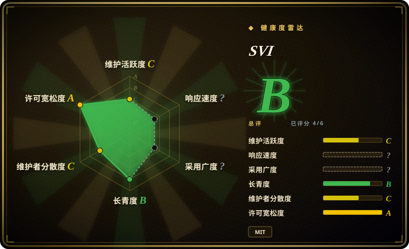
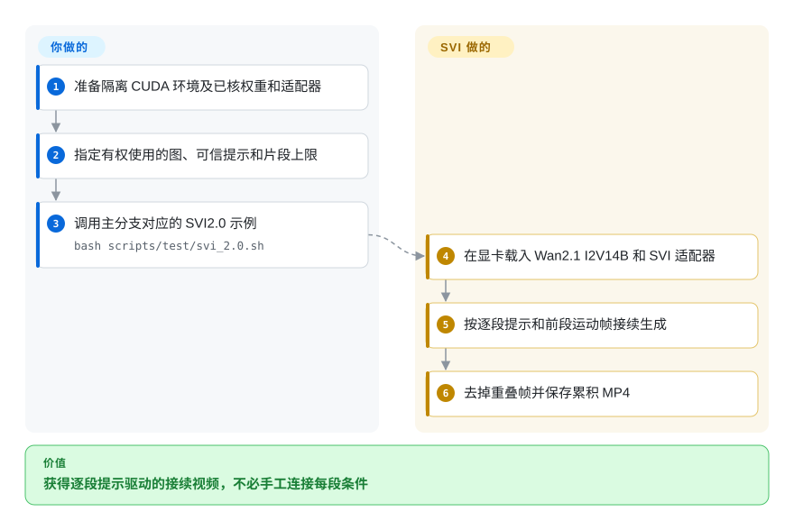
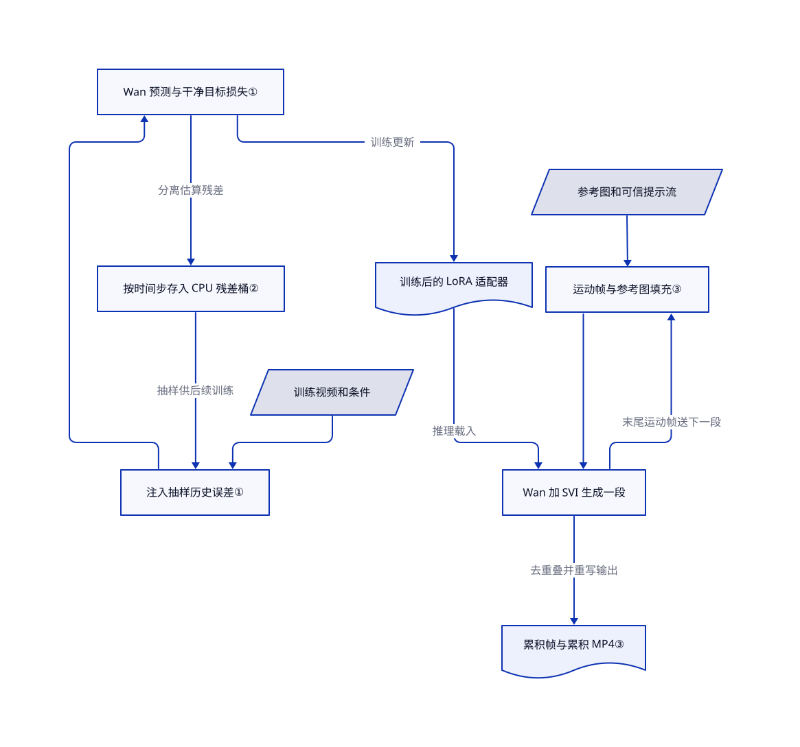

# Stable Video Infinity

拿上一段视频的末帧继续生成，人物和颜色却一段段变样。Stable Video Infinity（SVI）把模型过去的数值误差放回训练，再用参考图和逐段提示词接续视频。

> [!WARNING]
> **这是保留来源与许可疑点的信息页，不是无条件采用许可。** 固定主分支的 319 个文件中，191 个与 DiffSynth-Studio v1.1.2 完全同 blob，其中 Python 文件为 140／202。根目录的 [MIT 许可](https://github.com/vita-epfl/Stable-Video-Infinity/blob/557afca50d5766514c67ae39000b03e0dd66d6e5/LICENSE)可以覆盖 SVI 新增代码，但不能替代基础引擎的 [Apache-2.0 再分发条件](https://github.com/modelscope/DiffSynth-Studio/blob/a66203a3914b6ee54240b3cdd1b03408c4f11ec7/LICENSE#L89-L128)。完整文件树未见常规命名的 Apache 许可文件或未改动的上游许可 blob；已缓存的 17 个 SVI 文本也未发现完整副本。这**不是**对全部 319 个文件正文和所有分发渠道的法律审计。许可保留仍待核，不据此判侵权或 MIT 无效。`NOASSERTION` 避免把整包误写成 MIT；自动许可轴只识别更窄的根许可信号，不能消除此疑点。
>
> **不要加载不可信提示文件：** 赋值形式的提示文本会进入 Python `exec`。Gradio 包装脚本默认监听 `0.0.0.0:7860`，不是仅本机；不加 `--share` 也不等于本地隔离。

## 何时使用

你研究图生视频接续，已经能运行 Wan 的 GPU 环境。接几段后人物换了衣服，静止背景也渐渐变色；只把末帧交给普通生成器，并未解决训练只见过干净输入的问题。如果你要修改真正的微调代码，让模型学会处理过去的预测误差，又要逐段控制故事提示词，可以考虑 SVI，而不是只下载基础短视频权重或拼界面工作流。

本页固定阅读 `main` 的 `557afca5`，范围是 Wan2.1、SVI1.0 家族及 SVI2.0 推理示例。[分支说明](https://github.com/vita-epfl/Stable-Video-Infinity/blob/557afca50d5766514c67ae39000b03e0dd66d6e5/README.md#L53-L59)把 Wan2.2 和 SVI2.0 Pro 放在 `svi_wan22`。后者只读了固定版本的[文档](https://github.com/vita-epfl/Stable-Video-Infinity/blob/bab066229ea530a09587bed52c41ed6089bd509f/README.md#L174-L197)，未读实现；下列机制不能为 Pro 背书。

## 何时不用

- **要直接再分发、许可统一宽松的整包。** 不要凭 MIT 徽章放行 SVI。可先评估原始 [Wan2.1](https://github.com/Wan-Video/Wan2.1) 分发及各组件条款，或等 SVI 的 Apache 副本保留问题核清后再分发。两者都不自动授予训练数据和人物肖像权利。
- **要低延迟的因果交互视频。** 可评估 [Self Forcing](https://github.com/guandeh17/Self-Forcing)，它在训练时展开自回归生成，并缓存注意力历史。SVI 先完成一整段双向建模，再接下一段；不是已经验收的实时服务。
- **消费级显卡的显存预算最关键。** 可先评估 [FramePack](https://github.com/lllyasviel/FramePack)，它把历史压进固定长度上下文，并提供低显存桌面路径。其显存数字仍是作者报告；SVI 的 A100 80GB 测试环境也不是所有版本的最低显存承诺。
- **把无限时长、恒定内存或不漂移当作硬保证。** 固定上下文生成更该评估 FramePack；要求时长可控时，可独立验收 Wan 短片后再常规剪辑。SVI 当前循环保留累积帧，反复写累积 MP4，仅索引 10,000 个 seed，通常还受提示数限制。[FAQ](https://github.com/vita-epfl/Stable-Video-Infinity/blob/557afca50d5766514c67ae39000b03e0dd66d6e5/docs/FAQ.md#L23-L41)承认编解码误差与训练分布外退化。
- **接收任意用户提示文件，或直接提供公网应用。** 不要原样暴露研究入口；应在 Wan 外另建使用纯数据解析、访问控制及有界队列的应用。[解析器](https://github.com/vita-epfl/Stable-Video-Infinity/blob/557afca50d5766514c67ae39000b03e0dd66d6e5/test_svi.py#L31-L60)会执行赋值形式文本，[演示包装脚本](https://github.com/vita-epfl/Stable-Video-Infinity/blob/557afca50d5766514c67ae39000b03e0dd66d6e5/gradio_demo.sh#L112-L146)默认监听全部网卡。

## 横向对比

| 替代品 | 是否收录 | 我们的评价 | 取舍 |
|---|---|---|---|
| [Wan2.1](https://github.com/Wan-Video/Wan2.1) | 未收录 | 独立生成短片时选原始 Wan；要修改误差回收微调并按提示流接续时，才选 SVI。 | Wan 少一层 SVI 适配器和工作流，但没有 SVI 的误差桶与接续配方；仍须核对具体权重及组件许可。本批只处理三个指定仓库，不扩收。 |
| [Self Forcing](https://github.com/guandeh17/Self-Forcing) | 未收录 | 研究因果展开和流式延迟时选 Self Forcing；参考图引导的分段故事生成可选 SVI。 | 其文档路径使用 Wan2.1 T2V 1.3B 和注意力历史缓存；SVI 已读路径是 I2V 14B，片段内双向处理。本次没有独立速度或画质排名；受固定范围限制，本批不扩收。 |
| [FramePack](https://github.com/lllyasviel/FramePack) | 未收录 | 小显卡上逐步生成图生视频，比修改 SVI 训练环更重要时，先评估 FramePack。 | FramePack 压缩历史上下文并提供桌面界面；SVI 公开误差注入、存储训练及逐段提示。FramePack 的 6GB 报告未在本次复现；受固定范围限制，本批不扩收。 |

## 快速上手

核对许可问题后，按[主分支说明](https://github.com/vita-epfl/Stable-Video-Infinity/blob/557afca50d5766514c67ae39000b03e0dd66d6e5/README.md#L328-L379)建立隔离的 Python 3.10 环境，用 `pip install -e .` 安装该检出版本，再准备文档指定的 FlashAttention 和 FFmpeg。分别核对条款后，把 Wan2.1 I2V 14B 基础权重和对应 SVI2.0 LoRA（保存少量权重改动的适配器）放到规定目录。准备有权使用的参考图和**可信**提示文件，先修改[真实示例](https://github.com/vita-epfl/Stable-Video-Infinity/blob/557afca50d5766514c67ae39000b03e0dd66d6e5/scripts/test/svi_2.0.sh#L3-L13)中的路径及片段上限，再使用 `bash scripts/test/svi_2.0.sh`。SVI 负责载入基础模型与适配器，接续生成片段，并在时间戳目录写累积 MP4。你负责 GPU、素材权利、版本固定、输出审看与清理；它不是生产任务队列，也不自动清权。本次仅核源码，没有安装、下载模型、推理、训练或启动演示。

<!-- flow-steps:begin (generated from flows/stable-video-infinity.json by tools/flow_card.py — do not edit) -->

流程文字版

1. **你**：准备隔离 CUDA 环境及已核权重和适配器
2. **你**：指定有权使用的图、可信提示和片段上限
3. **你**：调用主分支对应的 SVI2.0 示例 — `bash scripts/test/svi_2.0.sh`
4. **SVI**：在显卡载入 Wan2.1 I2V14B 和 SVI 适配器
5. **SVI**：按逐段提示和前段运动帧接续生成
6. **SVI**：去掉重叠帧并保存累积 MP4

**价值**：获得逐段提示驱动的接续视频，不必手工连接每段条件

<!-- flow-steps:end -->

## 技术要点

<!-- mechanism:begin (generated from mechanisms/stable-video-infinity.json by tools/mechanism_card.py; do not edit) -->

机制文字版

- 训练视频和条件
- 注入抽样历史误差①
- Wan 预测与干净目标损失①
- 按时间步存入 CPU 残差桶②
- 训练后的 LoRA 适配器
- 参考图和可信提示流
- 运动帧与参考图填充③
- Wan 加 SVI 生成一段
- 累积帧与累积 MP4③

- 训练视频和条件 → 注入抽样历史误差①
- 按时间步存入 CPU 残差桶② → 注入抽样历史误差①（抽样供后续训练）
- 注入抽样历史误差① → Wan 预测与干净目标损失①
- Wan 预测与干净目标损失① → 按时间步存入 CPU 残差桶②（分离估算残差）
- Wan 预测与干净目标损失① → 训练后的 LoRA 适配器（训练更新）
- 训练后的 LoRA 适配器 → Wan 加 SVI 生成一段（推理载入）
- 参考图和可信提示流 → 运动帧与参考图填充③
- 运动帧与参考图填充③ → Wan 加 SVI 生成一段
- Wan 加 SVI 生成一段 → 运动帧与参考图填充③（末尾运动帧送下一段）
- Wan 加 SVI 生成一段 → 累积帧与累积 MP4③（去重叠并重写输出）

<!-- mechanism:end -->

### 1. 带历史误差输入，仍朝干净目标训练

- **解决：** 只见过干净条件的模型，没有学过如何恢复自己前一段产生的偏差。
- **做法：** 训练抽取历史误差，加入噪声、压缩后的视频表示或图像条件。目标仍指向干净视频表示，计算加权均方预测误差，再估算残差供后续回放。
- **边界：** 更新对象是视频扩散网络，不是提示词或编程 agent 控制器。干净输入概率、误差强度及领域数据仍要人为设定；存在损失函数不证明画面能无限保持一致。
- **源码：** [误差注入、目标与残差第 1099–1183 行](https://github.com/vita-epfl/Stable-Video-Infinity/blob/557afca50d5766514c67ae39000b03e0dd66d6e5/train_svi.py#L1099-L1183)、[冻结基础模型与连接 LoRA 第 940–965 行](https://github.com/vita-epfl/Stable-Video-Infinity/blob/557afca50d5766514c67ae39000b03e0dd66d6e5/train_svi.py#L940-L965)。

### 2. 按去噪时间步分桶回放数值误差

- **解决：** 不同去噪阶段的误差不能随意互换，完整保留每份历史张量又会无限增长。
- **做法：** 代码把采样时间步映射到最近的已配置推理时间步，把脱离梯度的残差放进 CPU 桶，再抽样送回训练设备。桶满后支持随机、先进先出或距离替换；预热阶段汇聚多卡误差，之后按本卡更新。
- **边界：** 条目有界不代表张量小或距离计算便宜。Shot 脚本的 50 桶、每桶 500 条及 `l2_batch` 是示例配置，不是统一默认值或画质保证；仍要预算误差桶占用的主机内存。
- **源码：** [时间步映射与存取第 685–938 行](https://github.com/vita-epfl/Stable-Video-Infinity/blob/557afca50d5766514c67ae39000b03e0dd66d6e5/train_svi.py#L685-L938)、[多卡与本卡更新第 1162–1183 行](https://github.com/vita-epfl/Stable-Video-Infinity/blob/557afca50d5766514c67ae39000b03e0dd66d6e5/train_svi.py#L1162-L1183)、[Shot 参数第 16–29 行](https://github.com/vita-epfl/Stable-Video-Infinity/blob/557afca50d5766514c67ae39000b03e0dd66d6e5/scripts/train/svi_shot.sh#L16-L29)。

### 3. 跨片段传递运动帧，并以参考图填充条件

- **解决：** 下一段既要接住最近的运动，也要有持续的视觉参考，不能每次无关重开。
- **做法：** 推理把上一段末尾运动帧传给下一次调用。管线编码这些帧、构造条件掩码，再用零、指定数量参考图或重复参考图填充余下位置；循环去掉重叠帧并保存接续结果。
- **边界：** 填充和运动帧数须对应具体家族。已读 SVI2.0 示例使用五帧及完整参考填充，不同于一帧 Shot；重复编解码仍会带来伪影，累积输出也不等于恒定内存流式生成。
- **源码：** [自适应条件构造第 291–364 行](https://github.com/vita-epfl/Stable-Video-Infinity/blob/557afca50d5766514c67ae39000b03e0dd66d6e5/diffsynth/pipelines/svi_video.py#L291-L364)、[片段循环与累积第 395–483 行](https://github.com/vita-epfl/Stable-Video-Infinity/blob/557afca50d5766514c67ae39000b03e0dd66d6e5/test_svi.py#L395-L483)、[SVI2.0 参数第 3–13 行](https://github.com/vita-epfl/Stable-Video-Infinity/blob/557afca50d5766514c67ae39000b03e0dd66d6e5/scripts/test/svi_2.0.sh#L3-L13)。

## 技术栈

- Python、PyTorch 视频扩散、Wan2.1 图像与文字编码器、视频自动编解码器、内嵌 DiffSynth 引擎、PEFT LoRA，以及 Lightning／DeepSpeed 训练。
- [依赖清单](https://github.com/vita-epfl/Stable-Video-Infinity/blob/557afca50d5766514c67ae39000b03e0dd66d6e5/requirements.txt)固定 PyTorch 2.5.0、torchvision 0.20.0、Transformers 4.46.2、PEFT 0.17，还包括 CUDA12 CuPy、Diffusers、Gradio、xformers、xfuser 和音视频库；另一些依赖只有下限。
- [包元数据](https://github.com/vita-epfl/Stable-Video-Infinity/blob/557afca50d5766514c67ae39000b03e0dd66d6e5/setup.py#L15-L30)仍标为 `diffsynth` 1.1.2。这是内嵌引擎的研究仓库，不能据此认为安装同名注册包就得到了 SVI。

## 依赖

- **显卡与环境。** [说明文档](https://github.com/vita-epfl/Stable-Video-Infinity/blob/557afca50d5766514c67ae39000b03e0dd66d6e5/README.md#L328-L344)报告 A100 80GB／CUDA12 测试，提到多个 PyTorch 版本，并另装 FlashAttention 2.8.0.post2 和 FFmpeg。推理入口明确选择 CUDA 并启用 CPU 卸载。报告硬件不是已核最低配置；未确认 CPU／Mac 路径。
- **模型资产。** Wan2.1 I2V 14B 分片、文字与图像编码器、视频自动编解码器，以及家族对应的 SVI 适配器。Talk 和 Dance 另需音频／姿态组件，不能把其输入或许可套到通用路径。
- **材料权利分开核对。** 根代码声明 MIT，复用的 DiffSynth 引擎为 Apache-2.0。复用的 2026-10-25 公开 Hub 卡分别声明 [SVI 权重为 MIT](https://huggingface.co/vita-video-gen/svi-model/blob/main/README.md)、[Wan2.1 权重为 Apache-2.0](https://huggingface.co/Wan-AI/Wan2.1-I2V-14B-480P/blob/main/README.md)；[benchmark 卡](https://huggingface.co/datasets/vita-video-gen/svi-benchmark/blob/main/README.md)没有许可字段。这些卡未锁 revision，本页没有重新抓取，不能充当每份资产的法律放行。权重、数据集、第三方代码和人物素材分别核对。

## 运维难度

**高。** 你要匹配 CUDA、PyTorch、FlashAttention，管理大体积基础权重和适配器／工作流兼容性。训练还要准备有权使用的视频、多卡环境、CPU 误差桶和检查点；README 的 8／64 卡测试不是确定的训练预算。推理也要限制片段数并预算主机内存和磁盘：`video_list` 保留累积帧，每段重写同一个累积 MP4。有限 seed 数组也是实现上限，不是“无限”。

清理状态为**部分／未知**，不是自动无残留：推理创建时间戳目录，训练写入 `experiments`，演示创建 `videos` 和 `logs`。[工具函数](https://github.com/vita-epfl/Stable-Video-Infinity/blob/557afca50d5766514c67ae39000b03e0dd66d6e5/utils/project_utils.py#L73-L109)只清自己的参数文件锁，不删除权重、缓存或生成视频。按保留策略审查并清理自己创建的产物；未来若启动演示，要先隔离并显式选监听地址。本次没有运行验证清理或网络暴露行为。

## 健康度与可持续性

- **维护，2026-10-25。** 已读主分支头提交为 2026-09-17，抽样 release 接口没有 GitHub release。README 的版本名代表研究家族，不是稳定包版本合同。三个训练／推理核心文件合计 2,457 行，有真实连接的训练和接续路径；不是仅论文占位，也不声称每行均为原创。
- **治理与支持。** VITA@EPFL 组织归属及实名研究作者是具体支持信号；抽样贡献者接口列两人，贡献数为 55 和 8，维护集中，不代表机构服务承诺。已核文件树未见独立治理或安全策略文件。
- **年龄与长期存续判断。** 仓库创建于 2025-10-09，约一年，主分支近期仍有更新。[推断：依据已核年龄和提交时间，未做存续研究] 应视为年轻研究项目，不能当作长期稳定的接口或运维服务。
- **采用信号。** 观察到的 2,613 星及上游链接的 ComfyUI／社区工作流说明存在关注和集成，不证明画质、商业采用或可复现性；旧 SVI1.0 工作流不能替代 Wan22 Pro 工作流。
- **决定性风险。** 根 MIT 和包元数据的 Apache 声明不能解决基础引擎许可副本保留问题。带警告信息收录后，191／319 同 blob 和仅 17 文本覆盖的边界仍成立；不能用自动雷达替代权利核查。

## 存疑（未验证）

- [未验证：许可保留检查仅覆盖固定树和 17 个已缓存 SVI 文本正文] 未见常规命名的 Apache 许可文件或原样上游许可 blob，但没有穷尽其它文件中重排／嵌入正文、其它分发渠道或另行授权。这是待核问题，不是侵权判决；新增代码的 MIT 可以与 Apache 条件并存。
- [未验证：复用的 Hub 卡来自 2026-10-25 的 raw/main 快照，未锁固定版本] 卡片字段不能证明每份权重、数据或人物素材都有商用权利；数据卡缺许可字段也不证明不存在其它条款。
- [未验证：未获准执行上游或下载模型] 没有复现安装、显卡兼容、峰值内存／显存、延迟、训练收敛、长视频画质、清理及宣传的不漂移时长。FramePack／Self Forcing 的性能也仅引用作者报告，没有本机比较。
- [未验证：Wan22 固定分支仅阅读文档] 未源码核验 SVI2.0 Pro 的重设计机制和工作流行为，不能用主分支 Wan2.1 实现为其举证。
- [推断：年轻仓库的年龄与近期活跃只是先验] 长期存续判断不保证未来支持、安全响应或接口稳定；已读入口也不等于全仓库恶意代码审计。
