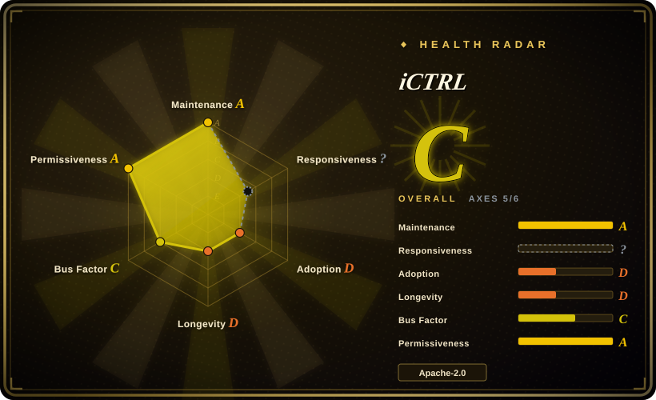
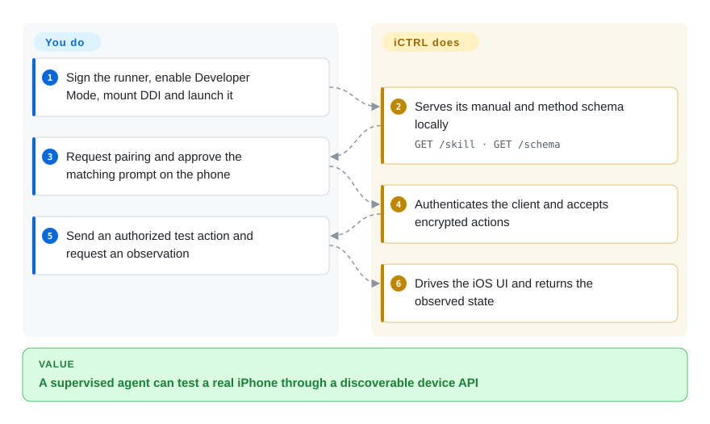
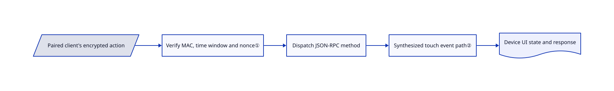

# iCTRL

An agent can see your real iPhone but cannot tap its apps through an ordinary desktop browser. iCTRL runs an on-device test runner that exposes screen, UI and input operations through a paired JSON-RPC client.

## When to use

You are testing apps on an iPhone you own and want an agent to inspect the live screen, choose an element and act without writing a fixed XCUITest script. Choose iCTRL when a self-describing device endpoint and phone-approved pairing matter more than WebDriver compatibility. The device serves an operating manual and method schema; a client can run on the same phone or a permitted remote host. Use a dedicated test device/account because a paired key grants broad control.

## When NOT to use

- Need one test framework for iOS and Android with established language clients? Choose [Appium](appium.md); iCTRL is iOS-specific and exposes its own JSON-RPC protocol.
- Need to build a standards-oriented iOS driver? Choose [WebDriverAgent](webdriveragent.md); it is the WebDriver substrate rather than an agent-oriented standalone endpoint.
- Need simple YAML simulator tests without IPA signing chores? Choose [Maestro](maestro.md); iCTRL's physical-device path needs signing, Developer Mode and a mounted Developer Disk Image.
- Cannot risk agent access to messages, payments or personal accounts? Use a simulator-only test setup such as Maestro instead; pairing encryption does not constrain the authorized agent's intent.

## Comparison

| Alternative | In index | Our verdict | Tradeoff |
|---|---|---|---|
| [Appium](appium.md) | ✅ | Choose Appium for cross-platform regression suites; choose iCTRL for interactive agent operation on a real iPhone. | Standard drivers and clients versus a phone-hosted manual/schema and custom paired protocol. |
| [WebDriverAgent](webdriveragent.md) | ✅ | Choose WDA when implementing a WebDriver-compatible driver; choose iCTRL when an HTTP-capable agent should discover device actions directly. | Ecosystem compatibility versus model-oriented results and explicit local pairing. No comparative speed benchmark was reproduced. |
| [Maestro](maestro.md) | ✅ | Choose Maestro for readable simulator flows; choose iCTRL when a physical iPhone is required. | Lower test-authoring friction versus physical-device control and its signing/security burden. |

## Quick start

Sign and install the required `iCTRLUITests-Runner.ipa` through the documented SideStore or Xcode route; the companion app is optional. Enable Developer Mode, mount the Developer Disk Image and launch the runner, remounting after a phone restart. The client reads `/skill` and `/schema`, requests pairing, and you approve the matching request on the phone. The runner then executes authenticated actions and returns observations; you own the test, device/account authorization and supervision. Remote access is off by default: enable it only when needed, revoke unused keys and stop the runner after testing.

<!-- flow-steps:begin (generated from flows/ictrl.json by tools/flow_card.py — do not edit) -->

Text version of the flow

1. **You**: Sign the runner, enable Developer Mode, mount DDI and launch it
2. **iCTRL**: Serves its manual and method schema locally — `GET /skill · GET /schema`
3. **You**: Request pairing and approve the matching prompt on the phone
4. **iCTRL**: Authenticates the client and accepts encrypted actions
5. **You**: Send an authorized test action and request an observation
6. **iCTRL**: Drives the iOS UI and returns the observed state

**Value**: A supervised agent can test a real iPhone through a discoverable device API

<!-- flow-steps:end -->

## Key techniques

<!-- mechanism:begin (generated from mechanisms/ictrl.json by tools/mechanism_card.py; do not edit) -->

Text version of the mechanism

- Paired client's encrypted action
- Verify MAC, time window and nonce①
- Dispatch JSON-RPC method
- Synthesized touch event path②
- Device UI state and response

- Paired client's encrypted action → Verify MAC, time window and nonce①
- Verify MAC, time window and nonce① → Dispatch JSON-RPC method
- Dispatch JSON-RPC method → Synthesized touch event path②
- Synthesized touch event path② → Device UI state and response

<!-- mechanism:end -->

### 1. Authenticate an encrypted envelope before accepting an action

- **Problem:** An HTTP endpoint controlling a phone must not accept arbitrary callers or replayed commands.
- **How:** Pairing creates a client key. Requests carry a timestamp, random nonce, ciphertext and HMAC; authentication precedes decryption, and the session manager rejects repeated nonces and timestamps outside its window.
- **Limits:** This is a custom HMAC-based encryption construction, not a reviewed TLS replacement. A valid paired client still has broad device authority; pairing is not per-action approval.
- **Source:** [Envelope primitives](https://github.com/OpenMinis/iCTRL/blob/d88bbf0b3a5addead31b4298d605d7ac7a87d6e7/iCTRLKit/SecureEnvelope.swift#L4-L148), [replay checks](https://github.com/OpenMinis/iCTRL/blob/d88bbf0b3a5addead31b4298d605d7ac7a87d6e7/iCTRLKit/AuthManager.swift#L239-L309).

### 2. Encode touch timing as a synthesized event path

- **Problem:** Separate tap calls can arrive too far apart to count as a double tap, while idle waits slow interactive control.
- **How:** Fast actions construct XCTest synthesized event records with explicit press/lift offsets. A double tap uses one event path; long presses and swipes add stationary samples to preserve the intended gesture.
- **Limits:** Private XCTest event interfaces and app gesture recognizers remain compatibility risks. Successful event injection is not proof that the intended UI state was reached.
- **Source:** [Fast event implementation](https://github.com/OpenMinis/iCTRL/blob/d88bbf0b3a5addead31b4298d605d7ac7a87d6e7/iCTRLUITests/FastActionHandler.swift#L13-L128).

## Tech stack

Swift, XCTest/XCUITest, Network framework HTTP listener, CryptoKit, Vision OCR and a Python/pure-C client. The optional companion uses the MIT `idevice` framework for developer-image mounting.

## Dependencies

iOS 16+, correctly nested IPA signatures, Developer Mode and a mounted Developer Disk Image. Free-account signing has renewal/app-count limits; Xcode is an alternative. Remote clients need enabled reachability and a paired secret. The companion's external framework is fetched separately for source builds.

## Ops difficulty

**Medium to high.** Installation is not a normal App Store install: signing, image remounting and notification/network permissions matter. Operate only owned/authorized devices, approve only expected pairing prompts and keep the endpoint local unless remote tests require it. Do not leave it unattended around irreversible actions.

## Health & viability

- On 2026-10-18, v1.98.12 dated to 2026-10-15 and push metadata to 2026-10-16. The repository was created on 2026-07-04: frequent releases, short history.
- OpenMinis hosts it, but `wsvn53` contributes nearly all commits in the sampled contributor list. [推断] The age × activity prior remains weak and Apple/private-API changes can dominate continuity.
- NOTICE documents a change from AGPL to Apache-2.0 after removing vendored `ldid`; old copies retain their old license. It credits WDA as prior art, not copied code.

## Caveats (unverified)

- [未验证] No IPA was installed, signed or run. Gesture timings, device coverage and performance figures were not reproduced.
- [未验证] No independent cryptographic audit was found in reviewed files; encryption claims are implementation evidence, not certification.
- [推断] Long-term compatibility is uncertain given the young, concentrated project and private XCTest interfaces.
