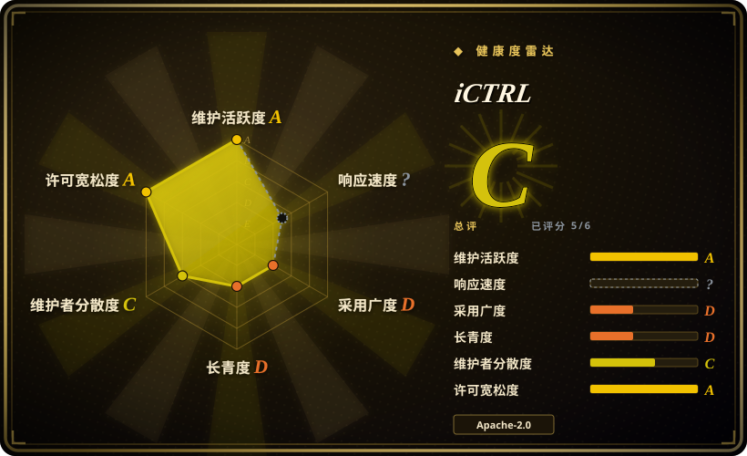
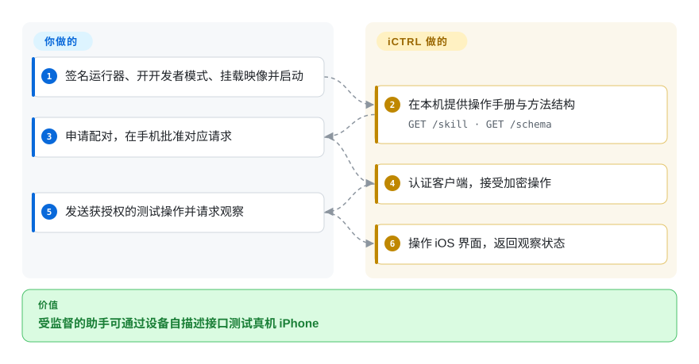

# iCTRL

助手能看到真机 iPhone，却不能用普通桌面浏览器点击手机应用。iCTRL 在手机上运行测试进程，向已配对客户端提供屏幕、界面与输入操作。

## 何时使用

你在自有 iPhone 上测试应用，希望助手检查当前屏幕、选择元素并操作，不想预写固定测试脚本。当你更需要设备自带操作手册与手机批准配对，而非兼容 WebDriver 时选它。设备提供手册与方法结构，客户端可在同机或获准远程主机运行。应使用专用测试机和账号，因为配对密钥赋予广泛控制权。

## 何时不用

- 要覆盖 iOS 和 Android，并沿用成熟语言客户端时，选 [Appium](appium.zh.md)。iCTRL 只面向 iOS，使用自有 JSON-RPC 协议。
- 要构建标准化 iOS 驱动时，选 [WebDriverAgent](webdriveragent.zh.md)。它是 WebDriver 基础层，不是模型导向的独立设备接口。
- 要简单 YAML 模拟器测试、不想处理 IPA 签名时，选 [Maestro](maestro.zh.md)。真机路径需要签名、开发者模式与开发者磁盘映像。
- 无法承受助手触碰消息、支付或个人账号时，改用 Maestro 等纯模拟器测试环境。加密配对不能约束获授权助手的意图。

## 横向对比

| 替代品 | 是否收录 | 我们的评价 | 取舍 |
|---|---|---|---|
| [Appium](appium.zh.md) | ✅ | 跨平台回归套件选 Appium；助手交互式操作真机 iPhone 选 iCTRL。 | 标准驱动与客户端，换设备自带手册、方法结构和自有配对协议。 |
| [WebDriverAgent](webdriveragent.zh.md) | ✅ | 实现兼容 WebDriver 的驱动选 WDA；要 HTTP 助手直接发现操作时选 iCTRL。 | 生态兼容换模型友好结果和本地显式配对；本次没有复现速度对比。 |
| [Maestro](maestro.zh.md) | ✅ | 可读模拟器流程选 Maestro；必须真机 iPhone 时选 iCTRL。 | 较低用例编写门槛，换真机控制及签名、安全负担。 |

## 快速上手

通过文档中的 SideStore 或 Xcode 路线签名并安装必需的 `iCTRLUITests-Runner.ipa`，伴随应用可不装。开启开发者模式，挂载开发者磁盘映像，再启动运行器；手机重启后要重新挂载。客户端读取 `/skill` 和 `/schema`，申请配对，你在手机批准对应请求。运行器负责执行认证操作并返回观察；你负责测试、设备与账号授权，以及全程监督。远程访问默认关闭，只在需要时开启，用完撤销多余密钥并停止运行器。

<!-- flow-steps:begin (generated from flows/ictrl.json by tools/flow_card.py — do not edit) -->

流程文字版

1. **你**：签名运行器、开开发者模式、挂载映像并启动
2. **iCTRL**：在本机提供操作手册与方法结构 — `GET /skill · GET /schema`
3. **你**：申请配对，在手机批准对应请求
4. **iCTRL**：认证客户端，接受加密操作
5. **你**：发送获授权的测试操作并请求观察
6. **iCTRL**：操作 iOS 界面，返回观察状态

**价值**：受监督的助手可通过设备自描述接口测试真机 iPhone

<!-- flow-steps:end -->

## 技术要点

<!-- mechanism:begin (generated from mechanisms/ictrl.json by tools/mechanism_card.py; do not edit) -->

机制文字版

- 已配对客户端的加密操作
- 校验认证码、时间窗口和随机数①
- 分派 JSON-RPC 方法
- 合成触摸事件路径②
- 设备界面状态与响应

- 已配对客户端的加密操作 → 校验认证码、时间窗口和随机数①
- 校验认证码、时间窗口和随机数① → 分派 JSON-RPC 方法
- 分派 JSON-RPC 方法 → 合成触摸事件路径②
- 合成触摸事件路径② → 设备界面状态与响应

<!-- mechanism:end -->

### 1. 接受操作前先认证加密信封

- **解决：** 控制手机的 HTTP 接口不能接受任意调用者或重放命令。
- **做法：** 配对生成客户端密钥，请求携带时间戳、随机数、密文和 HMAC；先校验再解密。会话管理器拒绝重复随机数与超时窗口的时间戳。
- **边界：** 这是自有的 HMAC 加密构造，不是经过审计的 TLS 替代品。合法客户端仍有广泛设备权限，配对不等于逐操作批准。
- **源码：** [信封原语](https://github.com/OpenMinis/iCTRL/blob/d88bbf0b3a5addead31b4298d605d7ac7a87d6e7/iCTRLKit/SecureEnvelope.swift#L4-L148)、[重放检查](https://github.com/OpenMinis/iCTRL/blob/d88bbf0b3a5addead31b4298d605d7ac7a87d6e7/iCTRLKit/AuthManager.swift#L239-L309)。

### 2. 用合成事件路径固定触摸时序

- **解决：** 分开调用两次点击，可能因间隔过长不再算双击；等待界面空闲也拖慢实时控制。
- **做法：** 快速操作构造 XCTest 合成事件记录，明确按下与抬起偏移。双击用一条路径，长按和滑动补静止采样，保留预期手势。
- **边界：** 私有 XCTest 事件接口与应用手势识别仍有兼容风险。注入成功不证明目标界面状态已经到达。
- **源码：** [快速事件实现](https://github.com/OpenMinis/iCTRL/blob/d88bbf0b3a5addead31b4298d605d7ac7a87d6e7/iCTRLUITests/FastActionHandler.swift#L13-L128)。

## 技术栈

Swift、XCTest／XCUITest、Network 框架 HTTP 监听器、CryptoKit、Vision 文字识别与 Python／纯 C 客户端。可选伴随应用通过 MIT 的 `idevice` 框架挂载开发映像。

## 依赖

iOS 16 以上、正确的嵌套 IPA 签名、开发者模式和已挂载的开发者磁盘映像。免费账号签名有续期与应用数量限制，也可用 Xcode。远程客户端需要开启可达性并持有配对密钥；源码构建需另取伴随应用的外部框架。

## 运维难度

**中到高。** 不是普通商店安装，签名、映像重新挂载与通知／网络权限都会影响运行。只操作自有或获授权设备，只批准预期配对，除远程测试需要外保持本地访问。不要在不可逆操作旁无人值守。

## 健康度与可持续性

- 截至 2026-10-18，v1.98.12 发布于 2026-10-15，推送记录为 2026-10-16。仓库创建于 2026-07-04，发版频繁但历史很短。
- 仓库由 OpenMinis 托管，贡献者快照中几乎全部提交来自 `wsvn53`。[推断] 年龄与持续活跃形成的先验仍弱，苹果系统与私有接口变化会主导兼容性。
- NOTICE 记录移除内置 `ldid` 后从 AGPL 改为 Apache-2.0，旧副本仍保留旧许可；WDA 被列为先例，而非复制代码。

## 存疑（未验证）

- [未验证] 没有安装、签名或运行 IPA，手势时延、设备覆盖和性能数字未复现。
- [未验证] 已读文件未提供独立密码审计；加密描述是实现证据，不是认证证明。
- [推断] 项目年轻、维护集中且依赖私有 XCTest 接口，长期兼容性待观察。
