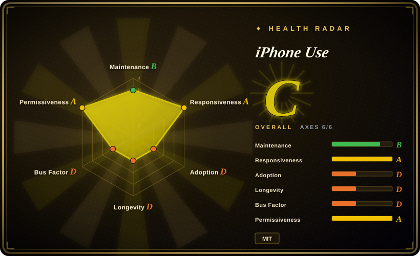
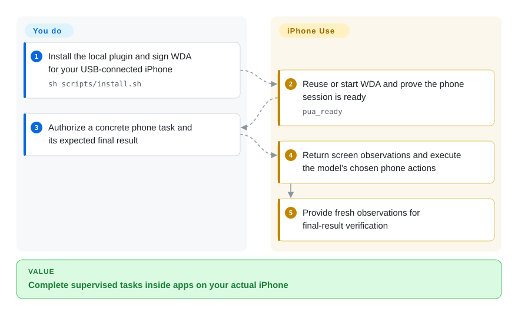
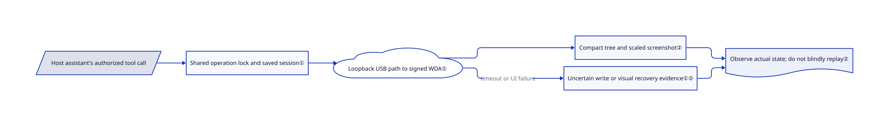

# iPhone Use

Your assistant can edit the desktop project, but the task ends inside an app on your actual iPhone. iPhone Use connects a local MCP server to a signed on-device WebDriverAgent, giving the assistant screen observations and phone actions over USB.

## When to use

You want Codex, WorkBuddy or Doubao Work on your Mac to navigate an installed iPhone app, prepare a draft or inspect a short list while you watch a live preview. You own the phone and can install and sign a test runner. Choose this over a simulator tool when real-device app state is essential, and over raw WebDriverAgent when you want ready-made MCP tools, setup guidance and screenshot recovery rather than writing a client. The model still chooses actions and must verify the user's final result; tool success is not task success.

## When NOT to use

- You need an Android/iOS regression suite with established test clients and repeatable assertions. Choose [Appium](appium.md); this is a young assistant-operated real-iPhone workflow, not a cross-platform test framework.
- You only need reproducible simulator flows. Choose [Maestro](maestro.md) and its YAML tests; it avoids giving a model control of your personal phone, but does not cover physical iOS devices.
- You are building a custom automation protocol or runner. Use [WebDriverAgent](webdriveragent.md) directly; iPhone Use adds a specific host/plugin and observation contract around that dependency.
- You cannot supply a Mac, full Xcode, a compatible iOS toolchain and your own signing team. Use an authorized hosted device-testing service or a simulator environment; a Python MCP server alone cannot install the phone-side runner.
- You require zero external usage reporting. Disable it before use with `IPHONE_USE_ANALYTICS=0` or `DO_NOT_TRACK=1` and restart the server. The Codex path enables PostHog and GA4 reporting by default; the documented WorkBuddy/Doubao adapters default to disabled reporting.
- You need a certified complete export of an app's records. Use the app's export/API where available. The list tool is bounded, deduplicates visible record fields and explicitly does not claim completeness.

## Comparison

| Alternative | In index | Our verdict | Tradeoff |
|---|---|---|---|
| [Appium](appium.md) | ✅ | Choose Appium for maintained cross-platform test infrastructure; choose iPhone Use for a supervised assistant task on your real USB-connected phone. | MCP tools and preview reduce client glue, but task planning depends on the model and the plugin is only days old. |
| [Maestro](maestro.md) | ✅ | Choose Maestro for readable repeatable simulator flows; choose iPhone Use when actual iPhone app data and installed apps are the deciding requirement. | Maestro supplies a test-flow model but no physical iOS support; iPhone Use brings device signing and supervision costs. |
| [WebDriverAgent](webdriveragent.md) | ✅ | Choose WDA directly to build the automation layer; choose iPhone Use to consume that layer through ready-made setup and MCP tools. | Same on-device dependency, with an additional host integration, tool policy, preview UI and telemetry surface to review. |

## Quick start

Review the installer and use a dedicated checkout on a Mac with full Xcode, Python 3.9+, Node/npm and a USB-connected iPhone. For Codex, run the documented `sh scripts/install.sh`; it stages the package, installs a local marketplace plugin and registers MCP, so reconnect the chat afterward. Configure the device with your own Apple team and bundle identifier, then build and run the pinned WDA Runner. Start phone tasks only after `pua_ready` returns `ready=true`; give the model an authorized task and inspect its final evidence. The plugin supplies setup jobs, phone tools and preview, while you retain responsibility for device trust, Developer Mode, signing, secrets and approval of consequential actions. Passwords, verification codes and biometrics stay with you; WorkBuddy and Doubao use their separate documented installers.

<!-- flow-steps:begin (generated from flows/iphone-use.json by tools/flow_card.py — do not edit) -->

Text version of the flow

1. **You**: Install the local plugin and sign WDA for your USB-connected iPhone — `sh scripts/install.sh`
2. **iPhone Use**: Reuse or start WDA and prove the phone session is ready — `pua_ready`
3. **You**: Authorize a concrete phone task and its expected final result
4. **iPhone Use**: Return screen observations and execute the model's chosen phone actions
5. **iPhone Use**: Provide fresh observations for final-result verification

**Value**: Complete supervised tasks inside apps on your actual iPhone

<!-- flow-steps:end -->

## Key techniques

<!-- mechanism:begin (generated from mechanisms/iphone-use.json by tools/mechanism_card.py; do not edit) -->

Text version of the mechanism

- Host assistant's authorized tool call
- Shared operation lock and saved session①
- Loopback USB path to signed WDA①
- Compact tree and scaled screenshot②
- Uncertain write or visual recovery evidence①②
- Observe actual state; do not blindly replay②

- Host assistant's authorized tool call → Shared operation lock and saved session①
- Shared operation lock and saved session① → Loopback USB path to signed WDA①
- Loopback USB path to signed WDA① → Compact tree and scaled screenshot②
- Loopback USB path to signed WDA① → Uncertain write or visual recovery evidence①② (timeout or UI failure)
- Compact tree and scaled screenshot② → Observe actual state; do not blindly replay②
- Uncertain write or visual recovery evidence①② → Observe actual state; do not blindly replay②

<!-- mechanism:end -->

### 1. Serialize device operations and distinguish uncertain writes

- **Problem:** Two assistant processes can share one phone, and a timed-out tap or text input may already have executed.
- **How:** Runtime dispatch takes a nonblocking filesystem lock and reuses the matching saved WDA session. The client restricts WDA URLs to local HTTP endpoints and classifies transport errors differently for reads and writes; an ambiguous write becomes `action_uncertain` with instructions not to replay it.
- **Limits:** The lock coordinates callers using the same plugin state directory, not all possible phone controllers. It prevents overlap, not wrong decisions; a timeout still requires a fresh observation before deciding what remains.
- **Source:** [Shared operation lock](https://github.com/zhongerxin/iPhone-use/blob/80006885df81531ce7a874b3b0df65980e25e59b/server/iphone_use.py#L274-L353), [loopback and transport classification](https://github.com/zhongerxin/iPhone-use/blob/80006885df81531ce7a874b3b0df65980e25e59b/server/wda_client.py#L28-L99).

### 2. Return fresh visual evidence instead of silently trying another action

- **Problem:** A matching accessibility element may be hidden by a popup, while screenshot pixels do not directly equal phone touch coordinates.
- **How:** Selector, focus and page-expectation failures attach a screenshot and explicit recovery guidance. Captured images include `pixel_to_point` scale factors; a supplied observation ID checks foreground app and viewport before coordinate actions. Ordinary successful navigation can defer verification, while final critical results remain explicit checkpoints.
- **Limits:** Observation IDs do not prove every element is unchanged or unobstructed. Screenshot inspection and the next action remain model decisions; `action_complete=true` alone does not prove business success, and local evidence images are retained with bounded cleanup.
- **Source:** [Screenshot scaling and recovery](https://github.com/zhongerxin/iPhone-use/blob/80006885df81531ce7a874b3b0df65980e25e59b/server/wda_controller.py#L335-L470), [deferred verification and tap](https://github.com/zhongerxin/iPhone-use/blob/80006885df81531ce7a874b3b0df65980e25e59b/server/wda_controller.py#L557-L593), [usage policy](https://github.com/zhongerxin/iPhone-use/blob/80006885df81531ce7a874b3b0df65980e25e59b/skills/iphone-use/SKILL.md).

## Tech stack

Python standard-library MCP/runtime server, Appium WebDriverAgent on iOS, Node-based USB forwarding and streaming through pinned `appium-ios-device`, and a TypeScript MCP Apps preview UI. MIT applies to project code; the bundled widget's third-party notices preserve its dependency licences.

## Dependencies

macOS, full Xcode supporting the phone's iOS version, your Apple account/team, a trusted USB-connected real iPhone and the signed WDA Runner. Python 3.9+, Node `^20.19.0 || ^22.12.0 || >=24.0.0`, npm 10+ and `appium-ios-device` 3.1.24 are documented. WDA is pinned to 16.14.0; a separate Appium Server and jailbreak are not required. Runtime configuration, builds and screenshots live under the private local state directory, not the source checkout.

## Ops difficulty

**Medium to high initially; medium afterward.** Signing, device trust, Developer Mode and Xcode/iOS compatibility dominate setup. Day-to-day work includes USB readiness, session recovery, updates and protecting local phone screenshots. Device authentication must pause automation. Keep a human in the loop for sending, purchases and other consequential actions rather than treating a local transport as an authorization system.

## Health & viability

- **2026-10-18:** Created October 6, not archived, with v0.3.15 released October 16 and several releases during the preceding week. At twelve days old it has no long-term compatibility or Lindy record.
- Most contributions come from `zhongerxin`, with a few small external contributions. The tree includes tests, CI, source packaging and third-party licence notices, but plugin maintenance remains concentrated.
- Roughly four thousand stars measure launch attention, not reliable task completion. Recent open issue titles concern Xcode device discovery and first-device registration. Verify your exact device/toolchain before relying on it.
- GitHub currently reports a public repository. The reviewed English README still says it is private, a concrete documentation inconsistency; use API visibility and the pinned source rather than repeating that obsolete sentence.

## Caveats (unverified)

- [未验证：没有授权操作真实设备，且禁止执行上游代码] Installation, signing, USB control and host-specific tool loading were not reproduced.
- [未验证：未运行设备验收或抓包] Task reliability, host parity and telemetry's actual runtime payloads remain unmeasured; reporting controls and field allow-lists were read in source.
- [未验证：没有逐条读取所有设备故障 issue] Recent issue titles flag toolchain risk, not proof that every report remains reproducible or unresolved in this revision.
